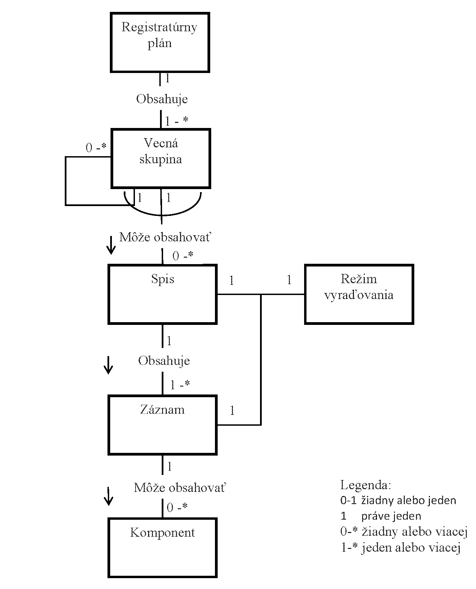

Príloha č. 2 k výnosu č. 525/2011 Z. z.

- MODEL VZŤAHOV MEDZI ENTITAMI REGISTRATÚRY

- Model vzťahov medzi entitami predstavuje všeobecný model vzťahov medzi jednotlivými entitami (vecná skupina, spis, záznam, komponent). Čiary, ktoré obdĺžniky spájajú, znázorňujú vzťahy medzi entitami. Každý vzťah je popísaný textom umiestneným uprostred čiary spájajúcej obdĺžniky a na správnu funkčnú interpretáciu musí byť sledovaný vždy v smere vyznačenom šípkou. Spojenie čiary s obdĺžnikom je označené symbolom, ktorý predstavuje početnosť výskytov vzťahov. Symboly sú uvedené v legende v spodnej časti obrázku. Označenie polkružnice vedúcej cez jednu čiaru alebo viac čiar vyjadrujúcich vzťahy medzi entitami ukazuje, že vzťahy sú vzájomne jedinečné pre každý daný prípad.
