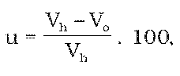

# § 10 Váhová merná skúška meracej zostavy na lieh

(1) Váhová merná skúška meracej zostavy na lieh sa vykonáva s prihliadnutím na prevádzkové pomery podniku na výrobu liehu zamestnancom colného úradu v prítomnosti prevádzkovateľa podniku na výrobu liehu.

(2) Pri váhovej mernej skúške meracej zostavy na lieh sa porovnáva vyrobené množstvo liehu vypočítané vyhodnocovacou jednotkou meracej zostavy na lieh na základe údajov o hmotnosti, objeme, teplote a hustote vyrobeného liehu s množstvom liehu vypočítaným z objemovej koncentrácie liehu a hmotnosti liehu zistenej etalónovým gravimetrickým zariadením s nádržou. Počas váhovej mernej skúšky meracej zostavy na lieh celé vyrobené množstvo liehu vteká len do etalónového gravimetrického zariadenia s nádržou.

(3) Odchýlka meracej zostavy na lieh (u) sa zisťuje z údajov podľa odseku 2, vyjadruje sa v percentách a vypočíta sa podľa vzorca

v ktorom

Vh je množstvo liehu (v l a.) zistené (vypočítané) z hmotnosti liehu,

Vo je množstvo liehu (v l a.) zmerané meracou zostavou na lieh.

(4) Odchýlka meracej zostavy na lieh zistená váhovou mernou skúškou meracej zostavy na lieh nesmie byť väčšia ako ±0,3 %.
