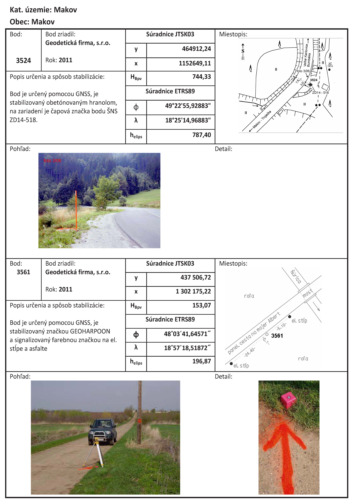

# Čl. I

Vyhláška Úradu geodézie, kartografie a katastra Slovenskej republiky č. 300/2009 Z. z., ktorou sa vykonáva zákon Národnej rady Slovenskej republiky č. 215/1995 Z. z. o geodézii a kartografii v znení neskorších predpisov sa mení a dopĺňa takto:

- 1. V § 1 sa slová „Táto vyhláška podrobnejšie upravuje“ nahrádzajú slovami „Táto vyhláška upravuje postup orgánov a organizácií ústredného orgánu štátnej správy v odbore geodézia a kartografia, podnikateľských subjektov v odbore geodézia a kartografia, ako aj geodetických útvarov investorských, projektantských a zhotoviteľských organizácií (ďalej len „účastníkov výstavby“) pri vykonávaní geodetických a kartografických činností. Vyhláška podrobnejšie upravuje“.

- 2. Nadpis prvej časti znie:

- „PRVÁ ČASŤ

- ZÁVÄZNÉ GEODETICKÉ REFERENČNÉ SYSTÉMY A ICH PLATNÉ REALIZÁCIE“.

- 3. § 2 znie:

- „(1)

- Názvy a kódy záväzných geodetických referenčných systémov sú:

- a)

- Európsky terestrický referenčný systém 1989 s alfanumerickým kódom ETRS89,

- b)

- Súradnicový systém Jednotnej trigonometrickej siete katastrálnej s alfabetickým kódom S-JTSK,

- c)

- Baltský výškový systém po vyrovnaní s alfabetickým kódom Bpv,

- d)

- Európsky vertikálny referenčný systém s alfabetickým kódom EVRS,

- e)

- Gravimetrický systém s alfabetickým kódom S-Gr.

- (2)

- Definície a parametre záväzných geodetických referenčných systémov sú:

- a)

- Európsky terestrický referenčný systém 1989 je definovaný na základe rezolúcie č. 1 Technicko-riadiacej skupiny subkomisie Európskeho referenčného rámca (EUREF TWG) prijatej na mítingu konanom v roku 1990 vo Florencii. Rezolúcia definuje ETRS89 ako systém, ktorý je stotožnený s Medzinárodným terestrickým referenčným systémom (ITRS) v epoche 1989.0 a ktorý je fixovaný na stabilnú časť Eurázijskej tektonickej platne. Týmto ETRS89 nesie všetky vlastnosti a charakteristiky ITRS:

- 1.

- geocentricita – počiatok systému sa nachádza v ťažisku hmôt celej Zeme vrátane oceánov a atmosféry,

- 2.

- jednotkou dĺžky je meter (sústava SI) a mierka je konzistentná s geocentrickým koordinovaným časom v súlade s rezolúciami Medzinárodnej astronomickej únie a Medzinárodnej únie geodézie a geofyziky (Viedeň 1991), čo je zabezpečené vhodným relativistickým modelovaním,

- 3.

- orientácia systému je definovaná orientáciou BIH(*) v epoche 1984.0,

- 4.

- vývoj orientácie v čase je zabezpečený použitím podmienky „sieť bez rotácie“ (NNR – z anglického no net rotation) s ohľadom na horizontálne pohyby tektonických platní celej Zeme.

- Súradnice Európskeho terestrického referenčného systému 1989 sa vyjadrujú buď v pravouhlých karteziánskych súradniciach XYZ, alebo v elipsoidických (geodetických) súradniciach φλh, kde „φ“ je elipsoidická (geodetická) šírka, „λ“ elipsoidická (geodetická) dĺžka a „h“ elipsoidická (geodetická) výška. Elipsoidické (geodetické) súradnice ETRS89 sú vztiahnuté na elipsoid Geodetického referenčného systému 1980 so základným poludníkom Greenwich a s konštantami a=6 378 137 m a f=298,257222101, kde „a“ je dĺžka hlavnej polosi a „f“ sploštenie, ktoré je vypočítané z konštánt GM = 3 986 005 × 108 m3.s-2, J2 = 108 263 × 10-8 a ů = 7 292 115 × 10-11 rad.s-1, kde „GM“ je geocentrická gravitačná konštanta, „J2“ je zonálny geopotenciálny koeficient druhého stupňa a „ω – omega“ je uhlová rýchlosť rotácie Zeme.

- b)

- Súradnicový systém Jednotnej trigonometrickej siete katastrálnej je definovaný

- 1.

- Besselovým elipsoidom 1841 so základným poludníkom Ferro nachádzajúcim sa 17o40` západne od poludníka Greenwich a s parametrami a = 6 377 397,155m a f = 1: 299,152 8128, kde „a“ je dĺžka hlavnej polosi a „f“ je sploštenie,

- 2.

- Křovákovým zobrazením popisujúcim výpočet pravouhlých rovinných súradníc konformného kužeľového zobrazenia vo všeobecnej polohe z daných zemepisných súradníc na Besselovom elipsoide 1841. Křovákove zobrazenie pozostáva zo štyroch na seba nadväzujúcich krokov: zo zobrazenia Besselovho elipsoidu na guľovú plochu, z transformácie zemepisných sférických súradníc na sférické kartografické súradnice na guľovej ploche, zo zmenšenia guľovej plochy a jej konformného zobrazenia na dotykový kužeľ vo všeobecnej polohe a z rozvinutia plochy dotykového kužeľa do roviny, pričom os x pravouhlého rovinného súradnicového systému smeruje na juh a os y na západ. Konštanty vystupujúce v zobrazovacích rovniciach Křovákovho zobrazenia sú φ0 = 49o30`, λ = 42o30`, α = 1,000 597 498 372, k = 1,003 419 164, a = 30o17`17,30311``, k1 = 0,9999 a Š0=78o30`, kde „φ0“ je hodnota zemepisnej šírky základnej neskreslenej rovnobežky na Besselovom elipsoide, „λ“ je zemepisná dĺžka kartografického pólu na Besselovom elipsoide definovaná od základného poludníka Ferro, „α“ a „k“ predstavujú parametre charakterizujúce konformné zobrazenie Besselovho elipsoidu na guľovú plochu, „a“ je pólová vzdialenosť kartografického pólu na guľovej ploche, „k1“ je koeficient zmenšenia guľovej plochy a „Š0“ je základná kartografická šírka na guľovej ploche,

- c)

- Baltský výškový systém po vyrovnaní je kinematický výškový referenčný systém vztiahnutý na strednú hladinu Baltského mora prostredníctvom referenčného bodu, ktorým je nula morského vodočtu v Kronštadte. Baltský výškový systém po vyrovnaní používa normálne výšky, t. j. pri výpočte výšok bodov vyrovnaním sa uplatňujú normálne korekcie v zmysle Molodenského teórie na namerané prevýšenia získané meraniami v nivelačných sieťach,

- d)

- Európsky výškový referenčný systém je kinematický výškový referenčný systém. Definícia Európskeho výškového referenčného systému je založená na štyroch konvenciách:

- 1.

- vzťažná výšková hladina je definovaná ako ekvipotenciálna plocha, na ktorej je potenciál tiažového poľa Zeme konštantný W0 = W0E = konšt. a ktorý je vo výške vodočtu v Amsterdame – Normaal Amsterdams Peil,

- 2.

- jednotka dĺžky je meter (sústava SI), jednotka času je sekunda (sústava SI), mierka je konzistentná s geocentrickým koordinovaným časom v súlade s rezolúciami Medzinárodnej astronomickej únie a Medzinárodnej únie geodézie a geofyziky (Viedeň 1991), čo je zabezpečené vhodným relativistickým modelovaním,

- 3.

- výškové zložky predstavujú rozdiely ÄWP medzi potenciálmi WP tiažového poľa Zeme prechádzajúcimi bodmi P a potenciálom W0E konvenčnej nulovej hladiny Európskeho výškového referenčného systému. Rozdiel potenciálu – ΔWP je označovaný aj ako geopotenciálna kóta cp, takže platí – ΔWp = cp= W0E – WP. Normálne výšky sú ekvivalentné s geopotenciálnymi kótami za predpokladu, že je špecifikované referenčné tiažové pole,

- 4.

- Európsky výškový referenčný systém je nulový slapový systém, čo je v súlade s IAG rezolúciami č. 9 a 16 prijatými v Hamburgu v roku 1983,

- e)

- Gravimetrický systém je kinematický referenčný systém definovaný geometrickými a fyzikálnymi parametrami, kde geometrické parametre definujú polohy bodov a fyzikálne parametre definujú charakteristiky tiažového poľa Zeme vztiahnuté k týmto bodom.

- (3)

- Realizácia ľubovoľného geodetického systému predstavuje určenie požadovaných parametrov, ako sú súradnice, výšky alebo tiažové zrýchlenia v zmysle definície systému, ktoré sa vzťahujú na fyzické body stabilizované na zemskom povrchu pre konkrétny (definovaný) okamih. Takáto výsledná množina bodov s určenými parametrami predstavuje referenčný rámec geodetického systému a označuje sa často názvom totožným s názvom geodetického systému, pričom sa niekedy písmeno S znamenajúce systém v kóde názvu systému nahradzuje písmenom F znamenajúcim rámec (z anglického frame = rámec). Na odlíšenie jednotlivých realizácií geodetických súradnicových systémov, resp. jednotlivých referenčných rámcov sa používa pripojenie dvojčísla alebo štvorčíslia k názvu referenčného rámca geodetického systému, pričom tento číselný údaj predstavuje rok výpočtu parametrov alebo rok zavedenia realizácie geodetického systému. V prípade, že dochádza k zmenám určovaných parametrov v jednotlivých realizáciách geodetických systémov, resp. v referenčných rámcoch, ktoré je možné matematicky vyjadriť napríklad pohybovými rovnicami v prípade polohových súradníc, označujeme jednotlivé realizácie, resp. referenčné rámce aj epochou. Epocha realizácie reprezentuje presný dátum, na ktorý sa vzťahuje vypočítaná realizácia, resp. referenčný rámec a vyjadruje sa v jednotkách kalendárneho roka na tri desatinné miesta.

- (4)

- Národná realizácia Európskeho terestrického referenčného systému 1989 predstavuje súbor geocentrických priestorových súradníc, ročných zmien súradníc a charakteristík presností vybraných bodov Štátnej priestorovej siete s alfabetickým kódom ŠPS, spracovaných k určitému dátumu pomocou množiny staníc EUREF permanentnej siete postupom definovaným v EUREF smerniciach, na ktoré sú naviazané ostatné body ŠPS. Jej názov je Slovenský terestrický referenčný rámec s alfanumerickým kódom SKTRFyy a ten zodpovedá a reprezentuje národné zhustenie konkrétne zvolenej epochy Európskeho terestrického referenčného rámca s alfanumerickým kódom ETRFyyyy a epochou yyyy.yyy. Súradnice a charakteristiky presností ostatných bodov ŠPS sú určené vo väzbe na národnú realizáciu SKTRFyy, a tým preberajú jej charakteristiky z pohľadu ETRFyyyy a epochy yyyy.yyy. Platnou národnou realizáciou ETRS89 je realizácia SKTRF09.

- (5)

- Realizácia súradnicového systému Jednotnej trigonometrickej siete katastrálnej predstavuje súbor rovinných súradníc vybraných bodov Štátnej priestorovej siete spracovaných k určitému dátumu a označuje sa alfanumerickým kódom JTSKyy. Realizácia JTSKyy má jednoznačne definovaný vzťah voči národnej realizácii ETRS89, z ktorého aj vychádza, a je mierkovo homogénna s touto národnou realizáciou. Platnou realizáciou S-JTSK súradnicového systému je JTSK03.

- (6)

- Národná realizácia Baltského výškového systému po vyrovnaní predstavuje súbor normálnych výšok a charakteristík presností bodov Štátnej nivelačnej siete určených vyrovnaním opakovaných nivelačných meraní vzhľadom na jeden základný alebo množinu viacerých základných nivelačných bodov a označuje sa alfanumerickým kódom Bpvyy. Normálna výška základného nivelačného bodu alebo základných nivelačných bodov je určená vo väzbe na medzinárodné vyrovnanie európskych nivelačných sietí k strednej hodnote reprezentujúcej nulu morského vodočtu v Kronštadte. Platnou národnou realizáciou Baltského výškového systému po vyrovnaní je Bpv.

- (7)

- Národná realizácia Európskeho výškového referenčného systému predstavuje súbor geopotenciálnych kót, normálnych výšok a charakteristík presností bodov Štátnej nivelačnej siete určených vyrovnaním vzhľadom na jeden základný alebo množinu viacerých základných nivelačných bodov určených v rámci medzinárodného vyrovnania vyšších rádov nivelačných sieti Európskych štátov. Národnú realizáciu EVRS nazývame Slovenský vertikálny referenčný rámec a označujeme ju alfanumerickým kódom SKVRFyy, pričom SKVRFyy zodpovedá a reprezentuje národné zhustenie konkrétnej realizácie Európskeho vertikálneho referenčného rámca označeného alfanumerickým kódom EVRFyyyy. Platnou národnou realizáciou EVRF je SKVRF05.

- (8)

- Národná realizácia Gravimetrického systému predstavuje súbor tiažových zrýchlení a charakteristík presností vybraných bodov geodetických základov určených z národného vyrovnania absolútnych a relatívnych gravimetrických meraní vykonaných v Štátnej gravimetrickej sieti. Národná realizácia Gravimetrického systému sa označuje alfanumerickým kódom S-Gryy. Platnou národnou realizáciou Gravimetrického systému je S-Gr.

- (9)

- Na transformovanie súradníc bodov medzi národnou realizáciou Európskeho terestrického referenčného systému 1989 a realizáciou súradnicového systému Jednotnej trigonometrickej siete katastrálnej sa používa globálny transformačný kľúč vyjadrujúci vzťah medzi elipsoidom Geodetického referenčného systému 1980 a Besselovým elipsoidom 1841 a zobrazovacie rovnice Křovákovho konformného kužeľového zobrazenia bodov z Besselovho elipsoidu 1841 do roviny. Globálny transformačný kľúč je platný pre celé územie Slovenska. Na výpočet priestorových súradníc bodov vychádzajúcich z realizácie rovinných súradníc súradnicového systému Jednotnej trigonometrickej siete katastrálnej sa používajú aj normálne výšky platnej národnej realizácie Baltského výškového systému po vyrovnaní a digitálny výškový referenčný model.

- Globálny transformačný kľúč reprezentujúci vzťah medzi národnou realizáciou ETRS89 a JTSK03 predstavuje sedem transformačných parametrov vypočítaných priestorovou podobnostnou transformáciou Burša-Wolfovým modelom. Parametre tohto globálneho transformačného kľúča (verzia 1/2007) sú:

- tri translácie: dX = – 485,021m, dY = – 169,465m, dZ = – 483,839m,

- tri rotácie: ωX = 7,786342", ωY = 4,397554", ωZ = 4,102655",

- mierka: ds = 0,000000 ppm.

- Transformačná služba medzi platnými realizáciami záväzných geodetických systémov ETRS89 a S-JTSK je prístupná na webovom sídle úradu.

- (10)

- Na prevod normálnych výšok určených v národnej realizácii Baltského výškového systému po vyrovnaní a elipsoidických výšok určených v národnej realizácii Európskeho terestrického referenčného systému 1989, definovaných nad elipsoidom Geodetického referenčného systému 1980 sa používa digitálny výškový referenčný model s alfabetickým kódom DVRM.“.

- 4. V § 8 ods. 3 sa na konci pripája táto veta: „Jej súčasťou sú aj štandardizované geografické názvy.“.

- 5. V § 8 ods. 4 sa vypúšťajú slová „štandardizované geografické názvy“.

- 6. V § 9 ods. 2 písm. c) sa za slovo „údajov“ vkladá čiarka a pripájajú sa tieto slová: „ak tieto neboli aktualizované webovou službou (transakčnou službou)“.

- 7. V § 9 ods. 2 písm. d) sa za slovo „metaúdaje“ vkladá čiarka a pripájajú sa tieto slová: „ak tieto neboli aktualizované webovou službou (transakčnou službou)“.

- 8. V § 9 ods. 5 sa za slovo „technickú“ vkladajú slová „a kvalitatívnu“.

- 9. V § 10 ods. 3 písm. a) sa za slová „webových služieb“ vkladá slovo „a“.

- 10. V § 10 ods. 4 písm. a) sa vypúšťajú slová „alebo vo forme digitálneho modelu reliéfu územia Slovenskej republiky“.

- 11. V § 12 ods. 4 sa za slová „katalógu tried objektov“ vkladajú slová „kartografického modelu“.

- 12. V § 14 ods. 1 písm. a) sa za slovo „rybníkov“ vkladá čiarka a slovo „studní“.

- 13. V § 14 ods. 1 písm. b) poznámke pod čiarou sa citácia k odkazu 2 „§ 22 až 24, § 27 až 33 zákona č. 543/2002 Z. z. o ochrane prírody a krajiny v znení neskorších predpisov“ nahrádza citáciou „Zákon č. 543/2002 Z. z. o ochrane prírody a krajiny v znení neskorších predpisov“.

- 14. V § 14 ods. 1 písmeno c) znie:

- „c)

- názvy jednotlivých útvarov vertikálneho členenia zemského povrchu, ktorými sú názvy brán, brázd, dolín, geomorfologických jednotiek, hrebeňov, chrbtov, kopcov, kotlín, krasových území, nížin, pahorkatín, planín, plošín, pohorí, priepastí, priesmykov, roklí, rovín, sediel, skál, skalných útvarov, stien, strží, svahov, tiesňav, vrchov, žľabov,“.

- 15. V § 14 ods. 1 písm. d) sa za slovo „majerov“ vkladá čiarka a slovo „mlynov“.

- 16. V § 14 ods. 1 písmeno f) znie:

- „f)

- ostatné názvy, ktorými sú názvy baní, šácht, štôlní, ciest, hámrov, chmeľníc, chodníkov, jaskýň, kameňolomov, lesov, lúk, ostrovov, pasienkov, parkov, polí, sadov, stromov, trstinových porastov, viníc, výškových kót, záhrad.“.

- 17. V § 14 ods. 2 písm. a) sa slová „oceánov a morí“ nahrádzajú slovami „oceánov, morí, podmorských útvarov a antarktických útvarov“.

- 18. V § 19 písm. k) sa na konci pripájajú tieto slová: „podľa § 24“.

- 19. § 23 vrátane nadpisu znie:

- 㤠23

- Zriaďovanie a aktualizácia bodov geodetických základov

- Geodetické body tvoriace geodetické základy zriaďuje a aktualizuje správca podľa § 4 až 6 tejto vyhlášky.“.

- 20. § 24 vrátane nadpisu znie:

- 㤠24

- Zriaďovanie a aktualizácia podrobných geodetických bodov

- (1)

- Podrobné polohové bodové pole tvoria:

- a)

- pevné body podrobného polohového bodového poľa,

- b)

- dočasne stabilizované body podrobného polohového bodového poľa.

- (2)

- Podrobné polohové bodové pole eviduje správa katastra.

- (3)

- Body podrobného polohového bodového poľa sa po určení novej národnej realizácie systému Jednotnej trigonometrickej siete katastrálnej, v ktorej dovtedy neboli určované, prestanú zriaďovať. Aktualizácia sa obmedzí na vyškrtnutie bodu z evidencie, ak bolo zariadenie bodu zničené, poškodené alebo zmenené, alebo sa preukáže, že presnosť bodu nevyhovuje kritériám stanoveným na jeho určenie.

- (4)

- Spôsob použitia bodov podrobného polohového bodového poľa na vybrané geodetické činnosti uvedené v § 6 písm. a), b) a c) zákona ustanoví úrad vo všeobecne záväznom právnom predpise na vykonanie osobitného predpisu.4a) Na ostatné vybrané geodetické činnosti sa po určení novej národnej realizácie body podrobného polohového bodového poľa prestanú používať.

- (5)

- Podrobné geodetické body eviduje správa katastra. Podrobné geodetické body zriaďujú osoby vykonávajúce vybrané geodetické a kartografické činnosti vtedy, ak je to potrebné na vykonanie podrobného merania alebo vytyčovania. Podrobné geodetické body sa pri pozemkových úpravách a pri obnove katastrálneho operátu novým mapovaním zriaďujú vždy.

- (6)

- Podrobný geodetický bod je bod, ktorý má určené súradnice v platnej národnej realizácii systému Jednotnej trigonometrickej siete katastrálnej a zároveň môže mať určenú výšku v Baltskom výškovom systéme po vyrovnaní. Ak sa poloha bodu určuje technológiou globálnych navigačných satelitných systémov, určia sa zároveň priestorové súradnice v platnej národnej realizácii Európskeho terestrického referenčného systému 1989. Zariadenie podrobného geodetického bodu tvorí meračská značka. Spôsoby určovania polohy podrobných geodetických bodov a spôsoby ich stabilizácie sú uvedené v prílohe č. 1.

- (7)

- Charakteristikou presnosti určenia súradníc podrobných geodetických bodov je základná stredná súradnicová chyba óxy. Podrobný geodetický bod sa určí tak, aby charakteristika presnosti určenia súradníc v platnej národnej realizácii systému Jednotnej trigonometrickej siete katastrálnej neprekročila hodnotu δxy = 0,04 m. Uvedená hodnota vyjadruje presnosť určenia súradníc k bodom Štátnej priestorovej siete. Krajná odchýlka sa stanovuje na dvojnásobok hodnoty δxy. Spôsoby posudzovania dosiahnutej presnosti určenia súradníc sú uvedené v prílohe č. 1.

- (8)

- Charakteristikou presnosti určenia výšok podrobných geodetických bodov je základná stredná výšková chyba óH.Podrobný geodetický bod sa určí tak, aby charakteristika presnosti určenia výšky neprekročila hodnotu óH = 0,06 m. Uvedená hodnota vyjadruje presnosť určenia výšky k bodom Štátnej nivelačnej siete. Krajná odchýlka sa stanovuje na dvojnásobok hodnoty óH.

- (9)

- Osoby zriaďujúce podrobné geodetické body vypracujú dokumentáciu o ich zriadení vo forme „Výsledného operátu zriadenia podrobných geodetických bodov“ (ďalej len „výsledný operát“). Výsledný operát sa odovzdá príslušnej správe katastra a obsahuje:

- a)

- zoznam súradníc a prípadne výšok podrobných geodetických bodov, ak boli určené,

- b)

- geodetické údaje o podrobných geodetických bodoch,

- c)

- technickú správu.

- Podrobnosti o vyhotovení a obsahu výsledného operátu sú uvedené v prílohe č. 1.“.

  - Poznámka pod čiarou k odkazu 4a znie:

  - „4a)

  - Vyhláška Úradu geodézie, kartografie a katastra Slovenskej republiky č. 461/2009 Z. z., ktorou sa vykonáva zákon Národnej rady Slovenskej republiky č. 162/1995 Z. z. o katastri nehnuteľností a o zápise vlastníckych a iných práv k nehnuteľnostiam (katastrálny zákon) v znení neskorších predpisov.“.

- 21. V § 29 ods. 1 sa slová „Geodetické činnosti pri budovaní a aktualizácii geografických informačných systémov sú“ nahrádzajú slovami „Geodetickými činnosťami pri budovaní a aktualizácii geografických informačných systémov sa rozumie“.

- 22. § 30 znie:

- 㤠30

- (1)

- Geodetické a kartografické činnosti v jednotlivých fázach výstavby inžinierskych stavieb6) sú zabezpečované prostredníctvom autorizovaných geodetov a kartografov jednotlivých účastníkov výstavby. Fázami výstavby sa rozumie:

- a)

- fáza spracovania projektovej dokumentácie stavby,

- b)

- fáza realizácie stavby,

- c)

- fáza kolaudácie a prevádzky stavby.

- (2)

- Pri spracovaní projektovej dokumentácie stavieb autorizovaný geodet a kartograf stavebníka zabezpečuje:

- a)

- prípravu mapových podkladov,

- b)

- vyhotovenie geodetických podkladov na úpravu majetkovoprávnych vzťahov, na vyňatie pozemkov z poľnohospodárskej pôdy a z lesných pozemkov,

- c)

- geodetické údaje bodov geodetických základov a podrobných geodetických bodov.

- (3)

- Pri spracovaní projektovej dokumentácie stavieb autorizovaný geodet a kartograf projektanta (zhotoviteľa projektu) zabezpečuje:

- a)

- vypracovanie projektu vytyčovacej siete,

- b)

- spoluprácu s projektantom,

- c)

- kontrolu vytyčovacích výkresov na vytýčenie priestorovej polohy objektov,

- d)

- kontrolu vytyčovacích výkresov na podrobné vytýčenie.

- (4)

- Pri realizácii stavieb autorizovaný geodet a kartograf stavebníka zabezpečuje:

- a)

- protokolárne odovzdanie geodetických a kartografických podkladov súvisiacich so stavbou zhotoviteľovi,

- b)

- vybudovanie vytyčovacej siete a určenie jej parametrov, jej ochranu pred poškodením a jej odovzdanie zhotoviteľovi,

- c)

- vyznačenie existujúcich podzemných vedení inžinierskych sietí na povrchu v areáli staveniska,

- d)

- kontrolné meranie terénu v priestore staveniska pred začatím zemných prác,

- e)

- vytýčenie priestorovej polohy stavby, ako je vytýčenie hlavných polohových čiar alebo hlavných osí a hlavných polohových bodov trás, hlavných výškových bodov v súlade s územným rozhodnutím a protokolárne odovzdanie zhotoviteľovi,

- f)

- tvorbu informačného systému výstavby z projektovej dokumentácie pri líniových stavbách,

- g)

- kontrolu geodetických a kartografických činností zhotoviteľa v priebehu výstavby,

- h)

- kontrolu správnosti geodeticky meraných položiek predkladaných zhotoviteľom na fakturáciu.

- (5)

- Pri realizácii stavieb autorizovaný geodet a kartograf projektanta (zhotoviteľa projektu) zabezpečuje kontrolu dodržiavania projektovaných parametrov stavebných objektov v spolupráci s autorským dozorom.

- (6)

- Pri realizácii stavieb autorizovaný geodet a kartograf zhotoviteľa zabezpečuje:

- a)

- protokolárne prevzatie geodetických podkladov súvisiacich so stavbou, vytyčovacej siete od autorizovaného geodeta a kartografa stavebníka vrátane kontrolného merania terénu pred začatím zemných prác,

- b)

- realizáciu podrobného vytýčenia jednotlivých objektov a technologických zariadení stavby podľa projektovej dokumentácie vrátane kontroly podkladov a výkresov podrobného vytýčenia,

- c)

- realizáciu merania skutočného vyhotovenia stavebných objektov a ich častí, ako aj terénnych úprav a priebehu podzemných inžinierskych sietí pred ich zakrytím, vyhotovenie geodetickej časti dokumentácie skutočného vyhotovenia stavieb a technologických zariadení,

- d)

- vypracovanie projektu na meranie posunov a deformácií stavieb, ak si to vyžaduje charakter stavby alebo to ukladá projektová dokumentácia,

- e)

- meranie posunov a deformácií stavieb počas výstavby, ako aj základné meranie posunov a deformácií pred kolaudáciou stavby, ak si to vyžaduje charakter stavby alebo to ukladá projektová dokumentácia,

- f)

- vyhotovenie technickej účelovej mapy (základná mapa diaľnice, základná mapa závodu, základná mapa letiska, technická mapa mesta, atď.), ak si to vyžaduje stavebník,

- g)

- meranie a kvantifikáciu geodeticky merateľných položiek vykonaných stavebných prác, ktoré sa predkladajú na fakturáciu stavebníkovi,

- h)

- archivovanie meračských dokumentov, vytyčovacích výkresov, vytyčovacích protokolov a záznamov v stavebnom denníku.

- (7)

- Pri kolaudácii stavieb a následnej prevádzke stavieb autorizovaný geodet a kartograf stavebníka zabezpečuje:

- a)

- súborné spracovanie vrátane tvorby informačného systému a archivovanie geodetickej časti dokumentácie skutočného vyhotovenia stavby podľa reálne vykonaných stavebných prác,

- b)

- porealizačnú dokumentáciu na majetkovoprávne vysporiadanie pozemkov podľa skutočného vyhotovenia stavby a vyhotovenie geometrických plánov,

- c)

- meranie posunov a deformácií objektov a zariadení, ak si to vyžaduje charakter stavby alebo to ukladá projektová dokumentácia.“.

- 23. V § 31 ods. 2 sa slová „bola zabezpečená vyžadovaná presnosť a využiteľnosť siete“ nahrádzajú slovami „boli určené súradnice a výšky bodov vytyčovacej siete v platných národných realizáciách záväzných geodetických systémov v súlade s § 2“.

- 24. V § 31 ods. 4 písm. d) sa slovo „v“ nahrádza slovami „aj v platnej“.

- 25. V § 31 ods. 4 písmeno f) znie:

- „f)

- relatívne charakteristiky presnosti a stredné súradnicové chyby, v prípade viacetapových sietí kovariančnú maticu bodov.“.

- 26. V § 32 ods. 2 sa na konci bodka nahrádza čiarkou a pripájajú sa tieto slová: „ktorý je realizovaný vytyčovacou sieťou stavby vybudovanou podľa § 31.“.

- 27. V § 32 ods. 3 uvádzacej vete sa za slovo „stavby“ vkladajú slová „v platných realizáciách záväzných geodetických systémov“.

- 28. V § 32 ods. 8 písm. c) sa slová „o kontrolnom meraní alebo nadbytočnom vytýčení“ nahrádzajú slovami „o nezávislom kontrolnom vytýčení (kontrola správnosti vytýčenia)“.

- 29. V § 33 ods. 1 prvej vete sa za slová „geometrických parametrov“ vkladajú slová „stavieb a ich častí,“.

- 30. V § 33 ods. 2 písm. a) sa na začiatku vkladajú slová „číselné a“.

- 31. V § 33 ods. 2 písm. b) sa slová „príslušných noriem“ nahrádzajú slovami „uvádzanými v projekte alebo v normách,“.

- 32. V § 33 ods. 2 písmeno c) znie:

- „c)

- technická správa s konštatovaním, že stavba, prípadne príslušné technologické zariadenie spĺňa alebo nespĺňa kritériá projektu alebo normy.“.

- 33. V § 34 ods. 5 sa na konci pripája táto veta:

- „Predmetný elaborát obsahuje:

- a)

- technickú správu,

- b)

- definíciu a realizáciu vzťažného systému a jeho vzťah k záväzným geodetickým systémom,

- c)

- situáciu rozmiestnenia vzťažných a pozorovaných bodov,

- d)

- zoznam súradníc a výšok vzťažných a pozorovaných bodov,

- e)

- relatívne charakteristiky presnosti pozorovaných bodov voči vzťažným bodom, stredné súradnicové chyby, v prípade viacetapových sietí kovariančnú maticu bodov,

- f)

- grafické znázornenie posunov, geodetickú interpretáciu dosiahnutých výsledkov.“.

- 34. V § 35 ods. 1 prvá veta znie: „Vyhotovenie geodetickej časti dokumentácie skutočného vyhotovenia stavby obsahuje číselné a grafické spracovanie výsledkov merania skutočnej polohy a výšok pozemných, podzemných a nadzemných objektov a zariadení v definovanej realizácii záväzného geodetického systému.“.

- 35. V § 35 ods. 2 sa slovo „Dokumentácia“ nahrádza slovami „Geodetická časť dokumentácie“.

- 36. § 35 sa dopĺňa odsekmi 3 a 4, ktoré znejú:

- „(3)

- Geodetická časť dokumentácie skutočného vyhotovenia stavby je vyhotovená priamym geodetickým meraním nadväzujúcim na vytyčovaciu sieť stavby.

- (4)

- Elaborát z geodetickej časti dokumentácie skutočného vyhotovenia stavby obsahuje:

- a)

- technickú správu,

- b)

- zoznam súradníc a výšok podrobných bodov,

- c)

- súbor údajov obsahujúci polohopis, popis, prípadne výškopis v digitálnej aj grafickej forme.“.

- 37. V § 44 odsek 1 znie:

- „(1)

- Geometrický plán sa predkladá na úradné overenie príslušnej správe katastra.“.

- 38. V § 44 ods. 2 sa slová „§ 22“ nahrádzajú slovami „§ 21“.

- 39. V § 45 ods. 1 sa za slová „kartografických činností“ vkladajú slová „podľa § 6 písm. a), b), d) a e) zákona“.

- 40. V § 45 ods. 1 sa na konci pripája táto veta: „Správa katastra preskúma súlad označenia nových parciel s pridelenými parcelnými číslami, súlad čísel novourčených podrobných geodetických bodov s pridelenými číslami, súlad označenia záznamov podrobného merania zmien s pridelenými číslami.“.

- 41. V § 45 odsek 2 znie:

- „(2)

- Správa katastra pred úradným overením geometrického plánu preskúma:

- a)

- či predložený operát geometrického plánu obsahuje súčasti podľa osobitného predpisu,11)

- b)

- vzájomný súlad údajov jednotlivých súčastí operátu geometrického plánu,

- c)

- súlad východiskových údajov s platnými údajmi katastra,

- d)

- súlad označenia nových parciel s pridelenými parcelnými číslami,

- e)

- súlad označenia záznamov podrobného merania zmien s pridelenými číslami,

- f)

- súlad čísel novourčených podrobných geodetických bodov s pridelenými číslami,

- g)

- či podklady na aktualizáciu údajov katastra nehnuteľností vo výmenných formátoch sú použiteľné na aktualizáciu údajov,

- h)

- či meranie bolo pripojené na aktívne geodetické základy alebo spôsobom podľa osobitného predpisu.12)“.

- Poznámky pod čiarou k odkazom 11 a 12 znejú:

- „11)

- § 50 vyhlášky č. 461/2009 Z. z.

- 12)

- § 57 vyhlášky č. 461/2009 Z. z.“.

- 42. V § 45 ods. 4 sa za slovo „kontrole“ vkladá bodka a vypúšťajú sa slová „a vráti výsledný elaborát bez úradného overenia tomu, kto ho predložil.“.

- 43. V § 46 ods. 2 sa slová „do dvadsiatich“ nahrádzajú slovami „do štrnástich“.

- 44. V § 46 ods. 2 sa slová „§ 45“ nahrádzajú slovami „§ 44“.

- 45. V § 46 ods. 4 sa slová „§ 45“ nahrádzajú slovami „§ 44“.

- 46. V § 46 ods. 4 sa za slová „správa katastra ho“ vkladajú slová „bez úradného overenia“.

- 47. Pripájajú sa prílohy č. 1 až 3, ktoré znejú:

- „Príloha č. 1 k vyhláške č. 300/2009 Z. z.

- VYHOTOVENIE A OBSAH VÝSLEDNÉHO OPERÁTU PODROBNÝCH GEODETICKÝCH BODOV

- 1.

- Voľba, rozloženie, číslovanie podrobných geodetických bodov a ich označenie trvalým znakom

- 1.1

- Podrobné geodetické body (ďalej len „PGB“) sa určujú v rámci katastrálneho územia. Ich počet a rozloženie v priestore je dané rozsahom geodetických prác, na ktoré sa prvotne zriaďujú.

- 1.2

- Ak sa PGB zriaďujú na účely pozemkových úprav, zriadia sa v primeranej hustote v celom obvode projektu pozemkových úprav, prípadne i mimo neho. Ak sa PGB zriaďujú na účely obnovy katastrálneho operátu novým mapovaním, zriadia sa pre celý obvod obnovy, a ak správa katastra rozhodne, aj pre celé katastrálne územie.

- 1.3

- PGB sa číslujú v rámci katastrálneho územia, v číselnom rade od 3 001 do 5 000. Čísla bodov na žiadosť zriaďovateľa preukázateľne (písomne) prideľuje správa katastra.

- 1.4

- PGB sa zriaďujú

- a)

- na existujúcich bodoch označených meračskou značkou

- aa)

- iných bodových polí (napr. výškových bodových polí – nivelačná značka na budovách a iných technických objektoch),

- ab)

- na vhodných trvalých znakoch označenia hraníc (opracovaný kamenný medzník na hranici katastrálnych území a pozemkov a pod),

- b)

- na novobudovaných bodoch označených meračskou značkou

- ba)

- značky, ktoré vyhovujú STN 73 0415,

- bb)

- vytesané krížiky alebo iné kovové značky na opracovaných plochách skál a na trvalých betónových konštrukciách,

- bc)

- iné značky určené na označenie meračských bodov, pri ktorých je predpoklad trvalého zachovania a jednoznačného definovania polohy a výšky bodu (geoharpony a pod.).

- 2.

- Určovanie polohy PGB

- 2.1

- Poloha PGB sa určuje súradnicami platnej národnej realizácie systému Jednotnej trigonometrickej siete katastrálnej (ďalej len „JTSK03“). Pri pozemkových úpravách a pri obnove katastrálneho operátu novým mapovaním aj geocentrickými súradnicami platnej národnej realizácie Európskeho terestrického referenčného systému (ďalej len „ETRS89“).

- 2.2

- Súradnice PGB sa určia na základe výsledkov merania

- a)

- vykonaného s využitím technológií globálnych navigačných satelitných systémov (ďalej len „GNSS“),

- b)

- vykonaného terestrickými (pozemnými) geodetickými metódami,

- c)

- vykonaného kombináciou metód uvedených pod písmenami a) a b).

- 2.3

- Metódy merania s využitím technológií GNSS podľa bodu 2.2 a) sú:

- a)

- kinematické meranie v reálnom čase (RTK – real time kinematics)

- aa)

- s využitím Slovenskej priestorovej observačnej služby (ďalej len „SKPOS“) (služba SKPOS_cm),

- ab)

- s využitím dočasnej referenčnej stanice (bázy) postavenej na bode Štátnej priestorovej siete (ďalej len „ŠPS“) (dĺžka spojnice bázy a rovera pri použití jednofrekvenčného prístroja je max. 20 km a rovera pri použití dvojfrekvenčného prístroja je max. 30 km),

- b)

- kinematické meranie s dodatočným spracovaním (PPK – post processing kinematics)

- ba)

- s pripojením na virtuálne referenčné stanice (VRS) SKPOS alebo priamo na permanentné stanice SKPOS,

- bb)

- s pripojením na dočasnú referenčnú stanicu postavenú na bode ŠPS,

- c)

- statické meranie s dodatočným spracovaním – (post processing static, rapid static, fast static)

- ca)

- s pripojením na VRS SKPOS alebo priamo na permanentné stanice SKPOS,

- cb)

- s pripojením na dočasnú referenčnú stanicu postavenú na bode ŠPS.

- 2.4

- Pri meraní s využitím technológií GNSS sa dodržia tieto zásady:

- a)

- pri meraní v RTK je nevyhnutné vykonať dve nezávislé merania (nová inicializácia); časový odstup je minimálne 1 hodina v ten istý deň alebo v iný deň s odstupom minimálne 1 hodiny oproti pôvodnému času merania; prípustný je rozdiel v polohe do 0,03 m a vo výške do 0,05 m, výsledná súradnica je priemerom oboch meraní,

- b)

- výsledné súradnice musia byť výsledkom celočíselného určenia ambiguit, tzv. fixed riešenie,

- pri meraní v RTK je minimálny počet 120 epôch,

- c)

- parameter PDOP (Position Dilution of Precision) musí byť počas observácie menší ako 4.

- 2.5

- Geodetické terestrické metódy podľa bodu 2.2 b) sú:

- a)

- polárna metóda,

- b)

- ortogonálna metóda,

- c)

- pretínanie napred z uhlov,

- d)

- pretínanie z dĺžok.

- 2.6

- Východiskové body pre terestrické merania sú body ŠPS.

- 2.7

- Pri kombinácii metód merania podľa bodu 2.2 c) môžu byť východiskovými bodmi okrem bodov ŠPS aj body určené technológiou GNSS podľa bodu 2.2 a).

- 3.

- Určovanie výšky PGB

- 3.1

- Výšky PGB sa určujú v Baltskom výškovom systéme po vyrovnaní (ďalej len „Bpv“).

- 3.2

- Na určenie výšky možno použiť tieto metódy merania:

- a)

- presná a technická nivelácia, pričom východiskový bod musí byť bod Štátnej nivelačnej siete alebo bod, ktorý má určenú výšku minimálne technickou niveláciou,

- b)

- trigonometrické určenie výšky, pričom východiskovým bodom musí byť bod Štátnej nivelačnej siete alebo bod, ktorý ma určenú výšku minimálne technickou niveláciou alebo technológiou GNSS,

- c)

- využitie technológie GNSS; na výpočet normálnej výšky v systéme Bpv z výšky určenej nad elipsoidom GRS80 sa použije Digitálny výškový referenčný model.

- 4.

- Posudzovanie presnosti určenia súradníc

- 4.1

- Pri posudzovaní presnosti určenia súradníc PGB sa vychádza

- a)

- zo stanovených postupov a pravidiel určených v tejto prílohe,

- b)

- z hodnoty základnej strednej súradnicovej chyby určenej v § 24 ods. 6 tejto vyhlášky – δxy = 0,04 m a krajnej odchýlky stanovenej na dvojnásobok tejto hodnoty.

- 4.2

- Presnosť sa posudzuje:

- a)

- kontrolou dodržania postupov stanovených v tejto prílohe, ktoré dávajú predpoklad na dodržanie presností (najmä pri metódach GNSS),

- b)

- podľa výberovej strednej súradnicovej chyby vypočítanej z dvojice meraní (dvakrát určené súradnice alebo určené a kontrolované súradnice), ktorá nesmie prekročiť krajnú odchýlku,

- c)

- ak sa posudzuje súbor meraní väčší ako 20 bodov súčasne s podmienkou uvedenou v bode b), musí byť najmenej 40 % výberových stredných súradnicových chýb menších ako základná stredná súradnicová chyba óxy.

- 5.

- Výsledný operát zriaďovania PGB

- 5.1

- Zoznam súradníc a výšok PGB obsahuje číslo bodu, súradnice x a y v JTSK03; ak bol bod určený technológiou GNSS, tak aj súradnice φ, λ, H v ETRS89 a výšku bodu v systéme Bpv, ak bola určená. Odovzdáva sa v elektronickej forme vo formáte „txt“.

- 5.2

- Geodetické údaje o PGB sa spracujú podľa prílohy č. 2.

- 5.3

- Technická správa obsahuje:

- a)

- metaúdaje merania podľa prílohy č. 3,

- b)

- referenčné údaje použité na pripojenie.

- Príloha č. 2 k vyhláške č. 300/2009 Z. z.

- VZOR

- GEODETICKÉ ÚDAJE O PGB

- 

- Príloha č. 3 k vyhláške č. 300/2009 Z. z.

- VZOR VÝSLEDNÉHO OPERÁTU ZRIADENIA PGB

- Názov, adresa a IČO firmy

- V zmysle § 24 a 44 vyhlášky Úradu geodézie, kartografie a katastra Slovenskej republiky č. 300/2009 Z. z., ktorou sa vykonáva zákon Národnej rady Slovenskej republiky č. 215/1995 Z. z. o geodézii a kartografii v znení neskorších predpisov žiadam o úradné overenie zriadenia podrobného geodetického bodu.

- Technická správa

- Metaúdaje merania:

- Označenie GNSS prijímača a typ antény alebo iného geodetického prístroja: výrobca, model

- Sériové číslo: xxxxx

- Zvislá výška antény od značky po referenčný bod antény (ARP) pri použití metódy s dodatočným spracovaním s pripojením na referenčnú stanicu postavenú na bode ŠPS.

- Implementovaný DVRM číslo (len pre metódu GNSS): xxxxx

- Metóda merania: napr. GNSS-RTK-SKPOS alebo GNSS-RTK-dočasná referenčná stanica

- alebo GNSS-Postprocessing-SKPOS alebo GNSS-Postprocessing statická metóda-dočasná referenčná stanica (a podobne)

- Poznámky: napr. „Bodu bola určená výška niveláciou alebo pri znovuurčení pôvodného bodu ŠTS alebo PPBP jeho staré číslo“ a pod.

- Overenie presnosti: xxxxx

- Referenčné údaje:

- Geodetické údaje bodu ŠPS číslo xxxxx v prílohe

- Prihlasovacie meno SKPOS (pri využití SKPOS): xxxxx

- Časový harmonogram: xxxxx (záleží od metódy merania)

- Zoznam súradníc a výšok podrobných geodetických bodov

- Kat. územie: xxxxxxx | Okres: xxxxxxx |

- Súradnice v systéme ETRS89 | |

- φ = 49o18’10,0000’’ | λ = 19o20’20,0000’’ | Elips. výška = 543,15 m

- Súradnice v realizácii JTSK03, výška H je v Bpv | |

- y = 385 000,00 m | x = 1 166 000,00 m | H = 500,00 m

- Č. b. | Spôsob stabilizácie |

- Autorizačne overil | | Úradne overil Meno: |

- Dňa: | Meno: | Dňa: | Číslo:

- Náležitosťami a presnosťou zodpovedá predpisom Odtlačok pečiatky a podpis | | Odtlačok pečiatky a podpis |

- V xxxxx dňa xxxxxxx

- Služba overená na bode ŠPS (nepovinný údaj)

- Číslo bodu ŠPS | dátum | Δx [m] | Δy [m] | ΔHx [m]

- “.
