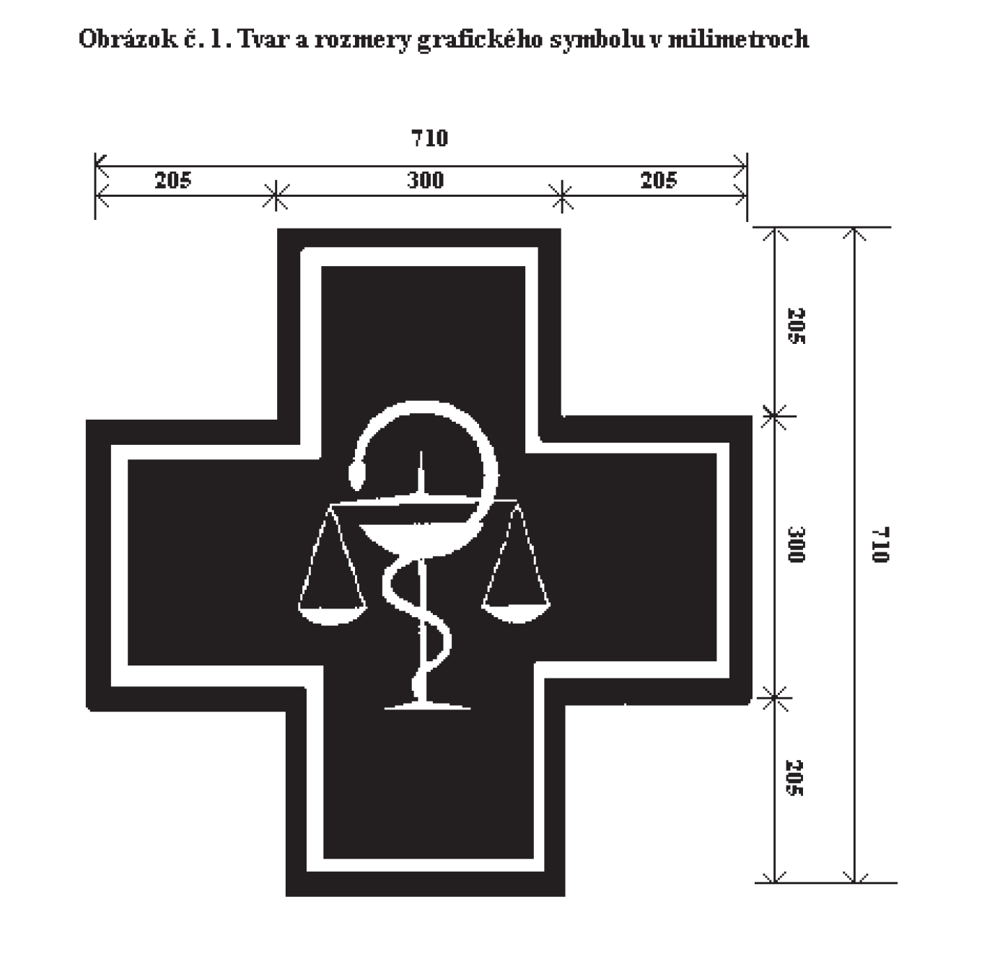

Príloha č. 4 k vyhláške č. 129/2012 Z. z.

- TECHNICKÉ POŽIADAVKY NA SYMBOL S LEKÁRENSKÝM ZNAKOM

  - 1. Lekárenský znak tvorí teleso znaku a grafický symbol podľa obrázku č. 1. Teleso znaku má podobu vonkajšieho obrysu grafického symbolu v tvare rovnoramenného kríža rovnakých rozmerov. Upevňovacie konzoly môžu mať tvar podľa požiadavky.

  - 2. Teleso znaku môže byť

    - a) obojstranne svetelné,

    - b) jednostranne svetelné,

    - c) obojstranne nesvetelné,

    - d) jednostranne nesvetelné.

  - 3. Obojstranne svetelné teleso znaku má bočné steny svetelné, vyrobené z mliečneho plexiskla s hrúbkou 3 mm. Hrúbka telesa je 160 mm. Vnútri telesa je zdroj svetla (neónové žiarivky alebo lineárne žiarovky). Zdroj svetla môže svietiť alebo blikať.

  - 4. Jednostranne svetelné teleso znaku má prednú stenu telesa svetelnú, vyrobenú z mliečneho plexiskla s hrúbkou 3 mm. Zadná stena je z hliníkového plechu. Hrúbka telesa je 130 mm. Vnútri telesa je zdroj svetla (neónové žiarivky alebo lineárne žiarovky). Zdroj svetla môže svietiť alebo blikať.

  - 5. Obojstranne nesvetelné teleso znaku tvorí rám v tvare grafického symbolu. Bočné steny sú z plastu s hrúbkou 4 mm. Hrúbka znaku je 20 mm.

  - 6. Jednostranne nesvetelné teleso znaku tvorí kovový rám v tvare grafického symbolu. Predná stena je z plastu s hrúbkou 4 mm. Hrúbka znaku je 15 mm.

  - 7. Plášť znaku vrátane obvodových stien a konzol je biely.

  - 8. Podklad grafického symbolu v tvare rovnoramenného kríža je biely a tvorí ho plast alebo mliečne plexisklo.

  - 9. Grafický symbol je zelený a je vyrezaný z krycej fólie, ak ide o nesvetelné telesá znaku, alebo z transparentnej, alebo z translucentnej fólie, ak ide o svetelné telesá znaku.

  - 10. Farebný odtieň symbolu je podľa stupnice RAL-6024 alebo podľa stupnice PANTONE-4-347 (vzorkovnica PANTONE COLOR SELECTOR/FOIL).

  - Obrázok č. 1. Tvar a rozmery grafického symbolu v milimetroch

- 
