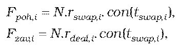
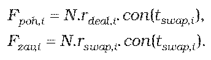
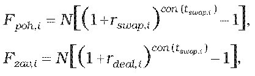
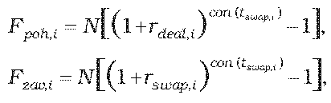
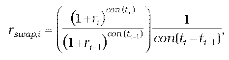

Príloha č. 10 k opatreniu č. 180/2012 Z. z.

- URČENIE TEORETICKEJ CENY IRS SWAPU

  - (1) Teoretická cena IRS swapu so splatnosťou do jedného roka vrátane sa vypočíta postupom uvedeným v prílohe č. 9, pričom

    - a) pre nákup dohodnutej úrokovej sadzby a predaj swapovej úrokovej sadzby

    - 

    - b) pre predaj dohodnutej úrokovej sadzby a nákup swapovej úrokovej sadzby

    - 

  - (2) Teoretická cena IRS swapu so splatnosťou dlhšou ako jeden rok sa vypočíta postupom uvedeným v prílohe č. 9, pričom

    - a) pre nákup dohodnutej úrokovej sadzby a predaj swapovej úrokovej sadzby

    - 

    - b) pre predaj dohodnutej úrokovej sadzby a nákup swapovej úrokovej sadzby

    - 

      - kde

      - N je dohodnutá istina (nocionálna hodnota),

      - Fpoh,i je forwardová hodnota pohľadávky zo swapu pre i-tú platbu v deň, ku ktorému sa swap oceňuje,

      - Fzav,i je forwardová hodnota záväzku zo swapu pre i-tú platbu v deň, ku ktorému sa swap oceňuje,

      - rswap,i je swapová úroková miera i-tej platby swapu v deň, ku ktorému sa IRS swap oceňuje,

      - rdeal,i je dohodnutá swapová úroková miera i-tej platby swapu,

      - tswap,ije dĺžka i-tého úrokového obdobia v dňoch,

      - con() je dĺžka obdobia vypočítaná podľa konvencie pre používanú metódu úročenia v podmienkach príslušného derivátu.

  - (3) Ak swapová úroková miera i-tej platby swapu v deň, ku ktorému sa IRS swap oceňuje, nie je dostupná, vypočíta sa podľa vzorca

  - 

    - kde

    - ti je zostatková doba splatnosti i-tej platby swapu v dňoch,

    - ti-1 je zostatková doba splatnosti i-tej platby swapu v dňoch,

    - con() je dĺžka obdobia vypočítaná podľa konvencie pre používanú metódu úročenia v podmienkach príslušného derivátu,

    - rije požadovaný výnos určený podľa prílohy č. 15 na obdobie ti,

    - ri-1 je požadovaný výnos určený podľa prílohy č. 15 na obdobie ti-1.
