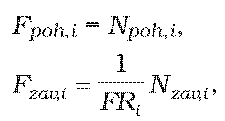
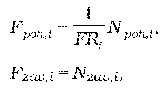
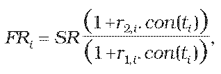
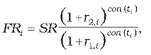

Príloha č. 11 k opatreniu č. 180/2012 Z. z.

- URČENIE TEORETICKEJ CENY FX SWAPU

  - (1) Teoretická cena FX swapu sa vypočíta postupom uvedeným v prílohe č. 9, pričom

    - a) pre nákup prvej meny a predaj druhej meny

    - 

      - kde

      - Npoh,i je dohodnutý objem nakúpenej meny v rámci i-tej zámeny v prvej mene,

      - Nzav,ije dohodnutý objem predanej meny v rámci i-tej zámeny v druhej mene,

      - Fpoh,i je forwardová hodnota pohľadávky zo swapu pre i-tú platbu v prvej mene v deň, ku ktorému sa swap oceňuje,

      - Fzav,i je forwardová hodnota záväzku zo swapu pre i-tú platbu v prvej mene v deň, ku ktorému sa swap oceňuje,

      - FRije forwardový kurz prvá mena/druhá mena k i-tej zámene v deň, ku ktorému sa swap oceňuje,

      - prvá mena je mena, ktorá je podľa konvencie udávaná v menovom páre ako prvá,

      - druhá mena je mena, ktorá je podľa konvencie udávaná v menovom páre ako druhá,

    - b) pre nákup druhej meny a predaj prvej meny

    - 

      - kde

      - Npoh,i je dohodnutý objem nakúpenej meny v rámci i-tej zámeny v druhej mene,

      - Nzav,i je dohodnutý objem predanej meny v rámci i-tej zámeny v prvej mene,

      - Fpoh,i je forwardová hodnota pohľadávky zo swapu pre i-tú platbu v prvej mene v deň, ku ktorému sa swap oceňuje,

      - Fzav,i je forwardová hodnota záväzku zo swapu pre i-tú platbu v prvej mene v deň, ku ktorému sa swap oceňuje,

      - FRpoh,ije forwardový kurz prvá mena/druhá mena k i-tej zámene v deň, ku ktorému sa swap oceňuje,

      - prvá mena je mena, ktorá je podľa konvencie udávaná v menovom páre ako prvá,

      - druhá mena je mena, ktorá je podľa konvencie udávaná v menovom páre ako druhá.

  - (2) Ak forwardový kurz prvej meny k druhej mene i-tej zámeny ku dňu, ku ktorému sa swap oceňuje, nie je dostupný, určí sa postupom, ak ide o

    - a) FX swap so splatnosťou do jedného roka vrátane

    - 

    - b) FX swap so splatnosťou dlhšou ako jeden rok

    - 

      - kde

      - SR je spotový kurz prvá mena/druhá mena ku dňu, ku ktorému sa swap oceňuje,

      - r1,i je požadovaný výnos pre prvú menu v percentách p.a. určený podľa prílohy č. 15 na obdobie ti,

      - r2,i je požadovaný výnos pre druhú menu v percentách p.a. určený podľa prílohy č. 15 na obdobie ti,

      - ti je zostatková doba splatnosti i-tej platby swapu v dňoch,

      - con() je dĺžka obdobia vypočítaná podľa konvencie pre používanú metódu úročenia v podmienkach príslušného derivátu.
