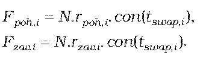
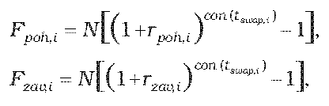

Príloha č. 12 k opatreniu č. 180/2012 Z. z.

- URČENIE TEORETICKEJ CENY BÁZICKÉHO SWAPU

  - (1) Na výpočet teoretickej ceny bázického swapu so splatnosťou do jedného roka vrátane sa použije postup uvedený v prílohe č. 9, pričom

  - 

  - (2) Na výpočet teoretickej ceny bázického swapu so splatnosťou dlhšou ako jeden rok sa použije postup uvedený v prílohe č. 9, pričom

  - 

    - kde

    - N je dohodnutá istina (nocionálna hodnota),

    - Fpoh,ije forwardová hodnota pohľadávky zo swapu pre i-tú platbu v deň, ku ktorému sa swap oceňuje,

    - Fzav,i je forwardová hodnota záväzku zo swapu pre i-tú platbu v deň, ku ktorému sa swap oceňuje,

    - rpoh,i je swapová úroková miera pohľadávky i-tej platby swapu v deň, ku ktorému sa swap oceňuje,

    - rzav,i je swapová úroková miera záväzku i-tej platby swapu v deň, ku ktorému sa swap oceňuje,

    - tswap,ije dĺžka i-tého úrokového obdobia v dňoch,

    - con() je dĺžka obdobia vypočítaná podľa konvencie pre používanú metódu úročenia v podmienkach príslušného derivátu.
