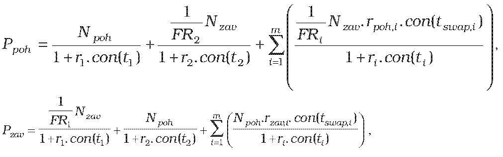
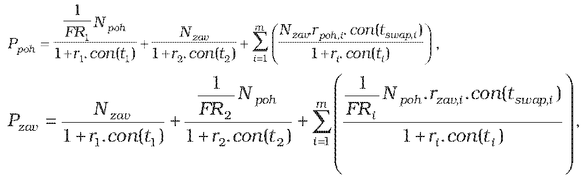
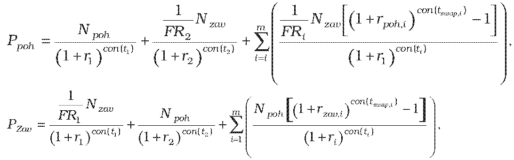
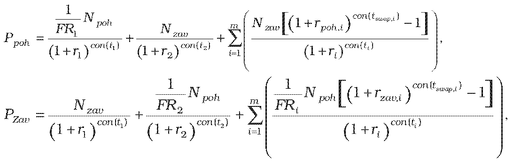

Príloha č. 13 k opatreniu č. 180/2012 Z. z.

- URČENIE TEORETICKEJ CENY KRÍŽOVÉHO MENOVO-ÚROKOVÉHO SWAPU

  - (1) Teoretická cena krížového menovo-úrokového swapu so splatnosťou do jedného roka vrátane sa vypočíta postupom:

    - a) ak ide o nákup prvej meny a predaj druhej meny v deň a spätný predaj prvej meny a nákup druhej meny v deň t2

    - 

      - kde

      - Ppohje hodnota diskontovaných pohľadávok zo swapu,

      - Pzavje hodnota diskontovaných záväzkov zo swapu,

      - t1 je začiatok krížového menovo-úrokového swapu,

      - t2 je koniec krížového menovo-úrokového swapu,

      - ti je zostatková splatnosť i-tej úrokovej platby swapu,

      - con() je dĺžka obdobia vypočítaná podľa konvencie pre používanú metódu úročenia v podmienkach príslušného derivátu,

      - r1 je požadovaný výnos pre prvú menu v percentách p.a., určený podľa prílohy č. 15 na obdobie t1,

      - r2 je požadovaný výnos pre prvú menu v percentách p.a., určený podľa prílohy č. 15 na obdobie t2,

      - r i je požadovaný výnos pre prvú menu v percentách p.a., určený podľa prílohy č. 15 na obdobie ti,

      - tswap,ije dĺžka i-tého úrokového obdobia v dňoch,

      - i je index budúcej platby swapu,

      - m je počet budúcich platieb swapu,

      - Npoh je dohodnutý objem nakúpenej meny v prvej mene,

      - Nzavje dohodnutý objem predanej meny v druhej mene,

      - FRije forwardový kurz prvá mena/druhá mena k i-tej zámene ku dňu, ku ktorému sa swap oceňuje,

      - FR1 je forwardový kurz prvá mena/druhá mena ku dňu t1nákupu prvej meny a predaja druhej meny,

      - FR2 je forwardový kurz prvá mena/druhá mena ku dňu t2 spätného nákupu druhej meny a predaja prvej meny,

      - prvá mena je mena, ktorá je podľa konvencie udávaná v menovom páre ako prvá,

      - druhá mena je mena, ktorá je podľa konvencie udávaná v menovom páre ako druhá,

      - rpoh,i je swapová úroková miera pohľadávky i-tej platby swapu ku dňu, ku ktorému sa swap oceňuje,

      - rzav,i je swapová úroková miera záväzku i-tej platby swapu ku dňu, ku ktorému sa swap oceňuje,

    - b) ak ide o predaj prvej meny a nákup druhej meny v deň a spätný nákup prvej meny a predaj druhej meny v deň t2

    - 

      - kde

      - Ppohje hodnota diskontovaných pohľadávok zo swapu,

      - Pzav je hodnota diskontovaných záväzkov zo swapu,

      - t1 je začiatok krížového menovo-úrokového swapu,

      - t2je koniec krížového menovo-úrokového swapu,

      - ti je zostatková splatnosť i-tej úrokovej platby swapu,

      - con() je dĺžka obdobia vypočítaná podľa konvencie pre používanú metódu úročenia v podmienkach príslušného

      - derivátu,

      - r1je požadovaný výnos pre prvú menu, určený podľa prílohy č. 15 na obdobie t1,

      - r2je požadovaný výnos pre prvú menu, určený podľa prílohy č. 15 na obdobie t2,

      - rije požadovaný výnos pre prvú menu, určený podľa prílohy č. 15 na obdobie ti,

      - tswap,i je dĺžka i-tého úrokového obdobia v dňoch,

      - i je index budúcej platby swapu,

      - m je počet budúcich platieb swapu,

      - Npoh je dohodnutý objem nakúpenej meny v druhej mene,

      - Nzav je dohodnutý objem predanej meny v prvej mene,

      - FRi je forwardový kurz prvá mena/druhá mena k i-tej zámene ku dňu, ku ktorému sa swap oceňuje,

      - FR1 je forwardový kurz prvá mena/druhá mena ku dňu t1 predaja prvej meny a nákupu druhej meny,

      - FR2 je forwardový kurz prvá mena/druhá mena ku dňu t2 spätného predaja druhej meny a nákupu prvej meny,

      - prvá mena je mena, ktorá je podľa konvencie udávaná v menovom páre ako prvá,

      - druhá mena je mena, ktorá je podľa konvencie udávaná v menovom páre ako druhá,

      - rpoh,i je swapová úroková miera pohľadávky i-tej platby swapu ku dňu, ku ktorému sa swap oceňuje,

      - rzav,i je swapová úroková miera záväzku i-tej platby swapu ku dňu, ku ktorému sa swap oceňuje.

  - (2) Teoretická cena krížového menovo-úrokového swapu so splatnosťou dlhšou ako jeden rok sa vypočíta postupom

    - a) ak ide o nákup prvej meny a predaj druhej meny v deň t1 a spätný predaj prvej meny a nákup druhej meny v deň t2

    - 

      - kde

      - Ppoh je hodnota diskontovaných pohľadávok zo swapu,

      - Pzav je hodnota diskontovaných záväzkov zo swapu,

      - t1 je začiatok krížového menovo-úrokového swapu,

      - t 2 je koniec krížového menovo-úrokového swapu,

      - ti je zostatková splatnosť i-tej úrokovej platby swapu,

      - con() je dĺžka obdobia vypočítaná podľa konvencie pre používanú metódu úročenia v podmienkach príslušného derivátu,

      - r1je požadovaný výnos pre prvú menu, určený podľa prílohy č. 15 na obdobie t1,

      - r2 je požadovaný výnos pre prvú menu, určený podľa prílohy č. 15 na obdobie t2,

      - rije požadovaný výnos pre prvú menu, určený podľa prílohy č. 15 na obdobie ti,

      - tswap,i je dĺžka i-tého úrokového obdobia v dňoch,

      - i je index budúcej platby swapu,

      - m je počet budúcich platieb swapu,

      - Npoh je dohodnutý objem nakúpenej meny v prvej mene,

      - Nzavje dohodnutý objem predanej meny v druhej mene,

      - FRi je forwardový kurz prvá mena/druhá mena k i-tej zámene ku dňu, ku ktorému sa swap oceňuje,

      - FR1 je forwardový kurz prvá mena/druhá mena ku dňu t1 nákupu prvej meny a predaja druhej meny,

      - FR2 je forwardový kurz prvá mena/druhá mena ku dňu t2 spätného nákupu druhej meny a predaja prvej meny,

      - prvá mena je mena, ktorá je podľa konvencie udávaná v menovom páre ako prvá,

      - druhá mena je mena, ktorá je podľa konvencie udávaná v menovom páre ako druhá,

      - rpoh,i je swapová úroková miera pohľadávky i-tej platby swapu ku dňu, ku ktorému sa swap oceňuje,

      - rzav,i je swapová úroková miera záväzku i-tej platby swapu ku dňu, ku ktorému sa swap oceňuje,

    - b) ak ide o predaj prvej meny a nákup druhej meny v deň t1a spätný nákup prvej meny a predaj druhej meny v deň t2

    - 

      - kde

      - Ppoh je hodnota diskontovaných pohľadávok zo swapu,

      - Pzavje hodnota diskontovaných záväzkov zo swapu,

      - t1 je začiatok krížového menovo-úrokového swapu,

      - t2 je koniec krížového menovo-úrokového swapu,

      - ti je zostatková splatnosť i-tej úrokovej platby swapu,

      - con() je dĺžka obdobia vypočítaná podľa konvencie pre používanú metódu úročenia v podmienkach príslušného

      - derivátu,

      - r1 je požadovaný výnos pre prvú menu, určený podľa prílohy č. 15 na obdobie t1,

      - r2 je požadovaný výnos pre prvú menu, určený podľa prílohy č. 15 na obdobie t2,

      - ri je požadovaný výnos pre prvú menu, určený podľa prílohy č. 15 na obdobie ti,

      - tswap,i je dĺžka i-tého úrokového obdobia v dňoch,

      - i je index budúcej platby swapu,

      - m je počet budúcich platieb swapu,

      - Npoh je dohodnutý objem nakúpenej meny v druhej mene,

      - Nzav je dohodnutý objem predanej meny v prvej mene,

      - FRi je forwardový kurz prvá mena/druhá mena k i-tej zámene ku dňu, ku ktorému sa swap oceňuje,

      - FR1 je forwardový kurz prvá mena/druhá mena ku dňu t1 predaja prvej meny a nákupu druhej meny,

      - FR2 je forwardový kurz prvá mena/druhá mena ku dňu t2 spätného predaja druhej meny a nákupu prvej meny,

      - prvá mena je mena, ktorá je podľa konvencie udávaná v menovom páre ako prvá,

      - druhá mena je mena, ktorá je podľa konvencie udávaná v menovom páre ako druhá,

      - rpoh,i je swapová úroková miera pohľadávky i-tej platby swapu ku dňu, ku ktorému sa swap oceňuje,

      - rzav,i je swapová úroková miera záväzku i-tej platby swapu ku dňu, ku ktorému sa swap oceňuje.
