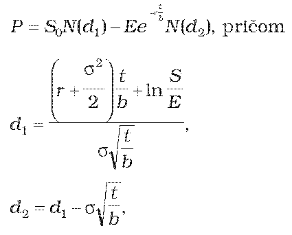
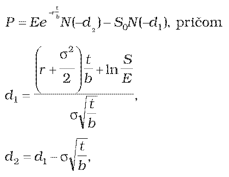
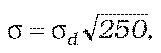
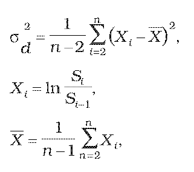

Príloha č. 14 k opatreniu č. 180/2012 Z. z.

- URČENIE TEORETICKEJ CENY EURÓPSKEJ OPCIE

  - (1) Teoretická cena európskej call opcie na kapitálový cenný papier, z ktorého sa nevypláca dividenda, sa vypočíta postupom

  - 

  - (2) Teoretická cena európskej put opcie na kapitálový cenný papier, z ktorého sa nevypláca dividenda, sa vypočíta postupom

  - 

    - kde

    - P je teoretická cena európskej call (put) opcie,

    - S0 je cena kapitálového cenného papiera v deň, ku ktorému sa opcia oceňuje,

    - E je expiračná cena kapitálového cenného papiera,

    - t je zostatková doba splatnosti opcie do expirácie v dňoch,

    - b je báza počtu dní v roku,

    - σ je historická volatilita kapitálového cenného papiera,

    - r je požadovaný spojitý úrokový výnos na obdobie t,

    - N() je kumulatívna distribučná funkcia normálneho rozdelenia so strednou hodnotou 0 a varianciou 1.

  - (3) Ak spojitý úrokový výnos nie je dostupný, vypočíta sa postupom

    - r = ln(1 + rd),

    - kde

    - rd je požadovaný výnos určený podľa prílohy č. 15 na obdobie t.

  - (4) Ak historická volatilita príslušného kapitálového cenného papiera nie je dostupná, vypočíta sa postupom

  - 

    - pričom

  - 

    - kde

    - σ je historická volatilita kapitálového cenného papiera,

    - σd je historická volatilita kapitálového cenného papiera vyjadrená v dňoch,

    - Si je cena príslušného kapitálového cenného papiera v deň i,

    - n je počet obchodných dní od začiatku kótovania ceny kapitálového cenného papiera; počet dní, za ktoré je počítaná historická volatilita kapitálového cenného papiera,

    - i = 1, 2, 3... je index obchodných dní od začiatku kótovania ceny kapitálového cenného papiera.
