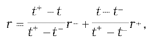

Príloha č. 15 k opatreniu č. 180/2012 Z. z.

- URČENIE POŽADOVANÉHO VÝNOSU PEŇAŽNÝCH TOKOV PLYNÚCICH Z FINANČNÉHO NÁSTROJA

  - (1) Požadovaný výnos peňažných tokov plynúcich z finančného nástroja (ďalej len „požadovaný výnos“) sa určuje metódou lineárnej interpolácie z výnosovej krivky dlhopisu s nulovým kupónom, a to podľa vzorca

  - 

    - kde

    - r je požadovaný výnos,

    - t je doba splatnosti peňažného toku z finančného nástroja,

    - t+ je najbližšia dlhšia doba splatnosti dostupná na výnosovej krivke dlhopisu s nulovým kupónom,

    - t– je najbližšia kratšia doba splatnosti dostupná na výnosovej krivke dlhopisu s nulovým kupónom,

    - r+ je hodnota úrokovej sadzby na výnosovej krivke dlhopisu s nulovým kupónom prináležiaca k najbližšej dlhšej dobe splatnosti dostupnej na výnosovej krivke dlhopisu s nulovým kupónom,

    - r– je hodnota úrokovej sadzby na výnosovej krivke dlhopisu s nulovým kupónom prináležiaca k najbližšej kratšej dobe splatnosti dostupnej na výnosovej krivke dlhopisu s nulovým kupónom.

  - (2) Ak nie je uvedené inak, všetky úrokové sadzby sú v percentuálnom vyjadrení v ročnej miere.

  - (3) Výnosová krivka dlhopisu s nulovým kupónom sa zostaví bootstrappingom, ak ide o finančné nástroje so splatnosťou

    - a) do jedného roka vrátane, z úrokových sadzieb medzibankového trhu, a to pre menu, v ktorej je príslušný finančný nástroj denominovaný,

    - b) dlhšou ako jeden rok, zo swapových úrokových sadzieb medzibankového trhu v mene, v ktorej je príslušný finančný nástroj denominovaný.

  - (4) Na účely určenia požadovaného výnosu sa rozumie

    - a) výnosovou krivkou dlhopisu s nulovým kupónom výnosová krivka znázorňujúca výnosy do splatnosti bezkupónových finančných nástrojov,

    - b) bootstrappingom spôsob konštrukcie výnosovej krivky dlhopisu s nulovým kupónom pre príslušné finančné nástroje odvodenej z výnosovej krivky.
