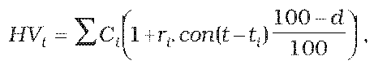

Príloha č. 2 k opatreniu č. 180/2012 Z. z.

- URČENIE HODNOTY PEŇAŽNÝCH PROSTRIEDKOV NA BEŽNOM ÚČTE A NA VKLADOVOM ÚČTE

  - Hodnota peňažných prostriedkov na bežnom účte a na vkladovom účte sa vypočíta podľa vzorca

- 

  - kde

  - C i je peňažný tok v čase ti,

  - ri je úroková sadzba, ktorou sa príslušný peňažný tok úročí,

  - con() je dĺžka obdobia vypočítaná podľa konvencie pre používanú metódu úročenia dohodnutej v podmienkach vkladu,

  - d je daň z príjmov vyberaná zrážkou v percentuálnom vyjadrení.
