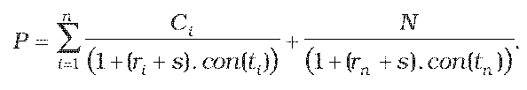
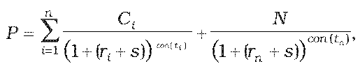

Príloha č. 3 k opatreniu č. 180/2012 Z. z.

- URČENIE TEORETICKEJ CENY DLHOVÉHO CENNÉHO PAPIERA

  - (1) Teoretická cena dlhového cenného papiera so splatnosťou do jedného roka vrátane sa vypočíta postupom

  - 

  - (2) Teoretická cena dlhového cenného papiera so splatnosťou dlhšou ako jeden rok sa vypočíta postupom

  - 

    - kde

    - P je teoretická cena dlhového cenného papiera vrátane alikvotného úrokového výnosu,

    - ri je požadovaný výnos určený podľa prílohy č. 15,

    - s je prémia za riziko určená podľa prílohy č. 16,

    - N je menovitá hodnota dlhového cenného papiera,

    - Ci je hodnota i-tého kupónu z dlhového cenného papiera; ak kupónová sadzba je odvodená zo sadzby medzibankového trhu, budúce kupónové sadzby sa určia zo vzorca uvedeného v prílohe č. 6 ods. 3 použitím forwardovej sadzby medzibankového trhu odvodenej z výnosovej krivky medzibankového trhu; ak nie je možné použiť výnosovú krivku medzibankového trhu, na odvodenie budúcich kupónových sadzieb sa použije swapová úroková krivka,

    - tije počet dní do splatnosti i-tého kupónu z dlhového cenného papiera v dňoch,

    - i je index budúceho kupónu z dlhového cenného papiera,

    - n je počet budúcich kupónov z dlhového cenného papiera,

    - tn je počet dní do splatnosti dlhového cenného papiera v dňoch,

    - con() je dĺžka obdobia vypočítaná podľa konvencie pre používanú metódu úročenia v emisných podmienkach príslušného dlhového cenného papiera.

  - (3) Na účely určenia teoretickej ceny dlhového cenného papiera sa výnosovou krivkou rozumie krivka znázorňujúca výnosy do splatnosti finančných nástrojov v príslušnom obchodnom dni v závislosti od ich zostatkovej doby splatnosti, poskytujúca informácie o časovej štruktúre úrokových mier.
