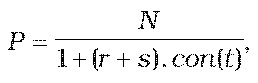
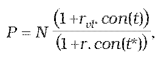
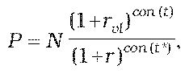

Príloha č. 4 k opatreniu č. 180/2012 Z. z.

- URČENIE TEORETICKEJ CENY NÁSTROJA PEŇAŽNÉHO TRHU

  - (1) Teoretická cena pokladničnej poukážky sa vypočíta postupom

  - 

    - kde

    - P je teoretická cena pokladničnej poukážky,

    - N je menovitá hodnota pokladničnej poukážky,

    - r je požadovaný výnos určený podľa prílohy č. 15,

    - s je prémia za riziko určená podľa prílohy č. 16,

    - t je počet dní do splatnosti pokladničnej poukážky,

    - con() je dĺžka obdobia vypočítaná podľa konvencie pre používanú metódu úročenia v emisných podmienkach.

  - (2) Teoretická cena vkladového listu sa vypočíta postupom

    - a) teoretická cena vkladového listu so splatnosťou do jedného roka vrátane

    - 

    - b) teoretická cena vkladového listu so splatnosťou dlhšou ako jeden rok

    - 

      - kde

      - P je teoretická cena vkladového listu,

      - N je nominálna hodnota vkladového listu,

      - rvl je ročná úroková sadzba vkladového listu platná pre aktuálne obdobie v percentuálnom vyjadrení,

      - r je požadovaný výnos určený podľa prílohy č. 15,

      - t je celková doba splatnosti vkladového listu v dňoch,

      - t* je doba do splatnosti vkladového listu v dňoch ku dňu ocenenia,

      - con() je dĺžka obdobia vypočítaná podľa konvencie pre používanú metódu úročenia v emisných podmienkach.
