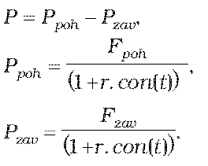
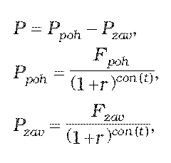

Príloha č. 5 k opatreniu č. 180/2012 Z. z.

- URČENIE TEORETICKEJ CENY FORWARDU

  - (1) Teoretická cena forwardu so splatnosťou do jedného roka vrátane sa vypočíta postupom

  - 

  - (2) Teoretická cena forwardu so splatnosťou dlhšou ako jeden rok sa vypočíta postupom

  - 

    - kde

    - P je teoretická cena forwardu,

    - Ppoh je hodnota diskontovaných pohľadávok z forwardu,

    - Pzav je hodnota diskontovaných záväzkov z forwardu,

    - Fpoh je forwardová hodnota pohľadávok z forwardu,

    - Fzav je forwardová hodnota záväzkov z forwardu,

    - t je zostatková doba splatnosti forwardu v dňoch,

    - r je požadovaný výnos pre menu, v ktorej je vypočítaná teoretická cena forwardu, určený podľa prílohy č. 15,

    - con() je dĺžka obdobia vypočítaná podľa konvencie pre používanú metódu úročenia pre príslušný derivát.
