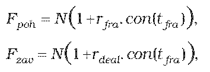
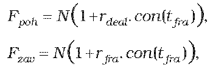
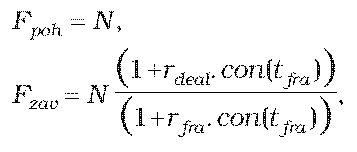
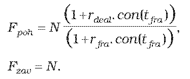
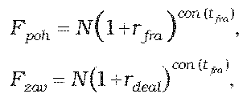
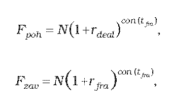
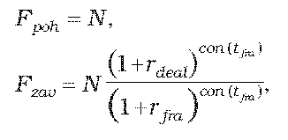
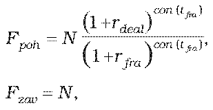
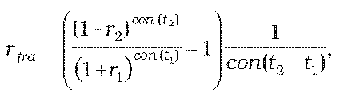

Príloha č. 6 k opatreniu č. 180/2012 Z. z.

- URČENIE TEORETICKEJ CENY FRA OBCHODU

  - (1) Teoretická cena FRA obchodu so splatnosťou do jedného roka vrátane sa vypočíta postupom uvedeným v prílohe č. 5, pričom ak k finančnému vysporiadaniu dôjde v

    - a) deň t2,

      - 1. ak sa platí dohodnutá forwardová úroková miera a prijíma sa forwardová úroková miera príslušného dňa

      - 

      - 2. ak sa platí forwardová úroková miera príslušného dňa a prijíma sa dohodnutá forwardová úroková miera

      - 

    - b) v deň t1,

      - 1. ak sa platí dohodnutá forwardová úroková miera a prijíma sa forwardová úroková miera príslušného dňa

      - 

      - 2. ak sa platí forwardová úroková miera príslušného dňa a prijíma sa dohodnutá forwardová úroková miera

      - 

  - (2) Teoretická cena FRA obchodu so splatnosťou dlhšou ako jeden rok sa vypočíta postupom uvedeným v prílohe č. 5, pričom ak k finančnému vysporiadaniu dôjde v

    - a) deň t2,

      - 1. ak sa platí dohodnutá forwardová úroková miera a prijíma sa forwardová úroková miera príslušného dňa

      - 

      - 2. ak sa platí forwardová úroková miera príslušného dňa a prijíma sa dohodnutá forwardová úroková miera

      - 

    - b) deň t1,

      - 1. ak sa platí dohodnutá forwardová úroková miera a prijíma sa forwardová úroková miera príslušného dňa

      - 

      - 2. ak sa platí forwardová úroková miera príslušného dňa a prijíma sa dohodnutá forwardová úroková miera

      - 

        - kde

        - N je dohodnutá istina,

        - rdealje dohodnutá forwardová úroková miera na obdobie od t1 do t2,

        - rfraje forwardová úroková miera príslušného dňa na obdobie od t1 do t2,

        - tfra=t2 – t1 je perióda FRA obchodu v dňoch,

        - con() je dĺžka obdobia vypočítaná podľa konvencie pre používanú metódu úročenia v podmienkach príslušného derivátu.

  - (3) Ak forwardová úroková miera príslušného dňa na obdobie od t1 do t2 nie je dostupná, určí sa podľa vzorca

  - 

    - kde

    - rfra je forwardová úroková miera na obdobie (t2 – t1) platná od t1,

    - r1 je požadovaný výnos určený podľa prílohy č. 15 na obdobie t1,

    - r2 je požadovaný výnos určený podľa prílohy č. 15 na obdobie t2,

    - con() je dĺžka obdobia vypočítaná podľa konvencie pre používanú metódu úročenia v podmienkach príslušného derivátu.
