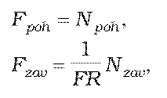
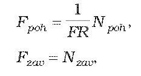
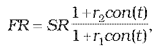
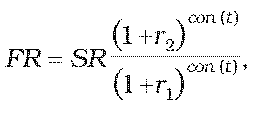

Príloha č. 7 k opatreniu č. 180/2012 Z. z.

- URČENIE TEORETICKEJ CENY FX FORWARDU

  - (1) Teoretická cena FX forwardu sa vypočíta postupom uvedeným v prílohe č. 5, pričom

    - a) pre forwardový nákup prvej meny a predaj druhej meny

    - 

      - kde

      - Fpoh je forwardová hodnota pohľadávok z forwardu v prvej mene,

      - Fzav je forwardová hodnota záväzkov z forwardu v prvej mene,

      - Npoh je dohodnutý objem nakúpenej meny v prvej mene,

      - Nzav je dohodnutý objem predanej meny v druhej mene,

      - FR je forwardový kurz prvá mena/druhá mena ku dňu ocenenia,

      - prvá mena je mena, ktorá je podľa konvencie udávaná v menovom páre ako prvá,

      - druhá mena je mena, ktorá je podľa konvencie udávaná v menovom páre ako druhá,

    - b) pre forwardový nákup druhej meny a predaj prvej meny

    - 

      - kde

      - Fpoh je forwardová hodnota pohľadávok z forwardu v prvej mene,

      - Fzav je forwardová hodnota záväzkov z forwardu v prvej mene,

      - Npoh je dohodnutý objem nakúpenej meny v druhej mene,

      - Nzavje dohodnutý objem predanej meny v prvej mene,

      - FR je forwardový kurz prvá mena/druhá mena ku dňu ocenenia,

      - prvá mena je mena, ktorá je podľa konvencie udávaná v menovom páre ako prvá,

      - druhá mena je mena, ktorá je podľa konvencie udávaná v menovom páre ako druhá.

  - (2) Ak forwardový kurz prvej meny k druhej mene ku dňu, ku ktorému sa FX forward oceňuje, nie je dostupný, vypočíta sa postupom

    - a) pre FX forwardy so splatnosťou do jedného roka vrátane

    - 

    - b) pre FX forwardy so splatnosťou dlhšou ako jeden rok

    - 

      - kde

      - FR je forwardový kurz prvá mena/druhá mena ku dňu ocenenia,

      - SR je spotový kurz prvá mena/druhá mena ku dňu ocenenia,

      - r1 je požadovaný výnos pre prvú menu v percentách p.a. určený podľa prílohy č. 15 na obdobie t,

      - r2 je požadovaný výnos pre druhú menu v percentách p.a. určený podľa prílohy č. 15 na obdobie t,

      - t je zostatková doba splatnosti forwardu v dňoch,

      - con() je dĺžka obdobia vypočítaná podľa konvencie pre používanú metódu úročenia pre príslušný derivát.
