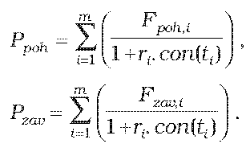
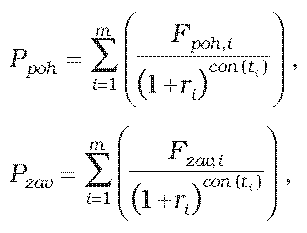

Príloha č. 9 k opatreniu č. 180/2012 Z. z.

- URČENIE TEORETICKEJ CENY SWAPU

  - (1) Teoretická cena swapu so splatnosťou do jedného roka vrátane sa vypočíta spôsobom

    - P = Ppoh – Pzav,

    - kde

  - 

  - (2) Teoretická cena swapu so splatnosťou dlhšou ako jeden rok sa vypočíta spôsobom

    - P = Ppoh – Pzav,

    - kde

  - 

    - kde

    - P je teoretická cena swapu,

    - Ppoh je hodnota diskontovaných pohľadávok zo swapu,

    - Pzavje hodnota diskontovaných záväzkov zo swapu,

    - Fpoh,i je forwardová hodnota pohľadávky zo swapu pre i-tú platbu v deň, ku ktorému sa swap oceňuje,

    - Fzav,i je forwardová hodnota záväzku zo swapu pre i-tú platbu v deň, ku ktorému sa swap oceňuje,

    - ti je zostatková doba splatnosti i-tej platby swapu v dňoch,

    - ri je požadovaný výnos určený podľa prílohy č. 15 na obdobie ti,

    - i je index budúcej platby swapu,

    - m je počet budúcich platieb swapu,

    - con() je dĺžka obdobia vypočítaná podľa konvencie pre používanú metódu úročenia v podmienkach príslušného derivátu.
