# Čl. I

Vyhláška Úradu pre reguláciu sieťových odvetví č. 225/2011 Z. z., ktorou sa ustanovuje cenová regulácia v elektroenergetike v znení vyhlášky č. 438/2011 Z. z. sa mení a dopĺňa takto:

- 1. § 1 sa dopĺňa písmenom m), ktoré znie:

- „m)

- areálom výrobcu elektriny územie, na ktorom sú vzájomne galvanicky prepojené elektroenergetické zariadenia výrobcu elektriny za odbernými miestami výrobcu elektriny.“.

- 2. V § 2 ods. 1 písmeno f) znie:

- „f)

- náklady na plnenie povinností podľa osobitných predpisov,5) v prípade poplatkov za znečisťovanie ovzdušia len poplatky za znečisťujúce látky vypustené do ovzdušia pri dodržaní podmienok a požiadaviek podľa osobitného predpisu5a) a v prípade skleníkových plynov len náklady maximálne do výšky 50 % na nákup emisných kvót nad množstvo bezodplatne pridelených a potrebných na vykonávanie regulovanej činnosti,“.

- Poznámka pod čiarou k odkazu 5a znie:

- „5a)

- Zákon č. 137/2010 Z. z. o ovzduší.“.

- 3. V § 6 ods. 2 sa za slová „množstva tepla z biomasy“ vkladá čiarka a slová „skládkového plynu, plynu z čističiek odpadových vôd“.

- 4. V § 6 ods. 5 sa vypúšťa písmeno f).

- Doterajšie písmeno g) sa označuje ako písmeno f).

- 5. V § 6 sa odsek 7 dopĺňa písmenom e), ktoré znie:

- „e)

- znalecký posudok preukazujúci splnenie podmienok rekonštrukcie alebo modernizácie.32a)“.

- Poznámka pod čiarou k odkazu 32a znie:

- „32a)

- § 3 ods. 6 zákona č. 309/2009 Z. z.“.

- 6. V § 6 ods. 8 sa slová „§ 8 ods. 2 a 3, § 9 ods. 1 a 2, § 10 ods. 1 a 2 alebo § 11 ods. 1 a 2“ nahrádzajú slovami „§ 8 ods. 2 a 3, § 9 ods. 1 a 2, § 10 ods. 1 a 2, § 11, 11a alebo § 11b“.

- 7. V § 6 ods. 9 sa slová „§ 8 ods. 2 a 3, § 9 ods. 1 a 2, § 10 ods. 1 a 2 alebo § 11 ods. 1 a 2“ nahrádzajú slovami „§ 8 ods. 2 a 3, § 9 ods. 1 a 2, § 10 ods. 1 a 2, § 11, 11a alebo § 11b“.

- 8. V § 6 ods. 14 sa slová „za predchádzajúci kalendárny rok“ nahrádzajú slovami „za rok t-2“.

- 9. § 6 sa dopĺňa odsekmi 15 a 16, ktoré znejú:

- „(15)

- Ak sa v zariadení výrobcu elektriny spoločne spaľuje biomasa alebo biokvapalina s fosílnymi palivami, cena elektriny vyrobenej z obnoviteľných zdrojov sa uplatní na množstvo elektriny určené podľa odseku 2 a zároveň vyrobené kombinovanou výrobou. Ak sa na toto zariadenie výrobcu elektriny uplatňuje aj cena elektriny vyrobenej vysoko účinnou kombinovanou výrobou, uplatní sa najviac na množstvo elektriny vypočítané ako rozdiel celkového množstva elektriny vyrobenej kombinovanou výrobou a množstva elektriny, na ktoré sa uplatnila cena elektriny podľa prvej vety.

- (16)

- Ak dôjde k zmene výrobcu elektriny, ktorý prevádzkuje zariadenie výrobcu elektriny, s návrhom ceny sa predkladá aj doklad o prevode zariadenia výrobcu elektriny z doterajšieho výrobcu elektriny na nového výrobcu elektriny, ktorým je najmä kúpna zmluva alebo nájomná zmluva.“.

- 10. V § 7 odsek 1 znie:

- „(1)

- Cena elektriny pre stanovenie doplatku na rok t v eurách na jednotku množstva elektriny za elektrinu vyrobenú i-tou technológiou j-tého zariadenia výrobcu elektriny CEPSDi,jt sa pre výrobcu elektriny vypočíta podľa vzorca

- 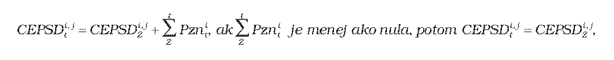

- kde

- a)

- CEPSDi,jZ - je určená alebo schválená cena elektriny pre stanovenie doplatku na rok Z predchádzajúci roku t vyrobenej i-tou technológiou j-tého zariadenia výrobcu elektriny na základe roku uvedenia zariadenia výrobcu elektriny do prevádzky alebo poslednej uplatnenej rekonštrukcie alebo modernizácie v eurách na jednotku množstva elektriny,

- b)

- Pznit - je príplatok37) v eurách na jednotku množstva elektriny na rok t uplatňovaný v hodnote podľa tabuľky č. 1; Pznit sa vypočíta podľa odseku 3,

- c)

- rok Z - je rok uvedenia zariadenia výrobcu elektriny do prevádzky alebo rok poslednej uplatnenej rekonštrukcie alebo modernizácie.

- „

- Technológia výroby elektriny | Primárne palivo | Príplatok Pznit v eur/MWh |

- | | 2012 | 2013

- z obnoviteľných zdrojov energie | biomasa | 0 | 0

- | biokvapalina – rastlinný olej | 17,75 | 0

- | bioplyn | 0 | 0

- | biometán | 0 | 0

- vysoko účinnou kombinovanou výrobou | zemný plyn | 3,77 | 0

- | vykurovací olej | 4,64 | 0

- | hnedé uhlie | 0 | 0

- | čierne uhlie | 0 | 0

- “.

- 11. Nadpis § 11 znie:

- „Cena elektriny pre zariadenie výrobcu elektriny uvedené do prevádzky od 1. januára 2012 do 30. júna 2012“.

- 12. V § 11 ods. 1 sa za slová „od 1. januára 2012“ vkladajú slová „do 30. júna 2012“.

- 13. V § 11 ods. 2 sa za slová „od 1. januára 2012“ vkladajú slová „do 30. júna 2012“.

- 14. Za § 11 sa vkladajú § 11a a 11b, ktoré vrátane nadpisov znejú:

- 㤠11a

- Cena elektriny pre zariadenie výrobcu elektriny uvedené do prevádzky od 1. júla 2012 do 31. decembra 2012

- (1)

- Cena elektriny vyrobenej z obnoviteľných zdrojov energie v zariadení výrobcu elektriny uvedeného do prevádzky od 1. júla 2012 do 31. decembra 2012 sa určuje priamym určením pevnej ceny v eurách na megawatthodinu takto:

- a)

- z vodnej energie s celkovým inštalovaným výkonom zariadenia výrobcu elektriny

- 1.

- do 1 MW vrátane 109,80 eura/MWh,

- 2.

- od 1 MW do 5 MW vrátane 97,98 eura/MWh,

- 3.

- nad 5 MW 61,72 eura/MWh,

- b)

- zo slnečnej energie s celkovým inštalovaným výkonom zariadenia výrobcu elektriny do 100 kW, ktoré je umiestnené na strešnej konštrukcii alebo obvodovom plášti jednej budovy spojenej so zemou pevným základom 119,11 eura/MWh,

- c)

- z veternej energie 79,29 eura/MWh,

- d)

- z geotermálnej energie 190,51 eura/MWh,

- e)

- zo spaľovania alebo spoluspaľovania kombinovanou výrobou

- 1.

- cielene pestovanej biomasy okrem obilnej slamy 112,24 eura/MWh,

- 2.

- odpadnej biomasy ostatnej okrem obilnej slamy 122,64 eura/MWh,

- 3.

- obilnej slamy 171,00 eura/MWh,

- 4.

- biokvapaliny 115,01 eura/MWh,

- f)

- zo spoluspaľovania biologicky rozložiteľných zložiek komunálneho odpadu s fosílnymi palivami kombinovanou výrobou; ak podiel biologicky rozložiteľnej zložky v komunálnom odpade je podľa osobitného predpisu,39) cena sa uplatní bez podmienky výroby elektriny kombinovanou výrobou 123,27 eura/MWh,

- g)

- zo spaľovania

- 1.

- skládkového plynu alebo plynu z čističiek odpadových vôd 93,08 eura/MWh,

- 2.

- bioplynu vyrobeného anaeróbnou fermentačnou technológiou s celkovým výkonom zariadenia do 1 MW vrátane okrem plynu podľa prvého bodu 136,33 eura/MWh,

- 3.

- bioplynu vyrobeného anaeróbnou fermentačnou technológiou s celkovým výkonom zariadenia nad 1 MW okrem plynu podľa prvého bodu 118,13 eura/MWh,

- 4.

- plynu vyrobeného termochemickým splyňovaním biomasy v splyňovacom generátore 149,87 eura/MWh,

- 5.

- fermentovanej zmesi vyrobenej aeróbnou fermentáciou biologicky rozložiteľného odpadu 144,88 eura/MWh.

- (2)

- Cena elektriny vyrobenej vysoko účinnou kombinovanou výrobou v zariadení výrobcu elektriny uvedeného do prevádzky od 1. júla 2012 do 31. decembra 2012 sa určuje priamym určením pevnej ceny v eurách na megawatthodinu takto:

- a)

- v spaľovacej turbíne s kombinovaným cyklom 83,06 eura/MWh,

- b)

- v spaľovacej turbíne s regeneráciou tepla 80,99 eura/MWh,

- c)

- v spaľovacom motore s palivom

- 1.

- zemný plyn 91,70 eura/MWh,

- 2.

- vykurovací olej 87,66 eura/MWh,

- 3.

- zmes vzduchu a metánu 75,52 eura/MWh,

- 4.

- z katalyticky spracovaného odpadu 149,00 eura/MWh,

- 5.

- z termického štiepenia odpadov a jeho produktov 140,00 eura/MWh,

- d)

- v protitlakovej parnej turbíne alebo v kondenzačnej parnej turbíne s odberom tepla s palivom

- 1.

- zemný plyn 81,71 eura/MWh,

- 2.

- vykurovací olej 87,73 eura/MWh,

- 3.

- hnedé uhlie 89,30 eura/MWh,

- 4.

- čierne uhlie s celkovým inštalovaným výkonom zariadenia výrobcu elektriny do 50 MW vrátane 83,16 eura/MWh,

- 5.

- čierne uhlie s celkovým inštalovaným výkonom zariadenia výrobcu elektriny nad 50 MW 79,81eura/MWh,

- 6.

- komunálny odpad 80,00 eura/MWh,

- 7.

- plyn vyrobený termochemickým splyňovaním odpadu v splyňovacom generátore alebo termickým štiepením odpadu 114,71 eura/MWh,

- e)

- v Rankinovom organickom cykle 123,24 eura/MWh.

- (3)

- Cena elektriny podľa odseku 1 písm. b) sa na jednej budove uplatní len pre jedného výrobcu elektriny a pre jedno zariadenie výrobcu elektriny.

- (4)

- Cena elektriny podľa odseku 1 písm. e) až g) sa uplatní len pre jedného výrobcu elektriny a pre jedno zariadenie výrobcu elektriny, ktoré obsahuje všetky technologické časti zariadenia výrobcu elektriny, ktorými sa vykonáva celý proces premeny energie obsiahnutej v biomase na elektrinu.

- § 11b

- Cena elektriny pre zariadenie výrobcu elektriny uvedené do prevádzky od 1. januára 2013

- (1)

- Cena elektriny vyrobenej z obnoviteľných zdrojov energie v zariadení výrobcu elektriny uvedeného do prevádzky od 1. januára 2013 sa určuje priamym určením pevnej ceny v eurách na megawatthodinu takto:

- a)

- z vodnej energie s celkovým inštalovaným výkonom zariadenia výrobcu elektriny

- 1.

- do 1 MW vrátane 109,80 eura/MWh,

- 2.

- od 1 MW do 5 MW vrátane 97,98 eura/MWh,

- 3.

- nad 5 MW 61,72 eura/MWh,

- b)

- zo slnečnej energie s celkovým inštalovaným výkonom zariadenia výrobcu elektriny do 100 kW, ktoré je umiestnené na strešnej konštrukcii alebo obvodovom plášti jednej budovy spojenej so zemou pevným základom 119,11 eura/MWh,

- c)

- z veternej energie 79,29 eura/MWh,

- d)

- z geotermálnej energie 190,51 eura/MWh,

- e)

- zo spaľovania alebo spoluspaľovania kombinovanou výrobou

- 1.

- cielene pestovanej biomasy okrem obilnej slamy 112,24 eura/MWh,

- 2.

- odpadnej biomasy ostatnej okrem obilnej slamy 122,64 eura/MWh,

- 3.

- obilnej slamy 154,27 eura/MWh,

- 4.

- biokvapaliny 115,01 eura/MWh,

- f)

- zo spoluspaľovania biologicky rozložiteľných zložiek komunálneho odpadu s fosílnymi palivami kombinovanou výrobou; ak podiel biologicky rozložiteľnej zložky v komunálnom odpade je podľa osobitného predpisu,39) cena sa uplatní bez podmienky výroby elektriny kombinovanou výrobou 123,27 eura/MWh,

- g)

- zo spaľovania

- 1.

- skládkového plynu alebo plynu z čističiek odpadových vôd 84,89 eura/MWh,

- 2.

- bioplynu vyrobeného anaeróbnou fermentačnou technológiou s celkovým výkonom zariadenia do 1 MW vrátane okrem plynu podľa prvého bodu 134,08 eura/MWh,

- 3.

- bioplynu vyrobeného anaeróbnou fermentačnou technológiou s celkovým výkonom zariadenia nad 1 MW okrem plynu podľa prvého bodu 118,13 eura/MWh,

- 4.

- plynu vyrobeného termochemickým splyňovaním biomasy v splyňovacom generátore 149,87 eura/MWh,

- 5.

- fermentovanej zmesi vyrobenej aeróbnou fermentáciou biologicky rozložiteľného odpadu 144,88 eura/MWh.

- (2)

- Cena elektriny vyrobenej vysoko účinnou kombinovanou výrobou v zariadení výrobcu elektriny uvedeného do prevádzky od 1. januára 2013 sa určuje priamym určením pevnej ceny v eurách na megawatthodinu takto:

- a)

- v spaľovacej turbíne s kombinovaným cyklom 83,06 eura/MWh,

- b)

- v spaľovacej turbíne s regeneráciou tepla 80,99 eura/MWh,

- c)

- v spaľovacom motore s palivom

- 1.

- zemný plyn 91,70 eura/MWh,

- 2.

- vykurovací olej 87,66 eura/MWh,

- 3.

- zmes vzduchu a metánu 75,52 eura/MWh,

- 4.

- z katalyticky spracovaného odpadu 149,00 eura/MWh,

- 5.

- z termického štiepenia odpadov a jeho produktov 140,00 eura/MWh,

- d)

- v protitlakovej parnej turbíne alebo v kondenzačnej parnej turbíne s odberom tepla s palivom

- 1.

- zemný plyn 81,71 eura/MWh,

- 2.

- vykurovací olej 87,73 eura/MWh,

- 3.

- hnedé uhlie 89,30 eura/MWh,

- 4.

- čierne uhlie s celkovým inštalovaným výkonom zariadenia výrobcu elektriny do 50 MW vrátane 83,16 eura/MWh,

- 5.

- čierne uhlie s celkovým inštalovaným výkonom zariadenia výrobcu elektriny nad 50 MW 79,81eura/MWh,

- 6.

- komunálny odpad 80,00 eura/MWh,

- 7.

- plyn vyrobený termochemickým splyňovaním odpadu v splyňovacom generátore alebo termickým štiepením odpadu 114,71 eura/MWh,

- e)

- v Rankinovom organickom cykle 123,24 eura/MWh.

- (3)

- Cena elektriny podľa odseku 1 písm. b) sa na jednej budove uplatní len pre jedného výrobcu elektriny a pre jedno zariadenie výrobcu elektriny.

- (4)

- Cena elektriny podľa odseku 1 písm. e) až g) sa uplatní len pre jedného výrobcu elektriny a pre jedno zariadenie výrobcu elektriny, ktoré obsahuje všetky technologické časti zariadenia výrobcu elektriny, ktorými sa vykonáva celý proces premeny energie obsiahnutej v biomase na elektrinu.“.

- 15. V § 14 ods. 1 písmeno a) znie:

- „a)

- NSTRt - sú náklady súvisiace s odberom elektriny na účel pokrytia strát elektriny v regionálnych distribučných sústavách v eurách v roku t vypočítané podľa vzorca

- 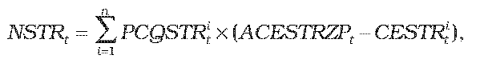

- kde

- 1.

- n - je počet regionálnych distribučných sústav v roku t,

- 2.

- PCQSTRit - je plánované množstvo strát elektriny v sústave i-tého prevádzkovateľa regionálnej distribučnej sústavy v jednotkách množstva elektriny na rok t,

- 3.

- ACESTRZPt - je určená cena elektriny na straty, ktorou je aritmetický priemer cien elektriny základného pásma na obdobie od 1. januára do 31. decembra roku t na účely pokrytia strát všetkých prevádzkovateľov regionálnych distribučných sústav bez nákladov na odchýlku; ceny elektriny základného pásma na účely pokrytia strát pre prevádzkovateľov regionálnych distribučných sústav v eurách na jednotku množstva elektriny na rok t sú schválené alebo určené úradom v cenovom konaní za prístup do distribučnej sústavy a distribúciu elektriny,

- 4.

- CESTRit - je cena elektriny na straty i-tého prevádzkovateľa regionálnej distribučnej sústavy bez nákladov na odchýlku schválená alebo určená cenovým rozhodnutím za prístup do distribučnej sústavy a distribúciu elektriny v eurách na jednotku množstva elektriny na rok t,“.

- 16. V § 14 ods. 1 písm. b) sa slová „ktorý sa vypočíta podľa vzorca“ nahrádzajú slovami „ktorý sa na roky 2013 a 2014 vypočíta podľa vzorca“.

- 17. V § 14 ods. 1 písm. b) sa na konci čiarka nahrádza bodkočiarkou a pripájajú sa tieto slová: „na rok t nasledujúci po roku 2014 sa KSTRt vypočíta podľa vzorca

- 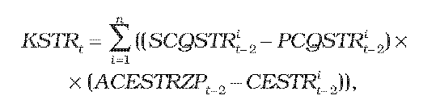

- kde

  - 6. n – je počet regionálnych distribučných sústav v roku t-2,

  - 7. PCQSTRit-2– je plánované množstvo strát elektriny v sústave i-tého prevádzkovateľa regionálnej distribučnej sústavy v jednotkách množstva elektriny na rok t-2,

  - 8. SCQSTRit-2– je skutočné množstvo strát elektriny v sústave i-tého prevádzkovateľa regionálnej distribučnej sústavy v jednotkách množstva elektriny v roku t-2,

  - 9. ACESTRZPt-2– je určená cena elektriny na straty základného pásma na obdobie od 1. januára do 31. decembra roku t-2, ktorou je aritmetický priemer cien elektriny na účely pokrytia strát všetkých prevádzkovateľov regionálnych distribučných sústav bez nákladov na odchýlku; ceny elektriny základného pásma na účely pokrytia strát pre prevádzkovateľov regionálnych distribučných sústav v eurách na jednotku množstva elektriny na rok t-2 sú schválené alebo určené úradom v rámci cenového konania za prístup do distribučnej sústavy a distribúciu elektriny,

  - 10. CESTRit-2 – je cena elektriny na účely pokrytia strát i-tého prevádzkovateľa regionálnej distribučnej sústavy bez nákladov na odchýlku schválená alebo určená cenovým rozhodnutím za prístup do distribučnej sústavy a distribúciu elektriny v eurách na jednotku množstva elektriny na rok t-2,“.

- 18. V § 14 ods. 1 písm. c) štvrtom bode sa za slová „plánované množstvo elektriny“ vkladajú slová „, na ktoré je možné uplatniť doplatok,“.

- 19. V § 14 ods. 1 písm. c) šiestom bode sa slovo „ACESTRt“ nahrádza slovom „ACESTRZPt“.

- 20. V § 14 ods. 1 písm. c) siedmom bode sa za slová „plánované množstvo elektriny“ vkladajú slová „, na ktoré je možné uplatniť doplatok,“.

- 21. V § 14 ods. 1 písm. c) deviatom bode sa slovo „ACESTRt“ nahrádza slovom „ACESTRZPt“.

- 22. V § 14 ods. 1 písm. d) štvrtom bode sa za slová „plánované množstvo elektriny“ vkladajú slová „, na ktoré je možné uplatniť doplatok,“.

- 23. V § 14 ods. 1 písm. d) šiestom bode sa za slová „skutočné množstvo elektriny“ vkladajú slová „, na ktoré je možné uplatniť doplatok,“.

- 24. V § 14 ods. 1 písm. d) ôsmom bode sa slovo „ACESTRt-2“ nahrádza slovom „ACESTRZPt-2“.

- 25. V § 14 ods. 1 písm. d) deviatom bode sa za slová „plánované množstvo elektriny“ vkladajú slová „, na ktoré je možné uplatniť doplatok,“.

- 26. V § 14 ods. 1 písm. d) jedenástom bode sa za slová „skutočné množstvo elektriny“ vkladajú slová „, na ktoré je možné uplatniť doplatok,“.

- 27. V § 14 ods. 1 písm. d) trinástom bode sa slovo „ACESTRt-2“ nahrádza slovom „ACESTRZPt-2“.

- 28. V § 14 ods. 1 písm. d) sa na konci pripájajú tieto slová: „pri výpočte KDOPt sa na roky 2013 a 2014 zohľadní hodnota ceny elektriny na straty určená na roky 2011 a 2012,“.

- 29. V § 14 ods. 1 písm. e) vzorec znie:

- 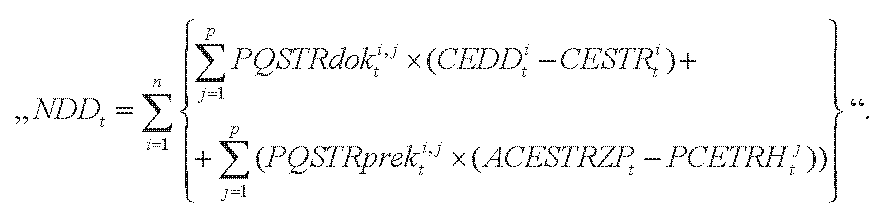

- 30. V § 14 ods. 1 sa písmeno e) dopĺňa ôsmym bodom, ktorý znie:

- „8.

- ACESTRZPt – je určená cena elektriny na straty, ktorou je aritmetický priemer cien elektriny základného pásma na obdobie od 1. januára do 31. decembra roku t na účely pokrytia strát všetkých prevádzkovateľov regionálnych distribučných sústav bez nákladov na odchýlku; ceny elektriny základného pásma na účely pokrytia strát pre prevádzkovateľov regionálnych distribučných sústav v eurách na jednotku množstva elektriny na rok t sú schválené alebo určené úradom v cenovom konaní za prístup do distribučnej sústavy a distribúciu elektriny,“.

- 31. V § 14 ods. 1 písm. f) vzorec znie:

- 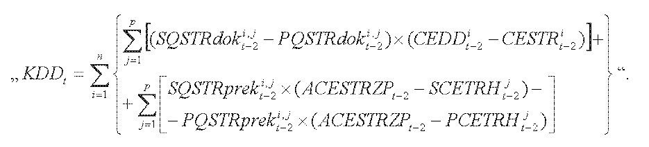

- 32. V § 14 ods. 1 sa písmeno f) dopĺňa jedenástym bodom, ktorý znie:

- „11.

- ACESTRZPt-2 – je určená cena elektriny na straty, ktorou je aritmetický priemer cien elektriny základného pásma na obdobie od 1. januára do 31. decembra roku t-2 na účely pokrytia strát všetkých prevádzkovateľov regionálnych distribučných sústav bez nákladov na odchýlku; ceny elektriny základného pásma na účely pokrytia strát pre prevádzkovateľov regionálnych distribučných sústav v eurách na jednotku množstva elektriny na rok t-2 sú schválené alebo určené úradom v cenovom konaní za prístup do distribučnej sústavy a distribúciu elektriny,“.

- 33. V § 14 ods. 1 písmená g) a h) znejú:

- „g)

- NODt – sú plánované náklady v eurách na rok t súvisiace s odchýlkou spôsobenou odberom elektriny na účel pokrytia strát elektriny v regionálnych distribučných sústavách zo zariadení výrobcov elektriny, ktorí majú právo na uplatnenie podpory prevzatím zodpovednosti za odchýlku, vypočítané podľa vzorca

- 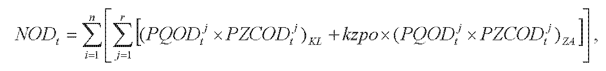

- kde

- 1.

- n – je počet regionálnych distribučných sústav v roku t,

- 2.

- r – je počet štvrťhodín v roku t,

- 3.

- PQODtj– je plánovaná schválená alebo určená odchýlka subjektu zúčtovania v jednotkách množstva elektriny v j-tej štvrťhodine roku t súvisiaca s odberom elektriny i-tého prevádzkovateľa regionálnej distribučnej sústavy zo zariadení výrobcov elektriny, ktorí majú právo na uplatnenie podpory prevzatím zodpovednosti za odchýlku; subjektom zúčtovania je subjekt, ktorý prevzal zodpovednosť za odchýlku i-tého prevádzkovateľa regionálnej distribučnej sústavy,

- 4.

- PZCODtj –je plánovaná schválená alebo určená zúčtovacia cena odchýlky v eurách na jednotku množstva elektriny v j-tej štvrťhodine roku t; PZCODtj sa rovná na obdobie január až september roku t hodnotám za obdobie január až september roku t-1 a na obdobie október až december roku t sa primerane použijú hodnoty z obdobia október až december roku t-2,

- 5.

- kzpo – je plánovaný určený koeficient zápornej platby za odchýlku na rok t,

- 6.

- KL – je parameter označujúci tie štvrťhodiny, v ktorých je súčin PQODtjaPZCODtj kladný alebo rovný nule,

- 7.

- ZA – je parameter označujúci tie štvrťhodiny, v ktorých je súčin PQODtj a PZCODtj záporný,

- h)

- KNODt– je korekčný faktor nákladov v eurách na rok t súvisiacich s odchýlkou spôsobenou odberom elektriny na účel pokrytia strát elektriny v regionálnych distribučných sústavách zo zariadení výrobcov elektriny, ktorí majú právo na uplatnenie podpory prevzatím zodpovednosti za odchýlku; KNODtsa na rok t = 2013 vypočíta podľa vzorca

- 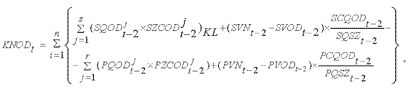

- kde

- 1.

- n – je počet regionálnych distribučných sústav v roku t-2,

- 2.

- s – je počet štvrťhodín v roku t-2,

- 3.

- SQODt-2j – je skutočná schválená alebo určená odchýlka subjektu zúčtovania v jednotkách množstva elektriny v j-tej štvrťhodine roku t-2 súvisiaca s odberom elektriny i-tého prevádzkovateľa regionálnej distribučnej sústavy zo zariadení výrobcov elektriny, ktorí majú právo na uplatnenie podpory prevzatím zodpovednosti za odchýlku,

- 4.

- SZCODt-2j– je skutočná schválená alebo určená zúčtovacia cena odchýlky v eurách na jednotku množstva elektriny v j-tej štvrťhodine roku t-2 stanovená zúčtovateľom odchýlok,

- 5.

- SVNt-2 – sú skutočné viacnáklady v eurách na rok t-2 uplatnené zúčtovateľom odchýlok subjektu zúčtovania, ktorý prevzal zodpovednosť za odchýlku i-tého prevádzkovateľa regionálnej distribučnej sústavy,

- 6.

- SVODt-2 – je skutočný celkový výnos za odchýlku v eurách na rok t-2 uplatnený subjektom zúčtovania zúčtovateľovi odchýlok; subjektom zúčtovania je subjekt, ktorý prevzal zodpovednosť za odchýlku i-tého prevádzkovateľa regionálnej distribučnej sústavy,

- 7.

- SCQODt-2 – je skutočná celková odchýlka v jednotkách množstva elektriny na rok t-2 súvisiaca s odberom elektriny i-tého prevádzkovateľa regionálnej distribučnej sústavy zo zariadení výrobcov elektriny, ktorí majú právo na uplatnenie podpory prevzatím zodpovednosti za odchýlku, vypočítaná podľa vzorca

- 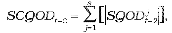

- kde

- 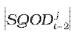 – je absolútna hodnota skutočnej odchýlky subjektu zúčtovania v jednotkách množstva elektriny v j-tej štvrťhodine roku t-2 súvisiacej s odberom elektriny i-tého prevádzkovateľa regionálnej distribučnej sústavy zo zariadení výrobcov elektriny, ktorí majú právo na uplatnenie podpory prevzatím zodpovednosti za odchýlku; subjektom zúčtovania je subjekt, ktorý prevzal zodpovednosť za odchýlku i-tého prevádzkovateľa regionálnej distribučnej sústavy,

- 8.

- SQSZt-2 – je skutočné množstvo dodávky elektriny subjektu zúčtovania v jednotkách množstva elektriny na rok t-2 pozostávajúce zo súčtu absolútnych hodnôt dodanej a odobratej elektriny týmto subjektom zúčtovania, ktorý prevzal zodpovednosť za odchýlku i-tého prevádzkovateľa regionálnej distribučnej sústavy,

- 9.

- r – je počet štvrťhodín v roku t-2, počas ktorých je súčin plánovanej odchýlky subjektu zúčtovania v j-tej štvťhodine roku t-2 v MWh a plánovanej zúčtovacej ceny odchýlky určenej zúčtovateľom odchýlok v j-tej štvťhodine roku t-2 kladný; subjektom zúčtovania je subjekt, ktorý prevzal zodpovednosť za odchýlku i-tého prevádzkovateľa regionálnej distribučnej sústavy,

- 10.

- PQODt-2j– je plánovaná schválená alebo určená odchýlka subjektu zúčtovania v jednotkách množstva elektriny v j-tej štvrťhodine roku t-2 súvisiaca s odberom elektriny i-tého prevádzkovateľa regionálnej distribučnej sústavy zo zariadení výrobcov elektriny, ktorí majú právo na uplatnenie podpory prevzatím zodpovednosti za odchýlku,

- 11.

- PZCODt-2j –je plánovaná schválená alebo určená zúčtovacia cena odchýlky v eurách na jednotku množstva elektriny v j-tej štvrťhodine roku t-2 stanovená zúčtovateľom odchýlok,

- 12.

- PVNt-2 – sú plánované viacnáklady v eurách na rok t-2 uplatnené zúčtovateľom odchýlok subjektu zúčtovania, ktorý prevzal zodpovednosť za odchýlku i-tého prevádzkovateľa regionálnej distribučnej sústavy,

- 13.

- PVODt-2 – je plánovaný celkový výnos za odchýlku v eurách na rok t-2 uplatnený subjektom zúčtovania zúčtovateľovi odchýlok; subjektom zúčtovania je subjekt, ktorý prevzal zodpovednosť za odchýlku i-tého prevádzkovateľa regionálnej distribučnej sústavy,

- 14.

- PCQODt-2 – je plánovaná celková odchýlka v jednotkách množstva elektriny na rok t-2 súvisiaca s odberom elektriny i-tého prevádzkovateľa regionálnej distribučnej sústavy zo zariadení výrobcov elektriny, ktorí majú právo na uplatnenie podpory prevzatím zodpovednosti za odchýlku, vypočítaná podľa vzorca

- 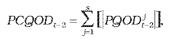

- kde

- 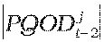 – je absolútna hodnota plánovanej odchýlky subjektu zúčtovania v jednotkách množstva elektriny v j-tej štvrťhodine roku t-2 súvisiacej s odberom elektriny i-tého prevádzkovateľa regionálnej distribučnej sústavy zo zariadení výrobcov elektriny, ktorí majú právo na uplatnenie podpory prevzatím zodpovednosti za odchýlku; subjektom zúčtovania je subjekt, ktorý prevzal zodpovednosť za odchýlku i-tého prevádzkovateľa regionálnej distribučnej sústavy,

- 15.

- PQSZt-2 – je plánované množstvo dodávky elektriny subjektu zúčtovania v jednotkách množstva elektriny na rok t-2 pozostávajúce zo súčtu absolútnych hodnôt dodanej a odobratej elektriny týmto subjektom zúčtovania, ktorý prevzal zodpovednosť za odchýlku i-tého prevádzkovateľa regionálnej distribučnej sústavy; a na rok t nasledujúci po roku 2013 sa KNODtvypočíta podľa vzorca

- 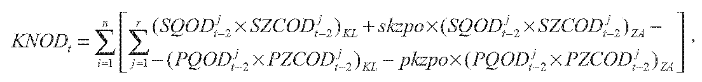

- kde

- 16.

- n – je počet regionálnych distribučných sústav v roku t,

- 17.

- r – je počet štvrťhodín v roku t,

- 18.

- SQODt-2j– je skutočná schválená alebo určená odchýlka subjektu zúčtovania v jednotkách množstva elektriny v j-tej štvrťhodine roku t-2 súvisiaca s odberom elektriny i-tého prevádzkovateľa regionálnej distribučnej sústavy zo zariadení výrobcov elektriny, ktorí majú právo na uplatnenie podpory prevzatím zodpovednosti za odchýlku; subjektom zúčtovania je subjekt, ktorý prevzal zodpovednosť za odchýlku i-tého prevádzkovateľa regionálnej distribučnej sústavy,

- 19.

- SZCODt-2j–je skutočná schválená alebo určená zúčtovacia cena odchýlky v eurách na jednotku množstva elektriny v j-tej štvrťhodine roku t-2,

- 20.

- PQODt-2j– je plánovaná schválená alebo určená odchýlka subjektu zúčtovania v jednotkách množstva elektriny v j-tej štvrťhodine roku t-2 súvisiaca s odberom elektriny i-tého prevádzkovateľa regionálnej distribučnej sústavy zo zariadení výrobcov elektriny, ktorí majú právo na uplatnenie podpory prevzatím zodpovednosti za odchýlku; subjektom zúčtovania je subjekt, ktorý prevzal zodpovednosť za odchýlku i-tého prevádzkovateľa regionálnej distribučnej sústavy,

- 21.

- PZCODt-2j– je plánovaná schválená alebo určená zúčtovacia cena odchýlky v eurách na jednotku množstva elektriny v j-tej štvrťhodine roku t-2 použitá na výpočet NOD na rok t-2,

- 22.

- skzpo – je skutočný určený koeficient zápornej platby za odchýlku za rok t-2, ktorý sa určí ako aritmetický priemer mesačných koeficientov zápornej platby za odchýlku na konečný prepočet vyhodnotenia odchýlky použitých organizátorom krátkodobého trhu s elektrinou v roku t-2,

- 23.

- KL – je parameter označujúci tie štvrťhodiny, v ktorých je súčin PQODt-2ja PZCODt-2j kladný alebo rovný nule,

- 24.

- ZA – je parameter označujúci tie štvrťhodiny, v ktorých je súčin PQODt-2ja PZCODt-2j záporný.“.

- 34. V § 15 ods. 2 písmeno h) znie:

- „h)

- skutočné výnosy v eurách v roku t-1 z uplatnenia úhrad nákladov prevádzkovateľmi distribučných sústav, výrobcami elektriny a koncovými odberateľmi elektriny za pripojenie do prenosovej sústavy.“.

- 35. V § 16 ods. 1 vzorec pre výpočet CPt znie:

- 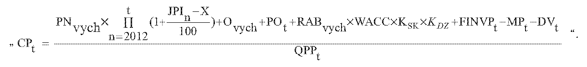

- 36. V § 16 ods. 1 písmeno e) znie:

- „e)

- POt – sú plánované schválené alebo určené odpisy v eurách na rok t súvisiace s regulovanou činnosťou vypočítané na základe dôb technických životností tried aktív nevyhnutne využívaných na regulovanú činnosť podľa prílohy č. 1 tabuľky č. 3 z plánovaných hodnôt schválených alebo určených investícií v eurách zaradených v roku t-1 do hodnoty regulačnej bázy aktív nevyhnutne využívaných na regulovanú činnosť,“.

- 37. V § 16 ods. 1 písmeno j) znie:

- „j)

- FINVPt – je faktor investícií v eurách na rok t; FINVPt sa na roky 2012 a 2013 rovná nule a na roky 2014 až 2016 sa vypočíta podľa vzorca

- FINVPt = SOt-2 – POt-2 ,

- kde

- 1.

- SOt-2– sú skutočné schválené alebo určené odpisy v eurách na rok t-2 súvisiace s regulovanou činnosťou vypočítané na základe dôb technických životností tried aktív nevyhnutne využívaných na regulovanú činnosť podľa prílohy č. 1 tabuľky č. 3 zo skutočných hodnôt schválených alebo určených investícií v eurách zaradených v roku t-3 do hodnoty regulačnej bázy aktív nevyhnutne využívaných na regulovanú činnosť,

- 2.

- POt-2 – sú plánované schválené alebo určené odpisy v eurách na rok t-2 súvisiace s regulovanou činnosťou vypočítané na základe dôb technických životností tried aktív nevyhnutne využívaných na regulovanú činnosť podľa prílohy č. 1 tabuľky č. 3 z plánovaných hodnôt schválených alebo určených investícií v eurách zaradených v roku t-3 do hodnoty regulačnej bázy aktív nevyhnutne využívaných na regulovanú činnosť,“.

- 38. V § 16 ods. 1 sa vypúšťa písmeno n).

- 39. V § 16 ods. 3 sa číslo „0,6“ nahrádza číslom „0,8“ a číslo „0,4“ sa nahrádza číslom „0,2“.

- 40. V § 17 ods. 2 písm. b) vzorec znie:

- 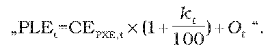

- 41. V § 17 ods. 2 písm. b) prvý bod znie:

- „1.

- CEPXE,t– je aritmetický priemer denných cien oficiálneho kurzového lístka, zverejneného burzou PXE (POWER EXCHANGE CENTRAL EUROPE) na jej webovom sídle, produktu F PXE CZ BL Cal-t v eurách na jednotku množstva elektriny za obdobie od 1. januára roku t-1 do 30. júna roku t-1,“.

- 42. V § 17 ods. 2 písm. b) druhom bode sa číslo „15“ nahrádza číslom „12“.

- 43. V § 18 ods. 2 písm. e) sa slová „určený cenovým rozhodnutím v rozsahu 0 až 0,9“ nahrádzajú slovami „, ktorého hodnota je 0,95“.

- 44. V § 20 ods. 1 písmeno f) znie:

- „f)

- PODispt– sú plánované schválené alebo určené odpisy v eurách na rok t súvisiace s dispečerskou činnosťou vypočítané na základe dôb technických životností tried aktív nevyhnutne využívaných na regulovanú činnosť podľa prílohy č. 1 tabuľky č. 3 z plánovaných hodnôt schválených alebo určených investícií v eurách zaradených v roku t-1 do hodnoty regulačnej bázy aktív nevyhnutne využívaných na dispečerskú činnosť,“.

- 45. V § 20 ods. 1 písmeno i) znie:

- „i)

- FINVDispt – je faktor investícií v eurách na rok t; FINVDispt sa na roky 2012 a 2013 rovná nule a na roky 2014 až 2016 sa vypočíta podľa vzorca FINVDispt = SODispt-2 – PODispt-2 ,

- kde

- 1.

- SODispt-2– sú skutočné schválené alebo určené odpisy v eurách na rok t-2 súvisiace s dispečerskou činnosťou vypočítané na základe dôb technických životností tried aktív nevyhnutne využívaných na regulovanú činnosť podľa prílohy č. 1 tabuľky č. 3 zo skutočných hodnôt schválených alebo určených investícií v eurách zaradených v roku t-3 do hodnoty regulačnej bázy aktív nevyhnutne využívaných na dispečerskú činnosť,

- 2.

- PODispt-2 – sú plánované schválené alebo určené odpisy v eurách na rok t-2 súvisiace s dispečerskou činnosťou vypočítané na základe dôb technických životností tried aktív nevyhnutne využívaných na regulovanú činnosť podľa prílohy č. 1 tabuľky č. 3 z plánovaných hodnôt schválených alebo určených investícií v eurách zaradených v roku t-3 do hodnoty regulačnej bázy aktív nevyhnutne využívaných na dispečerskú činnosť,“.

- 46. V § 20 ods. 2 vzorec znie:

- „KSt=SVSTt-2– SSTt-2 – (1– s) × (SPSt-2 – PPSt–2) – Naukct–2– CVt–2+ 0,5 × GCCt–2“.

- 47. V § 20 ods. 2 písmeno a) znie:

- „a)

- SVSTt-2 – je celkový skutočný výnos v eurách v roku t-2 z platieb za systémové služby vybratý od prevádzkovateľov distribučnej sústavy a od koncových odberateľov elektriny priamo pripojených do prenosovej sústavy,“.

- 48. V § 20 sa odsek 2 dopĺňa písmenom h), ktoré znie:

- „h)

- GCCt-2 – je skutočný dopad z regulačnej elektriny obstaranej v rámci systému GCC v eurách v roku t-2; GCCt-2 za rok 2011 sa rovná nule a za roky 2012 až 2014 sa vypočíta podľa vzorca GCCt-2 = VGCCt-2 – NGCCt-2 + VREGCCt-2 – NREGCCt-2 ,

- kde

- 1.

- VGCCt-2– sú skutočné výnosy prevádzkovateľa prenosovej sústavy za predaj regulačnej elektriny obstaranej automatickou aktiváciu regulačnej elektriny s parametrami sekundárnej regulácie výkonu prostredníctvom riadiaceho informačného systému dispečingu prevádzkovateľa prenosovej sústavy v spolupráci so susednými prevádzkovateľmi prenosových sústav v rámci systému GCC v eurách v roku t-2,

- 2.

- NGCCt-2 – sú skutočné náklady prevádzkovateľa prenosovej sústavy na nákup regulačnej elektriny obstaranej automatickou aktiváciu regulačnej elektriny s parametrami sekundárnej regulácie výkonu prostredníctvom riadiaceho informačného systému dispečingu prevádzkovateľa prenosovej sústavy v spolupráci so susednými prevádzkovateľmi prenosových sústav v rámci systému GCC v eurách v roku t-2,

- 3.

- VREGCCt-2 - sú skutočné výnosy prevádzkovateľa prenosovej sústavy ako dodávateľa regulačnej elektriny typu sekundárnej regulácie výkonu obstaranej prevádzkovateľom prenosovej sústavy v systéme GCC v eurách v roku t-2,

- 4.

- NREGCCt-2 – sú skutočné náklady prevádzkovateľa prenosovej sústavy ako dodávateľa regulačnej elektriny typu sekundárnej regulácie výkonu obstaranej prevádzkovateľom prenosovej sústavy v systéme GCC v eurách v roku t-2.“.

- 49. V § 20 ods. 3 písm. e) sa slová „určený cenovým rozhodnutím v rozsahu 0 až 0,9“ nahrádzajú slovami „, ktorého hodnota je 0,95“.

- 50. V § 23 ods. 1 vzorec na výpočet CDHN,tznie:

- „CDHN,t = CDEHN,t + CPDHN,t“.

- 51. V § 23 ods. 1 sa vypúšťa písmeno c).

- 52. V § 24 ods. 3 vzorec znie:

- 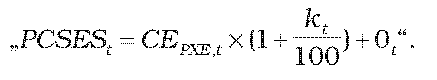

- 53. V § 24 ods. 3 písm. b) prvý bod a druhý bod znejú:

- „1.

- CEPXE,t– je aritmetický priemer denných cien oficiálneho kurzového lístka, zverejneného burzou PXE (POWER EXCHANGE CENTRAL EUROPE) na jej webovom sídle, produktu F PXE CZ BL Cal-t v eurách na jednotku množstva elektriny za obdobie od 1. januára roku t-1 do 30. júna roku t-1,

- 2.

- kt – je koeficient na rok t v percentách, ktorého hodnota je 10 % na rok 2013, 9 % na rok 2014, 8 % na rok 2015 a 7 % na rok 2016,“.

- 54. V § 24 ods. 5 tabuľka znie:

- „

- | Regionálna distribučná sústava |

- | PPSCHN | XSHN,n

- VVN | 0,878 % | 0,1 %

- VN | 3,692 % | 1,5 %

- NN | 12,504 % | 5,0 %

- “.

- 55. V § 25 ods. 1 vzorec znie:

- 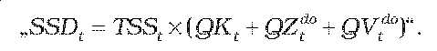

- 56. V § 25 ods. 1 sa vypúšťajú písmená c) a f).

- Doterajšie písmená d) a e) sa označujú ako písmená c) a d).

- 57. V § 28 ods. 1 vzorec znie:

- 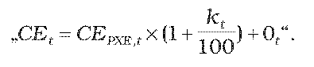

- 58. V § 28 ods. 1 písmeno a) znie:

- „a)

- CEPXE,t– je aritmetický priemer denných cien oficiálneho kurzového lístka, zverejneného burzou PXE (POWER EXCHANGE CENTRAL) na jej webovom sídle, produktu F PXE CZ BL Cal-t v eurách na jednotku množstva elektriny za obdobie od 1. januára roku t-1 do 30. júna roku t-1,“.

- 59. V § 28 ods. 2 písm. a) sa číslo „0,70“ nahrádza číslom „0,65“.

- 60. V § 28 ods. 3 písm. a) sa číslo „0,70“ nahrádza číslom „0,65“.

- 61. V § 31 ods. 1 písm. g) sa slová „t-1“ nahrádzajú slovami „t-2“ a slová „rok 2012 rovná nule“ sa nahrádzajú slovami „roky 2012 a 2013 rovná nule“.

- 62. V § 31 ods. 1 písm. h) prvom bode sa slová „tarify za systémové služby a tarify za prevádzkovanie systému“ nahrádzajú slovami „tarify za systémové služby, tarify za prevádzkovanie systému a efektívnej sadzby45)“.

- 63. V § 31 ods. 1 písm. h) druhom bode sa slová „tarify za systémové služby a tarify za prevádzkovanie systému“ nahrádzajú slovami „tarify za systémové služby, tarify za prevádzkovanie systému a efektívnej sadzby45)“.

- 64. V § 31 ods. 4 písm. a) vzorec znie:

- 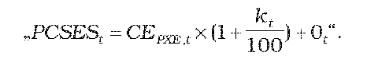

- 65. V § 31 ods. 4 písm. a) prvý bod znie:

- „1.

- CEPXE,t– je aritmetický priemer denných cien oficiálneho kurzového lístka, zverejneného burzou PXE (POWER EXCHANGE CENTRAL EUROPE) na jej webovom sídle, produktu F PXE CZ BL Cal-t v eurách na jednotku množstva elektriny za obdobie od 1. januára roku t-1 do 30. júna roku t-1,“.

- 66. § 31 sa dopĺňa odsekom 6, ktorý znie:

- „(6)

- Hodnota percenta strát pri distribúcii elektriny na príslušnej napäťovej úrovni PPSCHNsa pre miestnu distribučnú sústavu, ktorá je rozlohou porovnateľná s regionálnou distribučnou sústavou, určí individuálne.“.

- 67. V § 39 ods. 1 písmeno d) znie:

- „d)

- ko – je koeficient výšky spoluúčasti žiadateľa o pripojenie, ktorého hodnota sa rovná

- 1.

- 0,5, ak je žiadateľom o pripojenie odberateľ elektriny,

- 2.

- 1,0, ak je žiadateľom o pripojenie výrobca elektriny okrem výrobcu elektriny podľa tretieho bodu,

- 3.

- 0,98, ak je žiadateľom o pripojenie výrobca elektriny z obnoviteľných zdrojov energie alebo kombinovanou výrobou,

- 4.

- 0,50, ak je žiadateľom o pripojenie osoba, ktorej zariadenie na výrobu elektriny je pripojené do sústavy cez existujúce odberné miesto, pričom požadovaná maximálna rezervovaná kapacita pripojenia je rozdielom medzi dohodnutou maximálnou rezervovanou kapacitou pripojenia odberného miesta a skutočne využitou maximálnou rezervovanou kapacitou pripojenia, a v mieste pripojenia existujúceho odberného miesta do distribučnej sústavy je v distribučnej sústave k dispozícii požadovaná maximálna rezervovaná kapacita pre zariadenie na výrobu elektriny tak, aby nedošlo k ohrozeniu stability a bezpečnosti prevádzky distribučnej sústavy. Za skutočne využitú maximálnu rezervovanú kapacitu pripojenia sa považuje najvyššia nameraná hodnota príkonu za obdobie maximálne dvoch predchádzajúcich rokov. Ak požadovaná maximálna kapacita pripojenia pre zariadenie na výrobu elektriny prekročí maximálnu rezervovanú kapacitu dohodnutú v zmluve pre existujúce odberné zariadenie, na výpočet ceny za pripojenie pripadajúcej na rozdiel maximálnej rezervovanej kapacity pred pripojením a po pripojení zariadenia na výrobu elektriny sa použije koeficient ko podľa druhého bodu alebo tretieho bodu.“.

- 68. § 40 sa dopĺňa odsekom 3, ktorý znie:

- „(3)

- Koeficient k sa rovná 0,50, ak je žiadateľom o pripojenie osoba, ktorej zariadenie na výrobu elektriny je pripojené do sústavy cez existujúce odberné miesto, pričom požadovaná maximálna rezervovaná kapacita pripojenia je rozdielom medzi dohodnutou maximálnou rezervovanou kapacitou pripojenia odberného miesta a skutočne využitou maximálnou rezervovanou kapacitou pripojenia, a v mieste pripojenia existujúceho odberného miesta do distribučnej sústavy je v distribučnej sústave k dispozícii požadovaná maximálna rezervovaná kapacita pre zariadenie na výrobu elektriny tak, aby nedošlo k ohrozeniu stability a bezpečnosti prevádzky distribučnej sústavy. Za skutočne využitú maximálnu rezervovanú kapacitu pripojenia sa považuje najvyššia nameraná hodnota príkonu za obdobie maximálne dvoch predchádzajúcich rokov. Ak požadovaná maximálna kapacita pripojenia pre zariadenie na výrobu elektriny prekročí maximálnu rezervovanú kapacitu dohodnutú v zmluve pre existujúce odberné zariadenie, na výpočet ceny za pripojenie pripadajúcej na rozdiel maximálnej rezervovanej kapacity pred pripojením a po pripojení zariadenia na výrobu elektriny sa použije koeficient k podľa odseku 2.“.

- 69. V § 42 ods. 1 vzorec na výpočet maximálneho výnosu PPZOt znie:

- „PPZOt = PNZOt + PVAt + INVZOt – KZOt“.

- 70. V § 46 ods. 1 druhej vete sa slová „EEX (European Energy Exchange)“ nahrádzajú slovami „PXE (POWER EXCHANGE CENTRAL EUROPE)“ a slová „EEX Phelix Baseload Month Futures“ sa nahrádzajú slovami „F PXE CZ BL M“.

- 71. V § 46 ods. 2 písm. a) sa číslo „0,70“ nahrádza číslom „0,65“.

- 72. Za § 47 sa vkladá § 47a, ktorý vrátane nadpisu znie:

- 㤠47a

- Uplatnenie tarify za systémové služby a tarify za prevádzkovanie systému výrobcom elektriny

- (1)

- Tarifa za poskytovanie systémových služieb a tarifa za prevádzkovanie systému schválené alebo určené cenovým rozhodnutím pre prevádzkovateľa prenosovej sústavy alebo pre prevádzkovateľa regionálnej distribučnej sústavy, do ktorej je výrobca elektriny, ktorý je aj dodávateľom elektriny, pripojený, sa uplatňujú týmto výrobcom elektriny na všetku elektrinu ním vyrobenú a elektrinu týmto výrobcom elektriny dodanú do odberných miest odberateľov elektriny pripojených priamym vedením. Ak je výrobca elektriny pripojený do miestnej distribučnej sústavy, uplatňuje tarifu za poskytovanie systémových služieb a tarifu za prevádzkovanie systému schválenú alebo určenú pre prevádzkovateľa prenosovej sústavy alebo prevádzkovateľa regionálnej distribučnej sústavy, do ktorej je táto miestna distribučná sústava pripojená.

- (2)

- Na účely uplatnenia tarify za systémové služby a tarify za prevádzkovanie systému výrobca elektriny, ktorý je aj dodávateľom elektriny, poskytuje prevádzkovateľovi sústavy, do ktorej je tento výrobca elektriny pripojený, údaje o skutočnom množstve elektriny vyrobenej v zariadení na výrobu elektriny tohto výrobcu elektriny a dodanej odberateľom elektriny priamym vedením alebo spotrebovanej týmto výrobcom elektriny okrem elektriny spotrebovanej na vlastnú spotrebu elektriny pri výrobe elektriny, a to vždy za príslušný mesiac do siedmeho kalendárneho dňa nasledujúceho mesiaca.“.

- 73. Za § 48 sa vkladá § 48a, ktorý vrátane nadpisu znie:

- 㤠48a

- Prechodné ustanovenie k úpravám účinným od 1. júla 2012

- Podľa ustanovení účinných od 1. júla 2012 sa prvýkrát postupuje v konaniach o cenovej regulácii na rok 2013 okrem ustanovení uvedených v § 1 písm. m), § 2 ods. 1 písm. f), § 6 ods. 2, 5 a 7 písm. e), § 6 ods. 8, 9, 14 až 16, § 7 ods. 1, § 11 ods. 1 a 2, § 11a a 47a, podľa ktorých sa postupuje od 1. júla 2012.“.

- 74. V prílohe č. 2 štvrtý bod vysvetliviek k tabuľke znie:

- „4.

- Výkaz vybraných nákladov a výnosov prevádzkovateľa prenosovej sústavy

- Vybrané náklady/výnosy prevádzkovateľa prenosovej sústavy | | tisíc eur

- 1. | Náklady na nákup elektriny na krytie strát |

- 2. | Náklady na nákup elektriny na vlastnú spotrebu |

- | Nakúpené podporné služby | tisíc eur

- 1. | Primárna regulácia |

- 2. | Sekundárna regulácia |

- 3. | 30-minútová terciárna regulácia kladná |

- 4. | 30-minútová terciárna regulácia záporná |

- 5. | 3-minútová terciárna regulácia kladná |

- 6. | 3-minútová terciárna regulácia záporná |

- 7. | 10-minútová terciárna regulácia kladná |

- 8. | 10-minútová terciárna regulácia záporná |

- 9. | Zníženie odberu elektriny |

- 10. | Zvýšenie odberu elektriny |

- 11. | Regulácia napätia a jalového výkonu |

- 12. | Štart z tmy |

- 13. | Iné |

- 14. | Celkom |

- “.

- 75. V prílohe č. 2 piaty bod vysvetliviek k tabuľke znie:

- „5.

- Výkaz podporných služieb

- VPpS | Primárna regulácia | | Sekundárna regulácia | | 30-minútová terciárna regulácia kladná | | 30-minútová terciárna regulácia záporná | | 3-minútová terciárna regulácia kladná | | 3-minútová terciárna regulácia záporná |

- Dátum a čas | Objem | Priemerná cena | Objem | Priemerná cena | Objem | Priemerná cena | Objem | Priemerná cena | Objem | Priemerná cena | Objem | Priemerná cena

- | MW | euro/MW | MW | euro/MW | MW | euro/MW | MW | euro/MW | MW | euro/MW | MW | euro/MW

- dd.mm.hh | | | | | | | | | | | |

- dd.mm.hh | | | | | | | | | | | |

- VPpS | 10-minútová terciárna regulácia kladná | | 10-minútová terciárna regulácia záporná | | Zníženie odberu elektriny | | Zvýšenie odberu elektriny |

- Dátum a čas | Objem | Priemerná cena | Objem | Priemerná cena | Objem | Priemerná cena | Objem | Priemerná cena

- | MW | euro/MW | MW | euro/MW | MW | euro/MW | MW | euro/MW

- dd.mm.hh | | | | | | | |

- dd.mm.hh | | | | | | | |

- dd.mm.hh znamená deň, mesiac, hodina

- Vo výkaze podporných služieb sa uvádzajú nakúpené objemy (MW) a priemerné ceny (euro/MW) pre jednotlivé typy podporných služieb v jednotlivých hodinách mesiaca. Priemerná cena sa vypočíta ako priemerná cena nakúpených podporných služieb pre danú hodinu.“.

- 76. V prílohe č. 6 treťom bode vysvetliviek k tabuľke sa vypúšťa šiesty riadok tabuľky.
