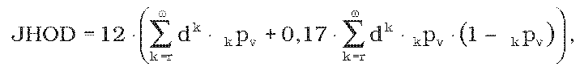
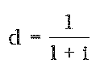

Príloha k nariadeniu vlády č. 200/2012 Z. z.

- VZOREC NA VÝPOČET JEDNOTKOVEJ HODNOTY ODLOŽENÉHO STAROBNÉHO DÔCHODKU

  - Jednotková hodnota odloženého starobného dôchodku (JHOD) sa vypočíta podľa vzorca

- 

  - kde

  - v je vek v celých rokoch, ktorý žiadateľ dosiahol ku dňu rozhodujúcemu na výpočet,

  - r je rozdiel medzi dôchodkovým vekom žiadateľa a vekom, ktorý žiadateľ dosiahol v celých rokoch ku dňu rozhodujúcemu na výpočet; ak vek žiadateľa dosiahnutý v celých rokoch ku dňu rozhodujúcemu na výpočet JHOD bude vyšší ako dôchodkový vek žiadateľa, potom r = 0,

  - ω je najvyšší vek uvedený v úmrtnostných tabuľkách,

  - kpv je pravdepodobnosť, že osoba, ktorá sa dožila veku v, sa dožije veku v + k, pričom táto pravdepodobnosť sa určí podľa úmrtnostných tabuliek,

-  je diskontný faktor zodpovedajúci maximálnej technickej úrokovej miere,1)

  - koeficient 0,17 je súčin pravdepodobnosti poskytnutia pozostalostného dôchodku a jeho výšky v porovnaní so starobným dôchodkom.

  - Na určenie pravdepodobnosti kpv sa použijú úmrtnostné tabuľky vykázané Štatistickým úradom Slovenskej republiky za kalendárny rok, ktorý dva roky predchádza rozhodujúcemu dňu.
