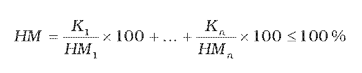

Príloha č. 1 k vyhláške č. 212/2012 Z. z.

- Zložky, ktoré možno pridávať do tabakovej suroviny a pri výrobe jednotlivých kategórií zložiek

  - ČASŤ A Zložky všeobecne použiteľné Por. čís. | Zložka | CE1) | E2) | Najvyššie prípustné množstvo v hmotnostných percentách | Požiadavky na čistotu zložky | |

  - 1. | Aromatické zložky a chuťové zložky prírodného pôvodu alebo chemicky zhodné so zložkami prírodného pôvodu vhodné na ľudskú výživu, ktoré sú medzinárodne registrované | | | | | |

  - 2. | Etylvanilín | 108 | | | | |

  - 3. | Alylfenoxyacetát | | | | | |

  - 4. | Anizylacetón | 163 | | | | |

  - 5. | Hydroxycitronellal | 100 | | | | |

  - 6. | Hydroxycitronellal- dietylacetát | 44 | | | | |

  - 7. | Hydroxycitronellaldi- metylacetát | 45 | | | | |

  - 8. | Beta-naftolketón | 147 | | | | |

  - 9. | 2-fenylpropiónaldehyd | | | | | |

  - 10. | Piperonylizobutyrát | 305 | | | | |

  - 11. | Propenylguaetol | 170 | | | | |

  - 12. | Chlorid amónny | | | | | |

  - 13. | Alfa-amylškoricový aldehyd | | | | | |

  - 14. | Vanilín acetát | | | | | |

  - 15. | Metyheptínkarbonát | 481 | | | | |

  - 16. | 6-metylkumarín | | | | | |

  - 17. | Maltol | 148 | | | | |

  - 18. | Etylmaltol | 692 | | | | |

  - 19. | Zložky od prírody obsiahnuté v tabaku | | | | | |

  - 20. | Ovocie, sušené ovocie, ovocná dužina, ovocná šťava, koncentrovaná ovocná šťava a ovocný sirup | | | | | |

  - 21. | Koreniny okrem rastlín alebo časti rastlín uvedených v prílohe č. 2 | | | | | |

  - 22. | Sladké drievko (Liguiritiae radix) | | | | | |

  - 23. | Šťava zo sladkého dreva (Lekorica) | | | | | |

  - 24. | Káva, kávoviny a výrobky z nich | | | | | |

  - 25. | Čaj a výrobky obdobné čaju | | | | | |

  - 26. | Kakao a výrobky z kakaa | | | | | |

  - 27. | Liehoviny | | | | | |

  - 28. | Víno aj likérové, dezertné a ovocné | | | | | |

  - 29. | Med | | | | | |

  - 30. | Javorový sirup | | | | | |

  - 31. | Cukry vhodné na ľudskú výživu, aj karamelizované | | | | | |

  - 32. | Dextríny | | | | | |

  - 33. | Melasa | | | | | |

  - 34. | Pektíny | 440 | | | | |

  - 35. | Škroby aj modifikované chemicky alebo fyzikálne | 1400 – 1450 | | | | |

  - 36. | Jedlá soľ | | | | | |

  - 37. | Kyseliny: octová | 260 | | | | |

  - | citrónová | 330 | | | | |

  - | jablčná | 296 | | | | |

  - | vínna | 334 | | | | |

  - | mliečna | 270 | | | | |

  - | jantárová | 363 | | | | |

  - 38. | Pitná voda | | | | | |

  - 39. | Kyselina L-askorbová | 300 | | | | |

  - 40. | Aromatické prípravky získané záhrevom východiskových látok pri teplote nepresahujúcej 180°C, pričom jedna z východiskových látok je s funkčnou aminoskupinou a ďalšia je redukujúci cukor (reakčné arómy) | | | | | |

  - ČASŤ B Zvlhčovadlá Por. čís. | | | | | Zložka | E | Najvyššie prípustné množstvo v hmotnostných percentách | Požiadavky na čistotu zložky

  - a) Fajčiarsky tabak, cigary, cigarky, cigarety, tabaková fólia a umelý obalový list cigár | | | | | | | |

  - 1. | | | | | Glycerol | 422 | 5 % sušiny výrobku |

  - 2. | | | | | Hydrogenovaný glukózový sirup | | | Číre, bezfarebné, sirupovité roztoky, pochádzajúce z glukózového sirupu, určené na ľudskú výživu a obsahujúce hydrogenované sacharidy; obsah D-sorbitu najmenej 5 % sušiny zložky.

  - 3. | | | | | 1,3 butándiol (1,3-butylénglykol) | | 5 % sušiny výrobku | Destilačné rozmedzie pri 101,3 kPa je 207 až 209 °C, index lomu pri 20 °C nD = 1,440 ±0,005; brómové číslo podľa Kleina je najviac 0,1.

  - 4. | | | | | 1,2-propándiol (1,2-propylénglykol) | 1520 | 5 % sušiny výrobku |

  - 5. | | | | | Trietylénglykol | | 5 % sušiny výrobku | Merná hmotnosť pri 20 °C je 1124 až 1126 kg.m-3; destilačné rozmedzie pri 101,3 kPa je 280 až 290 °C; index lomu pri 20 °C nD = 1,455 až 1,456; hmotnostný podiel nespáliteľného zvyšku – (popola) menej ako 0,01 %; hmotnostný podiel nespáliteľného monoetylénglykolu je menej ako 0,1 %.

  - 6. | | | | | Kyselina trihydrogénfosforečná (ortofosforečná) | 338 | 5 % sušiny výrobku |

  - 7. | | | | | Kyselina glycerolfosforečná a jej sodné, draselné a horečnaté soli | | 5 % sušiny výrobku |

  - b) Žuvací tabak a šnupavý tabak | | | | | | | |

  - 1. | | | | | Glycerol | 422 | 10 % sušiny výrobku |

  - 2. | | | | | Hydrogenovaný glukózový sirup | | | Číre, bezfarebné, sirupovité roztoky, pochádzajúce z glukózového sirupu, určené na ľudskú výživu a obsahujúce hydrogenované sacharidy; obsah D-sorbitu je najmenej 5 % sušiny zložky.

  - c) Šnupavý tabak | | | | | | | |

  - 1. | | | | | Kvapalný parafín | 905 | 25 % sušiny výrobku |

  - 2. | | | | | 1,2-propándiol (1,2 propylénglykol) | 1520 | |

  - 3. | | | | | 1,3 butándiol (1,3 butylénglykol) | | 5 % sušiny výrobku | Destilačné rozmedzie pri 101,3 kPa je 207 až 209 °C; index lomu pri 20 °C nD = 1,440 ±0,005; brómové číslo podľa Kleina najviac 0,1.

  - ČASŤ C Lepidlá, spojivá a zahusťovadlá Por. čís. | | | | | | Zložka | E | Najvyššie prípustné množstvo v hmotnostných percentách | Požiadavky na čistotu zložky | |

  - a) Cigary, cigarky, tabakový povrazec, tabaková fólia a umelý obalový list cigár a cigariek b) Zložky na výrobu lepidiel, spojív a zahusťovadiel na cigaretové záložky, filtrové prebaly, náustkové papiere a náustky c) Zložky na výrobu spojív tlačiarenských farieb a lakov na filtrové prebaly, náustkové papiere a náustky d) Zložky na výrobu cigaretového papiera | | | | | | | | | | |

  - 1. | | | | | | Želatina | 441 | | | |

  - 2. | | | | | | Šelak | 904 | | | |

  - 3. | | | | | | Kolódium | | | | |

  - 4. | | | | | | Celulózoacetát | | | | |

  - 5. | | | | | | Etylcelulóza aj hydroxyetylovaná | | | | |

  - 6. | | | | | | Metylcelulóza aj hydroxyetylovaná alebo karboxymetylovaná | 461 | | | |

  - 7. | | | | | | Karboxymetylcelulóza, aj metylovaná a ich soli: sodné, draselné, vápenaté, horečnaté | 466 | | | |

  - 8. | | | | | | Karboxymetylškrob | | | So stupňom substitúcie najviac 50 % dialdehyd škrobu vyrobeného z oxidovaného kukuričného škrobu s množstvom aldehydu najmenej 90 %. | |

  - 9. | | | | | | Mikrokryštalická celulóza | 460 | | | |

  - 10. | | | | | | Hydroxypropylcelulóza aj metylovaná | 463 | | | |

  - 11. | | | | | | Metyletylcelulóza | 465 | | | |

  - 12. | | | | | | Arabská guma | 414 | | | |

  - 13. | | | | | | Agar | 406 | | | |

  - 14. | | | | | | Kyselina algínová | 400 | | | |

  - 15. | | | | | | Algináty: | | | | |

  - | | | | | | sodný | 401 | | | |

  - | | | | | | draselný | 402 | | | |

  - | | | | | | vápenatý | 404 | | | |

  - | | | | | | horečnatý | | | | |

  - 16. | | | | | | Tragantová guma | 413 | | | |

  - 17. | | | | | | Karobová guma (svätojánsky chlieb) | 410 | | | |

  - 18. | | | | | | Guarová guma | 412 | | | |

  - 19. | | | | | | Galaktány aj modifikované | | | | |

  - 20. | | | | | | Mannány aj modifikované | | | | |

  - 21. | | | | | | Xantánová guma | 415 | | | |

  - 22. | | | | | | Karagénan (furcelaran) | 407 | | | |

  - 23. | | | | | | Polyvinylbutyrát | | | | |

  - 24. | | | | | | Acetopropionát celulózy | | | | |

  - 25. | | | | | | Izobutyrát sacharózy | | | | |

  - 26. | | | | | | Kopolyméry etylénvinylacetátu | | | | |

  - e) Cigary, cigarky, tabakový povrazec, tabaková fólia a umelý obalový list cigár a cigariek f) Zložky na výrobu lepidiel, spojív a zahusťovadiel na cigaretové záložky, filtrové prebaly, náustkové papiere a náustky | | | | | | | | | | |

  - 27. | | | | | | Lecitíny | 322 | | | |

  - 28. | | | | | | Hydroxyetylcelulóza | | | | |

  - 29. | | | | | | Acetylmetylcelulóza | | | | |

  - 30. | | | | | | Glyoxal | | 2 % sušiny výrobku | | |

  - 31. | | | | | | Melamín-formaldehy- dová živica | | 2 % sušiny výrobku | | |

  - g) Zložky na výrobu lepidiel, spojív a zahusťovadiel na cigaretové záložky, filtrové prebaly, náustkové papiere a náustky | | | | | | | | | | |

  - 32. Zmesi | | | | | | | | | | |

  - | | | | | | 1. vodných disperzií polyvinylacetátu, aj čiastočne hydrolyzované alebo z kopolymérov vinylacetátu s vinylestermi alifatických nasýtených organických kyselín s reťazcom C12 až C18 alebo s etylénom, 2. vodných roztokov polyvinylalkoholu; do týchto zmesí možno pridávať glycerolacetáty | | | | |

  - h) Fajčiarsky tabak | | | | | | | | | | |

  - 33. | | | | | | Agar | 406 | | | |

  - 34. | | | | | | Arabská guma | 414 | | | |

  - i) Žuvací tabak | | | | | | | | | | |

  - 35. | | | | | | Arabská guma | 414 | 25 % sušiny výrobku | | |

  - ČASŤ D Zložky ovplyvňujúce horenie Por. čís. | | | | | | Zložka | E | Najvyššie prípustné množstvo v hmotnostných percentách | Požiadavky na čistotu zložky | |

  - a) Cigariet, cigariek, cigár, fajčiarskeho tabaku, tabakovej fólie a umelého obalového listu cigár a cigariek b) Cigaretového papiera | | | | | | | | | | |

  - 1. | | | | | | Hydroxid hlinitý | | | | |

  - 2. | | | | | | Síran hlinitý | 520 | | | |

  - 3. | | | | | | Oxid hlinitý | | | | |

  - 4. | | | | | | Chlorid amónny | 510 | | | |

  - 5. | | | | | | Síran amónny | 517 | | | |

  - 6. | | | | | | Hydroxid vápenatý | 526 | | | |

  - 7. | | | | | | Síran vápenatý | 516 | | | |

  - 8. | | | | | | Síran draselný | 515 | | | |

  - 9. | | | | | | Oxid horečnatý | 530 | | | |

  - 10. | | | | | | Hydroxid horečnatý | 528 | | | |

  - 11. | | | | | | Síran horečnatý | 518 | | | |

  - 12. | | | | | | Hydrogénsíran sodný | 514 | | | |

  - 13. | | | | | | Mastenec | 553b | | | |

  - 14. | | | | | | Oxid titaničitý | 171 | | | |

  - 15. | | | | | | Močovina | 927b | | | |

  - 16. | | | | | | Uhličitany: sodný | 500 | | | |

  - | | | | | | draselný | 501 | | | |

  - | | | | | | vápenatý | 170 | | | |

  - | | | | | | amónny | 503 | | | |

  - 17. | | | | | | Mravčany: sodný, draselný, vápenatý, amónny | | | | |

  - 18. | | | | | | Octany: sodný | 262 | | | |

  - | | | | | | draselný | 261 | | | |

  - | | | | | | vápenatý | 263 | | | |

  - | | | | | | amónny | | | | |

  - 19. | | | | | | Jablčnany: sodný | 350 | | | |

  - | | | | | | draselný | 351 | | | |

  - | | | | | | vápenatý | 352 | | | |

  - | | | | | | amónny | | | | |

  - 20. | | | | | | Citrany: sodný | 331 | | | |

  - | | | | | | draselný | 332 | | | |

  - | | | | | | vápenatý | 333 | | | |

  - | | | | | | amónny | 380 | | | |

  - 21. | | | | | | Vínany: sodný | 335 | | | |

  - | | | | | | draselný | 336 | | | |

  - | | | | | | vápenatý | 354 | | | |

  - | | | | | | amónny | | | | |

  - 22. | | | | | | Mliečnany: sodný | 325 | | | |

  - | | | | | | draselný | 326 | | | |

  - | | | | | | vápenatý | 327 | | | |

  - | | | | | | amónny | | | | |

  - 23. | | | | | | Fosforečnany: sodný | 339 | | | |

  - | | | | | | draselný | 340 | | | |

  - | | | | | | vápenatý | 341 | | | |

  - | | | | | | amónny | | | | |

  - 24. | | | | | | Sulfamínany: sodný | | | | |

  - | | | | | | draselný | | | | |

  - | | | | | | vápenatý | | | | |

  - | | | | | | amónny | | | | |

  - 25. | | | | | | Jantárany: sodný | 363 | | | |

  - | | | | | | draselný | | | | |

  - | | | | | | vápenatý | | | | |

  - | | | | | | amónny | | | | |

  - 26. | | | | | | Aktívne uhlie (carbo medicinalis) | 153 | | | |

  - 27. | | | | | | Hlinitokremičitany prírodné a umelé – sodné, draselné, vápenaté, horečnaté, hlinité, železnaté a železité | | | | |

  - 28. | | | | | | Organické kyseliny s reťazcom C12 až C20 a ich vápenaté a draselné soli | | | | |

  - 29. | | | | | | Hydroxid amónny | 527 | | | |

  - 30. | | | | | | Hydroxid draselný | 525 | | | |

  - 31. | | | | | | Hydroxid sodný | 524 | | | |

  - 32. | | | | | | Hydrogénuhličitan sodný | 500 | | | |

  - 33. | | | | | | Oxid vápenatý | 529 | | | |

  - 34. | | | | | | Chlorid vápenatý | 509 | | | |

  - 35. | | | | | | Chlorid horečnatý | 511 | | | |

  - 36. | | | | | | Chlorid draselný | 508 | | | |

  - 37. | | | | | | Síran hlinitodraselný | 522 | | | |

  - 38. | | | | | | Vínan sodnodraselný | 337 | | | |

  - 39. | | | | | | Horečnaté soli kyseliny uhličitej, mravčej, octovej, jablčnej, citrónovej, vínnej, mliečnej, fosforečnej, sulfamínovej a jantárovej | | | | |

  - ČASŤ E Zložky pre umelý obalový list cigár a cigariek a tabakovú fóliu Por. čís. | Zložka | E | Najvyššie prípustné množstvo v hmotnostných percentách | Požiadavky na čistotu zložky

  - 1. | Celulóza obsahujúca zložky uvedené v časti C písm. a) a v časti D | | |

  - ČASŤ F Konzervačné zložky Por. čís. | | | | | Zložka | E | Najvyššie prípustné množstvo v hmotnostných percentách | Požiadavky na čistotu zložky

  - a) Na tabakovú fóliu b) Na výrobu lepidiel na cigaretové záložky | | | | | | | |

  - 1. | | | | | Kyselina sorbová a jej soli (ako kyselina sorbová): | 200 | 0,2 % sušiny výrobku |

  - | | | | | sodná | | |

  - | | | | | draselná | 202 | |

  - | | | | | vápenatá | 203 | |

  - 2. | | | | | Kyselina benzoová a jej soli (ako kyselina benzoová): | 210 | 0,5 % sušiny výrobku |

  - | | | | | sodná | 211 | |

  - | | | | | draselná | 212 | |

  - | | | | | vápenatá | 213 | |

  - 3. | | | | | Estery kyseliny para-hydroxybenzoovej a ich sodné soli (ako kyselina parahydroxy-benzoová) | 214 až 219 | 0,5 % sušiny výrobku |

  - 4. | | | | | Tiabendazol | 233 | 0,6 % sušiny výrobku |

  - 5. | | | | | Kyselina boritá a jej soli | 284 | |

  - | | | | | sodná (borax) | 285 | |

  - | | | | | draselná | | |

    - Ak sa tieto konzervačné zložky použijú vo vzájomnej zmesi, vypočíta sa najvyššie prípustné množstvo jednotlivých látok takto:

  - 

    - kde je

    - HM – najvyššie prípustné množstvo zmesi konzervačnej zložky v sušine tabakového výrobku [%],

    - K1– koncentrácia konzervačnej zložky „1“ v sušine tabakového výrobku [%],

    - HM1– najvyššie prípustné množstvo konzervačnej zložky „1“ [%],

    - Kn– koncentrácia konzervačnej zložky „n“ v sušine tabakového výrobku [%],

    - HMn.– najvyššie prípustné množstvo konzervačnej zložky „n“ [%].

  - ČASŤ G Farbivá Por. čís. | | | | | Zložka | E | Najvyššie prípustné množstvo v hmotnostných percentách | Požiadavky na čistotu zložky

  - a) Umelý obalový list cigár, cigariek a tabaková fólia b) Cigaretový papier c) Filtrové prebaly, náustkové papiere a náustky | | | | | | | |

  - 1. | | | | | Kyselina humínová a jej alkalické soli | | | Tieto zložky nesmú obsahovať extrahovateľné polycyklické aromatické uhľovodíky s tromi jadrami a viacerými jadrami.

  - 2. | | | | | Vodný extrakt z rešetliaka prečisťujúceho (Rhamnus cathartica) | | |

  - 3. | | | | | Vodný extrakt z jadrovníka kampeškovníka obyčajného (Haematoxylon campechianum) | | |

  - 4. | | | | | Vodný extrakt z maklury oranžovej (Maclura aurandiaca) | | |

  - 5. | | | | | Aktívne uhlie (carbo medinalis) | 153 | |

  - 6. | | | | | Brilantná čierna PN (BN) | 151 | |

  - 7. | | | | | Košenilová červená A | 124 | |

  - 8. | | | | | Azorubín | 122 | |

  - 9. | | | | | Žltá SY (FCF) | 110 | |

  - 10. | | | | | Oranž GGN | 111 | |

  - 11. | | | | | Indigotín | 132 | |

  - 12. | | | | | Amarant | 123 | |

  - 13. | | | | | Tartazín | 102 | |

  - 14. | | | | | Kurkumín | 100 | |

  - 15. | | | | | Riboflavín | 101 | |

  - 16. | | | | | Erytrozín | 127 | |

  - 17. | | | | | Chinolínová žltá | 104 | |

  - 18. | | | | | Patentná modrá V | 131 | |

  - 19. | | | | | Chlorofyl | 140 | |

  - | | | | | a jeho komplexy s meďou | 141 | |

  - 20. | | | | | Karamel obyčajný (cukrový kulér) | 150a | |

  - 21. | | | | | Kaustický sulfitový karamel | 159b | |

  - 22. | | | | | Amoniakový karamel | 150c | |

  - 23. | | | | | Amoniakovo sulfitový karamel | 150d | |

  - 24. | | | | | Xantofyly | 161 | |

  - 25. | | | | | Zložky uvedené v bodoch 5 až 24 a ich zlúčeniny s hliníkom,vápnikom a horčíkom (tzv. laky) | | |

  - 26. | | | | | Alazarínový alumíniový lak | | |

  - 27. | | | | | Antrachinónová modrá | 130 | |

  - 28. | | | | | Síran bárnatý (pigmentová beloba 21) | | |

  - 29. | | | | | Čierna 7984 | 152 | |

  - 30. | | | | | Uhličitan vápenatý | 170 | |

  - 31. | | | | | Chrysoin S | 103 | |

  - 32. | | | | | Košenila (karmín) | 120 | |

  - 33. | | | | | Para žltá AB | | |

  - 34. | | | | | Citrusová červená (orsille) | 121 | |

  - 35. | | | | | Ponceau 6R | 126 | |

  - 36. | | | | | Šarlátová červená (šarlat GN) | 125 | |

  - 37. | | | | | Lastúrová zlatá | | |

  - 38. | | | | | Ultramarínová modrá | | |

  - 39. | | | | | Ostatné farbivá uvedené v osobitnom predpise3) | | |

  - d) Umelý obalový list cigár, cigariek a tabaková fólia | | | | | | | |

  - 40. | | | | | Prášok z kokosovej škrupiny | | |

  - e) Žuvací tabak a šnupavý tabak | | | | | | | |

  - 41. | | | | | Síran železitý | | |

  - 42. | | | | | Tanín | | |

  - f) Šnupavý tabak | | | | | | | |

  - 43. | | | | | Oxidy železa | 172 | |

  - 44. | | | | | Aktívne uhlie (carbo medicinalis) | 153 | |

  - 45. | | | | | Indigotín | 132 | |

  - 46. | | | | | Chlorid amónny | 510 | |

  - 47. | | | | | Chlorid vápenatý | 509 | |

  - 48. | | | | | Karbamát amónny | | |

  - 49. | | | | | Uhličitan sodný | 500 | |

  - 50. | | | | | Uhličitan vápenatý | 170 | |

  - g) Filtrové prebaly, náustkové papiere a náustky | | | | | | | |

  - 51. | | | | | Zlatá fólia | 175 | |

  - 52. | | | | | Zlatý bronz (legovaný meďou a zinkom) | | | S množstvom zinku najviac 15 %.

  - 53. | | | | | Strieborný bronz | | |

  - 54. | | | | | Uhličitan vápenatý | 170 | |

  - 55. | | | | | Síran vápenatý | 516 | |

  - 56. | | | | | Oxid titaničitý aj viazaný na sľudu | 171 | | Sľuda najviac 75 %. Farbiaca zmes musí byť v prostredí spojiva laku.

  - 57. | | | | | Múčka zo škrupín kokosových orechov | | | Bez prímesí a najmä bez prítomnosti salmonel.

  - h) Lepidlá, spojivá a zahusťovadlá na cigary, cigarky a na fajčiarsky tabak | | | | | | | |

  - 58. | | | | | Karamel obyčajný (cukrový kulér) | 150a | |

  - 59. | | | | | Kaustický sulfitový karamel | 150b | |

  - 60. | | | | | Amoniakový karamel | 150c | |

  - 61. | | | | | Amoniakovo-sulfitový karamel | 150d | |

  - i) Zjemňovače farbív a lakov na potlač filtrových prebalov, náustkových papierov a náustkov | | | | | | | |

  - 62. | | | | | Glycerolacetát | | |

  - 63. | | | | | Epoxidovaný sójový olej | | |

  - 64. | | | | | Dioktyladipát | | |

  - 65. | | | | | Trietylcitrát | 1505 | |

  - 66. | | | | | Acetát-izobutyrát sacharózy | 444 | |

  - 67. | | | | | Acetyltributylcitrát | | |

  - ČASŤ H Zložky na výrobu filtrov Por. čís. | Zložka | E | Najvyššie prípustné množstvo v hmotnostných percentách | Požiadavky na čistotu zložky

  - 1. | Aktívne uhlie (carbo medicinalis) | 153 | |

  - 2. | Oxid hlinitý | | |

  - 3. | Acetátcelulóza | | |

  - 4. | Glycerolacetát | | |

  - 5. | Silikagél | | |

  - 6. | Hydrát kremičitanu horečnatého (morská pena) | | |

  - 7. | Papier, celulóza | | |

  - 8. | Polyetylén | | |

  - 9. | Polypropylén | | |

  - 10. | Oxid titaničitý | 171 | 2 % hmotnosti filtra |

  - 11. | Trietylénglykoldiacetát | | | Merná hmotnosť pri 20 °C je 1110 až 1130 kg.m-3; destilačné rozmedzie hlavnej frakcie od 5 ml do 95 ml jednej 100 ml vzorky pri 101,3 kPa je 288 až 300 °C; pri 6,7 kPa je 195 až 205 °C; farba najviac jemne žltkastá; index lomu pri 20 °C nD = 1,438 až 1,439; viskozita pri 25 °C 0,95 až 0,97 mPa.s; hmotnostný podiel trietylénglykoldiacetátu najmenej 97 %;

  - | | | | hmotnostné podiely di-, tetra- a polyetylén-glykoldiace- tátov najviac 1,2 %; hmotnostný podiel monoetylénglykolu najviac 0,1 %; hmotnostný podiel kyselín vyjadrených ako kyselina octová najviac 0,05 %; hmotnostný podiel vody najviac 0,2 %; hmotnostný podiel minerálnych látok najviac 0,01 %.

  - 12. | Hlinitokremičitany prírodné a umelé – sodné, draselné, vápenaté, horečnaté, hlinité, železnaté a železité | | |

  - 13. | Trietylcitrát | 1505 | | Číra, bezfarebná, viskózna kvapalina bez zápachu; množstvo titrovateľných kyselín zodpovedajúce spotrebe 20,2 ml ±0,6 ml roztoku KOH o koncentrácii c = 0,1 mol.l-1 na 1 g vzorky; ťažké kovy spolu najviac 10 mg.kg-1; z toho arzén najviac 3 mg.kg-1.

  - 14. | Zmesi | | |

  - | 1. vodných disperzií polyvinylacetátu, aj čiastočne hydrolyzované alebo z kopolymérov vinylacetátu s vinylestermi alifatických nasýtených organických kyselín s reťazcom C12 až C18 alebo etylénom, | | |

  - | 2. vodných roztokov polyvinylalkoholu; do týchto zmesí možno pridávať glycerolacetáty. | | |

  - ČASŤ I Zložky na výrobu filtrových prebalov, náustkových papierov a náustkov Por. čís. | Zložka | E | Najvyššie prípustné množstvo v hmotnostných percentách | Požiadavky na čistotu zložky

  - 1. | Papier, lepenka, celulózoacetát | | |

  - 2. | Korok a slama | | |

  - 3. | Hliník | 173 | | Bez cudzích zložiek a najmä bez prítomnosti salmonel. O čistote najmenej 99,5 %.

  - 4. | Hliníková fólia, aj ako ochranný lak | | | Ochranná laková vrstva sa musí sušiť vzhľadom na jej zloženie tak, aby z nej neprešli na náustky nijaké prchavé čiastočky, najmä nijaké rozpúšťadlá; po nanesení na vhodný nosný materiál nesmie 1 dm2 lakovanej plochy pri extrakcii destilovanou vodou pri 40 °C počas 10 dní uvoľniť viac ako a) 5 mg rozpustných látok, b) 1 mg substancií fenolových látok, c) 0,3 mg formaldehydu, d) 1 mg zinku, e) 1 mg organicky viazaného dusíka. V ochrannej lakovej vrstve nesmú byť dokázateľné aromatické amíny.

  - ČASŤ J Zložky na výrobu termoplastov na lepenie filtrových prebalov, náustkových papierov a náustkov Por. čís. | Zložka4) | E | Najvyššie prípustné množstvo v hmotnostných percentách | Požiadavky na čistotu zložky

  - 1. | Kopolyméry etylénu a vinylesterov alifatických nasýtených monokarbónových kyselín s dĺžkou reťazca C2 až C18 | | |

  - 2. | Hydrogenovaná polycyklopaptadiénová živica | | | Viskozita pri 140 °C najmenej 200 mPa.s (2000 cP).

  - 3. | Mikrokryštalické vosky | | |

  - 4. | Parafíny | | |

  - 5. | Polymerizát zmesného styrénu a štiepnych produktov styrénu, alfametylstyrénu a vinyltoluénu | | | Z nich vyrobená fólia o ploche 3 dm2 a o hmotnosti 10 g nesmie počas 24 hodín pri zohriatí na 90 °C uvoľniť viac ako 15 mg.dm-2 prchavej organickej zložky.

  - 6. | Polyizobutylén | | |

  - 7. | Glycerolový a pentaerytritolový ester živicovej kyseliny kolofónie a ich hydratačné produkty | | |

  - 8. | 2,6-diterciárny butyl-4-metylfenol | | | Pri výrobe termoplastov sa k zložkám: silikagél, hydrát kremičitanu horečnatého, papier, celulóza, polyetylén a polypropylén nesmie pridať viac ako 0,5 % tejto zložky ako antioxidantu.

  - 9. | Zmesi živíc z maleinátov a akrylátov | | |

  - ČASŤ K Zložky na priamu tlač na cigaretový papier a náustkové papiere Por. čís. | Zložka | E | Najvyššie prípustné množstvo v hmotnostných percentách | Požiadavky na čistotu zložky | |

  - 1. | Farbivá a zložky uvedené v časti G a C tejto prílohy | | | | |

  - 2. | Pravá žltá | 105 | | | |

  - 3. | Červená 2G | 128 | | | |

  - 4. | Allurová červená AC | 129 | | | |

  - 5. | Brilantná modrá FCF | 133 | | | |

  - 6. | Karamel (cukrový kulér) | 150 | | | |

  - 7. | Hnedá FK | 154 | | | |

  - 8. | Hnedá HT | 155 | | | |

  - 9. | Kantaxantín | 161g | | | |

  - 10. | Sľudové pigmenty aj s oxidom titaničitým | | | | |

  - 11. | Uhličitan horečnatý | 504 | | | |

  - 12. | Oxid hlinitý | | | | |

  - 13. | Kyselina kremičitá | 551 | | | |

  - 14. | Vysychavé nenasýtené oleje, a to ľanový olej a drevný olej a z nich záhrevom vyrobené stužené oleje | | | | |

  - 15. | Parafín | | | | |

  - 16. | Dezodorizovaný minerálny olej | | 25 % objemových v tlačovom farbive | Destilačné rozmedzie pri 101,3 kPa je 200 až 350 °C. Kvapalina bez chuti a zápachu. | |

  - 17. | Hydrogenovaný ester kolofónie a viacmocných alkoholov C3 až C6 | | | | |

  - 18. | Kolofónia modifikovaná fenolom a formaldehydom | | | | |

  - 19. | Kolofónia modifikovaná xylolom a formaldehydom | | | | |

  - 20. | Kolofónia modifikovaná kyselinou akrylovou | | | | |

  - 21. | Kolofónia modifikovaná kyselinou maleínovou | | | | |

  - 22. | Kolofónia modifikovaná kyselinou akrylovou a kyselinou maleínovou | | | | |

  - 23. | Estery modifikovaných kolofónií (poradové číslo 25 až 29) s trojmocnými alkoholmi a viacmocnými alkoholmi C3 až C6 | | | | |

  - 24. | Alkydová živica (polyester z viacmocných alkoholov a kyseliny ftalovej) aj modifikovaná mastnými kyselinami s dĺžkou reťazca mastných kyselín C6 a viac | | | | |

  - 25. | Kondenzačné produkty, ako aj éterifikované kondenzačné produkty z purifikovaných jednomocných alebo viacmocných, ako aj alkylových fenolov s formaldehydom | | | | |

  - 26. | Xylolformaldehydová živica a jej kondenzačné produkty s fenolom alebo alkylovanými fenolmi | | | | |

  - 27. | Fenolformaldehydová živica modifikovaná mastnými kyselinami s dĺžkou reťazca mastných kyselín C6 a viac | | | | |

  - 28. | Soli a oxidy kobaltu, mangánu, železa, vápnika, zirkónu a céru s nafténovými kyselinami nasýtenými prevažne terciárnymi monokarboxylovými kyselinami C9 až C11 a 2-etylhexánovou kyselinou | | | Vo vysušenom filme laku môže byť najviac 0,2 % kobaltu alebo najviac 0,5 % zvyškových látok spolu (vyjadrené na kov). | |

  - 29. | Košenila (karmín) | 120 | | | |

  - 30. | Meďnaté komplexy chlorofylu | 141 | | | |

  - 31. | Zelená S | 142 | | | |

  - 32. | Karotenoidy | 160 | | | |

  - 33. | Betanín | 162 | | | |

  - 34. | Litolová červená (litorubín BK) | 180 | | | |

  - 35. | Luteín | 161b | | | |

  - 36. | Pigmenty: ftalokyaninová zelená | | | | |

  - | kyslá zelená č. 1 | | | | |

  - | kyslá zelená č. 22 | | | | |

  - | kyslá fialová R | | | | |

  - | modrá č. 15 | | | | |

  - | modrá č. 16 | | | | |

  - | brilantná acilanová modrá FFR | | | | |

  - | červená č. 1 | | | | |

  - | sudánska modrá č. 2 | | | | |

  - | modrá victoria B | | | | |

  - | modrá viktoria R | | | | |

  - | violetová č. 3 | | | | |

  - | žltá č. 29 | | | | |

  - 37. | Striebro | 174 | | | |

  - ČASŤ L Rozpúšťadlá a nosiče aróm Por. čís. | Zložka | E | Najvyššie prípustné množstvo v hmotnostných percentách | Požiadavky na čistotu zložky | |

  - 1. | 1,3-butándiol (1,3- butylénglykol) | | | Destilačné rozmedzie pri 101,3 kPa je 207 až 209 °C; index lomu pri 20 °C nD = 1,440 ±0,005; brómové číslo podľa Kleina najviac 0,1. | |

  - 2. | Etanol | 1510 | | | |

  - 3. | 2-propanol (izopropylakohol) | | | | |

  - 4. | Glycerol | 422 | | | |

  - 5. | Triacetylglycerol | 1518 | | | |

  - 6. | Sorbitol | 420 | | | |

  - 7. | 1,2-propándiol (1,2-propylénglykol) | 1520 | | | |

  - 8. | Triacetylcitrát | 1505 | | | |

  - 9. | Benzylalkohol (fenol) | 1501 | | | |

  - 10. | Lecitíny | 322 | | | |

  - 11. | Metylcelulóza aj hydroxyetylovaná alebo karboxymetylovaná | | | | |

  - 12. | Karboxymetylcelulóza aj metylovaná a ich soli: | | | | |

  - | sodné | 466 | | | |

  - | draselné | | | | |

  - | vápenaté | | | | |

  - | horečnaté | | | | |

  - 13. | Arabská guma | 414 | | | |

  - 14. | Agar | 406 | | | |

  - 15. | Kyselina algínová | 400 | | | |

  - 16. | Algináty: sodný | 401 | | | |

  - | draselný | 402 | | | |

  - | vápenatý | 404 | | | |

  - | horečnatý | | | | |

  - 17. | Tragantová guma | 413 | | | |

  - 18. | Karobová guma (svätojánsky chlieb) | 410 | | | |

  - 19. | Guarová guma | 412 | | | |

  - 20. | Xantánová guma | 415 | | | |

  - 21. | Karagénan (furcelaran) | 407 | | | |

  - 22. | Etyllaktát | | | | |

  - 23. | Etylacetát | | | | |

  - 24. | Mono- a diglyceridy mastných mastných kyselín a ich estery s kyselinou | 471 | | | |

  - | octovou | 472a | | | |

  - | mliečnou | 472b | | | |

  - | citrónovou | 472c | | | |

  - | vínnou | 472d | | | |

  - 25. | Acetylovaný diškrob-fosfát | 1414 | | | |

  - 26. | Acetylovaný škrob acetanhydridom | 1420 | | | |

  - 27. | Acetylovaný diškrob-adipát | 1422 | | | |

  - 28. | Stearát vápenato-horečnatý | 470 | | | |

  - 29. | Octany: draselný | 261 | | | |

  - | sodný | 262 | | | |

  - | vápenatý | 263 | | | |

  - 30. | Mliečnany: sodný | 325 | | | |

  - | draselný | 326 | | | |

  - | vápenatý | 327 | | | |

  - 31. | Citrany: sodný | 331 | | | |

  - | draselný | 332 | | | |

  - | vápenatý | 333 | | | |

  - 32. | Uhličitany: sodný | 500 | | | |

  - | draselný | 501 | | | |

  - | vápenatý | 170 | | | |

  - | horečnatý | 504 | | | |

  - ČASŤ M Ostatné prísady, ktoré možno pridávať do tabakovej suroviny Por. čís. | | | | | Zložka | E | Najvyššie prípustné množstvo v hmotnostných percentách | Požiadavky na čistotu zložky

  - a) Žuvací tabak, šnupavý tabak | | | | | | | |

  - 1. | | | | | Chlorid amónny | 510 | |

  - 2. | | | | | Chlorid vápenatý | 509 | |

  - b) Žuvací tabak | | | | | | | |

  - 3. | | | | | Síran hlinitodraselný | 522 | |

  - 4. | | | | | Kyslý vínan draselný (vínny kameň) | | |

  - 5. | | | | | Sacharín | 954 | |

  - c) Šnupavý tabak | | | | | | | |

  - 6. | | | | | Droždie | | |

  - 7. | | | | | Jedlé tuky a oleje | | |

  - 8. | | | | | Semená stromov rodu Dipteryx, zbavené kumarínu | | 0,003 % kumarínu |

  - 9. | | | | | Amóniumkarbamát (soľ jelenieho rohu) | | |

  - 10. | | | | | Uhličitan sodný | 500 | |

  - 11. | | | | | Uhličitan draselný | 501 | |

  - 12. | | | | | Uhličitan vápenatý | 170 | |

  - 13. | | | | | Hydroxid amónny | 527 | |

  - 14. | | | | | Hydroxid vápenatý | 526 | |

  - 15. | | | | | Kyslý vínnan draselný (vínny kameň) | | |

  - 16. | | | | | 1,3-butándiol (1,3-butylénglykol) | | | Destilačné rozmedzie pri 101,3 kPa je 207 až 209 °C, index lomu pri 20 °C nD = 1,440 ±0,005; brómové číslo podľa Kleina najviac 0,1.
