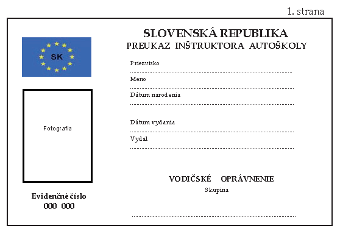
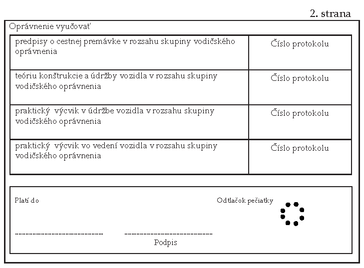
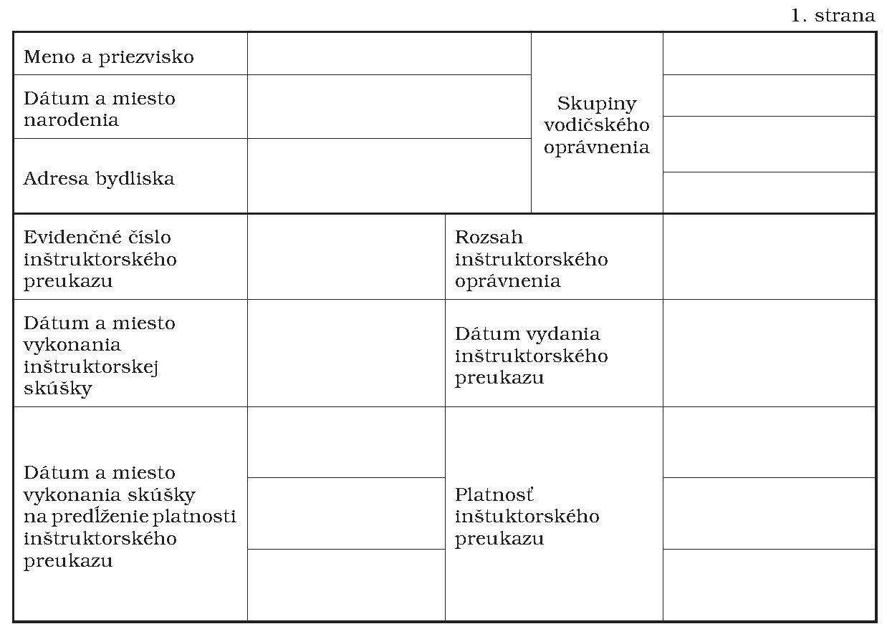
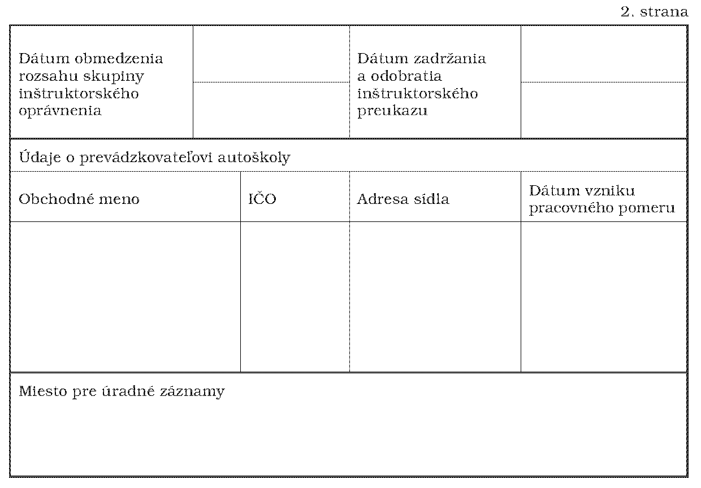

# Čl. I

Vyhláška Ministerstva dopravy, pôšt a telekomunikácií Slovenskej republiky č. 349/2005 Z. z., ktorou sa vykonáva zákon č. 93/2005 Z. z. o autoškolách a o zmene a doplnení niektorých zákonov sa mení a dopĺňa takto:

- 1. V § 1 písm. e) znie:

- „e)

- vzor inštruktorského preukazu a evidenčnej karty inštruktora autoškoly.“.

- 2. V § 7 ods. 1 písm. a) sa vypúšťajú slová „a podskupiny“.

- 3. V § 8 ods. 3 písm. a) sa slová „B alebo podskupiny B1“ nahrádzajú slovami „B1 alebo B“.

- 4. V § 8 ods. 3 písm. b) sa slová „B+E“ nahrádzajú slovom „BE“.

- 5. V § 8 ods. 3 písm. c) sa slová „C alebo podskupiny C1“ nahrádzajú slovami „C1 alebo C“.

- 6. V § 8 ods. 3 písm. d) sa slová „C+E alebo C1+E“ nahrádzajú slovami „C1E alebo CE“ a vypúšťa sa slovo „a podskupiny“.

- 7. V § 8 ods. 3 písm. e) sa slová „D alebo podskupiny D1“ nahrádzajú slovami „D1 alebo D“.

- 8. V § 8 ods. 3 písm. f) sa slová „D+E alebo D1+E“ nahrádzajú slovami „D1E alebo DE“ a vypúšťa sa slovo „podskupiny“.

- 9. V § 10 ods. 1 sa na konci pripája táto veta: „Osobitný výcvik podľa § 2 ods. 1 písm. b) zákona sa vykonáva podľa prílohy č. 1a.“.

- 10. V § 10 ods. 2 sa na konci pripája táto veta: „Osobitný výcvik podľa § 2 ods. 1 písm. b) zákona trvá najmenej sedem hodín.“.

- 11. V § 11 ods. 1 sa vypúšťajú slová „a podskupiny“ a za prvú vetu sa vkladá nová druhá veta, ktorá znie: „Trvanie vodičského kurzu je najviac 12 mesiacov odo dňa začatia kurzu.“.

- 12. V § 17 písm. a) sa slová „A a AM a pre podskupinu A1“ nahrádzajú slovami „AM, A1, A2 a A“.

- 13. V § 17 písm. b) sa slová „B a podskupinu B1“ nahrádzajú slovami „B1 a B“.

- 14. V § 17 písm. c) sa slová „B, C a T a pre podskupiny B1 a C1“ nahrádzajú slovami „B1, B, C1, C a T“.

- 15. V § 17 písm. d) sa slová „B, C, D a T a pre podskupiny B1, C1, D1“ nahrádzajú slovami „B1, B, C1, C, D1, D a T“.

- 16. V § 17 písm. e) sa slová „B a E“ nahrádzajú slovom „BE“ a slová „B a E a B a pre podskupinu B1“ sa nahrádzajú slovami „B1, B a BE“.

- 17. V § 17 písm. f) sa slová „C a E“ nahrádzajú slovom „CE“ a slová „C a E, B, C, C1 a E, B a E a pre podskupiny B1 a C1“ sa nahrádzajú slovami „B1, B, BE, C1, C1E, C, CE a T“.

- 18. V § 17 písm. g) sa slová „C1 a E“ nahrádzajú slovom „C1E“ a slová „C1 a E, B, T, B a E a pre podskupiny B1 a C1“ sa nahrádzajú slovami „B1, B, BE, C1, C1E a T“.

- 19. V § 17 písm. h) sa slová „D a E“ nahrádzajú slovom „DE“ a slová „D a E, B, C, D, T, D1 a E, C a E, C1 a E, B a D a E a pre podskupiny B1, C1, D1“ sa nahrádzajú slovami „B1, B, C1, C1E, C, CE, D1, D1E, D, DE a T“.

- 20. V § 17 písm. i) sa slová „D1 a E“ nahrádzajú slovom „D1E“ a slová „D1 a E, B, C, T, C a E, C1 a E, B a E a pre podskupiny B1, C1 a D1“ sa nahrádzajú slovami „B1, B, BE, C1, C1E, C, CE,D1, D1E a T“.

- 21. V § 25 ods. 2 písm. c) sa vypúšťajú slová „a podskupín“.

- 22. Za § 25 sa vkladá § 25a, ktorý vrátane nadpisu znie:

- „25a

- Osvedčenie o absolvovaní osobitného výcviku

- (1)

- Prevádzkovateľ autoškoly vydá osvedčenie účastníkovi, ktorý absolvoval osobitný výcvik podľa § 2 ods. 1 písm. b) zákona.

- (2)

- Osvedčenie obsahuje

- a)

- obchodné meno prevádzkovateľa autoškoly,

- b)

- údaje o registrácii autoškoly a vydaní živnostenského oprávnenia,

- c)

- druh osobitného výcviku podľa osobitného predpisu8a) a dátum jeho začatia a skončenia,

- d)

- meno a priezvisko účastníka a jeho číslo z matričnej knihy,

- e)

- dátum a miesto narodenia účastníka,

- f)

- vlastnoručný podpis prevádzkovateľa autoškoly.“.

- Poznámka pod čiarou k odkazu 8a znie:

- „8a)

- § 76 ods. 7, § 78 ods. 2 písm. c) alebo ods. 3 písm. c) zákona č. 8/2009 Z. z.“.

- 23. V § 26 sa vypúšťa odsek 3 vrátane poznámky pod čiarou k odkazu 9.

- 24. Za § 27 sa vkladá § 27a, ktorý znie:

- 㤠27a

- Touto vyhláškou sa preberajú právne záväzné akty Európskej únie uvedené v prílohe č. 4.“.

- 25. Za prílohu č. 1 sa vkladá príloha č. 1a, ktorá vrátane nadpisu znie:

- „Príloha č. 1a k vyhláške č. 349/2005 Z. z.

- Minimálne požiadavky na osobitný výcvik vodiča jazdných súprav a pre motocykle skupiny A2 a A podľa § 2 ods. 1 písm. b) zákona

- I.

- Minimálne požiadavky na praktické zručnosti a schopnosti vodičov vyžadované na vedenie motorových vozidiel skupín B, B1 a BE zamerané na:

- a)

- prípravu a technickú kontrolu vozidla pred jazdou vzhľadom na bezpečnosť cestnej premávky:

- 1.

- nastavenie sedadla do správnej polohy sedenia,

- 2.

- nastavenie spätných zrkadiel, bezpečnostných pásov a opierok hlavy, ak existujú,

- 3.

- kontrolu uzatvorenia dverí,

- 4.

- vykonanie náhodnej kontroly stavu pneumatík, riadenia, bŕzd, kvapalín (napríklad motorového oleja, chladiacej kvapaliny, kvapaliny ostrekovača), svietidiel, smerových svietidiel a zvukového výstražného zariadenia,

- b)

- kontrolu bezpečnostných faktorov súvisiacich s nakladaním: korba, plachty, nákladové dvere, zaistenie kabíny, spôsob nakladania, zabezpečenie nákladu (iba pre skupinu BE); kontrolu spojovacieho mechanizmu a brzdy a elektrických spojov (iba pre skupinu BE),

- c)

- osobitné úkony vzhľadom na bezpečnosť cestnej premávky (iba pre skupinu B1 a B):

- 1.

- cúvanie priamo alebo so zatáčaním vpravo alebo vľavo okolo rohu pri zachovaní určeného smeru,

- 2.

- otočenie vozidla do protismeru s použitím prevodovej páky a spätného chodu,

- 3.

- zaparkovanie vozidla a výjazd z parkovacieho miesta (pozdĺžne, šikmé alebo kolmé, dopredu alebo cúvaním, na rovine, pri stúpaní a klesaní),

- 4.

- presné brzdenie do zastavenia; uskutočnenie núdzového zastavenia je však nepovinné,

- d)

- osobitné úkony vzhľadom na bezpečnosť cestnej premávky (iba pre skupinu BE):

- 1.

- pripojenie a odpojenie alebo odpojenie a opätovné pripojenie prípojného vozidla od jeho motorového vozidla; tento úkon musí obsahovať zaparkovanie ťažného vozidla vedľa prípojného vozidla (nie v jednej línii),

- 2.

- cúvanie v zákrute,

- 3.

- bezpečné zaparkovanie pri nakladaní alebo vykladaní,

- e)

- správanie v cestnej premávke:

- 1.

- výjazd po zaparkovaní, po zastavení v premávke alebo výjazd z vozovky,

- 2.

- jazda na rovných cestách; prechádzanie okolo vozidiel idúcich v protismere vrátane obmedzených priestorov,

- 3.

- vedenie vozidla v zákrutách,

- 4.

- priblíženie sa a prejazd križovatiek a prípojných pozemných komunikácií,

- 5.

- zmena smeru: zákruty doľava a doprava; zmena jazdných pruhov,

- 6.

- vjazd alebo výjazd z diaľnic alebo z podobných cestných komunikácií (ak sú k dispozícii): zaradenie sa zo zrýchľovacieho pruhu; jazda v spomaľovacom pruhu,

- 7.

- predchádzanie alebo obchádzanie: predchádzanie iných vozidiel (ak je to možné); jazda popri prekážkach, napríklad zaparkovaných vozidlách; nechať sa predísť inými vozidlami (ak je to primerané),

- 8.

- osobitné charakteristiky ciest (ak existujú): kruhové objazdy, prejazdy cez železničné priecestia, zastávky električiek alebo autobusov, priechody pre chodcov; jazda do alebo z dlhých svahov,

- 9.

- prijatie potrebných bezpečnostných opatrení pri vystupovaní z vozidla.

- Osobitná pozornosť sa venuje dynamike pohybu vozidla, bezpečnosti premávky, ťažnému vozidlu skupiny B a prípojnému vozidlu (spojovací mechanizmus), správnemu nakladaniu a bezpečnostnému príslušenstvu.

- Praktická časť výcviku zahŕňa tieto cvičenia: zrýchľovanie, spomaľovanie, jazda dozadu, brzdenie, vzdialenosť zastavenia, brzdenie alebo vyhýbanie, otočenie prívesu, pripojenie prívesu k motorovému vozidlu a jeho odpojenie, parkovanie.

- II.

- Minimálne požiadavky na praktické zručnosti a schopnosti vodičov vyžadované na vedenie motorových vozidiel skupín A2 a A zamerané na:

- a)

- prípravu a technickú kontrolu vozidla pred jazdou vzhľadom na bezpečnosť cestnej premávky:

- 1.

- použitie ochranného vybavenia, ako sú rukavice, obuv, odev a ochranná prilba,

- 2.

- náhodnú kontrolu stavu pneumatík, bŕzd, riadenia, spínača výstražnej funkcie smerových svietidiel (ak je to vhodné), reťaze, mierok hladiny oleja, svetlometov, smerových svietidiel a zvukového výstražného zariadenia,

- b)

- osobitné úkony, ktoré sa majú odskúšať vzhľadom na bezpečnosť cestnej premávky:

- 1.

- zdvihnutie motocykla z podpery a tlačenie motocykla bez použitia motora chôdzou popri vozidle, zaparkovanie motocykla a zdvihnutie na podperu,

- 2.

- vykonanie aspoň dvoch úkonov pri malej rýchlosti vrátane slalomu; toto by malo umožniť vyhodnotenie spôsobilosti pri manipulácii so spojkou v spojení s brzdou, rovnováhou, smerom pohľadu, polohou na motocykli a polohou nôh na nožných opierkach,

- 3.

- vykonanie aspoň dvoch úkonov pri vyššej rýchlosti, z ktorých jeden je pri druhom alebo treťom prevodovom stupni pri rýchlosti najmenej 30 km/h a jeden úkon je vyhýbanie sa prekážke pri minimálnej rýchlosti 50 km/h; toto by malo umožniť vyhodnotenie spôsobilosti v polohe na motocykli, smere pohľadu, rovnováhy, techniky riadenia a techniky zmeny prevodových stupňov,

- 4.

- brzdenie: uskutočnia sa aspoň dve brzdné cvičenia vrátane núdzového brzdenia pri rýchlosti najmenej 50 km/h; toto by malo umožniť vyhodnotenie spôsobilosti pri manipulácii s prednou a zadnou brzdou, smer pohľadu a polohu na motocykli,

- c)

- správanie sa v cestnej premávke:

- 1.

- výjazd po zaparkovaní, po zastavení v premávke alebo výjazd z vozovky, jazda na rovných cestách; prechádzanie okolo vozidiel idúcich v protismere vrátane obmedzených priestorov,

- 2.

- vedenie vozidla v zákrutách; priblíženie sa a prejazd križovatiek a prípojok pozemných komunikácií,

- 3.

- zmenu smeru: zákruty doľava a doprava; zmena jazdných pruhov,

- 4.

- vjazd alebo výjazd z diaľnic alebo podobných cestných komunikácií (ak sú k dispozícii): zaradenie sa zo zrýchľovacieho pruhu; jazda v spomaľovacom pruhu,

- 5.

- predchádzanie alebo obchádzanie: predchádzanie iných vozidiel (ak je to možné): jazda popri prekážkach, napríklad zaparkovaných vozidlách; nechať sa predísť inými účastníkmi (ak je to primerané),

- 6.

- osobitné charakteristiky ciest (ak existujú): kruhové objazdy, prejazdy cez železničné priecestia, zastávky električiek alebo autobusov, priechody pre chodcov, jazda do alebo z dlhých svahov,

- 7.

- prijatie potrebných bezpečnostných opatrení pri vystupovaní z vozidla.“.

- 26. Príloha č. 2 vrátane nadpisu znie:

- „Príloha č. 2 k vyhláške č. 349/2005 Z. z.

- Vzor inštruktorského preukazu“.

- 

- 

- 27. Príloha č. 3 vrátane nadpisu znie:

- „Príloha č. 3 k vyhláške č. 349/2005 Z. z.

- Vzor evidenčnej karty inštruktora autoškoly“.

- 

- 

- 28. Príloha č. 4 vrátane nadpisu znie:

- „Príloha č. 4 k vyhláške č. 349/2005 Z. z.

- ZOZNAM PREBERANÝCH PRÁVNE ZÁVÄZNÝCH AKTOV EURÓPSKEJ ÚNIE

- Smernica Európskeho parlamentu a Rady 2006/126/ES z 20. decembra 2006 o vodičských preukazoch (prepracované znenie) (Ú. v. EÚ L 403, 30. 12. 2006).“.
