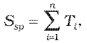
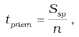
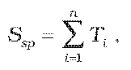
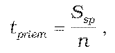
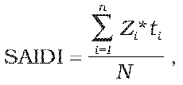
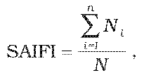

# § 13 Sledovanie, evidovanie a vyhodnocovanie štandardov kvality a uverejňovanie a archivovanie údajov o štandardoch kvality

(1) Štandardy kvality sa sledujú, evidujú a vyhodnocujú regulovaným subjektom v rozsahu ustanovenom v prílohách č. 1 až 8 za každý kalendárny rok alebo jeho časť, počas ktorej regulovaný subjekt vykonával regulovanú činnosť na základe podaní účastníkov trhu s plynom a informácií zistených z vlastnej činnosti regulovaného subjektu. Udalosti a podania, ktorým lehota na vybavenie neuplynula do konca kalendárneho roka, v ktorom nastali, sa zaradia do vyhodnotenia štandardov kvality za kalendárny rok, v ktorom uplynie lehota na ich vybavenie.

(2) Ak je regulovaným subjektom prevádzkovateľ zásobníka, prevádzkovateľ prepravnej siete, prevádzkovateľ distribučnej siete a dodávateľ plynu, na účely evidovania štandardov kvality sa vyhotovuje sumárny záznam, ktorý obsahuje

- a) identifikačné údaje regulovaného subjektu, a to

  - 1. obchodné meno a miesto podnikania a identifikačné číslo fyzickej osoby – podnikateľa,

  - 2. obchodné meno, právnu formu, sídlo a identifikačné číslo právnickej osoby,

- b) identifikačné údaje účastníka trhu s plynom, a to

  - 1. meno, priezvisko a trvalý pobyt fyzickej osoby,

  - 2. obchodné meno a miesto podnikania a identifikačné číslo fyzickej osoby – podnikateľa,

  - 3. obchodné meno, právnu formu, sídlo a identifikačné číslo právnickej osoby,

- c) názov, číslo a adresu odberného miesta alebo vstupno-výstupného bodu,

- d) dátum, čas a spôsob oznámenia udalosti alebo zistenia nedodržania štandardu kvality,

- e) popis udalosti,

- f) príčinu nedodržania štandardu kvality,

- g) dátum a spôsob vybavenia udalosti,

- h) podpis s uvedením mena, priezviska a funkcie oprávnenej osoby regulovaného subjektu.

(3) Údaje v zázname podľa odseku 2 písm. b) a c) sa nevyžadujú pri sledovaní štandardu kvality podľa § 2 písm. h) až j).

(4) Ak je regulovaným subjektom prevádzkovateľ zásobníka, na účely vyhodnotenia štandardu kvality sa v prílohe č. 1 tabuľke č. 2 vyhotovuje evidencia, ktorá obsahuje

- a) súhrnnú dobu prerušení uskladňovania plynu, ktorú tvorí súčet všetkých dôb trvania prerušení služieb uskladňovania plynu pri pevnej uskladňovacej kapacite, ktoré neboli zavinené prevádzkovateľom zásobníka, sú v súlade so zmluvou o prístupe do zásobníka a uskladňovaní plynu alebo neboli vopred oznámené podľa § 2 písm. f), ktorá sa za kalendárny rok vypočíta podľa vzorca

- 

- kde

- Ssp – súhrnná doba prerušení služieb uskladňovania plynu v hodinách,

- Ti – doba trvania i-tého prerušenia služieb uskladňovania plynu v hodinách,

- b) dobu trvania i-tého prerušenia služieb uskladňovania plynu v hodinách, ktorá sa vypočíta podľa vzorca

- Ti = t1 – t0 ,

- kde

- t0 – dátum a čas začiatku i-tého prerušenia služieb uskladňovania plynu,

- t1 – dátum a čas konca i-tého prerušenia služieb uskladňovania plynu,

- c) priemernú dobu trvania prerušenia služieb uskladňovania plynu pri pevnej uskladňovacej kapacite za kalendárny rok, ktorá sa vypočíta podľa vzorca

- 

- kde

- tpriem – priemerná doba trvania prerušenia uskladňovania plynu v hodinách,

- n – počet prerušení celkom.

(5) Ak je regulovaným subjektom prevádzkovateľ prepravnej siete, na účely vyhodnotenia štandardu kvality sa v prílohe č. 2 tabuľke č. 2 vyhotovuje evidencia, ktorá obsahuje

- a) súhrnnú dobu nedodržania plynulosti prepravy plynu, ktorú tvorí súčet všetkých dôb trvania nedodržaní plynulosti prepravy plynu za kalendárny rok, ktorá sa vypočíta podľa vzorca

- 

- kde

- Ssp – súhrnná doba nedodržania plynulosti prepravy plynu v hodinách,

- Ti – doba trvania i-tého nedodržania plynulosti prepravy plynu v hodinách,

- b) dobu i-tého nedodržania plynulosti prepravy plynu v hodinách, ktorá sa vypočíta podľa vzorca

- Ti = t1 – t0 ,

- kde

- t0 – dátum a čas začiatku i-tého nedodržania plynulosti prepravy plynu,

- t1 – dátum a čas konca i-tého nedodržania plynulosti prepravy plynu,

- c) priemernú dobu trvania nedodržania plynulosti prepravy plynu za kalendárny rok, ktorá sa vypočíta podľa vzorca

- 

- kde

- tpriem – priemerná doba trvania nedodržania plynulosti v hodinách,

- n – počet prerušení celkom.

(6) Ak je regulovaným subjektom prevádzkovateľ distribučnej siete, na účely vyhodnotenia štandardu kvality sa v prílohe č. 3 tabuľkách č. 2 a 3 vyhotovuje evidencia, ktorá obsahuje

- a) priemernú dobu prerušenia distribúcie plynu, ktorá sa vypočíta podľa vzorca

- 

- kde

- SAIDI – priemerná doba prerušenia distribúcie plynu,

- Zi – počet dotknutých odberných miest pri i-tom prerušení distribúcie plynu,

- N – celkový počet odberných miest prevádzkovateľa distribučnej siete,

- ti – doba trvania i-tého prerušenia distribúcie plynu v hodinách;

- pričom

- 1.

- do priemernej doby prerušenia distribúcie plynu vstupujú všetky neplánované prerušenia distribúcie plynu prevádzkovateľa distribučnej siete, ktoré mali za následok prerušenie distribúcie plynu odberateľom plynu na odberných miestach v trvaní viac ako jedna hodina,

- 2.

- do priemernej doby prerušenia distribúcie plynu nevstupujú prerušenia distribúcie plynu prevádzkovateľa distribučnej siete, ktoré boli zapríčinené vznikom udalosti v nadradenej distribučnej sieti, prepravnej sieti alebo živelnej udalosti,

- 3.

- priemerná doba prerušenia distribúcie plynu sa sleduje mesačne, o každej udalosti je zaznamenaný dátum a čas vzniku, doba trvania prerušenia distribúcie plynu, počet dotknutých odberných miest a príčina vzniku udalosti; prerušenie distribúcie plynu v danej distribučnej sieti, ktoré bolo zapríčinené vznikom udalosti podľa druhého bodu, sa eviduje a vyhodnocuje osobitne a úradu sa predkladá len na vyžiadanie,

- b) priemerný počet prerušení distribúcie plynu, ktorý sa vypočíta podľa vzorca

- 

- kde

- SAIFI – priemerný počet prerušení distribúcie plynu,

- Ni – počet dotknutých odberných miest pri i-tom prerušení distribúcie plynu,

- N – celkový počet odberných miest prevádzkovateľa distribučnej siete;

- pričom

- 1.

- do priemerného počtu prerušení distribúcie plynu vstupujú všetky neplánované prerušenia distribúcie plynu prevádzkovateľa distribučnej siete, ktoré mali za následok prerušenie distribúcie plynu odberateľom plynu na odberných miestach v trvaní viac ako jedna hodina,

- 2.

- do priemerného počtu prerušení distribúcie plynu nevstupujú prerušenia distribúcie plynu u prevádzkovateľa distribučnej siete, ktoré boli zapríčinené vznikom udalosti v nadradenej distribučnej sieti, prepravnej sieti alebo živelnej udalosti,

- 3.

- priemerný počet prerušení distribúcie plynu sa eviduje mesačne, o každej udalosti je zaznamenaný dátum a čas vzniku, doba trvania prerušenia distribúcie plynu, počet dotknutých odberných miest a príčina vzniku udalosti; prerušenie distribúcie plynu v danej distribučnej sieti, ktoré bolo zapríčinené vznikom udalosti podľa druhého bodu, sa eviduje a vyhodnocuje osobitne a úradu sa predkladá len na vyžiadanie.

(7) Nedodržanie štandardov kvality podľa § 6 sa vyhodnocuje samostatne podľa dôvodu vzniku udalosti v rozsahu údajov

- a) dátum a čas vzniku udalosti,

- b) dátum a čas skončenia udalosti,

- c) počet dotknutých účastníkov trhu s plynom,

- d) celkové množstvo nedodaného plynu.

(8) Vyhodnotenie štandardov kvality za rok t-1 v rozsahu podľa príloh č. 1 až 8 sa zverejňuje do konca februára roku t po dobu najmenej 12 mesiacov na webovom sídle regulovaného subjektu alebo vo výročnej správe regulovaného subjektu alebo iným obvyklým spôsobom, ak regulovaný subjekt nemá zriadené webové sídlo alebo nevydáva výročnú správu.

(9) Vyhodnotenie štandardov kvality za rok t-1 v rozsahu podľa príloh č. 1 až 8 a prehľad o vyplatených kompenzačných platbách v rozsahu prílohy č. 9 sa predkladá úradu do konca februára roku t písomne alebo elektronicky.

(10) Údaje o štandardoch kvality podľa odseku 2, § 8 ods. 3 a príloh č. 1 až 9 sa archivujú regulovaným subjektom sumárne za celý kalendárny rok v listinnej podobe alebo elektronickej podobe. Údaje o štandardoch kvality sa archivujú tak, aby nedošlo k ich zneužitiu, poškodeniu, zničeniu a neoprávneným zásahom.
