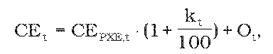

# § 8 Spôsob výpočtu maximálnej ceny za dodávku elektriny malému podniku

(1) Maximálna cena za elektrinu CEtna účely dodávky elektriny malému podniku schválená alebo určená cenovým rozhodnutím sa vypočíta podľa vzorca

- 

- kde

- a) CEPXE,t – aritmetický priemer denných cien oficiálneho kurzového lístka zverejneného burzou PXE (POWER EXCHANGE CENTRAL EUROPE) na jej webovom sídle, produktu F PXE CZ BL Cal-t v eurách na jednotku množstva elektriny za obdobie od 1. januára roku t-1 do 30. júna roku t-1,

- b) kt – koeficient na rok t v percentách určený cenovým rozhodnutím v rozsahu najviac 12 % v závislosti od plánovaného diagramu dodávky elektriny pre malý podnik na rok t,

- c) Ot– úradom schválené náklady regulovaného subjektu na odchýlku súvisiace s dodávkou elektriny malému podniku v eurách na jednotku množstva elektriny v roku t; ak je regulovaným subjektom dodávateľ elektriny, ktorý je súčasne prevádzkovateľom miestnej distribučnej sústavy a nie je subjektom zúčtovania, hodnota Ot je maximálne vo výške aritmetickej priemernej hodnoty povolených odchýlok schválených alebo určených úradom pre prevádzkovateľov regionálnych distribučných sústav na rok t.

(2) Jednopásmové sadzby podľa § 5 sú zložené z

- a) mesačnej platby za jedno odberné miesto NDOt; NDOt sú náklady na dodávku elektriny na jedno odberné miesto za mesiac, ktoré možno do ceny započítať najviac vo výške 0,65 eura na jedno odberné miesto a mesiac,

- b) ceny za elektrinu CEMPi v eurách na jednotku množstva elektriny, ktorá sa vypočíta podľa vzorca

- CEMPi = KJPMPi . CEt + PZt,

- kde

- KJPMPi – koeficient ceny jednopásmového odberu elektriny podľa odseku 4,

- CEt – cena elektriny určená podľa odseku 1,

- PZt – primeraný zisk v roku t v eurách na jednotku množstva elektriny, maximálne 16 % z určenej ceny za elektrinu CEt, najviac však osem eur za 1 MWh,

- i – číselný znak jednopásmovej sadzby.

(3) Dvojpásmové sadzby podľa § 5 sú zložené z

- a) mesačnej platby za jedno odberné miesto NDOt; NDOt sú náklady na dodávku elektriny na jedno odberné miesto za mesiac, ktoré možno do ceny započítať najviac vo výške 0,65 eura na jedno odberné miesto a mesiac,

- b) ceny za elektrinu CEVTMPi v eurách na jednotku množstva elektriny odobranej vo vysokom pásme, ktorá sa vypočíta podľa vzorca

- CEVTMPi = KVTMPi . CEt + PZt,

- kde

- KVTMPi – koeficient ceny odberu elektriny vo vysokom pásme podľa odseku 4,

- CEt – cena elektriny určená podľa odseku 1,

- PZt – primeraný zisk v roku t v eurách na jednotku množstva elektriny, maximálne 16 % z určenej ceny za elektrinu CEt, najviac však osem eur za 1 MWh,

- i – číselný znak dvojpásmovej sadzby,

- c) ceny za elektrinu CENTMPi v eurách na jednotku množstva elektriny odobranej v nízkom pásme, ktorá sa vypočíta podľa vzorca

- CENTMPi = KNTMPi . CEt + PZt,

- kde

- KNTMPi – koeficient ceny odberu elektriny v nízkom pásme podľa odseku 4,

- CEt – cena elektriny určená podľa odseku 1,

- PZt – primeraný zisk v roku t v eurách na jednotku množstva elektriny, maximálne 16 % z určenej ceny za elektrinu CEt, najviac však osem eur za 1 MWh,

- i – číselný znak dvojpásmovej sadzby.

(4) Koeficienty ceny jednopásmového odberu elektriny KJPMPi, koeficienty ceny odberu elektriny vo vysokom pásme KVTMPi a koeficienty ceny odberu elektriny v nízkom pásme KNTMPi sa určia v návrhu ceny regulovaného subjektu tak, aby vážený priemer cien elektriny bez primeraného zisku PZt všetkých sadzieb bol najviac vo výške rovnajúcej sa CEt podľa odseku 1.

(5) K sadzbám podľa odsekov 2 a 3 sa dodávateľom elektriny pripočíta cena za distribúciu elektriny vrátane prenosu elektriny a strát elektriny pri prenose a cena za straty elektriny pri distribúcii elektriny, tarifa za systémové služby a tarifa za prevádzkovanie systému podľa cenového rozhodnutia, ktorým boli schválené alebo určené ceny za prístup do distribučnej sústavy a distribúciu elektriny pre prevádzkovateľa distribučnej sústavy, do ktorej je malý podnik pripojený.
