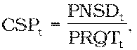
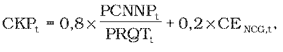

# § 7 Spôsob výpočtu maximálnej ceny za dodávku plynu malému podniku

(1) Maximálna cena za dodávku plynu malému podniku CDMPt v eurách na jednotku množstva plynu na rok t sa vypočíta podľa vzorca

CDMPt = CKPt + CPSt + CDSt + CSPt + CDDt + CPZt,

kde

CKPt sú náklady na nákup plynu v eurách na jednotku množstva plynu na rok t podľa odseku 5,

CPSt sú náklady na prístup do prepravnej siete a prepravu plynu v eurách na jednotku množstva plynu na rok t podľa odseku 2,

CDSt sú náklady na prístup do distribučnej siete a distribúciu plynu v eurách na jednotku množstva plynu na rok t podľa odseku 3,

CSPt sú náklady na uskladňovanie plynu potrebného na zabezpečenie dodávky plynu v eurách na jednotku množstva plynu na rok t podľa odseku 4,

CDDt sú náklady obchodnej činnosti dodávateľa plynu pre malý podnik v eurách na jednotku množstva plynu na rok t podľa odseku 6,

CPZt je primeraný zisk určený podľa odseku 7.

(2) CPSt sa určia ako podiel plánovaných nákladov dodávateľa plynu za prístup do prepravnej siete a prepravu plynu pre všetkých odberateľov plynu na vymedzenom území na základe plánovaných denných maxím a plánovaného množstva dodaného plynu všetkým odberateľom plynu na rok t.

(3) CDSt sa určia ako podiel plánovaných nákladov dodávateľa plynu za prístup do vysokotlakovej distribučnej siete na základe plánovaných denných maximálnych odberov odberateľov plynu kategórie malý podnik a za distribúciu plynu pre odberateľov plynu kategórie malý podnik zaradených do príslušných taríf za distribúciu plynu podľa plánovaného množstva odobratého plynu a plánovaného množstva dodaného plynu malým podnikom na rok t. Ak je dodávateľom plynu malému podniku regulovaný subjekt, do ktorého distribučnej siete je pripojených menej ako 100 000 odberných miest, súčasťou nákladov na prístup do distribučnej siete a distribúciu plynu sú aj náklady na prístup do distribučnej siete a distribúciu plynu distribučnou sieťou tohto regulovaného subjektu.

(4) CSPt sa vypočíta podľa vzorca

kde

PNSDt sú plánované náklady v eurách na uskladňovanie plynu potrebného na zabezpečenie dodávky plynu pre všetkých odberateľov plynu odvodené na základe uzavretých zmlúv na uskladňovanie plynu na rok t,

PRQTt je plánované množstvo dodaného plynu pre všetkých odberateľov plynu na rok t.

(5) CKPt sa vypočíta podľa vzorca

kde

PCNNPt sú celkové plánované náklady v eurách na nákup plynu na rok t vyplývajúce zo všetkých zmlúv o nákupe plynu na zabezpečenie zmluvných dodávok plynu pre všetkých odberateľov plynu vrátane krátkodobých zmlúv na obchodných miestach Európskej únie,

PRQTt je celkové plánované množstvo nakúpeného plynu na zabezpečenie dodávky plynu pre všetkých odberateľov plynu na rok t,

CENCG,t je aritmetický priemer denných cien, zverejnených burzou EEX (European Energy Exchange) na jej webovom sídle, produktu NCG Natural Gas Year futures Cal-t v eurách na jednotku množstva plynu za obdobie od 1. januára roku t-1 do 30. septembra roku t-1.

(6) CDDt sa určia ako podiel celkových plánovaných oprávnených nákladov podľa § 3 ods. 1 okrem nákladov uvedených v § 3 ods. 1 písm. a) obchodnej činnosti dodávateľa plynu na dodávku plynu pre odberateľov plynu kategórie malý podnik v eurách na celkové plánované množstvo dodaného plynu pre odberateľov plynu kategórie malý podnik na rok t. Do plánovaných oprávnených nákladov obchodnej činnosti, ktorá je zabezpečovaná regulovaným subjektom, iným ako regulovaným subjektom alebo subjektom, ktorý je alebo bol súčasťou vertikálne integrovaného podniku,24) možno zarátať len primerané náklady.5) Výpočet plánovaných nákladov obchodnej činnosti dodávateľa plynu na dodávku plynu pre malé podniky bude dodávateľom plynu predložený ako súčasť návrhu ceny spolu s odôvodnením výpočtu jednotlivých nákladových položiek.

(7) CPZt je najvyššia miera primeraného zisku, ktorý možno zahrnúť do maximálnej ceny za dodávku plynu malému podniku, ktorého hodnota je maximálne 10 % z CKPt, najviac však 3,50 eura za 1 MWh alebo 0,0371 eura na objemovú jednotku.

(8) Ak sa v priebehu roku t regulovaným subjektom predloží návrh na zmenu ceny za dodávku plynu malému podniku, maximálna cena za dodávku plynu malému podniku CDMPt Z v eurách na jednotku množstva plynu pre zostávajúce obdobie roku t sa vypočíta podľa vzorca

CDMPt Z = CDMPt + Z,

kde

CDMPt je maximálna cena za dodávku plynu malému podniku v eurách na jednotku množstva plynu na rok t,

Z je hodnota zmeny v eurách na jednotku množstva plynu, ktorá odzrkadľuje zmenu ekonomických parametrov, ktoré ovplyvňujú náklady regulovaného subjektu a z ktorých sa vychádzalo pri určení maximálnej ceny za dodávku plynu malému podniku na rok t. Hodnota zmeny sa zdôvodňuje analýzami v predloženom návrhu na zmenu ceny za dodávku plynu malému podniku.
