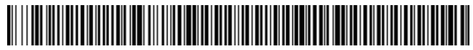

Príloha č. 1 k nariadeniu vlády č. 298/2012 Z. z.

- JEDNOZNAČNÁ IDENTIFIKÁCIA VÝBUŠNINY Jednoznačná identifikácia pozostáva z

  - A. čitateľnej časti identifikácie, ktorá obsahuje

    - a) názov výrobcu,

    - b) alfanumerický kód, ktorý obsahuje

      - 1. dve identifikačné písmená členského štátu Európskej únie (miesta výroby alebo dovozu na trh Európskej únie),

      - 2. tri čísla identifikujúce názov miesta výroby pridelené Hlavným banským úradom,

      - 3. jednoznačný kód výrobku a logistickú informáciu pridelenú výrobcom;

  - B. elektronicky čitateľnej identifikácie v podobe čiarového kódu alebo matricového kódu, ktorá sa vzťahuje priamo na alfanumerický kód.

    - Príklad čiarového kódu:

    - Názov, obchodné meno podnikateľa alebo označenie výrobcu alebo dovozcu

  - 

    - SK 000 xxxxx x xxxxx

    - Príklad matricového kódu:

    - Názov, obchodné meno podnikateľa alebo označenie výrobcu alebo dovozcu

  - 

    - SK 000 xxxxx x xxxxx

  - C. Pre položky príliš malé na to, aby k nim bol pripojený jednoznačný kód výrobku a logistická informácia pridelená výrobcom, sa za dostatočné považujú informácie podľa bodu A písm. b) bodu 1, bodu A písm. b) bodu 2 a bodu B.

    - Pre výrobky príliš malé na to, aby k nim bola pripojená informácia podľa bodu A písm. b) bodu 1, bodu A písm. b) bodu 2 a bodu B, alebo ak vzhľadom na ich tvar alebo dizajn nie je technicky možné k nim pripojiť jednoznačnú identifikáciu, sa jednoznačná identifikácia pripája ku každému najmenšiemu baleniu.

    - Každé najmenšie balenie musí byť uzavreté plombou.

    - Každá zážihová rozbuška alebo počinová nálož, na ktorú sa vzťahuje výnimka stanovená v druhom odseku, sa označuje trvanlivým spôsobom jasne čitateľnými informáciami podľa bodu A písm. b) v bode 1 a bodu A písm. b) v bode 2. Počet obsiahnutých zážihových rozbušiek a počinových náloží sa vyznačuje tlačou na najmenšom balení.

    - Každá bleskovica, na ktorú sa vzťahuje výnimka stanovená v druhom odseku, sa označuje jednoznačnou identifikáciou na cievke alebo vretene a tiež, ak je to možné, aj na najmenšom balení.

    - Označenie členských štátov Európskej únie

  - Belgicko | BE

  - Bulharsko | BG

  - Česká republika | CZ

  - Dánsko | DK

  - Estónsko | EE

  - Fínsko | FI

  - Francúzsko | FR

  - Írsko | IE

  - Taliansko | IT

  - Cyprus | CY

  - Litva | LV

  - Lotyšsko | LT

  - Luxembursko | LU

  - Maďarsko | HU

  - Malta | MT

  - Nemecko | DE

  - Holandsko | NL

  - Poľsko | PL

  - Portugalsko | PT

  - Rakúsko | AT

  - Rumunsko | RO

  - Grécko | GR

  - Slovensko | SK

  - Slovinsko | SI

  - Spojené kráľovstvo | GB

  - Španielsko | ES

  - Švédsko | SE
