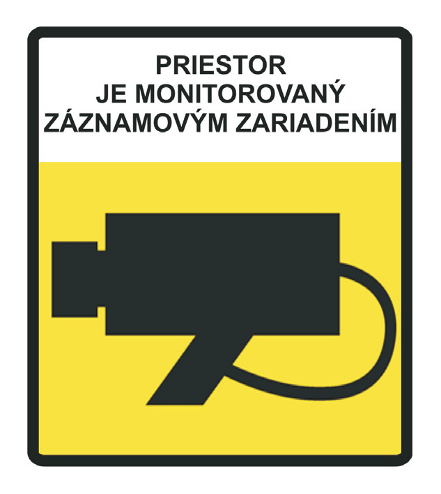
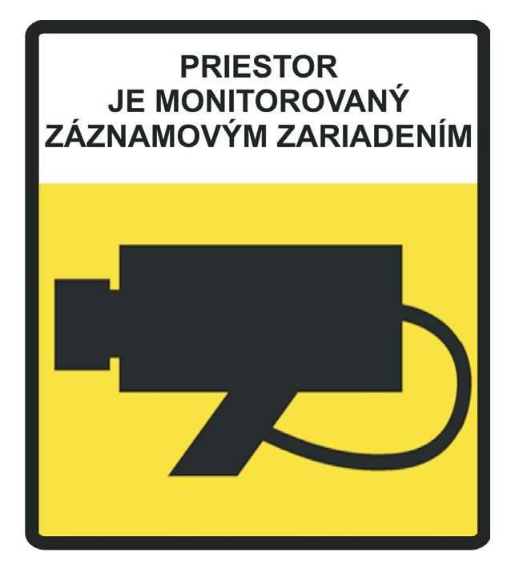

# Čl. I

Vyhláška Ministerstva dopravy, pôšt a telekomunikácií Slovenskej republiky č. 29/2006 Z. z. o vzore a náležitostiach tlačív, kontrolných nálepiek, pečiatok a o vzore označenia stanice technickej kontroly, pracoviska emisnej kontroly, pracoviska kontroly originality a pracoviska montáže plynových zariadení a o vzore a náležitostiach preukazu kontrolóra povereného vykonávať štátny odborný dozor v znení vyhlášky č. 353/2009 Z. z. sa dopĺňa takto:

- 1. Za § 12 sa vkladá § 12a, ktorý vrátane nadpisu znie:

- 㤠12a

- Vzor označenia stanice technickej kontroly o monitorovaní monitorovacím záznamovým zariadením

- Vzor označenia stanice technickej kontroly o monitorovaní monitorovacím záznamovým zariadením a jeho náležitosti sú uvedené v prílohe č. 21a.“.

- 2. Za § 13 sa vkladá § 13a, ktorý vrátane nadpisu znie:

- 㤠13a

- Vzor označenia pracoviska emisnej kontroly o monitorovaní monitorovacím záznamovým zariadením

- Vzor označenia pracoviska emisnej kontroly o monitorovaní monitorovacím záznamovým zariadením a jeho náležitosti sú uvedené v prílohe č. 22a.“.

- 3. Za prílohu 21 sa vkladá príloha 21a, ktorá znie:

- „Príloha č. 21a k vyhláške č. 29/2006 Z. z.

- VZOR OZNAČENIA STANICE TECHNICKEJ KONTROLY O MONITOROVANÍ MONITOROVACÍM ZÁZNAMOVÝM ZARIADENÍM

- 

- Výška označenia je minimálne 300 mm a šírka označenia je minimálne 200 mm.

- Označenie sa umiestňuje pri vstupe na kontrolnú linku a pri výstupe z kontrolnej linky stanice technickej kontroly z obidvoch strán.“.

- 4. Za prílohu 22 sa vkladá príloha 22a, ktorá znie:

- „Príloha č. 22a k vyhláške č. 29/2006 Z. z.

- VZOR OZNAČENIA PRACOVISKA EMISNEJ KONTROLY O MONITOROVANÍ MONITOROVACÍM ZÁZNAMOVÝM ZARIADENÍM

- 

- Výška označenia je minimálne 300 mm a šírka označenia je minimálne 200 mm.

- Označenie sa umiestňuje pri vstupe na pracovisko emisnej kontroly, prípadne pri výstupe z pracoviska emisnej kontroly z obidvoch strán.“.
