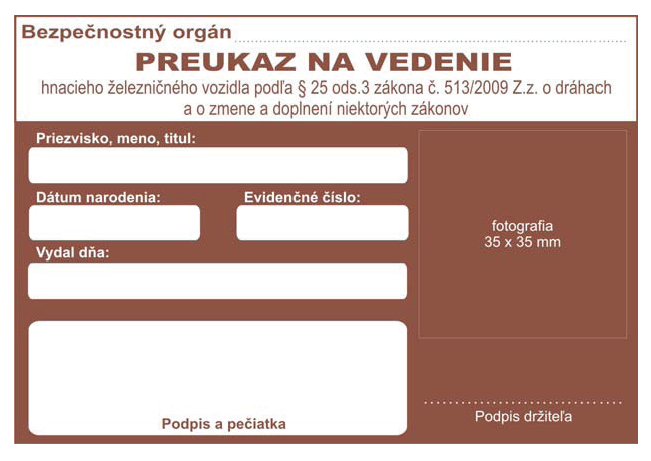
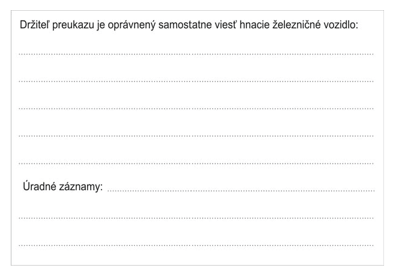
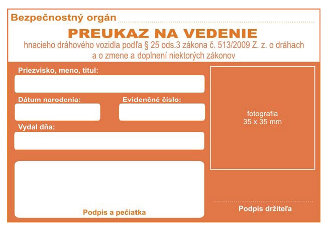
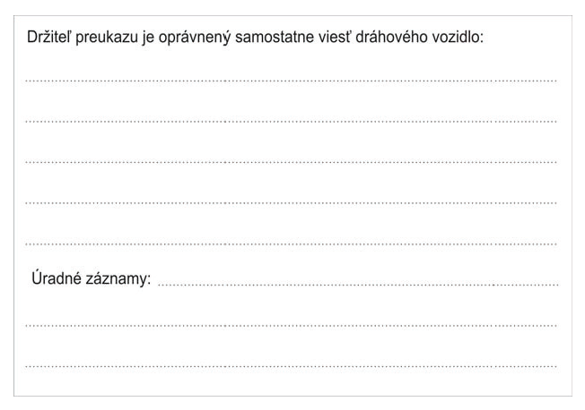
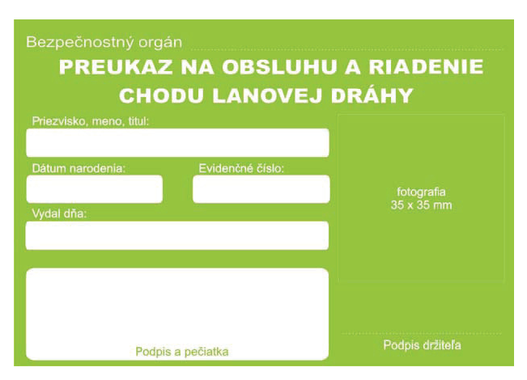
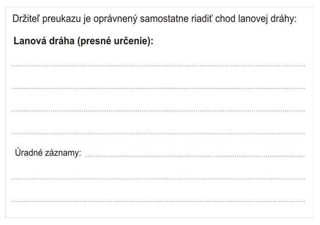

# Čl. 1

Vyhláška Ministerstva dopravy, pôšt a telekomunikácií Slovenskej republiky č. 245/2010 Z. z. o odbornej spôsobilosti, zdravotnej spôsobilosti a psychickej spôsobilosti osôb pri prevádzkovaní dráhy a dopravy na dráhe sa mení a dopĺňa takto:

- 1. § 1 sa dopĺňa písmenami e) až g), ktoré znejú:

- „e)

- požiadavky na vydanie poverenia právnickým osobám na posudzovanie zdravotnej spôsobilosti osôb prevádzkovateľov dráh a dráhových podnikov,

- f)

- požiadavky na vydanie poverenia právnickým osobám na posudzovanie psychickej spôsobilosti osôb prevádzkovateľov dráh a dráhových podnikov,

- g)

- požiadavky na vydanie poverenia právnickým osobám a fyzickým osobám – podnikateľom na vzdelávanie a overovanie odbornej spôsobilosti osôb prevádzkovateľov dráh a dráhových podnikov.“.

- 2. V § 2 ods. 3 druhej vete sa slová „ v dráhovom podniku“ nahrádzajú slovom „jazdou“ a na konci sa pripájajú tieto slová: „na príslušnej dráhe“.

- 3. V § 2 ods. 4 sa vypúšťajú slová „vedenie a“.

- 4. V § 3 ods. 3 sa vypúšťajú slová „alebo osobitného osvedčenia o odbornej spôsobilosti“.

- 5. § 4 sa dopĺňa odsekom 5, ktorý znie:

- „(5)

- Zácvik je praktická činnosť, pri ktorej vykonávaní sa osoba po úspešnom vykonaní odbornej skúšky a získaní osvedčenia o odbornej spôsobilosti oboznámi s prevádzkovými pomermi na príslušnej dráhe. Činnosti osoby počas zácviku sa vykonávajú za prítomnosti fyzickej osoby určenej zamestnávateľom, ktorá je odborne spôsobilá na výkon činnosti podľa tejto vyhlášky.“.

- 6. Za § 4 sa vkladá § 4a, ktorý znie:

- 㤠4a

- (1)

- Vzor preukazu na vedenie hnacieho železničného vozidla podľa § 24 ods. 2 písm. b) až e) zákona o doprave na dráhach je uvedený v prílohe č. 3a. Vzor preukazu na vedenie dráhového vozidla špeciálnej dráhy, električkovej dráhy alebo trolejbusovej dráhy je uvedený v prílohe č. 3b. Vzor preukazu na obsluhu a riadenie chodu lanovej dráhy je uvedený v prílohe č. 3c.

- (2)

- Preukaz na vedenie dráhového vozidla obsahuje

- a)

- identifikačné údaje žiadateľa, a to meno, priezvisko a dátum narodenia,

- b)

- farebnú fotografiu tváre žiadateľa s rozmermi 35 x 35 mm,

- c)

- evidenčné číslo,

- d)

- podpis oprávnenej osoby a odtlačok pečiatky bezpečnostného orgánu,

- e)

- druh a typ dráhového vozidla, ktoré môže žiadateľ na základe preukázanej odbornej spôsobilosti viesť a riadiť,

- f)

- úradné záznamy.“.

- 7. V § 5 sa vypúšťa odsek 7.

- 8. Za § 5 sa vkladajú § 5a a 5b, ktoré vrátane nadpisu nad § 5a znejú:

- „Podrobnosti o odbornej príprave a overovaní osobitnej odbornej spôsobilosti skúšobných komisárov

- § 5a

- Odborná príprava žiadateľov na vykonanie skúšky osobitnej odbornej spôsobilosti sa vykonáva v poverenom vzdelávacom zariadení v trvaní minimálne 24 hodín pre pracovné činnosti na železničných dráhach alebo minimálne 24 hodín pre pracovné činnosti na špeciálnych dráhach a mestských dráhach a je zameraná na znalosť

- a)

- predpisov o doprave na dráhach a predpisov súvisiacich s vedením dráhového vozidla podľa druhu dráhy,

- b)

- príslušných technických špecifikácií interoperability podľa § 65 zákona o dráhach; vzťahuje sa na skúšobného komisára na vykonávanie pracovných činností na železničnej dráhe,

- c)

- konštrukcie dráhových vozidiel, funkcie a princípu fungovania rozhodujúcich konštrukčných celkov jednotlivých typov dráhových vozidiel,

- d)

- podmienok vykonávania technicko-bezpečnostných skúšok dráhových vozidiel.

- § 5b

- (1)

- Osobitnú odbornú spôsobilosť uchádzačov overuje skúšobná komisia ustanovená ministerstvom formou

- a)

- skúšky, ak žiadateľ nadobúda osobitnú odbornú spôsobilosť,

- b)

- preskúšaním, ak sa žiadateľovi predlžuje platnosť osvedčenia skúšobného komisára.

- (2)

- Skúšobná komisia sa skladá minimálne z piatich členov, z ktorých jeden je predseda a jeden tajomník, ktorí sú zamestnancami ministerstva a odborníkmi v oblasti dopravy.

- (3)

- Skúška pozostáva z písomného testu a ústnej časti; preskúšanie sa vykonáva formou ústnej skúšky. Predmetom overenia je znalosť podľa § 5a ods. 1.

- (4)

- Skúška alebo preskúšanie sa hodnotí klasifikačným stupňom „prospel“ alebo „neprospel“. O výsledku skúšky alebo preskúšania sa vyhotovuje protokol, ktorý podpíše predseda komisie a jej členovia. Predseda komisie oboznámi všetkých žiadateľov zúčastnených na skúške s jej výsledkom.

- (5)

- Skúšku alebo preskúšanie možno opakovať najskôr po 15 dňoch a najneskôr do 60 dní odo dňa vykonania skúšky alebo preskúšania. Skúšku a preskúšanie možno opakovať len raz na základe písomnej žiadosti.“.

- 9. V § 6 ods. 1 písm. a) prvom bode sa nad slová „podľa osobitného predpisu“ umiestňuje odkaz 1a.

- Poznámka pod čiarou k odkazu 1a znie:

- „1a)

- Vyhláška Ministerstva dopravy, pôšt a telekomunikácií Slovenskej republiky č. 205/2010 Z. z. o určených technických zariadeniach a určených činnostiach a činnostiach na určených technických zariadeniach.“.

- 10. V § 6 ods. 2 písm. b), § 6 ods. 3 písm. a) prvom bode, § 6 ods. 3 písm. b) prvom bode, § 6 ods. 5 písm. a), § 7 ods. 1 písm. a), § 7 ods. 2 písm. a), § 8 ods. 1 písm. b), § 8 ods. 2 písm. b), § 8 ods. 3 písm. b) sa nad slová „podľa osobitného predpisu“ umiestňuje odkaz 1a.

- 11. V § 7 ods. 1 písm. c) a ods. 2 písm. c) sa číslo „4“ nahrádza číslom „5“.

- 12. V § 8 ods. 1 uvádzacej vete sa slová „chodu a obsluhy lanovej dráhy“ nahrádzajú slovami „dopravy na lanovej dráhe“.

- 13. V § 8 ods. 1 písm. a), ods. 2 písm. a) a ods. 3 písm. a) sa za slovo „učebnom“ vkladajú slová „alebo študijnom“.

- 14. V § 8 ods. 1 písm. d) sa číslo „4“ nahrádza číslom „6“ a na konci sa čiarka nahrádza bodkou.

- 15. V § 8 ods. 1 sa vypúšťa písmeno e).

- 16. V § 8 ods. 2 písmeno c) znie:

- „c)

- odborná prax pri montáži, údržbe a opravách lanovej dráhy v trvaní minimálne šesť mesiacov a v riadení chodu lanovej dráhy v trvaní minimálne šesť mesiacov,“.

- 17. V § 8 ods. 2 písm. d) sa číslo „4“ nahrádza číslom „7“.

- 18. V § 8 ods. 2 písmeno e) znie:

- „e)

- absolvovanie kurzu prvej pomoci.2a)“.

- Poznámka pod čiarou k odkazu 2a znie:

- „2a)

- Vyhláška Ministerstva zdravotníctva Slovenskej republiky č. 398/2010 Z. z. o minimálnych požiadavkách na kurz prvej pomoci a kurz inštruktora prvej pomoci.“.

- 19. V § 8 ods. 3 písm. d) sa číslo „4“ nahrádza číslom „8“.

- 20. V § 8 ods. 3 písm. e) sa slovo „vedenie“ nahrádza slovami „riadenie chodu“.

- 21. V § 8 ods. 3 písm. f) sa na konci bodka nahrádza čiarkou.

- 22. V § 8 sa odsek 3 dopĺňa písmenom g), ktoré znie: „g) absolvovanie kurzu prvej pomoci.2a)“.

- 23. V § 11 ods. 1 písm. a) sa za číslo „4“ vkladá čiarka a za číslo 5 sa vkladá slovo „a“.

- 24. V § 12 písm. b) bod 1.4. sa označuje ako bod 1.2. a doterajšie body 1.2. a 1.3. sa označujú ako body 1.3. a 1.4.

- 25. V § 12 písmená d) a e) znejú:

- „d)

- mimoriadna lekárska preventívna prehliadka a mimoriadne psychologické vyšetrenie, ktoré sa vykonávajú v prípadoch uvedených v § 33 ods. 3 zákona o dráhach,

- e)

- mimoriadna lekárska preventívna prehliadka, ktorá sa vykonáva v prípadoch uvedených v prílohe č. 2 bode 3.1. štvrtej až šiestej vete k zákonu o doprave na dráhach.“.

- 26. Za § 13 sa vkladá § 13a, ktorý vrátane nadpisu znie:

- 㤠13a

- Podrobnosti o poverovaní právnických osôb

- (1)

- Právnická osoba, ktorá žiada o poverenie na posudzovanie zdravotnej spôsobilosti osôb prevádzkovateľov dráh a dráhových podnikov, predloží najmä

- a)

- žiadosť o poverenie s identifikáciou dráhy, pre ktorú chce poskytovať posudzovanie zdravotnej spôsobilosti,

- b)

- výpis z obchodného registra nie starší ako tri mesiace ku dňu predloženia žiadosti,

- c)

- platné povolenie na prevádzkovanie zdravotníckeho zariadenia podľa osobitného predpisu,4)

- d)

- čestné vyhlásenie, že na jej majetok nebol vyhlásený konkurz, nie je v konkurznom konaní, reštrukturalizačnom konaní ani nebolo konkurzné konanie zastavené pre nedostatok majetku,

- e)

- doklad o zamestnávaní posudzujúcich lekárov na posudzovanie zdravotnej spôsobilosti podľa tejto vyhlášky so špecializáciou v špecializačnom odbore všeobecné lekárstvo,

- f)

- certifikát systému manažérstva kvality ISO.

- (2)

- Právnická osoba, ktorá žiada o poverenie na posudzovanie psychickej spôsobilosti osôb prevádzkovateľov dráh a dráhových podnikov, predloží najmä

- a)

- žiadosť o poverenie s identifikáciou dráhy, pre ktorú chce poskytovať posudzovanie psychickej spôsobilosti,

- b)

- výpis z obchodného registra nie starší ako tri mesiace ku dňu predloženia žiadosti,

- c)

- platné povolenie na prevádzkovanie zdravotníckeho zariadenia podľa osobitného predpisu,4)

- d)

- doklad o zamestnávaní posudzujúcich psychológov na posudzovanie psychickej spôsobilosti podľa tejto vyhlášky a licenciu na výkon činnosti odborného zástupcu zdravotníckym pracovníkom v povolaní psychológ na výkon certifikovanej pracovnej činnosti dopravná psychológia podľa osobitného predpisu,4)

- e)

- doklad o tom, že má špeciálne prístrojové vybavenie na zisťovanie reakcií a koordinácie pohybov,

- f)

- certifikát systému manažérstva kvality ISO.

- (3)

- Právnická osoba alebo fyzická osoba – podnikateľ, ktorá žiada o poverenie na vzdelávanie a overovanie odbornej spôsobilosti osôb prevádzkovateľov dráh a dráhových podnikov,

- a)

- predloží žiadosť o poverenie s identifikáciou dráhy, pre ktorú chce poskytovať vzdelávanie a overovanie odbornej spôsobilosti,

- b)

- výpis z obchodného registra alebo iného obdobného registra nie starší ako tri mesiace ku dňu predloženia žiadosti,

- c)

- predloží certifikát systému manažérstva kvality ISO,

- d)

- predloží doklad o tom, že má vyhovujúce technické a technologické vybavenie na vykonávanie vzdelávania a overovania odbornej spôsobilosti,

- e)

- predloží vypracovaný vnútorný systém kontroly realizácie vzdelávania,

- f)

- predloží vypracovaný skúšobný poriadok na získanie a overovanie odbornej spôsobilosti,

- g)

- predloží základné učebné osnovy na získanie odbornej spôsobilosti na pracovné činnosti na dráhe a pracovné činnosti v doprave na dráhe,

- h)

- predloží doklad o zamestnávaní osôb, ktoré budú realizovať vzdelávanie vrátane ich kvalifikácie a osvedčenia o odbornej spôsobilosti v rozsahu vykonávaného vzdelávania,

- i)

- predloží ďalšie informácie súvisiace s dokladmi predloženými podľa písmen a) až h),

- j)

- zabezpečí proces certifikácie rušňovodičov podľa tretej časti zákona o doprave na dráhach.“.

- 27. V prílohe č. 1 piatom bode písm. a) ôsmom bode, písm. b) ôsmom bode, písm. e) deviatom bode, písm. g) ôsmom bode sa počet vyučovacích hodín mení zo „4“ na „8“.

- 28. V prílohe č. 1 šiesty až ôsmy bod znejú:

- „6.

- Riadenie prevádzkovania lanovej dráhy a dopravy na lanovej dráhe

- | | počet vyučovacích hodín

- 1. | základné pojmy – terminológia | 1

- 2. | prevádzkový predpis podľa typu lanovej dráhy | 4

- 3. | pokyny na údržbu, obsluhu a skúšky príslušného typu lanovej dráhy | 4

- 4. | prepravný poriadok lanových dráh | 1

- 5. | cestovný poriadok, informačné systémy | 1

- 6. | poskytovanie prvej pomoci | 8

- 7. | technické vyhotovenie lanových dráh | 1

- 8. | ochrana životného prostredia pri prevádzke lanovej dráhy | 1

- 9. | technické normy – bezpečnostné požiadavky na zariadenia určené na osobnú lanovú dopravu | 1

- 10. | všeobecne záväzné právne predpisy a ostatné predpisy na zaistenie bezpečnosti a ochrany zdravia pri práci | 2

- 11. | všeobecne záväzné právne predpisy z oblasti prevádzkovania dráhy a dopravy na dráhe | 16

- 7.

- Riadenie a obsluha lanovej dráhy

- | | počet vyučovacích hodín

- 1. | základné pojmy – terminológia | 1

- 2. | prevádzkový predpis podľa typu lanovej dráhy | 8

- 3. | pokyny na údržbu, obsluhu a skúšky príslušného typu lanovej dráhy | 8

- 4. | prepravný poriadok lanových dráh | 1

- 5. | cestovný poriadok, informačné systémy | 1

- 6. | poskytovanie prvej pomoci | 8

- 7. | technické vyhotovenie lanových dráh | 1

- 8. | ochrana životného prostredia pri prevádzke lanovej dráhy | 1

- 9. | technické normy – bezpečnostné požiadavky na zariadenia určené na osobnú lanovú dopravu | 8

- 10. | všeobecne záväzné právne predpisy a ostatné predpisy na zaistenie bezpečnosti a ochrany zdravia pri práci | 4

- 11. | všeobecne záväzné právne predpisy z oblasti prevádzkovania dráhy a dopravy na dráhe | 16

- 8.

- Riadenie chodu lanovej dráhy

- | | počet vyučovacích hodín

- 1. | základné pojmy – terminológia | 1

- 2. | prevádzkový predpis podľa typu lanovej dráhy | 20

- 3. | pokyny na údržbu, obsluhu a skúšky príslušného typu lanovej dráhy | 30

- 4. | prepravný poriadok lanových dráh | 4

- 5. | cestovný poriadok, informačné systémy | 1

- 6. | poskytovanie prvej pomoci | 8

- 7. | technické vyhotovenie lanových dráh | 4

- 8. | ochrana životného prostredia pri prevádzke lanovej dráhy | 2

- 9. | technické normy – bezpečnostné požiadavky na zariadenia určené na osobnú lanovú dopravu | 16

- 10. | všeobecne záväzné právne predpisy a ostatné predpisy na zaistenie bezpečnosti a ochrany zdravia pri práci | 4

- 11. | všeobecne záväzné právne predpisy z oblasti prevádzkovania dráhy a dopravy na dráhe | 12“.

- “.

- 29. Príloha č. 1 sa dopĺňa deviatym bodom, ktorý znie:

- „9.

- Špeciálne dráhy

- | | počet vyučovacích hodín

- 1. | základné pojmy – terminológia | 1

- 2. | prevádzkový predpis príslušnej špeciálnej dráhy | 8

- 3. | pokyny na obsluhu, údržbu a skúšky dráhových vozidiel | 6

- 4. | prepravný poriadok špeciálnej dráhy | 4

- 5. | cestovný poriadok, informačné systémy | 1

- 6. | poskytovanie prvej pomoci | 8

- 7. | technické vyhotovenie dráhových vozidiel špeciálnej dráhy | 4

- 8. | ochrana životného prostredia pri prevádzke špeciálnej dráhy | 1

- 9. | technické normy – bezpečnostné požiadavky na určené technické zariadenia | 2

- 10. | všeobecne záväzné právne predpisy a ostatné predpisy na zaistenie bezpečnosti a ochrany zdravia pri práci | 4

- 11. | všeobecne záväzné právne predpisy z oblasti prevádzkovania dráhy a dopravy na dráhe vzťahujúce sa na špeciálne dráhy | 2“.

- “.

- 30. Za prílohu č. 3 sa vkladajú nové prílohy č. 3a, 3b a 3c, ktoré vrátane nadpisov znejú:

- „Príloha č. 3a k vyhláške č. 245/2010 Z. z.

- VZOR PREUKAZU

- na vedenie hnacieho železničného vozidla podľa § 24 ods. 2 písm. b) až e) zákona o doprave na dráhach vydaného podľa § 25 ods. 3 zákona o dráhach

- Rozmer: 105 mm x 72 mm

- Farba: kód RGB – 143, 84, 68

- Proti falšovaniu sa preukaz doplní o ochranné prvky, ako hologram alebo čip.

- Predná strana

- 

- Zadná strana

- 

- Príloha č. 3b k vyhláške č. 245/2010 Z. z.

- VZOR PREUKAZU

- na vedenie dráhového vozidla špeciálnej dráhy, električkovej dráhy alebo trolejbusovej dráhy

- Rozmer 105 mm x 72 mm

- Farba CMYK – 0, 60, 80, 0

- Farba RGB – 231, 120, 68

- Proti falšovaniu sa môže preukaz doplniť o ochranné prvky, ako hologram alebo čip.

- Predná strana

- 

- Zadná strana

- 

- Príloha č. 3c k vyhláške č. 245/2010 Z. z.

- VZOR PREUKAZU

- na obsluhu a riadenie chodu lanovej dráhy

- Rozmer 105 mm x 72 mm

- Farba CMYK – 40, 0, 100, 0

- Farba RGB – 132, 194, 37

- Proti falšovaniu sa môže preukaz doplniť o ochranné prvky, ako hologram alebo čip.

- Predná strana

- 

- Zadná strana“.

- 

- 31. V prílohe č. 4 prvom bode písm. e) sa za slovom „žien“ vypúšťa čiarka.

- 32. V prílohe č. 4 prvom bode písmeno f) znie: „f) röntgen hrudníka pri vstupnej prehliadke.“.

- 33. V prílohe č. 4 druhom bode písm. e) treťom bode, štvrtom bode, prílohe č. 5 v tabuľke pre VSTUPNÉ PREHLIADKY pre zmyslovú skupinu 3, tabuľke pre PERIODICKÉ, MIMORIADNE A VÝSTUPNÉ PREHLIADKY pre zmyslovú skupinu 3 sa slová „päť metrov“ nahrádzajú slovami „5,5 metra“.

- 34. V prílohe č. 5 štvrtom bode sa nadpis nad tabuľkou „PERIODICKÉ, MIMORIADNE A VÝSTUPNÉ PREHLIADKY“ nahrádza nadpisom „PERIODICKÉ A MIMORIADNE PREHLIADKY“.

- 35. Príloha č. 6 znie:

- „Príloha č. 6 k vyhláške č. 245/2010 Z. z.

- KONTRAINDIKÁCIE NA VÝKON PRACOVNEJ ČINNOSTI ZARADENEJ DO ZMYSLOVÝCH SKUPÍN 1 AŽ 3

- 1.

- Infekčné a parazitárne ochorenia

- a)

- až do vymiznutia prejavov aktivity ochorenia,

- b)

- následné stavy reziduálneho orgánového postihnutia, ak obmedzujú telesnú alebo duševnú výkonnosť a ak preukázateľne vedú k zmene pracovnej výkonnosti,

- c)

- lues – aktívne formy,

- d)

- TBC – do dvoch rokov po skončení liečby,

- e)

- vírusové hepatitídy do úplnej úpravy všetkých klinických a laboratórnych nálezov,

- f)

- bacilonosičstvo salmonel.

- 2.

- Novotvary a prekancerózy

- a)

- všetky formy zhubných nádorov, ktoré preukázateľne obmedzujú výkon pracovnej činnosti,

- b)

- pri nezhubných nádoroch tie, ktoré veľkosťou alebo lokalizáciou vyvolávajú poruchy funkcie orgánov alebo sťažujú telesný pohyb – do ich odstránenia.

- 3.

- Choroby žliaz s vnútornou sekréciou, výživy a premeny látok a poruchy imunity,

- a)

- ktoré vyžadujú sústavnú kontrolu a liečbu a ktoré spôsobili poruchy vývoja s obmedzením telesnej alebo duševnej výkonnosti,

- b)

- diabetes mellitus vyžadujúci liečbu diétou a inzulínom; pri pozitívnej rodinnej anamnéze na diabetes mellitus treba vykonať glukózotolerančný test pri vstupnej lekárskej prehliadke zmyslovej skupiny l,

- c)

- poruchy výživy, látkovej premeny a poruchy imunity – formy sprevádzané poruchou funkcie alebo anatomickými zmenami znižujúcimi fyzickú zdatnosť alebo odolnosť organizmu.

- 4.

- Choroby krvi a krvotvorných orgánov, ktoré vyžadujú sústavnú liečbu a preukázateľne obmedzujú výkon pracovnej činnosti.

- 5.

- Duševné poruchy a poruchy správania

- a)

- psychózy schizofrénne, afektívne, organické,

- b)

- zníženie rozumových schopností (oligofrénia, demencia), intelekt – všeobecné rozumové schopnosti pod úrovňou podpriemeru populácie,

- c)

- závislosť od alkoholu alebo iných návykových látok okrem osôb, u ktorých je preukázateľné dodržiavanie abstinencie najmenej dva roky a liečebného režimu odporučeného psychiatrom; sú pod pravidelnou kontrolou psychiatra a sú bez následných organických a funkčných zmien obmedzujúcich výkon pracovnej činnosti,

- d)

- výrazná neurotická symptomatológia, hlavne s orgánovými prejavmi, ktoré preukázateľne obmedzujú výkon pracovnej činnosti,

- e)

- poruchy osobnosti (paranoidná, antisociálna a emočne nestabilná) nestabilizované, narušujúce spoločenskú adaptáciu.

- 6.

- Choroby nervovej sústavy

- a)

- chronické formy alebo následné stavy po ochoreniach CNS so závažnou a trvalou poruchou funkcie CNS (záchvaty kŕčov, poruchy vedomia, rovnováhy alebo paretické stavy),

- b)

- epilepsia všetkých foriem vrátane izolovanej bioelektrickej aktivity bez ohľadu na frekvenciu záchvatov a všetky záchvatovité ochorenia,

- c)

- narkolepsia, hypersomnia,

- d)

- stavy po úrazoch lebky a mozgu s následnými poruchami hybnosti alebo s poruchami fatických a psychických funkcií, alebo s poruchami citlivosti a mimovoľnými pohybmi,

- e)

- stavy po úrazoch a operácii chrbtice s poškodením miechy a následnými poruchami, napr. hybnosti, citlivosti, sfinkterovými poruchami a poruchami trofiky,

- f)

- vertiginózne a iné ochorenia vestibulárneho ústrojenstva.

- 7.

- Choroby ušné

- a)

- choroby ucha a VIII. hlavového nervu sprevádzané progredujúcou nedoslýchavosťou a závratom,

- b)

- stavy pol roka po chirurgickej liečbe chorôb ucha s pretrvávajúcou väčšou nedoslýchavosťou, ako povoľujú kritériá zaradenia do jednotlivých zmyslových skupín a so závratom.

- 8.

- Choroby očné

- a)

- anomálne postavenie viečok, ktoré ovplyvňuje ich ochrannú funkciu a zrakovú ostrosť,

- b)

- chronické zápaly spojiviek a choroby slzných ciest ovplyvňujúce videnie,

- c)

- chronické zápalové a degeneratívne ochorenia rohovky,

- d)

- zápalové a degeneratívne ochorenia cievnatky a sietnice ovplyvňujúce videnie,

- e)

- ochorenia šošovky, sklovca ovplyvňujúce videnie,

- f)

- neliečený glaukóm; ak je ochorenie liečené a pravidelne sledované (dokázané príslušnou dokumentáciou pri preventívnej prehliadke), tak kontraindikáciou sú zmeny v zornom poli obmedzujúce výkon pracovnej činnosti a bezpečnosť zamestnanca,

- g)

- ochorenia zrakového nervu obmedzujúce výkon pracovnej činnosti a bezpečnosť zamestnanca,

- h)

- porucha rovnováhy očných svalov – strabizmus, aj pri normálnej zrakovej ostrosti, nystagmus.

- 9.

- Choroby obehovej sústavy

- a)

- všetky stavy po prekonanej reumatickej horúčke, ak sú prítomné známky aktivity procesu alebo chlopňového postihnutia, ktoré je hemodynamicky významné,

- b)

- hemodynamicky významné formy chlopňových chýb a vrodených chýb srdca,

- c)

- stavy po ochorení srdcového svalu alebo osrdcovníka pri takej poruche funkcie, ktorá obmedzuje výkon pracovnej činnosti,

- d)

- arteriálna esenciálna hypertenzia v III. štádiu (WHO),

- e)

- sekundárna hypertenzia,

- f)

- ischemická choroba srdca, f. s. II-IV/NYHA, a ischemická choroba dolných končatín vyžadujúce sústavnú kontrolu stavu a liečbu, ktoré preukázateľne obmedzujú výkon pracovnej činnosti; u uchádzačov nad štyridsať rokov veku s rizikovými faktormi (pozitívna rodinná anamnéza, fajčenie, obezita, porucha metabolizmu lipidov, sklon k hypertenzii) je potrebné interné vyšetrenie,

- g)

- závažné poruchy srdcového rytmu,

- h)

- Raynaudova choroba a Burgerova choroba,

- i)

- trombózy, embólie, posttrombotický syndróm dolných končatín vyžadujúce sústavnú kontrolu stavu a liečbu, ktoré preukázateľne obmedzujú výkon pracovnej činnosti,

- j)

- varixy dolných končatín väčšieho rozsahu alebo stupňa so známkami insuficiencie hlbokých žíl, opakujúce sa povrchové zápaly žíl, vredy predkolenia,

- k)

- žilové varixy konečníka, ktoré pôsobia časté ťažkosti – do ich odstránenia,

- l)

- postihnutie lymfatických ciest s rozsiahlymi edémami.

- 10.

- Choroby dýchacej sústavy

- a)

- chronické choroby nosa a prinosových dutín trvale obmedzujúce dýchanie cez nosovú dutinu, ktoré preukázateľne obmedzujú výkon pracovnej činnosti; stavy pol roka po chirurgickej liečbe nosa a prinosových dutín s pretrvávajúcou poruchou ventilačnej funkcie nosa; trvalé zmeny hlasového orgánu obmedzujúce komunikáciu a respiráciu,

- b)

- chronické a astmatoidné bronchitídy a astma, ktoré preukázateľne obmedzujú výkon pracovnej činnosti,

- c)

- všetky ochorenia vedúce k trvalému obmedzeniu kardiopulmonálnej funkcie alebo vyžadujúce sústavné liečenie (napr. pneumokoniózy, fibrózy, bronchiektázie, rozsiahle adhézie, závažné deformácie hrudníka).

- 11.

- Choroby tráviacej sústavy

- a)

- závažné ochorenia orgánov dutiny ústnej znemožňujúce príjem potravy alebo inak narušujúce funkciu orgánov dutiny ústnej,

- b)

- ochorenia pažeráka narušujúce jeho správnu funkciu, vyžadujúce sústavnú kontrolu stavu a liečbu, ktoré obmedzujú výkon pracovnej činnosti,

- c)

- vredová choroba žalúdka a dvanástnika (v akútnom štádiu),

- d)

- postresekčný syndróm,

- e)

- brušné prietrže vyvolávajúce poruchy funkcie alebo znemožňujúce výkon pracovnej činnosti do operatívneho odstránenia vzhľadom na budúcu fyzickú záťaž,

- f)

- chronické zápalové ochorenia tenkého čreva, hrubého čreva a konečníka vyžadujúce sústavnú kontrolu stavu a liečbu, ktoré obmedzujú výkon pracovnej činnosti,

- g)

- chronický zápal, toxické poškodenie a cirhóza pečene akejkoľvek formy a štádia vyžadujúce sústavnú kontrolu stavu a liečbu a obmedzujúce výkon pracovnej činnosti,

- h)

- žlčníkové kamene alebo kamene žlčových ciest vyvolávajúce koliky alebo iné komplikácie – do ich odstránenia, opakujúce sa zápaly žlčníka alebo žlčových ciest s postihnutím pečene alebo pankreasu,

- i)

- chronický zápal pankreasu, ktorý vyžaduje sústavnú kontrolu stavu a liečbu a ktorý obmedzuje výkon pracovnej činnosti,

- j)

- iné ochorenia zažívacej trubice, pobrušnice, pečene, žlčníka, žlčových ciest a pankreasu narušujúce správnu funkciu, vyžadujúce sústavnú kontrolu stavu a liečbu, ktoré obmedzujú výkon pracovnej činnosti.

- 12.

- Choroby kože a podkožného väziva, dermatitídy alebo ekzémy, rozsiahle, chronické alebo recidivujúce formy vzdorujúce liečbe, postihujúce najmä exponované miesta tváre alebo horných končatín alebo vedúce k závažnému postihnutiu funkcie pohybového aparátu.

- 13.

- Choroby svalovej a kostrovej sústavy a spojivového tkaniva

- a)

- reumatoidná artritída a jej varianty, systémové choroby spojiva, všetky štádiá a ostatné formy séronegatívnych artritíd a spondylartritíd vyžadujúce sústavnú kontrolu stavu a liečbu a obmedzujúce výkon pracovnej činnosti,

- b)

- ostatné zápalové alebo degeneratívne reumatické choroby s postihnutím zhybov a chrbtice, mimokĺbne reumatizmy a nereumatické choroby, ktoré pre bolesť a zníženú hybnosť obmedzujú výkon pracovnej činnosti,

- c)

- osteomyelitis s exacerbáciami v anamnéze,

- d)

- artropatie a ostatné chronické ochorenia vedúce k obmedzeniu funkcie pohybového a podporného aparátu tak, že obmedzujú bezpečný výkon pracovnej činnosti,

- e)

- recidivujúce vertebrogénne ťažkosti vyžadujúce sústavnú kontrolu stavu a liečbu a obmedzujúce výkon pracovnej činnosti.

- 14.

- Choroby močovej a pohlavnej sústavy

- a)

- stavy po akútnom zápale obličiek s reziduálnou poruchou funkcie,

- b)

- chronický zápal obličiek akejkoľvek formy a štádia, ktorý preukázateľne obmedzuje výkon pracovnej činnosti,

- c)

- obličkové kamene a kamene močových ciest s reziduálnymi príznakmi,

- d)

- recidivujúce alebo chronické zápaly močových ciest a mužských pohlavných orgánov, ktoré preukázateľne obmedzujú výkon pracovnej činnosti,

- e)

- ochorenia ženských pohlavných orgánov vyžadujúce sústavnú starostlivosť a liečbu, ktoré preukázateľne obmedzujú výkon pracovnej činnosti,

- f)

- klimakterický syndróm s vasomotorickými prejavmi a psychickými poruchami.

- 15.

- Vrodené chyby, poúrazové, pooperačné a iné následné stavy

- a)

- vrodené chyby, deformácie a abnormality, ak nie sú chirurgicky korigované,

- b)

- chronická rečová porucha,

- c)

- stavy po poraneniach, otravách a iných následkoch vonkajších príčin, ak nedošlo k zhojeniu a stav sa nedá považovať za vyliečený,

- d)

- stavy po strate končatiny alebo jej časti s protetickou náhradou alebo bez nej.

- 16.

- Antropometrické parametre posudzovanej osoby, ktorá riadi hnacie dráhové vozidlo na koľajach, musia zodpovedať požiadavkám bezpečného používania dráhových vozidiel podľa Rozhodnutia komisie 2006/920/ES z 11. 8. 2006 o technickej špecifikácii interoperability týkajúcej sa subsystému „Prevádzka a riadenie dopravy“ transeurópskej konvenčnej železničnej sústavy (Ú. v. EÚ L 359, 18. 12. 2006).

- 17.

- Ak je potrebné spresniť diagnostický záver alebo hraničný nález, posudzujúci lekár si vyžiada príslušné odborné lekárske vyšetrenie.“.

- 36. V nadpise prílohy č. 7 sa vypúšťajú slová „na lanovej a“ a na konci sa pripájajú tieto slová: „a riadenie chodu lanovej dráhy“.

- 37. V prílohe č. 7 druhom bode písm. d) druhej vete sa slovo „vyžiadať“ nahrádza slovom „vyžaduje“.

- 38. V prílohe č. 7 treťom bode písm. b) tretej vete sa slová „treba vyžiadať“ nahrádzajú slovami „vyžaduje sa“.

- 39. V nadpise prílohy č. 8 sa vypúšťajú slová „na lanovej dráhe a“ a na konci sa pripájajú tieto slová: „a riadiť chod lanovej dráhy“.

- 40. V prílohe č. 8 uvádzacej vete sa vypúšťajú slová „lanovej dráhe a“ a za slová „na špeciálnej dráhe“ sa vkladajú tieto slová: „a riadiť chod lanovej dráhy“.

- 41. V prílohe č. 8 písm. f) sa za slová „cukrovka (diabetes mellitus)“ vkladá pomlčka.

- 42. V prílohe č. 9 ods. 5 sa za slovom „vyšetrenia“ vypúšťa slovo „podľa“.

- 43. V prílohe č. 10 treťom bode sa za slovo "spôsobilá" vkladá slovo "dlhodobo*"
