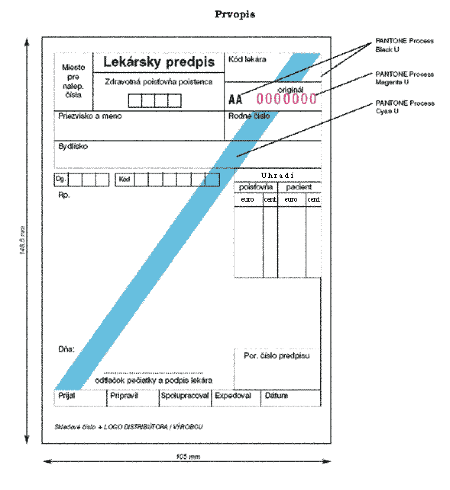
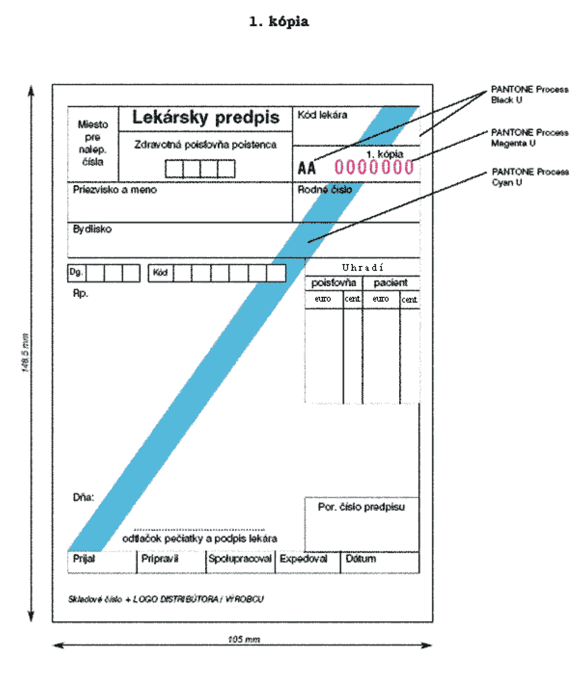
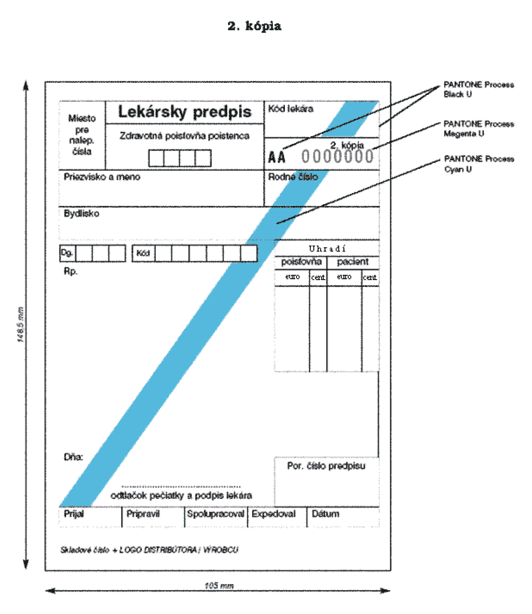

Príloha č. 2 k vyhláške č. 60/2012 Z. z.

- Vzor osobitného tlačiva lekárskeho predpisu označeného šikmým modrým pruhom a podrobnosti o jeho grafických prvkoch

  - Prvopis

- 

  - 1. kópia

- 

  - 2. kópia

- 

  - 1. Rozmer tlačiva:

  - Osobitné tlačivo lekárskeho predpisu označené šikmým modrým pruhom má rozmer 105 mm x 148,5 mm.

  - 2. Podkladový materiál:

  - Osobitné tlačivo lekárskeho predpisu označené šikmým modrým pruhom sa skladá z originálu a dvoch kópií.

  - Prvopis tlačiva je vytlačený na bezdrevnom ofsetovom papieri s hmotnosťou minimálne 80 g/m2.

  - Kópie tlačiva sú vytlačené na bezdrevnom ofsetovom papieri s hmotnosťou minimálne 80 g/m2.

  - 3. Farebnosť:

  - Lícna strana prvopisu tlačiva: 2 farby

    - 1. Tlač a texty na lícnej strane prvopisu tlačiva sú vyhotovené farbou z Pantone škály Black U.

    - 2. Prvopis tlačiva obsahuje na lícnej strane označenie šikmým modrým pruhom smerujúce uhlopriečne z ľavej dolnej strany prvopisu tlačiva do pravej hornej strany prvopisu tlačiva. Šírka šikmého modrého pruhu je 10 mm. Šikmý modrý pruh je vyhotovený farbou z Pantone škály Cyan U.

  - Rubová strana prvopisu tlačiva: 0 farieb

  - Lícna strana 1. a 2. kópie tlačiva: 2 farby

    - 1. Tlač a texty na lícnej strane kópie tlačiva sú vyhotovené farbou z Pantone škály Black U.

    - 2. Kópie tlačiva obsahujú na lícnej strane označenie šikmým modrým pruhom smerujúce uhlopriečne z ľavej dolnej strany kópie tlačiva do pravej hornej strany kópie tlačiva. Šírka šikmého modrého pruhu je 10 mm. Šikmý modrý pruh je vyhotovený farbou z Pantone škály Cyan U.

  - Rubová strana 1. a 2. kópie tlačiva: 0 farieb

  - 4. Číslovanie:

  - Prvopis tlačiva na lícnej strane obsahuje nezameniteľné sekvenčné evidenčné číslo tvorené kombináciou dvoch písmen a sedemmiestnym číslom. Písmená sú vyhotovené farbou z Pantone škály Black U a číslice sú vyhotovené farbou z Pantone škály Magenta U.

  - Kópie tlačiva obsahujú na lícnej strane nezameniteľné evidenčné číslo, ktoré je alfanumericky zhodné s evidenčným číslom prvopisu tlačiva.
