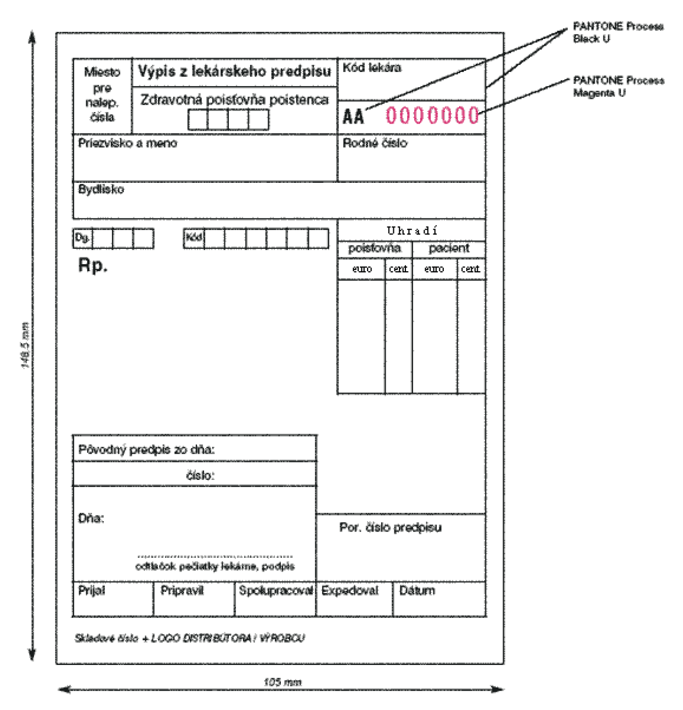

Príloha č. 4 k vyhláške č. 60/2012 Z. z.

- Vzor tlačiva výpisu z lekárskeho predpisu a podrobnosti o jeho grafických prvkoch 

  - 1. Rozmer tlačiva:

  - Tlačivo výpisu z lekárskeho predpisu má rozmer 105 mm x 148,5 mm.

  - 2. Podkladový materiál:

  - Tlačivo výpisu z lekárskeho predpisu je vytlačené na bezdrevnom ofsetovom papieri s hmotnosťou minimálne 80 g/m2.

  - 3. Farebnosť:

  - Lícna strana tlačiva: 1 farba

  - Tlač a texty na lícnej strane tlačiva sú vyhotovené farbou z Pantone škály Black U.

  - Rubová strana tlačiva: 0 farieb

  - 4. Číslovanie:

  - Tlačivo na lícnej strane obsahuje nezameniteľné sekvenčné evidenčné číslo tvorené kombináciou dvoch písmen a sedemmiestnym číslom. Písmená sú vyhotovené farbou z Pantone škály Black U a číslice sú vyhotovené farbou z Pantone škály Magenta U.
