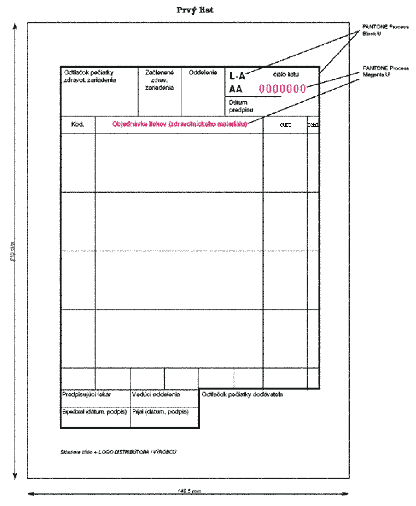
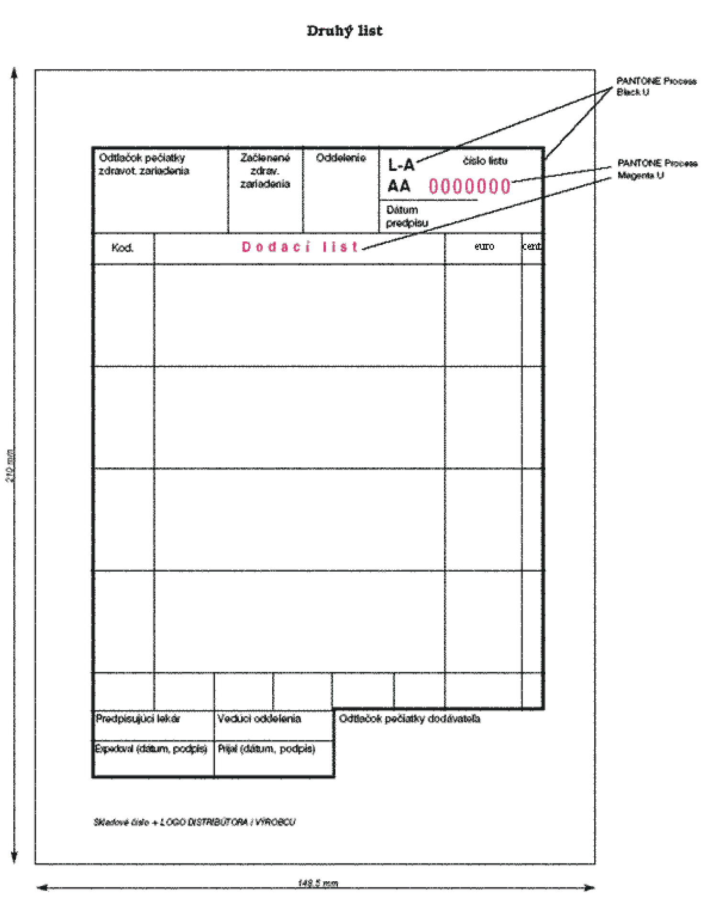
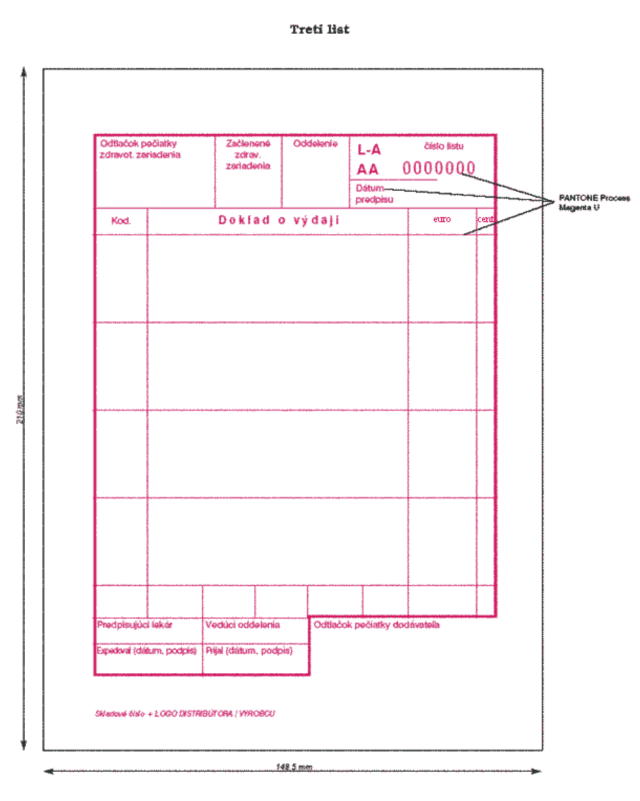
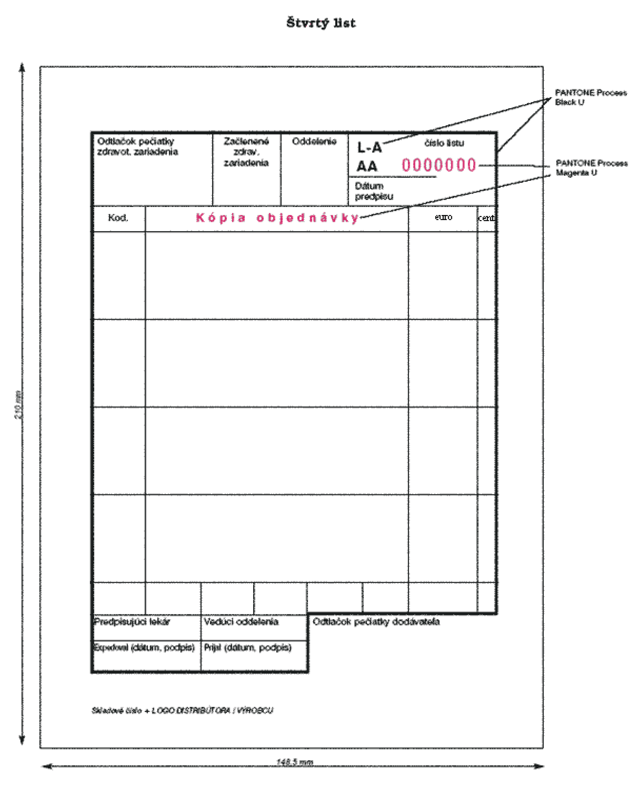

Príloha č. 5 k vyhláške č. 60/2012 Z. z.

- Vzor tlačiva objednávky a podrobnosti o jeho grafických prvkoch

  - Prvý list

- 

  - Druhý list

- 

  - Tretí list

- 

  - Štvrtý list

- 

  - 1. Rozmer tlačiva:

  - Tlačivo objednávky má rozmer 148,5 mm x 210 mm.

  - 2. Podkladový materiál:

  - Tlačivo objednávky sa skladá zo štyroch rovnocenných listov vytlačených na samoprepisovacom papieri s hmotnosťou minimálne 50 g/m2.

  - 3. Farebnosť:

  - Lícna strana každého tlačiva: 2 farby

    - 1. Tlačivo obsahuje na lícnej strane prvého listu tlačiva tlač a texty vyhotovené farbou z Pantone škály Black U a Magenta U.

    - 2. Tlačivo obsahuje na lícnej strane druhého listu tlačiva tlač a texty vyhotovené farbou z Pantone škály Black U a Magenta U.

    - 3. Tlačivo obsahuje na lícnej strane tretieho listu tlačiva tlač a texty vyhotovené farbou z Pantone škály Magenta U.

    - 4. Tlačivo obsahuje na lícnej strane štvrtého listu tlačiva tlač a texty vyhotovené farbou z Pantone škály Black U a Magenta U.

    - Rubová strana tlačiva: 0 farieb

  - 4. Číslovanie:

  - Tlačivo na lícnej strane každého listu obsahuje nezameniteľné sekvenčné evidenčné číslo tvorené kombináciou dvoch písmen a sedemmiestnym číslom. Písmená sú vyhotovené farbou z Pantone škály Black U a číslice sú vyhotovené farbou z Pantone škály Magenta U.
