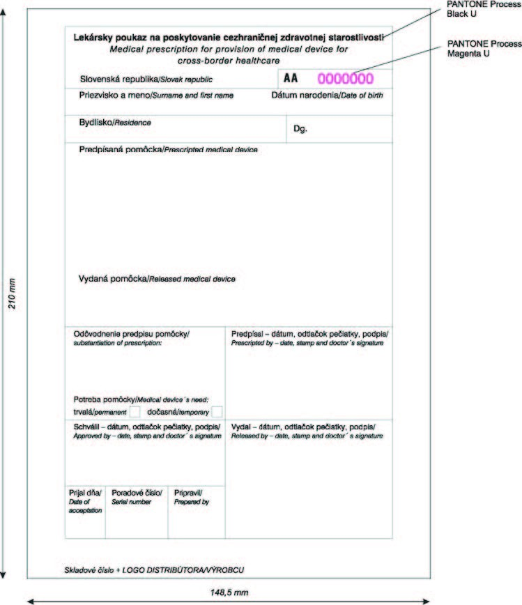
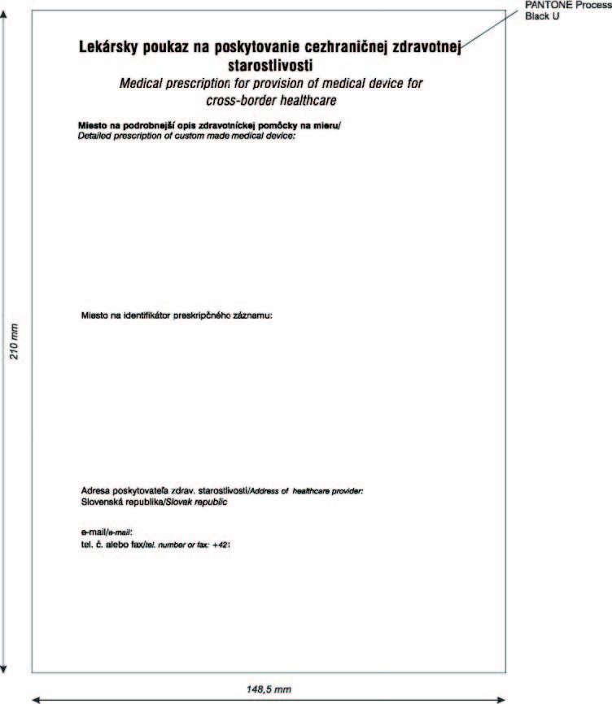

Príloha č. 8 k vyhláške č. 60/2012 Z. z.

- VZOR TLAČIVA LEKÁRSKEHO POUKAZU NA POSKYTOVANIE CEZHRANIČNEJ ZDRAVOTNEJ STAROSTLIVOSTI A PODROBNOSTI O JEHO GRAFICKÝCH PRVKOCH

  - Obrázok: Príloha č. 8 lícna strana

- 

  - Obrázok: Príloha č. 8 rubová strana

- 

  - 1. Rozmer tlačiva:

    - Tlačivo lekárskeho poukazu má rozmer 148,5 mm x 210 mm.

  - 2. Podkladový materiál:

    - Tlačivo lekárskeho poukazu je vytlačené na bezdrevnom ofsetovom papieri s hmotnosťou minimálne 80 g/m2.

  - 3. Farebnosť:

    - Lícna strana tlačiva: 1 farba

    - Tlač a texty na lícnej strane tlačiva sú vyhotovené farbou z Pantone škály Black U.

    - Rubová strana tlačiva: 1 farba

    - Texty na rubovej strane tlačiva sú vyhotovené farbou z Pantone škály Black U.

  - 4. Číslovanie:

    - Tlačivo na lícnej strane obsahuje nezameniteľné sekvenčné evidenčné číslo tvorené kombináciou dvoch písmen a sedemmiestnym číslom. Písmená sú vyhotovené farbou z Pantone škály Black U a číslice sú vyhotovené farbou z Pantone škály Magenta U.
