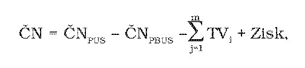
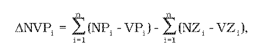

Príloha č. 2 k vyhláške č. 63/2012 Z. z.

- Postup výpočtu čistých nákladov a spôsob posudzovania nákladovej efektívnosti poskytovania univerzálnej služby, výnosov a trhovej výhody podľa § 56 ods. 2 zákona

  - (1) Výpočet čistých nákladov zahŕňa

    - a) čisté náklady vynaložené na poskytovanie univerzálnej služby v súlade s podmienkou nákladovej efektívnosti jej poskytovania podľa § 56 ods. 2 zákona, a to priame náklady, ako aj časť nepriamych nákladov súvisiacich s poskytnutou univerzálnou službou,

    - b) primeraný zisk v súlade s podmienkou prihliadania na výnosy poskytovateľa z poskytovania univerzálnej služby podľa § 56 ods. 2 zákona a

    - c) trhovú výhodu podľa § 56 ods. 2 zákona.

  - (2) Pri výpočte čistých nákladov sa zohľadní vplyv plnenia povinnosti poskytovateľa na náklady a výnosy poskytovateľa, pričom sa dodržiavajú tieto princípy:

    - a) zohľadnia sa iba náklady súvisiace s poskytovaním univerzálnej služby v kvalite podľa zákona, a to najmä podľa požiadaviek na kvalitu univerzálnej služby (§ 41 zákona) a poštovej licencie,

    - b) v súlade s podmienkou zohľadnenia výnosov z poskytovania univerzálnej služby podľa § 56 ods. 2 zákona sa započítajú len tie časti univerzálnej služby, pri ktorých má poskytovateľ stratu alebo ktoré sa vykonávajú za takých podmienok a nákladov, ktoré nezodpovedajú obvyklým obchodným podmienkam a ktoré by bez povinnosti univerzálnej služby poskytovateľ neposkytoval alebo poskytoval za iných podmienok,

    - c) čisté náklady je potrebné vypočítať tak, aby sa dodržala zásada transparentnosti,

    - d) oddelené čisté náklady je potrebné sčítať tak, aby sa zabránilo dvojitému započítaniu,

    - e) poskytovateľ má právo pri poskytovaní univerzálnej služby tvoriť primeraný zisk, ktorý by mal dosahovať stupeň ziskovosti prostriedkov, aký by dosahoval bez povinnosti poskytovania univerzálnej služby,

    - f) musí sa dodržiavať zníženie čistých nákladov o každú trhovú výhodu poskytovateľa, ktorú dosiahol z titulu poskytovania univerzálnej služby.

  - (3) Pri posudzovaní nákladovej efektívnosti sa berie do úvahy spôsob poskytovania univerzálnej služby, pričom za nákladovo efektívne poskytovanie univerzálnej služby sa považuje len také poskytovanie univerzálnej služby, ktorým poskytovateľ zabezpečuje poskytovanie univerzálnej služby v kvalite podľa zákona, a to najmä podľa požiadaviek na kvalitu univerzálnej služby (§ 41 zákona) a poštovej licencie, s najnižšími nákladmi, a to aj v prípadoch, keď sa poskytovateľ rozhodol pre iný spôsob poskytovania univerzálnej služby. Náklady, ktoré neboli vynaložené v súlade s nákladovo efektívnym poskytovaním univerzálnej služby, sa do čistých nákladov nezahŕňajú.

  - (4) Na účely určenia čistých nákladov poskytovateľa sa vypracuje komerčný scenár, ktorý popisuje, ako by sa poskytovateľ správal, ak by nemal povinnosť poskytovať univerzálnu službu. Komerčný scenár najmä identifikuje kontaktné miesta verejnej poštovej siete a prístupové miesta verejnej poštovej siete, ktoré by poskytovateľ neprevádzkoval (ďalej len „stratové pošty“), a nerentabilné lokality a skupiny užívateľov poštových služieb, v ktorých a ktorým by poštové služby neposkytoval alebo poskytoval v obmedzenom rozsahu, za iných podmienok a v inej kvalite (ďalej len „stratové lokality“). Komerčný scenár musí byť reálny a konkurencieschopný, potvrdzujúci snahu udržať si postavenie na trhu a zákazníkov a pri jeho vypracovaní sa

    - a) berie do úvahy, že ide o ten istý poštový podnik, ktorý si bez povinnosti univerzálnej služby plní svoje ďalšie záväzky a povinnosti vyplývajúce z uzavretých zmlúv,

    - b) uvedie, akým spôsobom, v akej kvalite a ktoré produkty a služby by tento poštový podnik za komerčných podmienok poskytoval a ako by zabezpečil doručovanie,

    - c) zohľadnia zmeny v týchto parametroch univerzálnej služby:

      - 1. geografické podmienky a hustota osídlenia na relevantnom území,

      - 2. frekvencia dodávania,

      - 3. poskytované produkty a služby,

      - 4. požadovaná kvalita služieb,

      - 5. požadovaná hustota poštovej siete a

      - 6. cenotvorba,

    - d) náležitá pozornosť venuje ohodnoteniu komerčného scenára, najmä vplyvu reakcie zákazníkov na dopyt po službách a vplyv na výnosy.

  - (5) Na účely určenia čistých nákladov poskytovateľa sa berú do úvahy skutočne vynaložené ekonomicky oprávnené náklady poskytovateľa, vychádzajúc z účtovníctva poskytovateľa vedeného v súlade s § 54 zákona.

  - (6) Čisté náklady sa vypočítajú ako rozdiel efektívne vynaložených čistých nákladov poskytovateľa a čistých nákladov, ktoré by dosiahol ten istý poskytovateľ bez povinnosti univerzálnej služby, vrátane započítania zmien vo výnosoch, zohľadnenia trhovej výhody a práva na primeraný zisk podľa vzorca

  - 

    - kde

    - ČNPUS – efektívne vynaložené čisté náklady poskytovateľa so zohľadnením zmien vo výnosoch,

    - ČNPBUS – čisté náklady poskytovateľa bez povinnosti poskytovať univerzálnu službu so zohľadnením zmien vo výnosoch, ktoré sú stanovené na základe komerčného scenára,

    - TV – trhová výhoda,

    - Zisk – právo na primeraný zisk.

  - (7) Rozdiel čistých nákladov poskytovateľa a čistých nákladov toho istého poskytovateľa, bez povinnosti poskytovať univerzálnu službu, sa vypočíta osobitne za jednotlivé prvky súvisiace s povinnosťami univerzálnej služby podľa vzorca

  - 

    - kde

    - a) ΔNVPi – zmena nákladov a výnosov poskytovateľa za podaciu časť pôšt „i“, ktoré sú ovplyvnené zmenami v jednotlivých parametroch v komerčnom scenári podľa odseku 4 písm. c). Predpokladá sa, že poskytovateľ by podľa komerčného scenára neprevádzkoval stratové pošty a časť objemov podaja spolu s ich výnosmi a nákladmi by bola zaistená inými prístupovými alebo kontaktnými miestami (ďalej len „prevádzkované pošty“).

    - Pošta je považovaná za stratovú, ak dosiahla záporný výsledok hospodárenia, t. j. NCi > VCi, kde

    - NCi – celkové náklady pošty „i“ zistené z účtovníctva,

    - VCi – celkové výnosy z produktov predaných poštou „i“ zistené z účtovníctva.

    - ΔNVPisa za podaciu časť stratových pôšt a prevádzkovaných pôšt vypočíta podľa vzorca

    - 

      - kde

      - NPi – náklady na prevádzku podacej časti stratovej pošty „i“; nákladmi na podaciu časť pošty sa rozumejú náklady danej pošty znížené o osobné náklady doručovateľov,

      - VPi – výnosy z produktov a služieb predaných stratovou poštou „i“,

      - NZi – časť nákladov NPi, o ktoré sa zvýšia náklady prevádzkovaným poštám preberajúcim služby pôvodne poskytované poštou „i“,

      - VZi – časť výnosov VPi, o ktoré sa zvýšia výnosy prevádzkovaným poštám preberajúcim predaj produktov pôvodne predávaných poštou „i“.

    - b) ΔNVDi – zmena nákladov a výnosov poskytovateľa vplyvom zmien parametrov podľa odseku 4 písm. c) na dodanie v nadväznosti na komerčný scenár. Predpokladá sa, že poskytovateľ by podľa komerčného scenára neposkytoval poštové služby v stratových lokalitách, prípadne by ich poskytoval v obmedzenom rozsahu, za iných podmienok a v inej kvalite. Táto zmena sa vypočíta podľa vzorca

    - 

      - kde

      - ΔONDi – zmena osobných nákladov doručovateľa za rajón „i“ v dôsledku zmien v doručovaní,

      - ΔINi – iné náklady súvisiace so zmenami doručovania v rajóne „i“ (napr. nárast spotreby pohonných látok pri motorizovanom doručovaní),

      - ΔVSi – zmena výnosov poskytovateľa vplyvom zmien v dodaní podľa komerčného scenára.

    - c) ΔNPT – zmena v nákladoch na prepravu a triedenie produktov poskytovateľa v dôsledku zmien prepravnej siete a doručovania v komerčnom scenári.

    - d) ΔNR – zmena v režijných nákladoch poskytovateľa v dôsledku zmeny v parametroch v nadväznosti na komerčný scenár.

  - (8) Trhová výhoda poskytovateľa (TVi) je finančne ohodnotená trhová hmotná a nehmotná výhoda plynúca poskytovateľovi z poskytovania univerzálnej služby. Hmotná výhoda je zohľadnená priamo vo vzorci výpočtu čistých nákladov podľa odseku 7, kde sa zohľadňujú zmeny v nákladoch a výnosoch. Nehmotná výhoda je najmä:

    - 1. Daňová výhoda, ako napríklad oslobodenie univerzálnych služieb od dane z pridanej hodnoty.

    - 2. Obchodné meno, označenie „pošta“ podľa § 8 ods. 8 zákona, ako aj ochranná známka. Na ocenenie tejto výhody sa bežne používa prístup úspory poplatkov za autorské práva alebo úspora marketingových nákladov („relief from royalty“).

    - 3. Marketingový efekt. Označenie pôšt, dopravných prostriedkov a doručovateľov poskytovateľa predstavuje reklamnú plochu, ktorú poskytovateľ môže použiť na propagáciu svojej značky a služieb alebo ju prenajať.

    - 4. Úspora z rozsahu a vyššia vyjednávajúca sila s dodávateľmi. Vzhľadom na navýšenie objemu celkových poskytovaných služieb vďaka poskytovaniu univerzálnej služby dosahuje poskytovateľ nižšie jednotkové náklady. Zároveň jeho zvýšená veľkosť mu umožňuje vyjednať s dodávateľmi výhodnejšie komerčné podmienky. Táto úspora predstavuje pre poskytovateľa výhodu pri poskytovaní ostatných služieb.

    - 5. Iná výhoda poskytovateľa, ktorú možno kvantifikovať na základe údajov z účtovníctva, marketingových prieskumov a špecifických oceňovacích postupov ako zvýšenie dopytu po poštových službách a prístup na trh filatelie.

  - (9) Ziskom sa rozumie právo na primeraný zisk poskytovateľa, ktorý mu zabezpečí primeranú návratnosť vlastného kapitálu alokovaného na univerzálnu službu, alebo zisk určený na základe vývoja obvyklého podielu zisku na oprávnených nákladoch.
