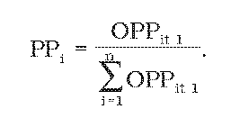

Príloha č. 5 k vyhláške č. 63/2012 Z. z.

- Výpočet výšky príspevku poštového podniku a podiel poskytovateľa podľa § 58 zákona

  - (1) Na účely určenia výšky príspevku poštového podniku úrad určí predbežné čisté náklady za obdobie prvých šiestich mesiacov kalendárneho roka t, za ktorý sa uhrádzajú čisté náklady. Predbežné čisté náklady úrad určí v súlade s postupom na výpočet čistých nákladov podľa prílohy č. 2.

  - (2) Povinnosť platiť príspevok má každý poštový podnik, ktorý v kalendárnom roku t, za ktorý sa uhrádzajú čisté náklady, poskytoval zameniteľné poštové služby. Príspevok poštového podniku sa určí podľa vzorca

    - PiKFt= PPix PČNt,

    - pričom

    - PiKFt ≤ 0,03 x OPPit,

    - kde

    - PiKFt – príspevok poštového podniku i do kompenzačného fondu za rok t z obratu poštového podniku z poskytovania zameniteľných poštových služieb,

    - PČNt – predbežné čisté náklady určené úradom za kalendárny rok t,

    - OPPit – predložený obrat poštového podniku zo zameniteľných služieb alebo obrat poskytovateľa z poskytovania služieb v rozsahu univerzálnej služby za obdobie prvých šiestich mesiacov kalendárneho roka t,

    - PPi – podiel poštového podniku na trhu; PPi sa vypočíta podľa vzorca

  - 

  - (3) Na účely určenia podielu poštového podniku na trhu podľa § 58 ods. 1 zákona sa v roku 2012 použijú údaje o obrate za prvých šesť mesiacov roku 2012.

  - (4) Ak je rozdiel medzi sumou náhrady čistých nákladov univerzálnej služby a sumou predbežných čistých nákladov kladný, na účely doplnenia príspevkov do kompenzačného fondu sa príspevok poštového podniku dopočíta rovnakým postupom podľa odseku 2.

  - (5) Na účely doplnenia chýbajúcich prostriedkov v kompenzačnom fonde zo štátneho rozpočtu podľa § 58 ods. 5 oznámi úrad Ministerstvu dopravy, výstavby a regionálneho rozvoja Slovenskej republiky výšku predbežných čistých nákladov, sumu príspevkov poštových podnikov a podiel poskytovateľa na príspevku.
