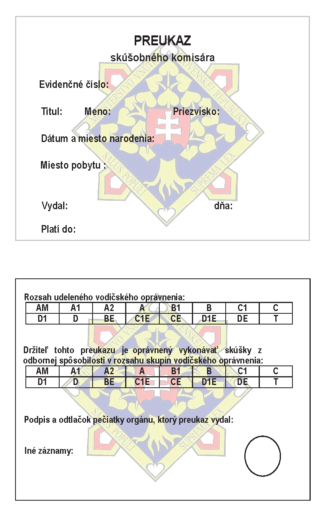

# Čl. I

Vyhláška Ministerstva vnútra Slovenskej republiky č. 9/2009 Z. z., ktorou sa vykonáva zákon o cestnej premávke a o zmene a doplnení niektorých zákonov v znení vyhlášky č. 130/2010 Z. z., vyhlášky č. 413/2010 Z. z., vyhlášky č. 361/2011 Z. z. a vyhlášky č. 381/2012 Z. z. sa mení a dopĺňa takto:

- 1. V § 22a ods. 2 sa za slová „jazdnej súpravy“ vkladajú slová „presahujúcou 3 500 kg a“.

- 2. V § 23 ods. 2 uvádzacej vete sa slová „v dvojtýždňovom študijnom programe tak“ nahrádzajú slovami „v takom študijnom programe“.

- 3. V § 24 odsek 1 znie:

- „(1)

- Skúška na vydanie preukazu skúšobného komisára po absolvovaní odbornej prípravy žiadateľa o vydanie preukazu skúšobného komisára sa skladá

- a)

- z teoretickej skúšky a

- b)

- zo skúšky z vedenia motorových vozidiel.“.

- 4. V § 25a odsek 1 znie:

- „(1)

- Skúšobný komisár sa zúčastňuje pravidelného výcviku zloženého z

- a)

- výučby teórie v rozsahu 32 hodín v priebehu dvoch rokov a

- b)

- praktického výcviku v rozsahu 40 hodín v priebehu piatich rokov.“.

- 5. V § 25a sa vypúšťa odsek 2.

- Doterajšie odseky 3 a 4 sa označujú ako odseky 2 a 3.

- 6. § 26 znie:

- 㤠26

- (1)

- Platnosť preukazu skúšobného komisára možno predĺžiť na základe úspešného vykonania skúšky podľa § 24 ods. 1 písm. a).

- (2)

- Na vykonanie skúšky a na jej hodnotenie sa primerane vzťahujú § 24 ods. 2, 3 a 5 a § 25.

- (3)

- Obsah teoretickej skúšky sa určuje podľa toho, na ktoré skupiny motorových vozidiel je skúšobný komisár oprávnený vykonávať skúšky z odbornej spôsobilosti.“.

- 7. V prílohe č. 1 II. diele čl. 8 odsek 18 znie:

- „(18) Dodatková tabuľka s textom (č. E 12) s nápisom „OKREM DOPRAVNEJ OBSLUHY“ obmedzuje platnosť značky, pod ktorou je umiestnená na

- a) vozidlá zabezpečujúce zásobovanie (nakládku alebo vykládku tovaru), opravárenské, údržbárske služby alebo komunálne a podobné služby,

- b) vozidlá s parkovacím preukazom pre osoby so zdravotným postihnutím alebo na vozidlá s osobitným označením č. O 3,

- c) vozidlá taxislužby,

- d) vozidlá, ktorých vodiči, prípadne prevádzkovatelia, majú v miestach za značkou bydlisko, sídlo, garáž alebo prevádzku,

- e) vozidlá, ktorých jazda alebo preprava za značkou je vykonávaná z dôvodu opravy, servisu, technickej kontroly, emisnej kontroly alebo kontroly originality predmetného vozidla;

- pre tieto vozidlá neplatí značka, pod ktorou je tabuľka umiestnená.“.

- 8. Príloha č. 4 vrátane nadpisu znie:

- „Príloha č. 4 k vyhláške č. 9/2009 Z. z.“.

  - VZOR PREUKAZU SKÚŠOBNÉHO KOMISÁRA 

  - .“
