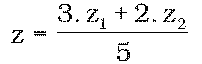
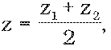
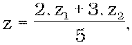

# Čl. I

Vyhláška Ministerstva školstva Slovenskej republiky č. 318/2008 Z. z. o ukončovaní štúdia na stredných školách v znení vyhlášky č. 209/2011 Z. z. sa mení a dopĺňa takto:

- 1. V § 8 ods. 2 sa na konci prvej vety bodka nahrádza bodkočiarkou a pripájajú sa tieto slová: „v predmete slovenský jazyk a literatúra je súčasťou maturitných zadaní aj vzorec na výpočet stupňa prospechu.“.

- 2. V § 9 ods. 1 sa na konci pripájajú tieto slová: „do 31. marca“.

- 3. V § 11 sa vkladá nový odsek 1, ktorý znie:

- „(1)

- Témy na jednotlivé časti absolventskej skúšky s uvedením učebných pomôcok, ktoré môže žiak používať, schvaľuje na návrh predsedu predmetovej komisie riaditeľ školy do 31. marca okrem výnimky ustanovenej v odseku 9.“.

- Doterajšie odseky 1 až 8 sa označujú ako odseky 2 až 9.

- 4. V § 11 ods. 2 sa vypúšťa posledná veta.

- 5. V § 11 ods. 9 písm. c) sa slová „31. marca“ nahrádzajú slovami „31. októbra“.

- 6. Za § 17a sa vkladá § 17b, ktorý vrátane nadpisu znie:

- 㤠17b

- Prechodné ustanovenie k úpravám účinným od 1. septembra 2013

- Žiak, ktorý vykonal maturitnú skúšku podľa predpisov účinných do 31. augusta 2013 a bola mu povolená opravná skúška alebo skúška v náhradnom termíne, vykoná maturitnú skúšku podľa týchto predpisov.“.

- 7. V prílohe časti III predmet SLOVENSKÝ JAZYK A LITERATÚRA znie:

- „Každé maturitné zadanie obsahuje dve úlohy a súvisiace východiskové texty. Prvá úloha obsahuje učivo zo slovenského jazyka. Druhá úloha obsahuje učivo z literatúry.

- Charakteristika úloh maturitných zadaní

- Úloha č. 1 - Úloha je zameraná tak, aby žiak pri odpovedi prejavil pripravenosť komunikovať v štátnom jazyku, schopnosť jazykovo, kompozične a štylisticky analyzovať a interpretovať text a znalosť teoretického systému slovenského jazyka v rozsahu určenom katalógom cieľových požiadaviek a vzdelávacím štandardom. Zároveň má žiak preukázať schopnosť pohotovo reagovať na podnety, argumentovať a kriticky hodnotiť text; uplatňuje sa forma dialógu s členmi predmetovej maturitnej komisie.

- Úloha č. 2 - Úloha je zameraná na schopnosť analyzovať, interpretovať a esteticky hodnotiť umelecký text a pritom uplatňovať vedomosti z literárnej teórie a literárnej histórie; uplatňuje sa forma dialógu s členmi predmetovej maturitnej komisie.

- Zastúpenie jednotlivých tematických okruhov v úlohách maturitných zadaní je takéto:

- Úlohy z jazyka

- zvuková rovina jazyka a pravopis,

- významová/lexikálna rovina jazyka,

- tvarová/morfologická rovina jazyka,

- skladobná/syntaktická rovina jazyka,

- sloh,

- jazykoveda,

- jazyk a reč,

- učenie sa,

- práca s informáciami,

- jazyková kultúra,

- komunikácia.

- Úlohy z literatúry

- všeobecné pojmy,

- literárne obdobia a smery,

- literárne druhy,

- literárne žánre,

- štruktúra literárneho diela,

- štylizácia textu,

- metrika.

- Všeobecné pomôcky

- Krátky slovník slovenského jazyka

- Synonymický slovník slovenčiny

- Pravidlá slovenského pravopisu

- Hodnotenie

- a) Predmetová maturitná komisia hodnotí obsahovú kvalitu a úroveň jazykovej kultúry, t. j. jazykovú a gramatickú správnosť odpovede, rozsah slovnej zásoby, štylistickú pôsobivosť a stupeň rečovej pohotovosti.

- b) Každá úloha maturitného zadania sa hodnotí stupňom prospechu 1 až 5.

- c) Váha hodnotenia jednotlivých úloh je 3 : 2 alebo 1 : 1. Pri výpočte stupňa prospechu sa používa vzorec

- 

- alebo vzorec

- 

- pričom z je po zaokrúhlení výsledný stupeň prospechu, z1 je známka za úlohu č. 1 a z2 je známka za úlohu č. 2. Príslušný vzorec je určený predmetovou komisiou pre jednotlivé triedy podľa formulácie maturitných zadaní.

- d) Váha hodnotenia jednotlivých úloh pre gymnáziá s osemročným vzdelávacím programom môže byť aj v pomere 2 : 3. Pri výpočte stupňa prospechu sa používa vzorec

- 

- pričom z je po zaokrúhlení výsledný stupeň prospechu, z1 je známka za úlohu č. 1 a z2 je známka za úlohu č. 2.

- Ustanovenie tohto písmena sa uplatňuje do 31. augusta 2015.

- Úpravy pre žiakov so zdravotným znevýhodnením

- Trvanie skúšky: 30 minút

- Čas na prípravu: 40 minút.“.

  - 8. V prílohe časti IV vo Všeobecných pokynoch treťom bode sa na konci bodka nahrádza čiarkou a pripájajú sa tieto slová: „okrem ich predloženia na vyjadrenie stavovskej organizácii a profesijnej organizácii k obsahu teoretickej časti odbornej zložky maturitnej skúšky a obsahu praktickej časti odbornej zložky maturitnej skúšky.“.
