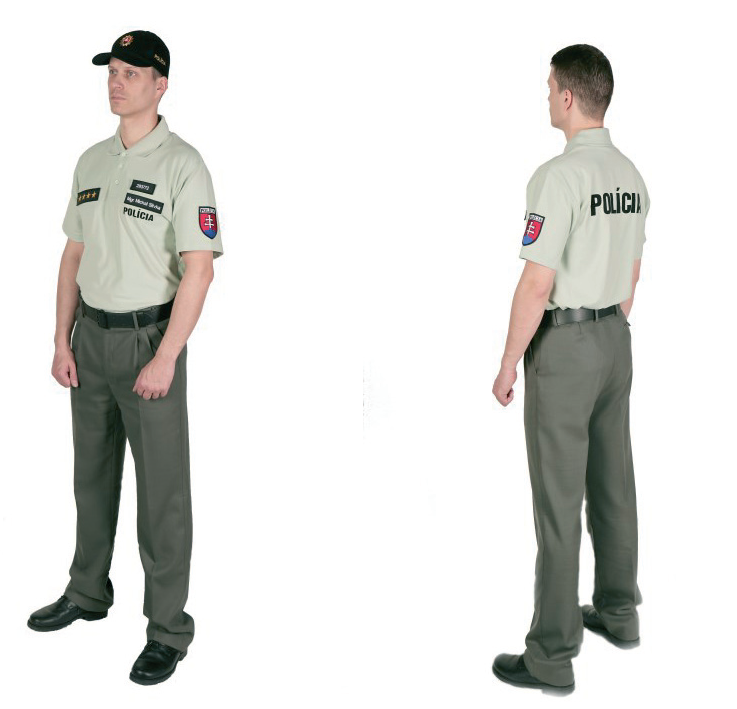
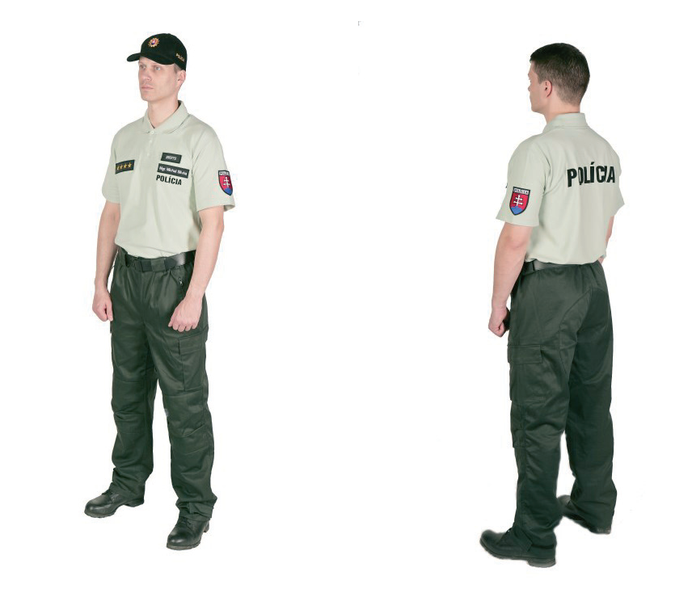

# Čl. I

Vyhláška Ministerstva vnútra Slovenskej republiky č. 151/2009 Z. z. o podrobnostiach o služobnej rovnošate Policajného zboru a jej vyobrazení v znení vyhlášky Ministerstva vnútra Slovenskej republiky č. 109/2010 Z. z. sa mení a dopĺňa takto:

- 1. V § 2 ods. 2 písm. e) sa vypúšťa šiesty bod.

- 2. V § 3 ods. 2 sa za písmeno r) vkladá nové písmeno s), ktoré znie:

- „s)

- polokošeľa s krátkymi rukávmi zelená s nápisom „POLÍCIA“,“.

- Doterajšie písmená s) až ac) sa označujú ako písmená t) až ad).

- 3. V § 4 ods. 1 sa za písmeno k) vkladá nové písmeno l), ktoré znie:

- „l)

- polokošeľa s krátkymi rukávmi zelená s nápisom „POLÍCIA“,“.

- Doterajšie písmená l) až n) sa označujú ako písmená m) až o).

- 4. V § 5 ods. 2 písmená f) a g) znejú:

- „f)

- polokošeľa s krátkymi rukávmi čierna s nápisom „POLÍCIA“,

- g)

- polokošeľa s krátkymi rukávmi biela s nápisom „POLÍCIA“,“.

- 5. V § 5 ods. 2 sa za písmeno g) vkladá nové písmeno h), ktoré znie:

- „h)

- polokošeľa s krátkymi rukávmi zelená s nápisom „POLÍCIA“,“.

- Doterajšie písmená h) až w) sa označujú ako písmená i) až x).

- 6. V § 6 ods. 1 sa za písmeno k) vkladá nové písmeno l), ktoré znie:

- „l)

- polokošeľa s krátkymi rukávmi zelená s nápisom „POLÍCIA“,“.

- Doterajšie písmená l) až n) sa označujú ako písmená m) až o).

- 7. V § 10 ods. 2 sa za písmeno e) vkladá nové písmeno f), ktoré znie:

- „f)

- polokošeľa s krátkymi rukávmi zelená s nápisom „POLÍCIA“,“.

- Doterajšie písmená f) až p) sa označujú ako písmená g) až q).

- 8. V § 11 ods. 2 sa za písmeno e) vkladá nové písmeno f), ktoré znie:

- „f)

- polokošeľa s krátkymi rukávmi zelená s nápisom „POLÍCIA“,“.

- Doterajšie písmená f) až p) sa označujú ako písmená g) až q).

- 9. V prílohe v časti Služobná rovnošata vzor 98 - muž sa na konci pripájajú tieto zobrazenia:

- 

- 10. V prílohe v časti Služobná rovnošata vzor 07 zelená sa na konci pripájajú tieto zobrazenia:

- 

- 11. V prílohe sa vypúšťa časť Označenie hodnostné vyšívané k služobnej rovnošate vzor 07 čiernej pre duchovných.
