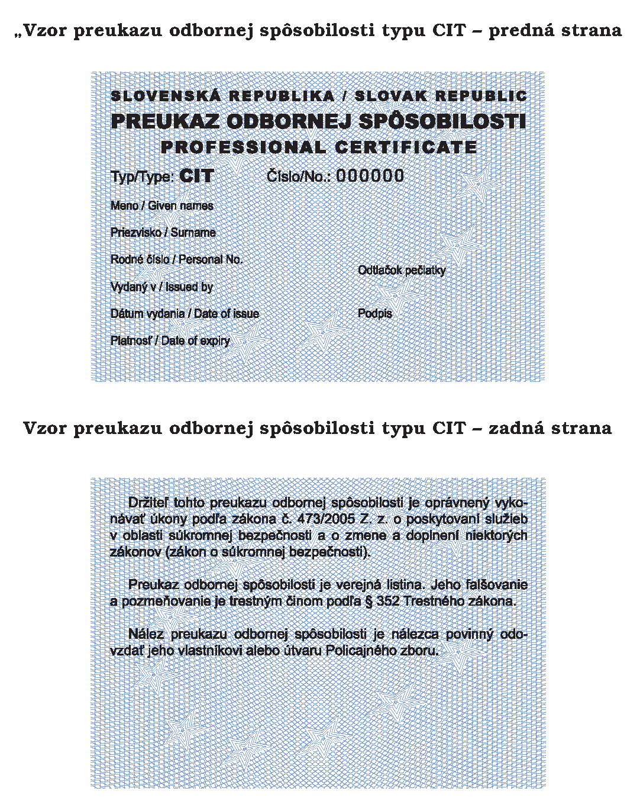
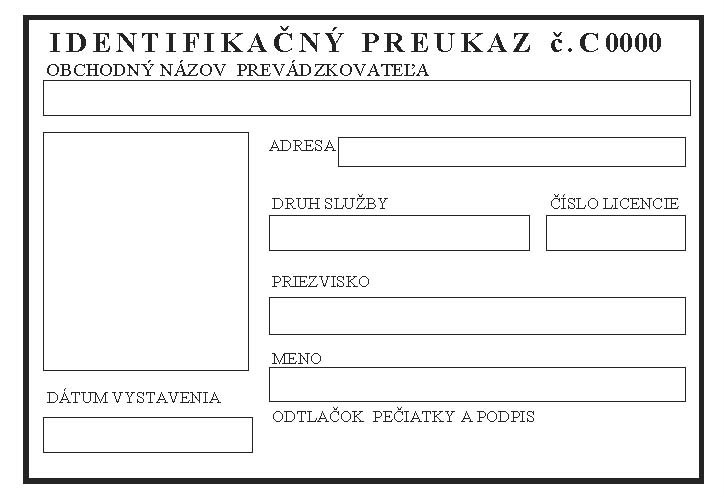

# Čl. I

Vyhláška Ministerstva vnútra Slovenskej republiky č. 634/2005 Z. z., ktorou sa vykonávajú niektoré ustanovenia zákona č. 473/2005 Z. z. o poskytovaní služieb v oblasti súkromnej bezpečnosti a o zmene a doplnení niektorých zákonov (zákon o súkromnej bezpečnosti) sa mení a dopĺňa takto:

- 1. § 4 vrátane nadpisu znie:

- 㤠4

- Odborná príprava

- (1)

- Odborná príprava na skúšku odbornej spôsobilosti (ďalej len „skúška”) typu S sa vykonáva v tomto rozsahu:

- a)

- základy právneho poriadku Slovenskej republiky 1 hodina,

- b)

- Ústava Slovenskej republiky a právna úprava ľudských práv a slobôd 2 hodiny,

- c)

- všeobecne záväzné právne predpisy týkajúce sa poskytovania služieb v oblasti súkromnej bezpečnosti 14 hodín,

- d)

- základy trestného práva 8 hodín,

- e)

- základy kriminalistiky 6 hodín,

- f)

- zákon o priestupkoch 3 hodiny,

- g)

- zákon o Policajnom zbore, zákon o obecnej polícii, zákon o Vojenskej polícii a zákon o Slovenskej informačnej službe 6 hodín,

- h)

- teória taktiky a techniky vykonávania zásahov a riešenie krízových situácií 8 hodín,

- i)

- praktický výcvik taktiky a techniky vykonávania zásahov a riešenie krízových situácií 12 hodín,

- j)

- poskytovanie prvej pomoci 8 hodín,

- k)

- požiarna príprava 5 hodín,

- l)

- všeobecne záväzné právne predpisy týkajúce sa ochrany osobných údajov 5 hodín.

- (2)

- Odborná príprava na skúšku typu P sa vykonáva v tomto rozsahu:

- a)

- základy právneho poriadku Slovenskej republiky 5 hodín,

- b)

- Ústava Slovenskej republiky a právna úprava ľudských práv a slobôd 4 hodiny,

- c)

- všeobecne záväzné právne predpisy týkajúce sa poskytovania služieb v oblasti súkromnej bezpečnosti 15 hodín,

- d)

- základy trestného práva 8 hodín,

- e)

- základy kriminalistiky a kriminológie 6 hodín,

- f)

- zákon o priestupkoch a správny poriadok 8 hodín,

- g)

- zákon o Policajnom zbore, zákon o obecnej polícii, zákon o Vojenskej polícii a zákon o Slovenskej informačnej službe 10 hodín,

- h)

- teória taktiky a techniky vykonávania zásahov a riešenie krízových situácií 8 hodín,

- i)

- praktický výcvik taktiky a techniky vykonávania zásahov a riešenie krízových situácií 12 hodín,

- j)

- poskytovanie prvej pomoci 8 hodín,

- k)

- požiarna príprava 5 hodín,

- l)

- manažment (starostlivosť o zákazníka, komunikácia, základné pracovnoprávne vzťahy) 6 hodín,

- m)

- všeobecne záväzné právne predpisy týkajúce sa ochrany osobných údajov 5 hodín.

- (3)

- Odborná príprava na skúšku typu CIT sa vykonáva v tomto rozsahu:

- a)

- základy právneho poriadku Slovenskej republiky 5 hodín,

- b)

- Ústava Slovenskej republiky a právna úprava ľudských práv a slobôd 4 hodiny,

- c)

- všeobecne záväzné právne predpisy týkajúce sa poskytovania služieb v oblasti súkromnej bezpečnosti 25 hodín,

- d)

- základy trestného práva 15 hodín,

- e)

- základy kriminalistiky a kriminológie 10 hodín,

- f)

- zákon o priestupkoch a správny poriadok 8 hodín,

- g)

- zákon o Policajnom zbore, zákon o obecnej polícii, zákon o Vojenskej polícii a zákon o Slovenskej informačnej službe 10 hodín,

- h)

- teória taktiky a techniky vykonávania zásahov a riešenie krízových situácií 15 hodín,

- i)

- praktický výcvik taktiky a techniky vykonávania zásahov a riešenie krízových situácií 30 hodín,

- j)

- poskytovanie prvej pomoci 9 hodín,

- k)

- požiarna príprava 5 hodín,

- l)

- manažment (Zákonník práce, Obchodný zákonník, Občiansky zákonník) 15 hodín,

- m)

- základy sebaobrany 20 hodín,

- n)

- uplatňovanie oprávnení zamestnanca bezpečnostnej služby v praxi 14 hodín,

- o)

- všeobecne záväzné právne predpisy týkajúce sa ochrany osobných údajov 5 hodín,

- p)

- predpisy týkajúce sa profesionálnej cezhraničnej prepravy eurovej hotovosti cestnou dopravou medzi členskými štátmi eurozóny a ich uplatnenie v praxi 78 hodín.

- (4)

- Vyučovacia hodina podľa odsekov 1 až 3 trvá 45 minút. Pri prednáške možno spojiť dve vyučovacie hodiny.

- (5)

- Odbornú prípravu možno vykonávať v skupine s počtom najviac 30 účastníkov, okrem odbornej prípravy z poskytovania prvej pomoci, ktorá sa vykonáva v skupine s počtom najviac 15 účastníkov. Odborná príprava na skúšky typu S, P a CIT sa vykonáva samostatne. O absolvovaní odbornej prípravy osoba akreditovaná ministerstvom na vykonávanie odbornej prípravy (ďalej len „akreditovaná osoba") vydá účastníkovi osvedčenie o absolvovaní odbornej prípravy, ktoré obsahuje

- a)

- obchodné meno akreditovanej osoby, číslo rozhodnutia o udelení akreditácie,

- b)

- meno, priezvisko, titul, dátum narodenia účastníka,

- c)

- termín konania odbornej prípravy,

- d)

- podpis osoby zodpovednej za riadne vykonávanie odbornej prípravy a odtlačok pečiatky akreditovanej osoby.“.

- 2. V § 5 odsek 2 znie:

- „(2)

- Pred začatím skúšky skúšobná komisia overí totožnosť účastníka, ktorý absolvoval odbornú prípravu alebo osoby uvedenej v § 19 ods. 5 zákona (ďalej len „uchádzač“), absolvovanie odbornej prípravy alebo splnenie podmienok podľa § 19 ods. 5 zákona uchádzačom a poučí ho o spôsobe vykonania skúšky.“.

- 3. V § 6 sa za odsek 2 vkladá nový odsek 3, ktorý znie:

- „(3)

- Písomný test na skúšku typu CIT obsahuje 36 otázok s tromi odpoveďami, z ktorých len jedna je správna.“.

- Doterajšie odseky 3 a 4 sa označujú ako odseky 4 a 5.

- 4. V § 6 ods. 5 sa za slová „typu P“ vkladajú slová „a CIT“.

- 5. V § 8 ods. 1 sa slová „Absolvent skúšky“ nahrádzajú slovom „Uchádzač“.

- 6. V § 8 ods. 2 sa slovo „absolventovi“ nahrádza slovom „uchádzačovi“.

- 7. V § 9 ods. 2 sa slovo „absolventa“ nahrádza slovom „uchádzača“.

- 8. § 11 znie:

- 㤠11

- Vzory žiadostí o udelenie licencie na prevádzkovanie bezpečnostnej služby a licencie na prevádzkovanie technickej služby na ochranu majetku a osoby (ďalej len „technická služba“) sú uvedené v prílohe č. 3.“.

- 9. V § 13 sa slová „č. 4 až 13“ nahrádzajú slovami „č. 4 až 13a“.

- 10. V § 16 ods. 2 sa za slová „označenie S“ vkladá čiarka a slová „identifikačný preukaz na výkon profesionálnej cezhraničnej prepravy eurovej hotovosti cestnou dopravou má označenie CIT“.

- 11. § 19 vrátane nadpisu znie:

- 㤠19

- Evidencia služieb

- (1)

- Prevádzkovateľ strážnej služby v evidencii služieb vedie

- a)

- dátum služby, druh služby v členení podľa § 3 zákona, časové vymedzenie služby (hodina, minúty od - do),

- b)

- miesto výkonu služby (adresa chráneného objektu, chránenej osoby, strážneho stanoviska, miesto zdržiavania sa chránenej osoby),

- c)

- priezvisko, meno, titul a číslo identifikačného preukazu osoby poverenej výkonom fyzickej ochrany.

- (2)

- Prevádzkovateľ strážnej služby alebo ním poverená osoba vyplní údaje uvedené v odseku 1 najmenej šesť hodín pred začatím výkonu služby. Ak dôjde k zmene údajov uvedených v odseku 1 písm. c), zmenu vyznačí ihneď po tom, čo zmena nastala, tak aby pôvodné údaje zostali čitateľné.“.

- 12. V § 24 ods. 1 sa slová „a) až e)“ nahrádzajú slovami „a) až f)“.

- 13. V § 24 ods. 2 sa slová „písm. f)“ nahrádzajú slovami „písm. g)“.

- 14. V § 24 ods. 3 sa slová „písm. g)“ nahrádzajú slovami „písm. h)“.

- 15. V § 24 ods. 4 sa slová „písm. h)“ nahrádzajú slovami „písm. i)“.

- 16. V § 24 ods. 5 sa slová „písm. i)“ nahrádzajú slovami „písm. j)“.

- 17. V § 24 ods. 6 sa slová „písm. j) až n)“ nahrádzajú slovami „písm. k) až o)“ a slová „písm. j) zákona“ sa nahrádzajú slovami „písm. k) zákona“.

- 18. V § 24 ods. 7 sa slová „písm. o)“ nahrádzajú slovami „písm. p)“.

- 19. V § 24 ods. 8 sa slová „písm. p)“ nahrádzajú slovami „písm. q)“.

- 20. Za § 24 sa vkladá § 24a, ktorý vrátane nadpisu znie:

- 㤠24a

- Prechodné ustanovenia k úpravám účinným od 1. februára 2013

- Odborná príprava začatá pred 1. februárom 2013 sa dokončí podľa predpisov účinných do 31. januára 2013.“.

- 21. Príloha č. 2 sa dopĺňa vyobrazením vzoru preukazu odbornej spôsobilosti typu CIT.

- Vzor preukazu odbornej spôsobilosti typu CIT

- 

- Preukaz odbornej spôsobilosti je tlačivo, ktoré má rozmery 99 x 68 mm.“.

- 22. Príloha č. 3 znie:

- „Príloha č. 3 k vyhláške č. 634/2005 Z. z.

- Žiadosť o udelenie licencie na prevádzkovanie strážnej služby, detektívnej služby, odbornej prípravy a poradenstva, vlastnej ochrany alebo technickej služby

- [Vzor 03](assets/e7449d73601a15c17807d1dffbc08565d95a53371a4592fa6d63247f6cfa95a6.pdf)

- “.

- 23. Za prílohu č. 13 sa vkladá príloha č. 13a, ktorá znie:

- „Príloha č. 13a k vyhláške č. 634/2005 Z. z.

- Vzor licencie

- [Vzor 13a](assets/971adf263f1d0c9beb9a3e71793e6d02574722b6858d88822b007924cfb55a3d.pdf)

- “.

- 24. Príloha č. 14 znie:

- „Príloha č. 14 k vyhláške č. 634/2005 Z. z.

- Vzor výkazu štatistických údajov v SR za rok .............................

- [Vzor 14](assets/310508e35e07aec4b71ae005cbc12cae04afda34a8343c9b85c8f8dbbd708e5f.pdf)

- “.

- 25. Príloha č. 15 sa dopĺňa písmenom d), ktoré znie:

- „d)

- Vzor identifikačného preukazu CIT“.

- 
