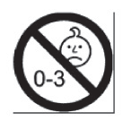

Príloha č. 2 k vyhláške č. 225/2013 Z. z.

- OSOBITNÉ UPOZORNENIA A OPATRENIA, KTORÉ SA MAJÚ DODRŽIAVAŤ PRI POUŽÍVANÍ NIEKTORÝCH KATEGÓRIÍ HRAČIEK

  - 1. Hračka, ktorá nie je určená na hranie pre dieťa vo veku do 36 mesiacov

    - Na hračke, ktorá môže byť pre dieťa vo veku do 36 mesiacov nebezpečná, sa uvádza toto upozornenie: „Nevhodné pre deti vo veku do 36 mesiacov.“ alebo „Nevhodné pre deti do troch rokov.“ alebo upozornenie vo forme tejto grafiky:

  - 

    - Upozornenie je doplnené krátkou informáciou o osobitnom nebezpečenstve vysvetľujúcom toto bezpečnostné opatrenie, ktoré možno uviesť v návode na použitie. Tento bod sa neuplatňuje na hračku, ktorá je vzhľadom na svoju funkciu, rozmery, charakteristiky a jej vlastnosti alebo iné závažné dôvody zjavne nevhodná pre dieťa vo veku do 36 mesiacov.

  - 2. Hračka na rozvíjanie pohybovej aktivity

    - Na hračke na rozvíjanie pohybovej aktivity sa uvádza toto upozornenie: „Iba na domáce použitie.“.

    - K hračke na rozvíjanie pohybovej aktivity pripevnenej k nosníku, a ak je to potrebné, aj k inej hračke na rozvíjanie pohybovej aktivity, musia byť pripojené pokyny, ktoré upozorňujú na potrebu uskutočňovania kontrol a údržby hlavných častí (závesov, upevnení, zakotvení atď.) v určitých intervaloch a poukazujúce na to, že ak tieto kontroly nebudú vykonané, hračka môže spôsobiť pád alebo prevrátenie. Tiež musia byť uvedené pokyny na zabezpečenie správnej montáže hračky s upozornením na tie časti, ktoré môžu pri nesprávnej montáži predstavovať nebezpečenstvo. Zároveň sa uvedú osobitné informácie týkajúce sa vhodného povrchu, na ktorý sa musí hračka umiestniť.

  - 3. Funkčná hračka

    - Na funkčnej hračke sa uvádza toto upozornenie: „Používať pod priamym dohľadom dospelej osoby.“.

    - Navyše je k hračke pripojený návod na použitie uvádzajúci pracovné pokyny, ako aj preventívne opatrenia, ktoré má dieťa dodržiavať, s upozornením, že nedodržiavanie týchto preventívnych opatrení vystavuje dieťa nebezpečenstvu, ktoré je potrebné spresniť - bežne súvisiace so spotrebičom alebo výrobkom, ktorého je daná hračka zmenšeným modelom alebo napodobeninou. Takisto sa uvedie, že hračka sa musí držať mimo dosahu detí do určitého veku, ktorý určí výrobca.

  - 4. Chemická hračka

    - Návod na použitie hračky, ktorá obsahuje nebezpečné chemické látky alebo chemické zmesi, ktoré sú zo svojej samotnej podstaty nebezpečné, musí obsahovať

    - a) upozornenie o nebezpečnej povahe týchto chemických látok alebo chemických zmesí,

    - b) preventívne opatrenia, ktoré musí dieťa dodržiavať, aby sa vyhlo nebezpečenstvu spojenému s ich používaním, ktoré sú stručne špecifikované podľa typu hračky,

    - c) ustanovenie o prvej pomoci, ktorá sa poskytne v prípade vážnej nehody spôsobenej používaním tohto typu hračky a

    - d) upozornenie, že hračka sa musí uchovávať mimo dosahu detí vo veku určenom výrobcom.

  - Na obale chemickej hračky musí byť uvedené aj toto upozornenie: „Nevhodné pre deti vo veku do (vek určí výrobca) rokov. Používať pod priamym dohľadom dospelej osoby.“.

  - 5. Korčule, kolieskové korčule, in-line korčule, skejtbordy, kolobežky a bicykle pre deti

    - Ak sa tieto hračky ponúkajú na predaj, musí na nich byť uvedené toto upozornenie: „Používať ochranné prostriedky. Nepoužívať v premávke na pozemných komunikáciách.“.

    - Návod na použitie musí obsahovať:

    - a) upozornenie, že sa hračka musí používať opatrne, pretože si vyžaduje veľkú zručnosť, aby sa tak zamedzilo pádom alebo zrážkam zapríčiňujúcim zranenie dieťaťa alebo iných osôb, a

    - b) informácie o odporúčaných osobných ochranných prostriedkoch (helmách, rukaviciach, nákolenníkoch, chráničoch na lakte atď.).

  - 6. Hračka do vody

    - Na hračke do vody sa uvádza toto upozornenie: „Používať len vo vode, v ktorej dieťa dosiahne na dno, a pod dohľadom dospelej osoby.“.

  - 7. Hračky s potravinami

    - Ak sa hračka nachádza v potravinách alebo sa ponúka s potravinami, na vonkajšom obale sa uvádza toto upozornenie: „Vnútri sa nachádza hračka. Odporúča sa dohľad dospelej osoby.“.

  - 8. Napodobeniny ochranných masiek a prílb

    - Na napodobenine ochrannej masky a prilby sa uvádza toto upozornenie: „Táto hračka neposkytuje ochranu.“.

  - 9. Hračka určená na zavesenie na kolísku, detskú postieľku alebo detský kočík prostredníctvom povrázkov, šnúr, gumičiek alebo remienkov

    - Hračka určená na zavesenie na kolísku, detskú postieľku alebo detský kočík prostredníctvom povrázkov, šnúr, gumičiek alebo remienkov musí mať na obale toto upozornenie, ktoré je tiež trvalo uvedené aj na hračke: „Aby sa predišlo možnému zraneniu dieťaťa jeho zapletením sa do hračky, odstráňte túto hračku, keď sa dieťa začne stavať na ruky a kolená do plaziacej polohy.“.

  - 10. Balenie alergénnych vonných látok v čuchových spoločenských hrách, kozmetických spoločenských hrách a chuťových spoločenských hrách

    - Balenia alergénnych vonných látok v čuchových spoločenských hrách, kozmetických spoločenských hrách a chuťových spoločenských hrách, ktoré obsahujú vonné látky uvedené v prílohe č. 1 písm. a) bodoch 41 až 55, a alergénnych vonných látok uvedených v prílohe č. 1 písm. b) musia obsahovať toto upozornenie:

  - „Obsahuje alergénne vonné látky, ktoré môžu spôsobiť alergie.“.
