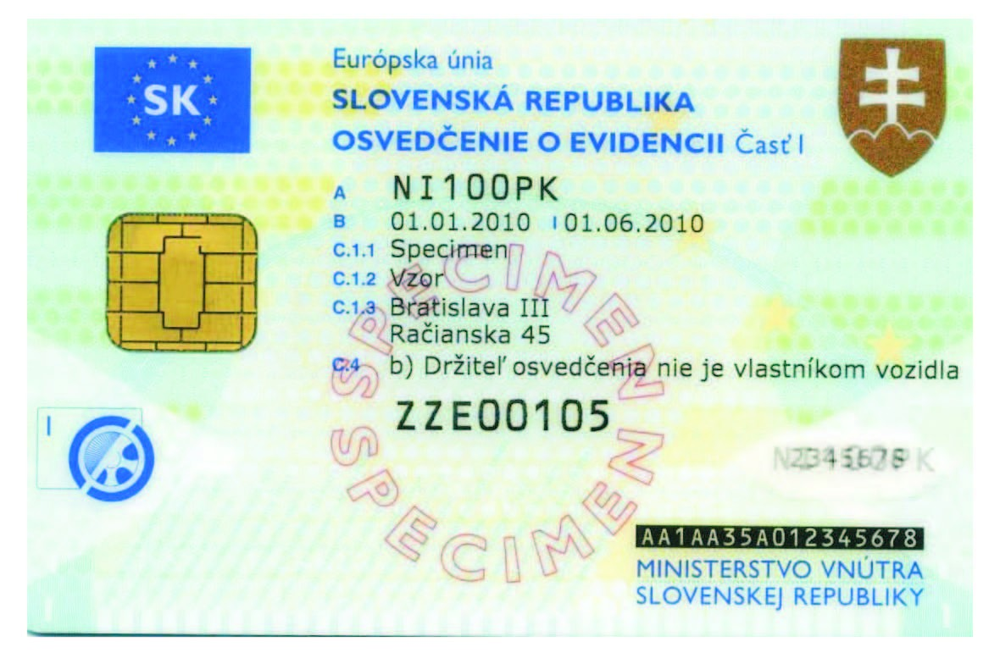
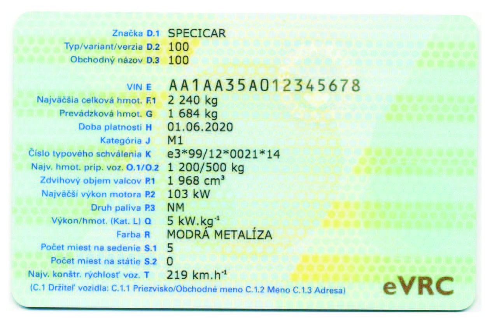
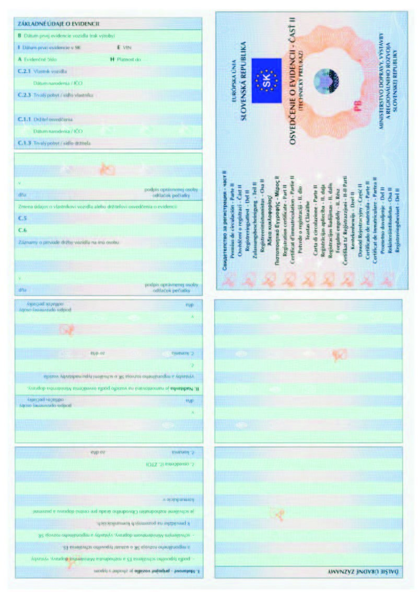
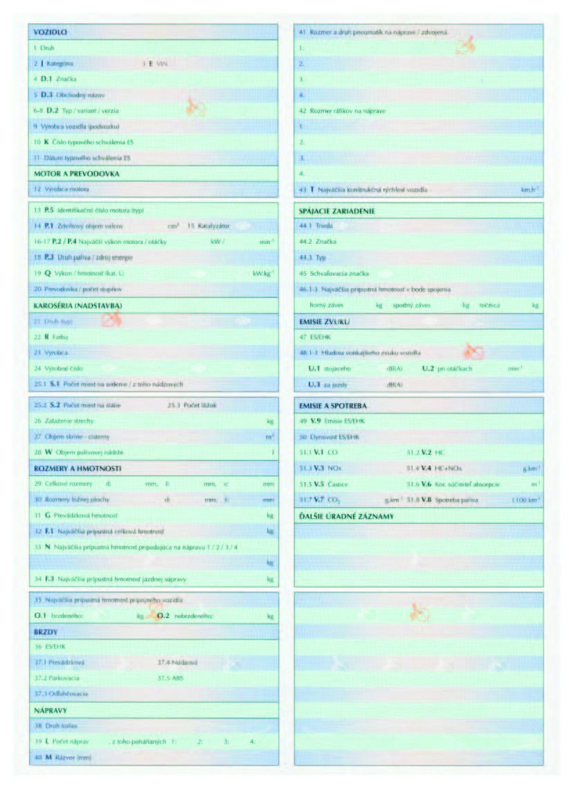

# Čl. I

Vyhláška Ministerstva dopravy, pôšt a telekomunikácií Slovenskej republiky č. 169/2010 Z. z. o osvedčení o evidencii časť I, osvedčení o evidencii časť II a technickom osvedčení vozidla sa mení a dopĺňa takto:

- 1. Za § 8 sa vkladá § 8a, ktorý vrátane nadpisu znie:

- 㤠8a

- Prechodné ustanovenie k úprave účinnej od 15. októbra 2013

- Osvedčenie o evidencii časť I a časť II vydávané podľa predpisov účinných do 14. októbra 2013 možno vydávať do doby vyčerpania ich skladových zásob, najneskôr do 31. decembra 2014.“.

- 2. Prílohy č. 2 a 3 vrátane nadpisov znejú:

- „Príloha č. 2 k vyhláške č. 169/2010 Z. z.

- VZOR OSVEDČENIA O EVIDENCII ČASŤ I

- Predná strana

- 

- Zadná strana

- 

- Príloha č. 3 k vyhláške č. 169/2010 Z. z.

- VZOR OSVEDČENIA O EVIDENCII ČASŤ II

- 

- 

- .“.

- 3. V prílohe č. 4 v časti A ods. 1 písm. b) a v časti B ods. 1 písm. b) sa za slová „F: Francúzsko“ vkladajú slová „HR: Chorvátsko“.

- 4. V prílohe č. 5 ods. 1 písm. k) šiestom bode sa za slová „bodoch 1 až 5“ vkladajú slová „a 7“.

- 5. V prílohe č. 5 ods. 1 sa písmeno k) dopĺňa siedmym bodom, ktorý znie:

- „7. úžitkové kombi (AG)

- – je motorové vozidlo určené na prepravu osôb a ich batožiny, pričom priestor na batožinu musí byť úplne oddelený od priestoru pre cestujúcich. Referenčný bod miesta na sedenie vodiča sa musí nachádzať aspoň 750 mm nad nosným povrchom vozidla.“.

- 6. V prílohe č. 5 ods. 1 písm. l) v prvom a druhom bode sa na konci pripájajú tieto slová: „jednopodlažnom s otvorenou strechou, dvojpodlažnom s otvorenou strechou,“.

- 7. V prílohe č. 5 ods. 1 písm. l) vo štvrtom bode sa na konci pripájajú tieto slová: „jednopodlažnom s otvorenou strechou,“.

- 8. V prílohe č. 5 ods. 1 písm. l) v piatom bode sa na konci bodka nahrádza čiarkou a pripájajú sa tieto slová: „jednopodlažnom s otvorenou strechou.“.

- 9. V prílohe č. 5 ods. 1 písm. p) v treťom, šiestom a siedmom bode sa slová „(BA)“ nahrádzajú slovami „(BA, BE)“.

- 10. V prílohe č. 5 ods. 1 písm. t) sa za piaty bod vkladá nový šiesty bod, ktorý znie:

- „6.

- vozidlo na prepravu osôb na invalidnom vozíku (SH) - motorové vozidlo kategórie M1 osobitne konštruované alebo upravené tak, aby zodpovedalo potrebám jednej alebo viacerých osôb sediacich počas jazdy na svojom invalidnom vozíku,“.

- Doterajší šiesty bod sa označuje ako siedmy bod.

- 11. V prílohe č. 5 ods. 1 sa písmeno u) dopĺňa štvrtým bodom, ktorý znie:

- „4.

- príves s pevným ojom (DE) - prípojné vozidlo s jednou nápravou alebo skupinou náprav s ojami, ktoré vzhľadom na svoju konštrukciu prenáša na ťažné vozidlo statické zaťaženie nepresahujúce 4 000 daN a ktoré nespĺňa vymedzenie prívesu so stredovou nápravou, pričom zariadenie na spojenie jazdnej súpravy nesmie pozostávať z návesového čapu a točnice;“.

- 12. V prílohe č. 5 ods. 1 písm. w) a z) sa za slová „sacio kanalizačná“ vkladá čiarka a slová „na prepravu nadmerného nákladu (SK)“.

- 13. V prílohe č. 5 ods. 1 sa za písmeno cc) vkladá nové písmeno dd), ktoré znie:

- „dd) príves pod náves (SJ) - prípojné vozidlo vybavené točnicou na podopretie návesu s cieľom zmeniť náves na príves,“.

- Doterajšie písmená dd) až rr) sa označujú ako písmená ee) až ss).

- 14. V prílohe č. 5 v poznámke pod čiarou k odkazu 14 sa slová „č. 303/2007 Z. z.“ nahrádzajú slovami „č. 112/2012 Z. z.“.

- 15. Názov prílohy č. 7 znie: „ZOZNAM PREBERANÝCH PRÁVNE ZÁVÄZNÝCH AKTOV EURÓPSKEJ ÚNIE“.

- 16. Doterajší text prílohy č. 7 sa označuje ako prvý bod a dopĺňa sa druhým bodom, ktorý znie:

- „2.

- Smernica Rady 2013/22/EÚ z 13. mája 2013, ktorou sa z dôvodu pristúpenia Chorvátskej republiky upravujú určité smernice v oblasti dopravnej politiky (Ú. v. EÚ L 158, 10. 6. 2013).“.
