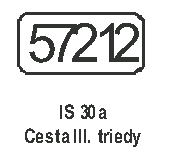
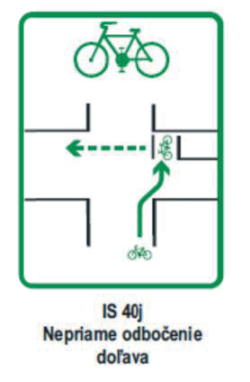
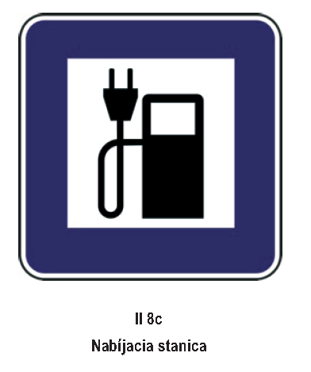
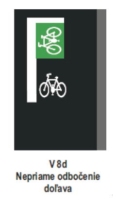
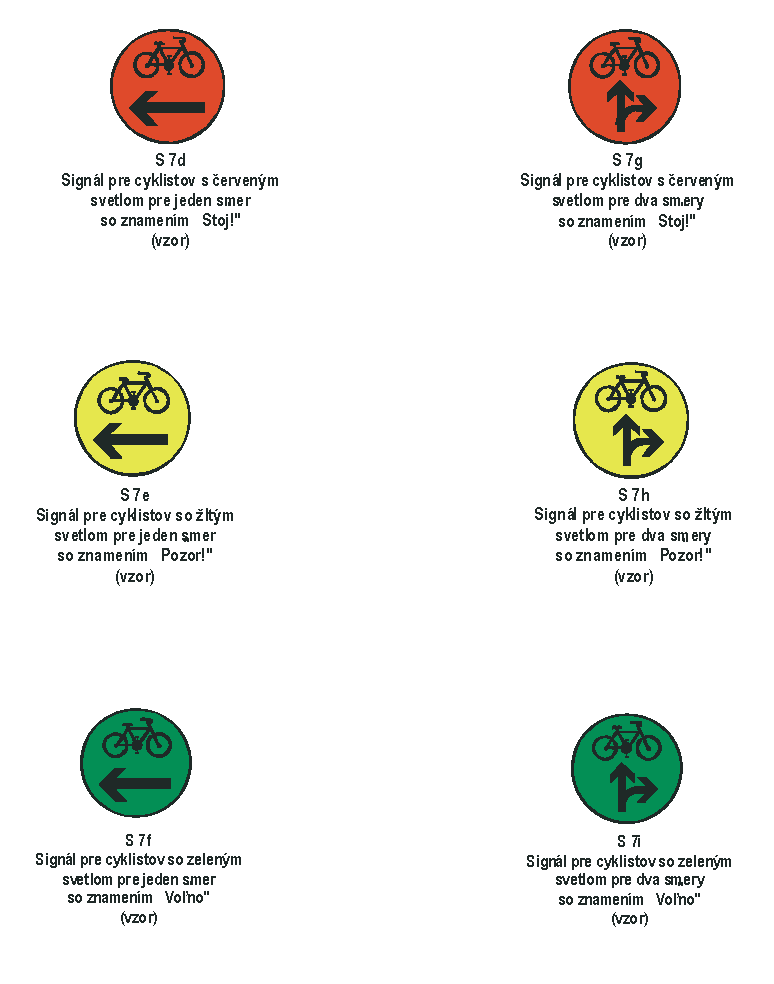
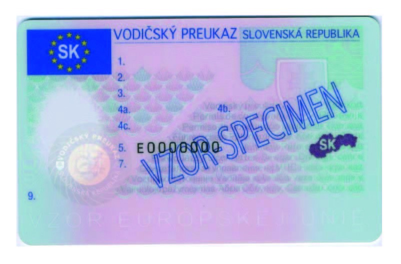
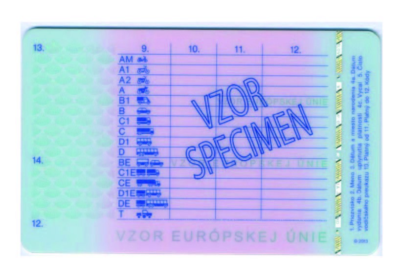

# Čl. I

Vyhláška Ministerstva vnútra Slovenskej republiky č. 9/2009 Z. z., ktorou sa vykonáva zákon o cestnej premávke a o zmene a doplnení niektorých zákonov v znení vyhlášky č. 130/2010 Z. z., vyhlášky č. 413/2010 Z. z., vyhlášky č. 361/2011 Z. z., vyhlášky č. 381/2012 Z. z. a vyhlášky č. 128/2013 Z. z. sa mení a dopĺňa takto:

- 1. Úvodná veta znie: „Ministerstvo vnútra Slovenskej republiky (ďalej len „ministerstvo vnútra“) podľa § 34 ods. 6, § 44 ods. 9, § 51 ods. 5, § 58 ods. 2, § 60 ods. 13, § 62 ods. 3, § 63 ods. 3, § 85, § 91 ods. 16, § 92 ods. 11, § 94 ods. 8, § 101 ods. 8, § 123 ods. 19, § 125 ods. 4, § 128 ods. 4, § 133 ods. 3 a § 140 ods. 8 zákona č. 8/2009 Z. z. o cestnej premávke a o zmene a doplnení niektorých zákonov (ďalej len „zákon“) a po dohode s Ministerstvom zdravotníctva Slovenskej republiky podľa § 86 ods. 6, § 87 ods. 10, § 88 ods. 9, § 89 ods. 4 a § 91 ods. 11 a 12 zákona ustanovuje:“.

- 2. V § 6 ods. 3 prvá veta znie: „Na vodorovné trvalé dopravné značky a doplňujúce nápisy sa používa biela farba, prípadne modrá farba na označenie parkovacích miest s plateným alebo regulovaným státím alebo na oddelenie parkovacieho pruhu s plateným alebo regulovaným státím od jazdného pruhu, na vodorovné dopravné značky vyznačujúce zákaz státia alebo zákaz zastavenia sa používa žltá farba, na vyznačenie zastávky vozidiel pravidelnej dopravy osôb sa používa žltá farba, prípadne biela farba, na vyznačenie cyklistických trás a ich priechodov sa používa zelená farba, prípadne biela farba a na zvýraznenie viditeľnosti cyklistických trás a ich priechodov sa používa zelená farba alebo biela farba na farebnom zelenom alebo červenom podklade.“.

- 3. V § 7 ods. 3 písm. c) ôsmy bod znie:

- „8.

- odrazové sklá a lineárne vodiace pásy,“.

- 4. V § 8 ods. 2 sa za písmeno b) vkladá nové písmeno c), ktoré znie:

- „c)

- dopravné značky č. B 37, č. C 16, č. IP 33, č. IP 33a, č. IS 2 až IS 8, č. IS 9, č. IS 10, č. IS 12, č. IS 16, č. IS 17a až IS 21, č. IS 22c, č. IS 25, č. IS 33 až IS 35, dodatkové tabuľky okrem dodatkovej tabuľky č. E 3 a elektronické (č. Z 11a) a elektromechanické (č. Z 11b) panely na premenné značky, na ktorých možno použiť kombináciu veľkých a malých písmen,“.

- Doterajšie písmená c) až e) sa označujú ako písmená d) až f).

- 5. V § 8 odsek 10 znie:

- „(10)

- Zvislé dopravné značky pri pravom okraji cesty alebo na ľavom okraji jazdného pruhu alebo cesty v smere jazdy vozidiel možno upevniť na jednom stĺpiku alebo na inej nosnej konštrukcii v počte spravidla najviac dve dopravné značky s príslušnými dodatkovými tabuľkami; dopravné značky č. IS 17a až IS 26, č. IS 40a až IS 40d a č. IS 40f až IS 40h v počte najviac štyri dopravné značky.“.

- 6. V § 8 ods. 20 sa slová „C 30“ nahrádzajú slovami „C 25“.

- 7. § 8 sa dopĺňa odsekom 22, ktorý znie:

- „(22)

- Farba používaná na informatívnych smerových značkách č. IS 1a až IS 26 je

- a)

- zelená, ak ide o značku na diaľnici alebo rýchlostnej ceste alebo ak ide o značku smerujúcu k diaľnici alebo k rýchlostnej ceste okrem značiek podľa písmen c) až e),

- b)

- modrá alebo biela, ak ide o značku na inej ceste ako je uvedené v písmene a) okrem značiek podľa písmen c) až e),

- c)

- biela, ak ide o označenie iného cieľa,

- d)

- hnedá, ak ide o označenie kultúrneho alebo turistického cieľa,

- e)

- žltá, ak ide o dočasné označenie alebo o označenie obchádzky.“.

- 8. V § 9 ods. 5 sa slová „odseku 2“ nahrádzajú slovami „odseku 3“.

- 9. V § 10 ods. 4 sa slová „§ 9 ods. 2“ nahrádzajú slovami „§ 9 ods. 3“.

- 10. V § 11 ods. 2 sa slová „§ 9 ods. 2“ nahrádzajú slovami „§ 9 ods. 3“ a slová „(č. S 7a až S 7c)“ sa nahrádzajú slovami „(č. S 7a až S 7i)“.

- 11. V § 11 ods. 4 sa slová „(č. S 5a alebo č. S 7a)“ nahrádzajú slovami „(č. S 5a, č. S 7a, č. S 7d alebo č. S 7g)“ a slová „(č. S 5b alebo č. S 7c)“ sa nahrádzajú slovami „(č. S 5b, č. S 7c, č. S 7f alebo č. S 7i).“.

- 12. V § 15 sa vypúšťa odsek 3.

- Doterajšie odseky 4 až 11 sa označujú ako odseky 3 až 10.

- 13. V § 15 ods. 3 sa slová „podľa odseku 3“ nahrádzajú slovami „o udelenie vodičského oprávnenia“.

- 14. V § 15 ods. 4 sa slová „odseku 4“ nahrádzajú slovami „odseku 3“.

- 15. V § 15 ods. 9 sa za slová „predpísaného na“ vkladajú slová „udelenie vodičského oprávnenia a“.

- 16. V § 15 sa za odsek 9 vkladá nový odsek 10, ktorý znie:

- „(10)

- Ustanovenia odsekov 1 až 3, 5 a 7 sa primerane vzťahujú aj na rozhodovanie o udelení vodičského oprávnenia žiadateľovi o udelenie vodičského oprávnenia, ktorý absolvoval osobitný výcvik v autoškole podľa § 76 ods. 7 alebo § 78 ods. 2 písm. c) alebo ods. 3 písm. c) zákona.“.

- Doterajší odsek 10 sa označuje ako odsek 11.

- 17. V § 16 sa slová „protokol o skúškach z odbornej spôsobilosti“ vo všetkých tvaroch nahrádzajú slovami „protokol vodičských oprávnení“ v príslušnom tvare.

- 18. V § 16 ods. 2 sa slová „§ 15 ods. 4“ nahrádzajú slovami „§ 15 ods. 3“.

- 19. V § 16 ods. 7 poslednej vete sa slová „protokolu o skúškach“ nahrádzajú slovami „protokolu vodičských oprávnení“.

- 20. V § 17 ods. 4 prvej vete sa slová „o ďalšie“ nahrádzajú slovami „najviac o“.

- 21. V § 19 ods. 2 písm. o) sa na konci pripájajú tieto slová: „ak ide o motorové vozidlo skupiny CE a DE,“.

- 22. V § 19 sa odsek 2 dopĺňa písmenom t), ktoré znie:

- „t)

- o používaní záznamového zariadenia,3) ak ide o žiadateľa o vykonanie skúšky skupiny C1, C1E, C, CE, D1, D1E, D a DE.“.

- 23. V § 20 ods. 6 písm. a) štvrtom bode sa vypúšťa slovo „všetkých“ a slová „blatníkov a vykonať kontrolu prístrojového panela vrátane záznamového zariadenia,“ sa nahrádzajú slovami „blatníkov, čelného skla, okien a stieračov,“.

- 24. V § 20 ods. 6 písm. a) sa vypúšťa siedmy bod.

- Doterajšie body 8 až 12 sa označujú ako body 7 až 11.

- 25. V § 21 ods. 1 písmeno c) znie:

- „c)

- berie do úvahy vplyv otáčok motora, radenia prevodových stupňov, zrýchľovania a brzdenia na spotrebu paliva a emisií a či vedie motorové vozidlo skupiny B, BE, C1, C1E, C, CE, D1, D1E, D a DE tak, aby sa znížila spotreba paliva a emisie počas zvyšovania a znižovania rýchlosti, pri jazde do kopca a z kopca, ak je to potrebné a možné, aj ručným radením prevodových stupňov,“.

- 26. V § 22 ods. 2 písmená b) až d) znejú:

- „b)

- skupiny A1 sa vykonáva na dvojkolesovom vozidle skupiny A1 bez postranného vozíka s objemom valcov spaľovacieho motora najmenej 115 cm3, s najväčšou konštrukčnou rýchlosťou najmenej 90 km ● h-1, s výkonom najviac 11 kW a s pomerom výkonu k najväčšej celkovej prípustnej hmotnosti najviac 0,1 kW/kg; v prípade elektrického motora musí byť pomer výkonu k najväčšej celkovej prípustnej hmotnosti v rozsahu od 0,08 kW/kg do 0,1 kW/kg vrátane,

- c)

- skupiny A2 sa vykonáva na dvojkolesovom vozidle skupiny A2 bez postranného vozíka s objemom valcov spaľovacieho motora najmenej 395 cm3, s výkonom najmenej 20 kW a najviac 35 kW a s pomerom výkonu k najväčšej celkovej prípustnej hmotnosti najviac 0,2 kW/kg; v prípade elektrického motora musí byť pomer výkonu k najväčšej celkovej prípustnej hmotnosti v rozsahu od 0,15 kW/kg do 0,2 kW/kg vrátane,

- d)

- skupiny A sa vykonáva na dvojkolesovom vozidle skupiny A bez postranného vozíka s prevádzkovou hmotnosťou najmenej 180 kg, s objemom valcov spaľovacieho motora najmenej 595 cm3, s výkonom motora najmenej 50 kW; v prípade elektrického motora musí byť pomer výkonu k najväčšej celkovej prípustnej hmotnosti najmenej 0,25 kW/kg,“.

- 27. V § 22 ods. 2 písm. j) a k) sa slová „prevodovkou s minimálne ôsmimi prevodovými stupňami vpred“ nahrádzajú slovami „prevodovkou umožňujúcou ručné radenie prevodových stupňov“.

- 28. V § 22 odsek 3 znie:

- „(3)

- Na účely skúšky z vedenia motorových vozidiel a vodičského oprávnenia sa rozumie

- a)

- skutočnou hmotnosťou hmotnosť vozidla v čase konania skúšky z vedenia motorových vozidiel,

- b)

- vozidlom s manuálnou prevodovkou vozidlo, v ktorom je prítomný pedál spojky alebo ručne ovládaná páka spojky pri vozidlách skupiny A1, A2 a A, ktoré vodič takéhoto vozidla musí použiť pri rozjazde alebo zastavení vozidla a pri radení prevodových stupňov,

- c)

- vozidlom s automatickou prevodovkou vozidlo iné, ako je vozidlo podľa písmena b).“.

- 29. V § 22 ods. 4 sa slová „rozsah vodičského oprávnenia“ nahrádzajú slovami „príslušné vodičské oprávnenie“ a vypúšťajú sa druhá a tretia veta.

- 30. V § 22 sa za odsek 4 vkladajú nové odseky 5 až 9, ktoré znejú:

- „(5)

- Ďalšie vodičské oprávnenie skupiny BE sa neobmedzí podľa odseku 4, ak je žiadateľ už oprávnený viesť motorové vozidlo skupiny B s manuálnou prevodovkou.

- (6)

- Vodičské oprávnenie skupiny B udelené podľa § 76 ods. 7 zákona sa neobmedzí podľa odseku 4, ak je žiadateľ už oprávnený viesť motorové vozidlo skupiny B s manuálnou prevodovkou.

- (7)

- Ďalšie vodičské oprávnenie skupiny C, CE, D alebo DE sa neobmedzí podľa odseku 4, ak je žiadateľ už oprávnený viesť motorové vozidlo s manuálnou prevodovkou, ktoré patrí do jednej zo skupín B, BE, C1, C1E, C, CE, D1, D1E alebo D.

- (8)

- Obmedzenie vodičského oprávnenia podľa odseku 4 sa zruší, ak držiteľ takto obmedzeného vodičského oprávnenia úspešne vykoná skúšku z vedenia motorových vozidiel podľa § 20 na motorovom vozidle s manuálnou prevodovkou alebo na jazdnej súprave, kde je motorové vozidlo s manuálnou prevodovkou, ktoré patria do tej skupiny, na vedenie ktorej je vodičské oprávnenie obmedzené.

- (9)

- Obmedzenie vodičského oprávnenia podľa odseku 4 sa zruší aj vtedy, ak držiteľ takto obmedzeného vodičského oprávnenia

- a)

- skupiny AM úspešne vykoná skúšku z odbornej spôsobilosti na udelenie vodičského oprávnenia skupiny A1, A2 alebo A na motorovom vozidle s manuálnou prevodovkou,

- b)

- skupiny A1 úspešne vykoná skúšku z odbornej spôsobilosti na udelenie vodičského oprávnenia skupiny A2 alebo A na motorovom vozidle s manuálnou prevodovkou,

- c)

- skupiny A2 úspešne vykoná skúšku z odbornej spôsobilosti na udelenie vodičského oprávnenia skupiny A na motorovom vozidle s manuálnou prevodovkou,

- d)

- skupiny B, BE, C1, C1E, C, CE, D1, D1E, D alebo DE úspešne vykoná skúšku z odbornej spôsobilosti na udelenie vodičského oprávnenia skupiny BE, C1, C1E, C, CE, D1, D1E, D alebo DE na motorovom vozidle s manuálnou prevodovkou,

- e)

- skupiny B úspešne vykoná osobitnú skúšku podľa § 76 ods. 7 zákona na motorovom vozidle s manuálnou prevodovkou.“.

- Doterajšie odseky 5 až 8 sa označujú ako odseky 10 až 13.

- 31. V § 22a ods. 1 sa za slovo „vzťahuje“ vkladajú slová „§ 15 ods. 1 až 3, 5 a 7 až 11,“ a slová „§ 22 ods. 1, 3, 5 až 8“ sa nahrádzajú slovami „§ 22 ods. 1, 3, 10 až 13“.

- 32. V § 22a sa vypúšťa odsek 4.

- 33. V § 25b ods. 2 sa vypúšťajú slová „po uplynutí doby podľa odseku 1“.

- 34. V § 25c odsek 1 znie:

- „(1)

- Skúšobnému komisárovi, u ktorého boli počas dohľadu podľa § 25b ods. 1 písm. a) alebo počas kontroly podľa § 25b ods. 3 zistené nedostatky v spôsobe vedenia a hodnotenia skúšky z odbornej spôsobilosti alebo osobitnej skúšky, orgán podľa § 81 ods. 7 zákona bezodkladne poskytne metodické poradenstvo zamerané na zistené nedostatky.“.

- 35. V § 25c ods. 2 sa slová „Do piatich dní od absolvovania teórie“ nahrádzajú slovami „Do šesťdesiatich dní od poskytnutia metodického poradenstva“ a na konci sa pripájajú tieto slová „podľa § 24 ods. 1 písm. a)“.

- 36. V § 25c ods. 3 sa slová „ustanovenia § 24 a 25“ nahrádzajú slovami „§ 24 ods. 2, 3 a 5 a § 25“.

- 37. V nadpise § 29 sa slová „§ 87 ods. 7“ nahrádzajú slovami „§ 87 ods. 10“.

- 38. V § 29 sa vypúšťa odsek 1.

- Doterajšie odseky 2 až 14 sa označujú ako odseky 1 až 13.

- 39. V § 29 odsek 1 znie:

- „(1)

- Vzor čestného vyhlásenia podľa § 87 ods. 9 zákona je uvedený v prílohe č. 6.“.

- 40. V § 29 ods. 2 sa slová „kópiu príslušného rozhodnutia“ nahrádzajú slovami „príslušné rozhodnutie“.

- 41. V § 29 odsek 3 znie:

- „(3)

- Osoba, ktorá sa podrobuje lekárskej prehliadke na základe záverov odborného psychiatrického vyšetrenia, predloží posudzujúcemu lekárovi aj kópiu dokladu o preskúmaní zdravotnej spôsobilosti osobitne vo vzťahu k závislosti od alkoholu, inej návykovej látky alebo liečiva overenú orgánom Policajného zboru, ktorý rozhodol o preskúmaní zdravotnej spôsobilosti osobitne vo vzťahu k závislosti od alkoholu, inej návykovej látky alebo liečiva.“.

- 42. V § 29 sa vypúšťa odsek 4.

- Doterajšie odseky 5 až 13 sa označujú ako odseky 4 až 12.

- 43. V § 29 ods. 5 sa za slová „čestného vyhlásenia“ vkladajú slová „podľa odseku 1“.

- 44. V § 29 ods. 6 sa slová „odseku 6“ nahrádzajú slovami „odseku 4“ a slová „odseku 7“ sa nahrádzajú slovami „odseku 5“.

- 45. V § 29 ods. 11 sa slová „odseku 9“ nahrádzajú slovami „odseku 10“.

- 46. Za § 29 sa vkladá § 29a, ktorý vrátane nadpisu znie:

- 㤠29a

- Odborné psychiatrické vyšetrenie (k § 91 ods. 11 zákona)

- (1)

- Zdravotná spôsobilosť osobitne vo vzťahu k závislosti od alkoholu, inej návykovej látky alebo liečiva na základe rozhodnutia orgánu Policajného zboru podľa § 91 ods. 4 zákona sa preskúmava odborným psychiatrickým vyšetrením, ktoré vykonáva lekár so špecializáciou v špecializačnom odbore psychiatria (ďalej len „psychiater“).

- (2)

- Osoba, ktorá sa podrobuje odbornému psychiatrickému vyšetreniu, predloží psychiatrovi aj rozhodnutie podľa odseku 1.

- (3)

- Ďalšie podrobnosti o preskúmaní zdravotnej spôsobilosti osobitne vo vzťahu k závislosti od alkoholu, inej návykovej látky alebo liečiva sú ustanovené v prílohe č. 5a.“.

- 47. V nadpise § 30 sa slová „§ 88 ods. 7“ nahrádzajú slovami „§ 88 ods. 9“.

- 48. V § 30 odsek 3 znie:

- „(3)

- Osoba, ktorá sa podrobuje psychologickému vyšetreniu na základe rozhodnutia o preskúmaní psychickej spôsobilosti, predloží posudzujúcemu psychológovi aj príslušné rozhodnutie.“.

- 49. § 30 sa dopĺňa odsekom 9, ktorý znie:

- „(9)

- Vzor čestného vyhlásenia podľa § 88 ods. 8 zákona je uvedený v prílohe č. 11.“.

- 50. § 31 vrátane nadpisu znie:

- 㤠31

- Doklad o zdravotnej spôsobilosti a doklad o psychickej spôsobilosti (k § 89 ods. 4 zákona)

- (1)

- Doklad o zdravotnej spôsobilosti sa vydáva, ak ide o

- a)

- žiadateľa o udelenie vodičského oprávnenia, ak uplynula platnosť potvrdenia o výsledku lekárskej prehliadky v žiadosti o udelenie vodičského oprávnenia alebo ak je toto potvrdenie nesprávne vyplnené,

- b)

- vodiča, ktorý sa podrobuje preskúmaniu zdravotnej spôsobilosti,

- c)

- vodiča, ktorý má povinnosť podľa § 87 ods. 4, § 89 ods. 1 alebo § 143b zákona,

- d)

- osobu, na ktorú sa vzťahuje § 87 ods. 5 zákona.

- (2)

- Platnosť dokladu o zdravotnej spôsobilosti osoby podľa odseku 1 písm. a) a b) a platnosť potvrdenia o výsledku lekárskej prehliadky podľa § 77 ods. 4 písm. f) zákona je jeden rok od dátumu vykonania lekárskej prehliadky; ak je zdravotná spôsobilosť posudzovanej osoby podmienená podľa § 86 ods. 2 písm. c) zákona, dobu platnosti určuje posudzujúci lekár, najviac na jeden rok. Platnosť dokladu o zdravotnej spôsobilosti podľa odseku 1 písm. d) určuje posudzujúci lekár, najviac na päť rokov; ak je posudzovaná osoba staršia ako 65 rokov, najviac na dva roky.

- (3)

- Vzor a spôsob vyplnenia dokladu o zdravotnej spôsobilosti osoby podľa odseku 1 písm. a) a b) je uvedený v prílohe č. 7. Doklad o zdravotnej spôsobilosti osoby podľa odseku 1 písm. c) a d) má rozmer 86 mm x 55 mm a jeho vzor a spôsob vyplnenia je uvedený v prílohe č. 8.

- (4)

- Doklad o psychickej spôsobilosti sa vydáva, ak ide o

- a)

- žiadateľa o udelenie vodičského oprávnenia,

- b)

- vodiča, ktorý sa podrobuje preskúmaniu psychickej spôsobilosti,

- c)

- vodiča, ktorý má povinnosť podľa § 89 ods. 1 alebo § 143b zákona,

- d)

- osobu, na ktorú sa vzťahuje § 88 ods. 4 zákona.

- (5)

- Platnosť dokladu o psychickej spôsobilosti osoby podľa odseku 4 písm. a) a b) je jeden rok od dátumu vykonania psychologického vyšetrenia; ak je psychická spôsobilosť posudzovanej osoby podmienená podľa § 88 ods. 4 zákona, dobu platnosti dokladu určuje posudzujúci psychológ, najviac na jeden rok. Platnosť dokladu o psychickej spôsobilosti podľa odseku 4 písm. d) určuje posudzujúci psychológ, najviac na päť rokov; ak je posudzovaná osoba staršia ako 65 rokov, najviac na dva roky.

- (6)

- Vzor a spôsob vyplnenia dokladu o psychickej spôsobilosti osoby podľa odseku 4 písm. a) a b) je uvedený v prílohe č. 12. Doklad o psychickej spôsobilosti osoby podľa odseku 4 písm. c) a d) má rozmer 86 mm x 55 mm a jeho vzor a spôsob vyplnenia je uvedený v prílohe č. 13.“.

- 51. V nadpise § 31a sa slová „§ 91 ods. 8“ nahrádzajú slovami „§ 91 ods. 11“.

- 52. V § 31a sa za odsek 6 vkladá nový odsek 7, ktorý znie:

- „(7)

- Osoba, ktorá sa podrobuje odbornému poradenstvu, predloží na začiatku prvého skupinového stretnutia posudzujúcemu psychológovi rozhodnutie o podrobení sa odbornému poradenstvu na účely vyhotovenia jeho kópie posudzujúcim psychológom.“.

- Doterajšie odseky 7 až 10 sa označujú ako odseky 8 až 11.

- 53. § 31b a 31c vrátane nadpisov znejú:

- 㤠31b

- Doklad o preskúmaní zdravotnej spôsobilosti osobitne vo vzťahu k závislosti od alkoholu, inej návykovej látky alebo liečiva a doklad o podrobení sa odbornému poradenstvu (k § 91 ods. 12 zákona)

- (1)

- Doklad o preskúmaní zdravotnej spôsobilosti osobitne vo vzťahu k závislosti od alkoholu, inej návykovej látky alebo liečiva vydáva psychiater.

- (2)

- Vzor dokladu podľa odseku 1 je uvedený v prílohe č. 7a.

- (3)

- Doklad o podrobení sa odbornému poradenstvu vydáva posudzujúci psychológ.

- (4)

- Vzor dokladu podľa odseku 3 je uvedený v prílohe č. 13b.

- § 31c

- Doklad o preskúšaní odbornej spôsobilosti (k § 91 ods. 16 zákona)

- Vzor a spôsob vyplnenia dokladu o preskúšaní odbornej spôsobilosti sú uvedené v prílohe č. 13c.“.

- 54. V nadpise § 32 sa slová „§ 94 ods. 4“ nahrádzajú slovami „§ 94 ods. 8“.

- 55. V § 32 ods. 2 uvádzacej vete sa na konci pripájajú tieto slová: „údaje podľa § 94 ods. 6 zákona a“.

- 56. V § 32 ods. 2 sa vypúšťa písmeno c).

- Doterajšie písmená d) a e) sa označujú ako písmená c) a d).

- 57. V § 32 ods. 2 písm. c) sa za slová „Ceadúnas Tiomána,“ vkladajú slová „Vozačka dozvola,“.

- 58. V § 32 ods. 4 písm. a) sa čiarka na konci nahrádza bodkočiarkou a pripájajú sa tieto slová: „kódy 600.09 a 600.10 sa vo vodičskom preukaze neuvádzajú,“.

- 59. V nadpise § 35 sa slová „§ 123 ods. 18“ nahrádzajú slovami „§ 123 ods. 19“.

- 60. V nadpise § 38 sa slová „§ 128 ods. 3“ nahrádzajú slovami „§ 128 ods. 4“.

- 61. Za § 41b sa vkladá § 41c, ktorý vrátane nadpisu znie:

- 㤠41c

- Prechodné ustanovenia k úpravám účinným od 1. januára 2014

- (1)

- Skúšky z odbornej spôsobilosti na vedenie motorových vozidiel skupiny A a osobitné skúšky podľa § 78 ods. 3 písm. c) zákona sa môžu do 31. decembra 2018 vykonávať aj na motorových vozidlách spĺňajúcich podmienky podľa predpisov účinných do 31. decembra 2013, pričom objem valcov spaľovacieho motora týchto motorových vozidiel musí byť najmenej 595 cm3.

- (2)

- Žiadosti o udelenie vodičského oprávnenia podľa predpisov účinných do 31. decembra 2013 sa môžu používať do 31. decembra 2015.

- (3)

- Vzory dokladov o zdravotnej spôsobilosti a dokladov o psychickej spôsobilosti podľa predpisov účinných do 31. decembra 2013 sa môžu používať do 31. decembra 2014, pričom na nich musí byť uvedené evidenčné číslo a dátum vykonania lekárskej prehliadky alebo psychologického vyšetrenia.

- (4)

- Vodičské preukazy vydávané podľa predpisov účinných do 31. decembra 2013 možno vydávať do vyčerpania ich skladových zásob, najneskôr do 31. decembra 2014.“.

- 62. V prílohe č. 1 I. diele I. časti piatom bode sa vypúšťa vyobrazenie dopravnej značky č. IS 22b.

- 63. V prílohe č. 1 I. diele I. časti piatom bode sa za vyobrazenie dopravnej značky č. IS 30 vkladá vyobrazenie novej dopravnej značky č. IS 30a:

- 

- 64. V prílohe č. 1 I. diele I. časti piatom bode sa vypúšťa vyobrazenie dopravnej značky č. IS 32c.

- 65. V prílohe č. 1 I. diele I. časti piatom bode sa za vyobrazenie dopravnej značky č. IS 40i vkladá vyobrazenie novej dopravnej značky č. IS 40j:

- 

- 66. V prílohe č. 1 I. diele I. časti piatom bode názov značky č. II 8b znie: „Čerpacia stanica plynu“.

- 67. V prílohe č. 1 I. diele I. časti piatom bode sa vyobrazenie dopravnej značky č. II 8c nahrádza týmto vyobrazením:

- 

- II 8c

- Nabíjacia stanica

- 68. V prílohe č. 1 I. diele II. časti sa za vyobrazenie vodorovnej dopravnej značky č. V 8c vkladá vyobrazenie novej vodorovnej dopravnej značky č. V 8d:

- 

- 69. V prílohe č. 1 I. diele III. časti prvom bode sa za vyobrazenie svetelného signálu č. S 7c vkladá vyobrazenie nových svetelných signálov č. S 7d až č. S 7i:

- 

- 70. V prílohe č. 1 II. diele čl. 2 ods. 2 štvrtej vete sa slová „č. E 2“ nahrádzajú slovami „č. E 3“.

- 71. V prílohe č. 1 II. diele čl. 3 ods. 21 prvej vete sa na konci pripájajú tieto slová: „a ktoré musia byť označené podľa osobitného predpisu.11)“.

- 72. V prílohe č. 1 II. diele čl. 4 odsek 12 znie:

- „(12)

- K značke č. C 14

- Značka Použiť protisklzové reťaze (č. C 14) prikazuje vodičom na takto označenom úseku cesty použiť pri jazde protisklzové reťaze alebo obdobné zariadenia.9) Reťaze alebo obdobné zariadenia sa musia použiť minimálne na dvoch kolesách hnacej nápravy.“.

- Poznámka pod čiarou k odkazu 9 znie:

- „9)

- § 5 ods. 12 vyhlášky Ministerstva dopravy, pôšt a telekomunikácií Slovenskej republiky č. 464/2009 Z. z., ktorou sa ustanovujú podrobnosti o prevádzke vozidiel v premávke na pozemných komunikáciách.“.

- 73. V prílohe č. 1 II. diele čl. 4 odsek 30 znie:

- „(30)

- K značke č. C 30:

- Značka Striedavé radenie (č. C 30), ktorej symbol môže byť obrátený, vyznačuje miesto, kde pri súbežnej jazde platí striedavé radenie pri prechádzaní z jedného jazdného pruhu do druhého jazdného pruhu. Značka sa používa v záujme zvýšenia plynulosti cestnej premávky. Ak sa značka použije pri prekážke cestnej premávky, vodič vozidla idúceho vo voľnom jazdnom pruhu je povinný pri súbežnej jazde umožniť vodičovi prvého vozidla nachádzajúceho sa v jazdnom pruhu, v ktorom je prekážka cestnej premávke, ak ten dáva znamenie o zmene smeru jazdy, preradenie do voľného jazdného pruhu. Ak sa značka použije pri zbiehaní dvoch jazdných pruhov, vodič vozidla idúceho v priebežnom jazdnom pruhu je povinný pri súbežnej jazde umožniť vodičovi prvého vozidla nachádzajúceho sa v jazdnom pruhu, ktorý sa zaraďuje do priebežného jazdného pruhu, ak ten dáva znamenie o zmene smeru jazdy, preradenie do priebežného jazdného pruhu; značka sa umiestňuje na začiatku výjazdového klinu. Vodič pri zaraďovaní do voľného alebo priebežného jazdného pruhu pritom nesmie ohroziť vodiča jazdiaceho vo voľnom alebo v priebežnom jazdnom pruhu.“.

- 74. V prílohe č. 1 II. diele čl. 5 ods. 30 sa vypúšťa druhá veta.

- 75. V prílohe č. 1 II. diele čl. 5 ods. 32 sa vypúšťa druhá veta.

- 76. V prílohe č. 1 II. diele čl. 5 ods. 45 sa slová „rýchlostných ciest a ciest I. triedy,“ nahrádzajú slovami „rýchlostných ciest, ciest I. triedy, ciest II. triedy a ciest. III. triedy,“.

- 77. V prílohe č. 1 II. diele čl. 6 odseky 3 až 10 znejú:

- „(3)

- K značke č. IS 2:

- Značka Návesť pred križovatkou (č. IS 2) informuje na ceste o vzdialenosti k najbližšej križovatke, o smeroch k vyznačeným cieľom dosiahnuteľným v priamom smere alebo v smere výjazdu (odbočenia) z priameho smeru cesty a o číslach pokračujúcej a križujúcej cesty, prípadne krajiny, vyjadrenej medzinárodným označením štátu.

- (4)

- K značke č. IS 3:

- Značka Návesť pred križovatkou (č. IS 3) informuje na ceste o vzdialenosti k najbližšej križovatke, o smeroch k vyznačeným cieľom dosiahnuteľným v priamom smere alebo v smere výjazdu (odbočenia) z priameho smeru cesty, o číslach pokračujúcej a križujúcej cesty, prípadne krajiny, vyjadrenej medzinárodným označením štátu a o počte a usporiadaní jazdných pruhov.

- (5)

- K značke č. IS 4:

- Značka Návesť pred križovatkou (č. IS 4) informuje na ceste o cieľoch dosiahnuteľných v smere jazdy, o číslach pokračujúcej cesty, prípadne krajiny, vyjadrenej medzinárodným označením štátu a o počte a usporiadaní jazdných pruhov.

- (6)

- K značkám č. IS 5a a 5b:

- Značky Návesť pred križovatkou (č. IS 5a a 5b) informujú na ceste v mieste začiatku odbočovacieho pruhu o určujúcich dopravných cieľoch v smere výjazdu (odbočenia) z priameho smeru cesty, o čísle križujúcej cesty, o počte jazdných pruhov v smere odbočenia a o spôsobe radenia v križovatke.

- (7)

- K značke č. IS 6:

- Značka Návesť pred križovatkou (č. IS 6) poskytuje na diaľnici a rýchlostnej ceste rozšírené informácie o cieľoch v smere odbočenia.

- (8)

- K značke č. IS 7a:

- Značka Smerová tabuľa (č. IS 7a) informuje na ceste o cieľoch v smere odbočenia a o čísle križujúcej cesty.

- (9)

- K značke č. IS 7b:

- Značka Výjazd (č. IS 7b) informuje na diaľnici a rýchlostnej ceste o čísle výjazdu (odbočenia), ktoré zodpovedá staničeniu križovatky. Používa sa len v križovatkách označených značkou č. IS 1b. Umiestňuje sa nad značkou č. IS 2, č. IS 3, č. IS 5a, č. IS 5b, č. IS 6, č. IS 7a.

- (10)

- K značke č. IS 8:

- Značka Diaľková návesť (č. IS 8) informuje na ceste o diaľkových cieľoch s uvedením vzdialenosti v kilometroch.“.

- 78. V prílohe č. 1 II. diele čl. 6 odseky 22 a 23 znejú:

- „(22)

- K značkám č. IS 19a a IS 19b:

- Značky Smerová tabuľa pre príjazd k diaľnici (č. IS 19a a IS 19b) informujú o smere príjazdu k diaľnici alebo k rýchlostnej ceste užívanej v plnom profile.

- (23)

- K značkám č. IS 20a a 20b:

- Značky Smerová tabuľa pre príjazd k rýchlostnej ceste (IS 20a a IS 20b) informujú o smere príjazdu k diaľnici užívanej v polovičnom profile alebo k rýchlostnej ceste.“.

- 79. V prílohe č. 1 II. diele čl. 6 odsek 25 znie:

- „(25)

- K značke č. IS 22a:

- Značka Smerová tabuľa k inému cieľu (č. IS 22a) vyznačeným vhodným nápisom, symbolom, piktogramom informuje o smere, prípadne o vzdialenosti k inému významnému cieľu ako k obci alebo k jej časti, ktorý má dopravný význam pre účastníkov cestnej premávky, napríklad k letisku, k autobusovej alebo železničnej stanici, k prístavisku lodí, k parkovaciemu domu, k obchodným alebo priemyselným prevádzkam, k stanici technickej alebo emisnej kontroly, k úradom orgánov verejnej moci, ku kongresovej hale, k hotelu, k bazénu, k reštaurácii, k štadiónu, ku kempingu, k športovisku, k táborisku, k lyžiarskemu vleku, k lanovke, a podobne.“.

- 80. V prílohe č. 1 II. diele čl. 6 sa vypúšťa odsek 26.

- Doterajšie odseky 27 až 49 sa označujú ako odseky 26 až 48.

- 81. V prílohe č. 1 II. diele čl. 6 ods. 29 sa slová „radnici alebo magistrátu a podobne“ nahrádzajú slovami „radnici, ak ide o kultúrnu pamiatku.“.

- 82. V prílohe č. 1 II. diele čl. 6 odseky 32 až 35 znejú:

- „(32)

- K značke č. IS 27:

- Značka Diaľnica (č. IS 27) informuje o čísle diaľnice; na značke je vyobrazené písmeno „D“ a číslo. Na zlepšenie orientácie sa symbol značky č. IS 27 používa na návestiach pred križovatkami a na smerových tabuliach alebo samostatne.

- (33)

- K značke č. IS 28:

- Značka Rýchlostná cesta (č. IS 28) informuje o čísle rýchlostnej cesty; na značke je vyobrazené písmeno „R“ a číslo. Na zlepšenie orientácie sa symbol značky č. IS 28 používa na návestiach pred križovatkami a na smerových tabuliach alebo samostatne.

- (34)

- K značke č. IS 29:

- Značka Cesta I. triedy (č. IS 29) informuje o čísle cesty I. triedy; na značke je vyobrazené číslo. Na zlepšenie orientácie sa symbol značky č. IS 29 používa na návestiach pred križovatkami a na smerových tabuliach alebo samostatne.

- (35)

- K značke č. IS 30:

- Značka Cesta II. triedy (č. IS 30) informuje o čísle cesty II. triedy; na značke je vyobrazené číslo. Na zlepšenie orientácie sa symbol značky č. IS 30 používa na návestiach pred križovatkami a na smerových tabuliach alebo samostatne.“.

- 83. V prílohe č. 1 II. diele čl. 6 sa za odsek 35 vkladá nový odsek 36, ktorý znie:

- „(36)

- K značke č. IS 30a:

- Značka Cesta III. triedy (č. IS 30a) informuje o čísle cesty III. triedy; na značke je vyobrazené číslo. Na zlepšenie orientácie sa používa symbol značky č. IS 30a na návestiach pred križovatkami a na smerových tabuliach alebo samostatne.“.

- Doterajšie odseky 36 až 48 sa označujú ako odseky 37 až 49.

- 84. V prílohe č. 1 II. diele čl. 6 ods. 38 sa vypúšťajú slová „I., II. alebo III. triedy“.

- 85. V prílohe č. 1 II. diele čl. 6 sa vypúšťa odsek 40.

- Doterajšie odseky 41 až 49 sa označujú ako odseky 40 až 48.

- 86. V prílohe č. 1 II. diele sa čl. 6 dopĺňa odsekom 49, ktorý znie:

- „(49)

- K značke č. IS 40j:

- Značka Nepriame odbočenie doľava (č. IS 40j) spravidla v zložitejších a riadených križovatkách so svetelným signalizačným zariadením informuje schematickým vyznačením na značke cyklistov o odporúčanom spôsobe prejdenia križovatkou. Značka sa používa najmä v kombinácii so značku č. V 8d.“.

- 87. V prílohe č. 1 II. diele čl. 7 odseky 14 a 15 znejú:

- „(14)

- K značke Čerpacia stanica plynu (č. II 8b) informuje o blízkosti čerpacej stanice skvapalneného ropného plynu (LPG), stlačeného prírodného plynu (CNG), skvapalneného zemného plynu (LNG) alebo iného druhu skvapalneného alebo stlačeného plynu. V ľavej časti značky sa uvádza skratka plynu, ak je na čerpacej stanici len jeden druh plynu; ak možno načerpať dva a viac druhov plynu, ľavá časť značky ostáva prázdna a skratky plynov sa uvedú na dodatkovej tabuľke.

- (15)

- K značke č. II 8c:

- Značka Nabíjacia stanica (č. II 8c) informuje o blízkosti nabíjacej stanice s elektrickou energiou pre elektromobily; na vyznačenie druhu nabíjaného vozidla sa značka používa v kombinácii s dodatkovou tabuľkou č. E 10.“.

- 88. V prílohe č. 1 II. diele čl. 7 odseky 30 až 33 znejú:

- „(30)

- K značke č. II 21a:

- Značka Úhrada mýta (č. II 21a) informuje o konci úseku diaľnice alebo rýchlostnej cesty, ktorej užívanie nepodlieha úhrade mýta.

- (31)

- K značke II 21b:

- Značka Koniec úhrady mýta (č. II 21b) informuje o začiatku úseku diaľnice alebo rýchlostnej cesty, ktorej užívanie nepodlieha úhrade mýta.

- (32)

- K značke č. II 22a:

- Značka Úhrada diaľničnou nálepkou (č. II 22a) informuje o konci úseku diaľnice alebo rýchlostnej ceste, ktorej užívanie nepodlieha úhrade diaľničnou nálepkou.

- (33)

- K značke č. II 22b:

- Značka Koniec úhrady diaľničnou nálepkou (č. II 22b) informuje o začiatku úseku diaľnice alebo rýchlostnej cesty, ktorej užívanie nepodlieha úhrade diaľničnou nálepkou.“.

- Poznámky pod čiarou k odkazom 9a a 9b sa vypúšťajú.“.

- 89. V prílohe č. 1 II. diele čl. 8 ods. 18 písmeno e) znie:

- „e)

- vozidlá, ktorých jazda alebo preprava za značkou je vykonávaná z dôvodu opravy, servisu, technickej kontroly, emisnej kontroly, kontroly originality predmetného vozidla alebo odovzdania palubnej jednotky na najbližšie predajné miesto za značkou; pre tieto vozidlá neplatí značka, pod ktorou je tabuľka umiestnená.“.

- 90. V prílohe č. 1 II. diele čl. 8 ods. 20 sa slová „odsekov 15 až 17“ nahrádzajú slovami „odsekov 17 až 19“.

- 91. V prílohe č. 1 II. diele čl. 9 ods. 2 prvej vete sa za slovo „premávky“ vkladá slovo „s“.

- 92. V prílohe č. 1 II. diele čl. 9 odsek 6 znie:

- „(6)

- K značke č. V 4:

- Značka Vodiaca čiara (č. V 4) vyznačuje ľavý alebo pravý okraj vozovky a oddeľuje vozovku od krajnice, prípadne chodníka. Vyhotovenie prerušovanej a plnej čiary možno použiť aj na oddelenie časti odbočovacieho alebo pripájacieho pruhu od priebežného pruhu. Pri použití plnej čiary na oddelenie časti odbočovacieho alebo pripájacieho pruhu od priebežného pruhu je zakázané značku prechádzať alebo nákladom presahovať, ak to nie je potrebné na obchádzanie. Vyhotovenie prerušovanej čiary sa používa najmä pri vyústení vjazdu z miesta mimo cesty a na oddelenie vjazdového alebo výjazdového klina zastávkového pruhu a na oddelenie parkovacieho pruhu. Značka č. V 4 neupravuje prednosť v jazde.“.

- 93. V prílohe č. 1 II. diele čl. 11 sa za odsek 2 vkladá nový odsek 3, ktorý znie:

- „(3)

- K značke č. V 8d:

- Značka Nepriame odbočenie doľava (č. V 8d) informuje cyklistov o odporúčanom spôsobe prejdenia križovatkou. Značka sa používa najmä v kombinácii so značkou č. IS 40j.“.

- Doterajšie odseky 3 až 4 sa označujú ako odseky 4 až 5.“.

- 94. V prílohe č. 1 II. diele čl. 15 odsek 1 znie:

- „(1)

- K značke č. V 14:

- Značka Nápisy na ceste (č. V 14) sa používa na povrchu cesty, parkoviska alebo na inej dopravnej ploche a vhodným údajom, významovým symbolom alebo symbolom zvislej dopravnej značky, alebo nápismi, napríklad BUS, STOP, D1, R1, medzinárodným označením štátu (PL, UA), označením obce (BRATISLAVA alebo BA, Banská Bystrica alebo BB, NITRA alebo NR, Trnava alebo TT) alebo názvom križovatky alebo cieľov dostupných po ceste, alebo vzdialenosťou k začiatku odbočovacieho pruhu križovatky a podobne, vyjadruje rôzne doplňujúce údaje.“.

- 95. V prílohe č. 1 II. diele čl. 16 ods. 14 sa slová „napríklad značiek č. V 4, č. V 13 alebo č. V 6a a č. V 6b“ nahrádzajú slovami „železničných priecestí, mostov alebo tunelov,“ a na konci sa pripája táto veta: „Ak sú aktívne dopravné gombíky použité pred priechodom pre chodcov, blikajú len pri detekcii chodca pred vstupom na priechod pre chodcov, inak sú dopravné gombíky neaktívne. Ak sú aktívne dopravné gombíky použité na mostoch, sú spravidla vybavené funkciou detekcie poklesu teploty vozovky pod 2 oC, na ktorú upozorňujú takisto blikaním.“.

- 96. V prílohe č. 1 II. diele čl. 22 odsek 20 znie:

- „(20)

- K značke č. IP 22a:

- Značka č. IP 22a sa umiestňuje na začiatku rýchlostnej cesty, značkou možno označiť aj diaľnicu alebo rýchlostnú cestu vybudovanú v polovičnom profile, na ktorej tiež platia zvláštne ustanovenia o premávke na diaľnici a rýchlostnej ceste; spolu so značkou č. IP 22a sa umiestni značka č. IS 27 alebo č. IS 28. Značka č. IP 22a sa umiestňuje na začiatku rýchlostnej cesty bezprostredne za poslednou križovatkou tak, aby bola dostatočne zreteľná zo všetkých smerov príjazdu.“.

- 97. V prílohe č. 1 II. diele čl. 22 odsek 22 znie:

- „(22)

- K značke č. IP 23a:

- Značka č. IP 23a sa umiestňuje na začiatku diaľnice, značkou č. IP 23a možno označiť aj rýchlostnú cestu vybudovanú v plnom profile, na ktorej tiež platia zvláštne ustanovenia o premávke na diaľnici a rýchlostnej ceste; spolu so značkou č. IP 23a sa umiestni značka č. IS 27 alebo č. IS 28. Značka č. IP 23a sa umiestňuje na začiatku diaľnice bezprostredne za poslednou križovatkou tak, aby bola dostatočne zreteľná zo všetkých smerov príjazdu.“.

- 98. V čl. 23 odseky 3 až 9 znejú:

- „(3)

- K značke č. IS 2:

- Značka č. IS 2 sa umiestňuje vedľa vozovky; v odôvodnených prípadoch možno značku umiestniť nad vozovkou. V priamom smere sa ako prvý uvádza najvzdialenejší cieľ, posledný sa uvedie názov a označenie nasledujúcej križovatky. Pre odbočenie sa uvedie určujúci dopravný cieľ ležiaci na križujúcej ceste. K určujúcemu dopravnému cieľu sa môže umiestniť aj ďalší doplnkový cieľ, pričom platí, že ako prvý sa uvádza najvzdialenejší cieľ. Spolu s cieľom sa uvádza aj číslo cesty, po ktorej je cieľ dosiahnuteľný, aj keď táto cesta nie je pokračujúcou cestou, a to spravidla najskôr pred križovatkou, ktorá bezprostredne predchádza križovatke, z ktorej je cieľ dostupný.

- (4)

- K značke č. IS 3:

- Značka č. IS 3 sa umiestňuje nad vozovkou. V priamom smere sa ako prvý uvádza najvzdialenejší cieľ, posledný sa uvedie názov a označenie nasledujúcej križovatky. Pre odbočenie sa uvedie určujúci dopravný cieľ ležiaci na križujúcej ceste. K určujúcemu dopravnému cieľu sa môže umiestniť aj ďalší doplnkový cieľ, pričom platí, že ako prvý sa uvádza najvzdialenejší cieľ. Spolu s cieľom sa uvádza aj číslo cesty, po ktorej je cieľ dosiahnuteľný, aj keď táto cesta nie je pokračujúcou cestou, a to spravidla najskôr pred križovatkou, ktorá bezprostredne predchádza križovatke, z ktorej je cieľ dostupný.

- (5)

- K značke č. IS 4:

- Značka č. IS 4 sa umiestňuje nad vozovkou alebo vedľa vozovky. Ako prvý sa uvádza najvzdialenejší cieľ, posledný sa uvedie názov a označenie nasledujúcej križovatky. Značka sa použije v mieste začiatku alebo priebehu odbočovacieho pruhu križovatky, pričom šípky súčasne znázorňujú spôsob radenia v križovatke. Značku možno použiť pre potvrdenie priameho smeru v odbočovacom kline alebo pred týmto priestorom v kombinácii so značkami č. IS 5a, IS 5b alebo IS 7a. V tomto prípade značku IS 4 možno použiť s jednou šípkou. Spolu s cieľom sa uvádza aj číslo cesty, po ktorej je cieľ dosiahnuteľný, aj keď táto cesta nie je pokračujúcou cestou, a to spravidla najskôr pred križovatkou, ktorá bezprostredne predchádza križovatke, z ktorej je cieľ dostupný.

- (6)

- K značkám č. IS 5a a č. IS 5b:

- Značky č. IS 5a a č. IS 5b sa umiestňujú vedľa vozovky alebo nad vozovkou. Značky možno umiestniť nad vozovkou spolu so značkou č. IS 4. Ak sa jeden odbočovací pruh použije na odbočenie pre dva rôzne smery, so značkou č. IS 5a alebo č. IS 5b možno použiť aj značku č. IS 7a. Pre odbočenie sa uvedie určujúci dopravný cieľ ležiaci na križujúcej ceste. K určujúcemu dopravnému cieľu sa môže umiestniť aj ďalší doplnkový cieľ, pričom platí, že ako prvý sa uvádza najvzdialenejší cieľ. Spolu s cieľom sa uvádza aj číslo cesty, po ktorej je cieľ dosiahnuteľný, aj keď táto cesta nie je pokračujúcou cestou, a to spravidla najskôr pred križovatkou, ktorá bezprostredne predchádza križovatke, z ktorej je cieľ dostupný.

- (7)

- K značke č. IS 6:

- Značka č. IS 6 sa umiestňuje vedľa vozovky a v odôvodnených prípadoch možno značku umiestniť nad vozovkou.

- (8)

- K značke č. IS 7a:

- Značka č. IS 7a sa umiestňuje vedľa vozovky a v odôvodnených prípadoch možno značku umiestniť nad vozovkou. Značka sa umiestňuje pri ľavom okraji vozovky do odbočovacieho klina alebo pred tento priestor v smere jazdy. Tvar šípok zodpovedá priebehu, usporiadaniu a počtu jazdných pruhov. Pre odbočenie sa uvedie určujúci dopravný cieľ ležiaci na križujúcej ceste. K určujúcemu dopravnému cieľu sa môže umiestniť aj ďalší doplnkový cieľ, pričom platí, že ako prvý sa uvádza najvzdialenejší cieľ. Spolu s cieľom sa uvádza aj číslo cesty, po ktorej je cieľ dosiahnuteľný, aj keď táto cesta nie je pokračujúcou cestou, a to spravidla najskôr pred križovatkou, ktorá bezprostredne predchádza križovatke, z ktorej je cieľ dostupný. Ak sa jeden odbočovací pruh použije na odbočenie pre dva rôzne smery, so značkou č. IS 7a možno použiť aj značku č. IS 4, IS 5a alebo č. IS 5b.

- (9)

- K značke č. IS 8:

- Značka č. IS 8 sa umiestňuje vedľa vozovky. Ako prvý sa uvádza najvzdialenejší určujúci dopravný cieľ, posledný sa uvedie názov a označenie nasledujúcej križovatky. Pod čiarou sa môže vedľa doplnkového cieľa uviesť aj číslo cesty, po ktorej je doplnkový cieľ dosiahnuteľný, aj keď táto cesta nie je pokračujúcou cestou, a to spravidla najskôr pred križovatkou, ktorá bezprostredne predchádza križovatke, z ktorej je cieľ dostupný.“.

- 99. V čl. 23 odsek 11 znie:

- „(11)

- K značkám č. IS 22a a IS 22c:

- Na značkách č. IS 22a a IS 22c nesmú byť vyznačené reklamné nápisy a symboly. Na značkách možno vyznačiť názvy prevádzok, prípadne ich vyznačiť na dodatkovej tabuľke č. E12.“.

- 100. V čl. 23 sa za odsek 11 vkladá nový odsek 12, ktorý znie:

- „(12)

- K značke č. IS 32b:

- Ak na diaľnici alebo rýchlostnej ceste nie je stanovište núdzového volania, použije sa značka č. IS 32a.“.

- Doterajšie odseky 12 až 14 sa označujú ako odseky 13 až 15.“.

- 101. V prílohe č. 1 II. diele sa čl. 23 dopĺňa odsekom 16, ktorý znie:

- „(16)

- K značkám č. IS 36a až č. IS 37b:

- Značky č. IS 36a, IS 36c a IS 37a sa umiestňujú spravidla približne na rovnakej úrovni značiek č. IS 36b, IS 36d a IS 37b.“.

- 102. V prílohe č. 1 II. diele sa za čl. 24 vkladá nový čl. 24a, ktorý vrátane nadpisu znie:

- „Čl. 24a

- Dodatkové tabuľky

- Na dodatkových tabuľkách možno vyznačiť skratkami dni v týždni (Po, Ut, St, Št, Pi, So, Ne) a symboly zákonných meracích jednotiek.11a)“.

- Poznámka pod čiarou k odkazu 11a znie:“.

- „11a)

- § 3 zákona č. 142/2000 Z. z. o metrológii a o zmene a doplnení niektorých zákonov.“.

- 103. Príloha č. 1a sa vypúšťa.

- 104. Príloha č. 2a znie:

- „Príloha č. 2a k vyhláške č. 9/2009 Z. z.

- ŽIADOSŤ O UDELENIE VODIČSKÉHO OPRÁVNENIA

- [príloha 2](assets/e88f21e3071dd565c269f248ff5eb0c10a5556406e656e314d1a8a0ebc806f04.pdf)“.

- 105. V prílohe č. 3 sa dopĺňa nadpis, ktorý znie „Protokol vodičských oprávnení“.

- 106. V prílohe č. 3 treťom stĺpci sa slovo „rozsah“ nahrádza slovom „skupina“.

- 107. Za prílohu č. 5 sa vkladá nová príloha č. 5a, ktorá vrátane nadpisu znie:

- „Príloha č. 5a k vyhláške č. 9/2009 Z. z.

- PODROBNOSTI O PRESKÚMANÍ ZDRAVOTNEJ SPÔSOBILOSTI OSOBITNE VO VZŤAHU K ZÁVISLOSTI OD ALKOHOLU, INEJ NÁVYKOVEJ LÁTKY ALEBO LIEČIVA

- I.

- Preskúmanie zdravotnej spôsobilosti osobitne vo vzťahu k závislosti od alkoholu, inej návykovej látky alebo liečiva sa vykonáva na základe rozhodnutia orgánu Policajného zboru podľa § 91 ods. 4. zákona pre dôvodné podozrenie držiteľa vodičského oprávnenia ako vodiča motorového vozidla z porušenia pravidiel cestnej premávky požitím alkoholu, inej návykovej látky alebo liečiva alebo odmietnutím podrobiť sa vyšetreniu na ich zistenie a vzťahuje sa aj na inú osobu, ktorej taká povinnosť vyplýva zo zákona (ďalej len „povinná osoba“).

- II.

- Zdravotná spôsobilosť osobitne vo vzťahu k závislosti od alkoholu, inej návykovej látky alebo liečiva sa preskúmava odborným psychiatrickým vyšetrením.

- III.

- Účelom odborného psychiatrického vyšetrenia je vylúčiť alebo stanoviť diagnózu závislosti od alkoholu, inej návykovej látky alebo liečiva (opioidov, kanabinoidov, kokaínu, stimulancií amfetamínového typu, sedatív alebo hypnotík, prchavých látok) alebo kombinovanej závislosti od viacerých psychoaktívnych látok súčasne.

- IV.

- Odborné psychiatrické vyšetrenie tvorí

- 1.

- samotné psychiatrické vyšetrenie,

- 2.

- orientačné somatické a neurologické vyšetrenie so zameraním na markery chronického etylizmu, chronického užívania drog (alkoholická facies, ascites, pavúčikovité névy, alkoholická polyneuropatia, stopy po injekčných vpichoch, výrazná redukcia váhy a podobne),

- 3.

- fakultatívne klinické psychologické vyšetrenie s použitím špecificky zameraných psychologických testov na skríning problémov súvisiacich s užívaním alkoholu (napríklad AUDIT, MAST, MALT),

- 4.

- toxikologické vyšetrenie (detekcia alkoholu v expirovanom vzduchu, kvalitatívne testy detekcie THC, morfínu, kokaínu, sedatív a hypnotík alebo ďalšie),

- 5.

- biochemické vyšetrenie krvi so zameraním na markery chronickej konzumácie alkoholu (GMT),

- 6.

- hematologické vyšetrenie (krvný obraz so zameraním na markery chronickej konzumácie alkoholu – MCV a na abúzus iných návykových látok – vyšetrenie krvou prenosných infekcií, napríklad protilátok proti HCV).

- V.

- Záver:

- 1.

- na základe prvotného vyšetrenia pri úplnej jednoznačnosti zistení sa stanoví podľa prílohy č. 1 k zákonu č. 576/2004 Z. z. o zdravotnej starostlivosti, službách súvisiacich s poskytovaním zdravotnej starostlivosti a o zmene a doplnení niektorých zákonov v znení neskorších predpisov alebo vylúči diagnóza závislosti od alkoholu, inej návykovej látky alebo liečiva, ktoré u povinnej osoby zistil orgán Policajného zboru,

- 2.

- psychiater okrem vlastných klinických zistení zohľadňuje v kontexte psychopatologického rozboru a záveru toxikologický nález orgánu Policajného zboru, dobu od vydania rozhodnutia do času príchodu povinnej osoby na psychiatrické vyšetrenie alebo iné relevantné anamnestické skutočnosti,

- 3.

- na základe opakovaných kontrolných vyšetrení, ak vzhľadom na častú tendenciu k zľahčovaniu a v prípade rozporu medzi subjektívne poskytnutými údajmi a objektívnymi zisteniami z pomocných vyšetrení, nie je možné stanoviť definitívnu diagnózu hneď po prvotnom vyšetrení, povinná osoba absolvuje ambulantné diagnostické sledovanie v týždňových intervaloch počas štyroch týždňov,

- 4.

- v rámci ambulantného diagnostického sledovania sa opakovane hodnotia

- a)

- zmeny klinického stavu,

- b)

- toxikologické nálezy,

- c)

- dodržiavanie termínov vyšetrení.

- VI.

- Ak psychiater odborným psychiatrickým vyšetrením

- 1.

- nezistí závislosť povinnej osoby od alkoholu, inej návykovej látky alebo liečiva, v doklade o preskúmaní zdravotnej spôsobilosti osobitne vo vzťahu k závislosti od alkoholu, inej návykovej látky alebo liečiva neodporučí preskúmanie zdravotnej spôsobilosti; záver vyšetrenia zaznamená do zdravotnej dokumentácie povinnej osoby pod diagnostickým kódom „Z 71.4 Poradenstvo a dohľad pri abúze alkoholu“ alebo „Z 71.5 Poradenstvo a dohľad pri abúze drog“,

- 2.

- zistí závislosť povinnej osoby od alkoholu, inej návykovej látky alebo liečiva, v doklade o preskúmaní zdravotnej spôsobilosti osobitne vo vztahu k závislosti od alkoholu, inej návykovej látky alebo liečiva odporučí preskúmanie jej zdravotnej spôsobilosti.

- VII.

- Doklad o preskúmaní zdravotnej spôsobilosti osobitne vo vztahu k závislosti od alkoholu, inej návykovej látky alebo liečiva je psychiater povinný zaslať príslušnému orgánu Policajného zboru v lehote ustanovenej zákonom.“.

- 108. V prílohe č. 6 II. časti ods. 1 bode 4c) sa slová „§ 29 ods. 1 vyhlášky Ministerstva vnútra Slovenskej republiky č. 9/2009 Z. z.“ nahrádzajú slovami „§ 87 ods. 7 zákona č. 8/2009 Z. z.“.

- 109. Príloha č. 7 vrátane nadpisu znie:

- „Príloha č. 7 k vyhláške č. 9/2009 Z. z.

- DOKLAD O ZDRAVOTNEJ SPÔSOBILOSTI ŽIADATEĽA O UDELENIE VODIČSKÉHO OPRÁVNENIA/VODIČA, KTORÝ SA PODROBUJE PRESKÚMANIU ZDRAVOTNEJ SPÔSOBILOSTI

- I.

- [príloha 7](assets/fdb0528b86a8977aa87c27637f51b38ace35d0758618c41b64dbdb249f3b465c.pdf)

- II.

- Spôsob vyplnenia dokladu o zdravotnej spôsobilosti žiadateľa o udelenie vodičského oprávnenia/vodiča, ktorý sa podrobuje preskúmaniu zdravotnej spôsobilosti

- (1)

- Doklad o zdravotnej spôsobilosti žiadateľa o udelenie vodičského oprávnenia/vodiča, ktorý sa podrobuje preskúmaniu zdravotnej spôsobilosti sa vypĺňa podľa predtlače.

- (2)

- Posudzujúci lekár v názve dokladu o zdravotnej spôsobilosti prečiarkne možnosť, ktorá pre posudzovanú osobu nie je relevantná.

- (3)

- Skupiny vodičských oprávnení, ktorých je posudzovaná osoba držiteľom, sa označia takým spôsobom, že sa zakrúžkujú skupiny vodičského oprávnenia, ktorých je posudzovaná osoba držiteľom, a v tvare X sa prečiarknu skupiny vodičského oprávnenia, ktorých posudzovaná osoba nie je držiteľom.

- (4)

- Skupiny vodičských oprávnení, o ktorých udelenie posudzovaná osoba žiada, sa označia takým spôsobom, že sa zakrúžkujú skupiny vodičského oprávnenia, o ktorých udelenie posudzovaná osoba žiada, a v tvare X sa prečiarknu skupiny vodičského oprávnenia, o udelenie ktorých posudzovaná osoba nežiada.

- (5)

- V závere písmena a) sa prečiarkne skupina, do ktorej posudzovaná osoba nepatrí podľa § 87 ods. 7 zákona č. 8/2009 Z. z.

- (6)

- V závere písmena b) bodoch 1. a 2. posudzujúci lekár uvedie tie skupiny vodičského oprávnenia, ktorých je posudzovaná osoba držiteľom a o ktorých udelenie žiada, na ktoré sa vzťahuje záver uvedený v tomto bode.

- (7)

- V závere písmena b) bode 3. posudzujúci lekár uvedie tie skupiny vodičského oprávnenia, ktorých je posudzovaná osoba držiteľom a o ktorých udelenie žiada, na ktoré sa vzťahuje záver uvedený v tomto bode takým spôsobom, že uvedie príslušný kód (prípadne kódy) podľa prílohy č. 9 k vyhláške Ministerstva vnútra Slovenskej republiky č. 9/2009 Z. z., slovo „pre“ a označenie skupiny vodičského oprávnenia (napr. „5.01 pre C“, „5.01, 6.01 pre C, CE“). V prípade zaznamenania jedného kódu pre viacero skupín, viacerých kódov pre jednu skupinu vodičského oprávnenia alebo pre viacero skupín sa kódy a skupiny vodičského oprávnenia oddelia čiarkami.

- (8)

- Dátum uplynutia platnosti dokladu sa uvedie len vtedy, ak je zdravotná spôsobilosť osoby podmienená podľa § 86 ods. 2 zákona č. 8/2009 Z. z.

- (9)

- Ak v závere písmena b) niektorý z bodov 1. až 3. nie je pre posudzovanú osobu relevantný, posudzujúci lekár tento bod prečiarkne.“.

  - 110. Prílohy č. 7a a 8 vrátane nadpisov znejú:

- „Príloha č. 7a k vyhláške č. 9/2009 Z. z.

- DOKLAD O PRESKÚMANÍ ZDRAVOTNEJ SPÔSOBILOSTI OSOBITNE VO VZŤAHU K ZÁVISLOSTI OD ALKOHOLU, INEJ NÁVYKOVEJ LÁTKY ALEBO LIEČIVA

- [príloha 7a](assets/5189cc853e156e0b101d13a1710ff0911bcb6b9f795930a9e31d749f8d523071.pdf)

- Príloha č. 8 k vyhláške č. 9/2009 Z. z.

- DOKLAD O ZDRAVOTNEJ SPÔSOBILOSTI VODIČA/DOKLAD O PODMIENENEJ ZDRAVOTNEJ SPÔSOBILOSTI

- I.

- [príloha 8](assets/f254b66cb83f67e8394bcf5e4f71f6a625ec148f10019ddddabac1b67b3afe54.pdf)

- II.

- Spôsob vyplnenia dokladu o zdravotnej spôsobilosti vodiča/dokladu o podmienenej zdravotnej spôsobilosti

- (1)

- Doklad o zdravotnej spôsobilosti vodiča/doklad o podmienenej zdravotnej spôsobilosti sa vypĺňa podľa predtlače

- 1.

- meno, priezvisko, adresa (sídlo) posudzujúceho lekára (aj vo forme pečiatky, ak táto obsahuje požadované údaje),

- 2.

- meno a priezvisko posudzovanej osoby,

- 3.

- dátum narodenia alebo rodné číslo posudzovanej osoby,

- 4.

- uvedú sa skupiny vodičských oprávnení, ktorých je posudzovaná osoba držiteľom,

- 5.

- a)

- prečiarkne sa skupina, do ktorej posudzovaná osoba nepatrí podľa § 87 ods. 7 zákona č. 8/2009 Z. z.,

- b)

- 1.

- – 2. posudzujúci lekár uvedie tie skupiny vodičského oprávnenia, ktorých je posudzovaná osoba držiteľom a o ktorých udelenie žiada, na ktoré sa vzťahuje záver uvedený v tomto bode,

- 3.

- posudzujúci lekár uvedie tie skupiny vodičského oprávnenia, ktorých je posudzovaná osoba držiteľom a o ktorých udelenie žiada, na ktoré sa vzťahuje záver uvedený v tomto bode takým spôsobom, že uvedie príslušný kód (prípadne kódy) podľa prílohy č. 9 k vyhláške Ministerstva vnútra Slovenskej republiky č. 9/2009 Z. z., slovo „pre“ a označenie skupiny vodičského oprávnenia (napr. „5.01 pre C“, „5.01, 6.01 pre C, CE“). V prípade zaznamenania jedného kódu pre viacero skupín, viacerých kódov pre jednu skupinu vodičského oprávnenia alebo pre viacero skupín sa kódy a skupiny vodičského oprávnenia oddelia čiarkami,

- 6.

- miesto a dátum vykonania lekárskej prehliadky,

- 7.

- dátum uplynutia platnosti dokladu, ak je zdravotná spôsobilosť osoby podmienená podľa § 86 ods. 2 zákona č. 8/2009 Z. z.,

- 8.

- evidenčné číslo,

- 9.

- odtlačok pečiatky a podpis posudzujúceho lekára.

- (2)

- Ak v bode 5 písm. b) niektorý z bodov 1 až 3 nie je pre posudzovanú osobu relevantný, posudzujúci lekár tento bod prečiarkne.“.

  - 111. V prílohe č. 9 kód 10.01 znie:

  - „10.01

  - Manuálna prevodovka“.

  - 112. V prílohe č. 9 sa za kód 45 vkladá kód 46, ktorý znie:

  - „46.

  - Len trojkolky“.

  - 113. V prílohe č. 9 sa vypúšťa kód 72.

  - 114. V prílohe č. 9 kód 73 znie:

  - „73.

  - Len pre vozidlá skupiny B štvorkolky (B1)“.

  - 115. V prílohe č. 9 sa vypúšťajú kódy 74 až 77.

  - 116. V prílohe č. 9 kódy 79 až 79.06 znejú:

  - „79.

  - [...] Len pre vozidlá, ktoré spĺňajú špecifikácie uvedené v zátvorkách, v súvislosti s uplatňovaním § 102 až 106a zákona

  - 79.01.

  - Len pre dvojkolesové vozidlá s postranným vozíkom alebo bez neho

  - 79.02.

  - Len pre trojkolky alebo ľahké štvorkolky skupiny AM

  - 79.03.

  - Len pre trojkolky

  - 79.04.

  - Len pre trojkolky doplnené prípojným vozidlom s najväčšou prípustnou celkovou hmotnosťou nepresahujúcou 750 kg

  - 79.05.

  - Motocykel skupiny A1 s pomerom výkonu k najväčšej prípustnej celkovej hmotnosti presahujúcim 0,1 kW/kg

  - 79.06.

  - Vozidlo skupiny BE, kde najväčšia prípustná celková hmotnosť prípojného vozidla presahuje 3 500 kg“.

  - 117. V prílohe č. 9 sa za kód 79.06 vkladajú kódy 80 a 81, ktoré znejú:

  - „80.

  - Obmedzené pre držiteľov vodičských preukazov pre motorovú trojkolku skupiny A, ktorí nedosiahli vek 24 rokov

  - 81.

  - Obmedzené pre držiteľov vodičských preukazov pre dvojkolesový motocykel skupiny A, ktorí nedosiahli vek 21 rokov“.

  - 118. V prílohe č. 9 sa za kód 81 vkladá kód 90, ktorý znie:

  - „90.

  - Kódy použité v kombinácii s kódmi vymedzujúcimi úpravy vozidla“.

  - 119. V prílohe č. 9 kód 96 znie:

  - „96.

  - Vozidlá skupiny B doplnené prípojným vozidlom s najväčšou prípustnou celkovou hmotnosťou presahujúcou 750 kg, kde najväčšia prípustná celková hmotnosť tejto jazdnej súpravy presahuje 3 500 kg, ale nepresahuje 4 250 kg“.

  - 120. V prílohe č. 9 sa za kód 96 vkladá kód 97, ktorý znie:

  - „97.

  - Nie je oprávnený viesť vozidlo skupiny C1, ktoré patrí do oblasti pôsobnosti nariadenia Rady (EHS) č. 3821/85 z 20. decembra 1985 o záznamovom zariadení v cestnej doprave“.

  - 121. V prílohe č. 9 kódy 600.09 až -0 znejú:

  - „600.09

  - Povolené vedenie motorového vozidla s právom prednostnej jazdy a motorového vozidla využívaného na prepravu nebezpečných vecí

  - 600.10

  - Povolené vedenie motorového vozidla využívaného na zasielateľstvo a taxislužbu a na poskytovanie poštových služieb

  - -0 Kódy 600. až 600.08 sú platné, len ak ide o vodiča podľa § 88 ods. 4 alebo ods. 6 zákona (kód „-0“ sa pripája k jednotlivým kódom 600. až 600.08)“.

  - 122. Prílohy č. 12 a 13 vrátane názvov znejú:

  - „Príloha č. 12 k vyhláške č. 9/2009 Z. z.

  - DOKLAD O PSYCHICKEJ SPÔSOBILOSTI ŽIADATEĽA O UDELENIE VODIČSKÉHO OPRÁVNENIA/VODIČA, KTORÝ SA PODROBUJE PRESKÚMANIU PSYCHICKEJ SPÔSOBILOSTI

  - I.

  - [príloha 12](assets/ab7dbd0f12279143df2c806a09ce9d6657535c15980d0805663d306c74f313bf.pdf)

  - II.

  - Spôsob vyplnenia

  - dokladu o psychickej spôsobilosti

  - žiadateľa o udelenie vodičského oprávnenia/vodiča,

  - ktorý sa podrobuje preskúmaniu psychickej spôsobilosti

  - (1)

  - Doklad o psychickej spôsobilosti žiadateľa o udelenie vodičského oprávnenia/vodiča, ktorý sa podrobuje preskúmaniu psychickej spôsobilosti sa vypĺňa podľa predtlače.

  - (2)

  - Posudzujúci psychológ v názve prečiarkne možnosť, ktorá pre posudzujúcu osobu nie je relevantná.

  - (3)

  - Skupiny vodičských oprávnení, ktorých je posudzovaná osoba držiteľom, sa označia takým spôsobom, že sa zakrúžkujú skupiny vodičského oprávnenia, ktorých je posudzovaná osoba držiteľom, a v tvare X sa prečiarknu skupiny vodičského oprávnenia, ktorých posudzovaná osoba nie je držiteľom.

  - (4)

  - Skupiny vodičských oprávnení, o ktorých udelenie posudzovaná osoba žiada, sa označia takým spôsobom, že sa zakrúžkujú skupiny vodičského oprávnenia, o ktorých udelenie posudzovaná osoba žiada, a v tvare X sa prečiarknu skupiny vodičského oprávnenia, o udelenie ktorých posudzovaná osoba nežiada.

  - (5)

  - V závere bodoch 1. a 2. posudzujúci psychológ uvedie tie skupiny vodičského oprávnenia, ktorých je posudzovaná osoba držiteľom a o ktorých udelenie žiada, na ktoré sa vzťahuje záver uvedený v tomto bode; kódy 600.09 a 600.10 sa vždy zaznamenajú v bode 1.

  - (6)

  - V závere bode 3. posudzujúci psychológ uvedie tie skupiny vodičského oprávnenia, ktorých je posudzovaná osoba držiteľom a o ktorých udelenie žiada, na ktoré sa vzťahuje záver uvedený v tomto bode takým spôsobom, že uvedie príslušný kód (prípadne kódy) podľa prílohy č. 9 k vyhláške Ministerstva vnútra Slovenskej republiky č. 9/2009 Z. z., slovo „pre“ a označenie skupiny vodičského oprávnenia (napr. „600. pre C“, „600.01, 600.02-0 pre B“). V prípade zaznamenania jedného kódu pre viacero skupín, viacerých kódov pre jednu skupinu alebo pre viacero skupín vodičského oprávnenia sa kódy a skupiny vodičského oprávnenia oddelia čiarkami.

  - (7)

  - Dátum uplynutia platnosti dokladu sa uvedie len vtedy, ak je psychická spôsobilosť osoby podmienená podľa § 88 ods. 4 zákona č. 8/2009 Z. z.

  - (8)

  - Ak v závere niektorý z bodov 1. až 3. nie je pre posudzovanú osobu relevantný, posudzujúci psychológ tento bod prečiarkne.

  - Príloha č. 13 k vyhláške č. 9/2009 Z. z.

  - DOKLAD O PSYCHICKEJ SPÔSOBILOSTI VODIČA/DOKLAD O PODMIENENEJ PSYCHICKEJ SPÔSOBILOSTI VODIČA

  - I.

  - [príloha 13](assets/259a1549c636d369e4b228207a13c497c90f544865c9072d2debb44846bb0486.pdf)

  - II.

  - Spôsob vyplnenia

  - dokladu o psychickej spôsobilosti vodiča/dokladu o podmienenej psychickej spôsobilosti

  - (1)

  - Doklad o psychickej spôsobilosti vodiča/doklad o podmienenej psychickej spôsobilosti sa vypĺňa podľa predtlače

  - 1.

  - meno, priezvisko, adresa (sídlo) posudzujúceho psychológa (aj vo forme pečiatky, ak táto obsahuje požadované údaje),

  - 2.

  - meno a priezvisko posudzovanej osoby,

  - 3.

  - dátum narodenia alebo rodné číslo posudzovanej osoby,

  - 4.

  - uvedú sa skupiny vodičských oprávnení, ktorých je posudzovaná osoba držiteľom,

  - 5.

  - 1.

  - - 2. posudzujúci psychológ uvedie tie skupiny vodičského oprávnenia, ktorých je posudzovaná osoba držiteľom a na ktoré sa vzťahuje záver uvedený v tomto bode; kódy 600.09 a 600.10 sa vždy zaznamenajú v bode 1.,

  - 3.

  - posudzujúci psychológ uvedie tie skupiny vodičského oprávnenia, ktorých je posudzovaná osoba držiteľom a na ktoré sa vzťahuje záver uvedený v tomto bode, takým spôsobom, že uvedie príslušný kód (prípadne kódy) podľa prílohy č. 9 k vyhláške Ministerstva vnútra Slovenskej republiky č. 9/2009 Z. z., slovo „pre“ a označenie skupiny vodičského oprávnenia (napr. „600. pre C“, „600.01, 600.02-0 pre B“). V prípade zaznamenania jedného kódu pre viacero skupín, viacerých kódov pre jednu skupinu alebo pre viacero skupín vodičského oprávnenia sa kódy a skupiny vodičského oprávnenia oddelia čiarkami,

  - 6.

  - miesto a dátum vykonania psychologického vyšetrenia,

  - 7.

  - dátum uplynutia platnosti dokladu, ak je zdravotná spôsobilosť osoby podmienená podľa § 88 ods. 4 zákona č. 8/2009 Z. z.,

  - 8.

  - evidenčné číslo,

  - 9.

  - odtlačok pečiatky a podpis posudzujúceho psychológa.

  - (2)

  - Ak v bode 5 niektorý z bodov 1 až 3 nie je pre posudzovanú osobu relevantný, posudzujúci psychológ tento bod prečiarkne.

  - (3)

  - Posudzujúci psychológ v názve dokladu o psychickej spôsobilosti prečiarkne možnosť, ktorá pre posudzovanú osobu nie je relevantná.“.

  - 123. Príloha č. 14 vrátane nadpisu znie:

  - „Príloha č. 14 k vyhláške č. 9/2009 Z. z.

  - VZOR VODIČSKÉHO PREUKAZU

  - 1.

  - Predná strana

  - 

  - 2.

  - Zadná strana“.

  - 

  - 124. Príloha č. 21 vrátane názvu znie:

  - „Príloha č. 21 k vyhláške č. 9/2009 Z. z.

  - Zoznam preberaných právne záväzných aktov Európskej únie

  - Smernica Európskeho parlamentu a Rady 2006/126/ES z 20. decembra 2006 o vodičských preukazoch (prepracované znenie) (Ú. v. EÚ L 403, 30. 12. 2006) v znení smernice Komisie 2009/113/ES z 25. augusta 2009 (Ú. v. EÚ L 223, 26. 08. 2009), smernice Komisie 2011/94/EÚ z 28. novembra 2011 (Ú. v. EÚ L 314, 29. 11. 2011), smernice Komisie 2012/36/EÚ z 19. novembra 2012 (Ú. v. EÚ L 101, 10. 04. 2013), smernice Rady 2013/22/EÚ z 13. mája 2013 (Ú. v. EÚ L 158, 10. 06. 2013) a smernice Komisie 2013/47/EÚ z 2. októbra 2013 (Ú. V. EÚ L 261, 03. 10. 2013).“.

  - 125. Slová „km.h-1“ sa v celom texte vyhlášky nahrádzajú slovami „km ● h-1“.
