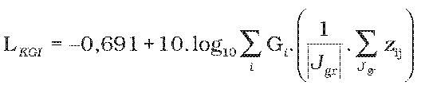
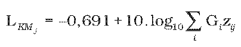
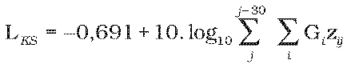
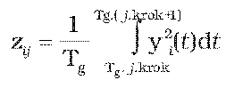
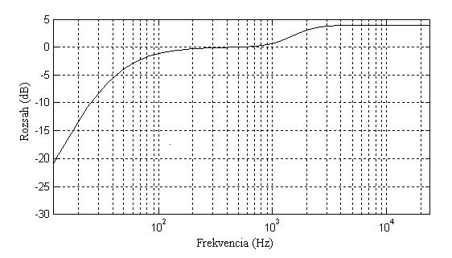
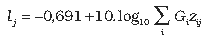
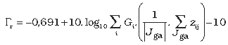

Príloha k vyhláške č. 468/2013 Z. z.

- 1. 

- 2. 

- 3. 

- Index „i“ označuje názov zvukového kanálu (R - pravý, L - ľavý, C - stredný, Ls - ľavý zadný, Rs - pravý zadný).

- Koeficienty Gi nadobúdajú hodnoty: GL = GR= GC = 1 a GLs = GRs = 1,41.

- Veličina zij je energia zvukového signálu definovaná ako:

-  .

- Index „j“ čísluje jednotlivé časové úseky zvukových signálov yi(t), z ktorých sa počítajú príslušné hodnoty zij. Každý časový úsek má dĺžku Tg = 400 ms. Index „j“ nadobúda postupne celočíselné hodnoty od 0 až do hodnoty indexu posledného časového úseku Tg, ktorý ešte celý obsahuje zvukové signály yi(t).

- Hodnoty energií zij sa počítajú zo signálov yj(t) od času t = Tg.j.krok do času t = Tg.(j.krok+1). Hodnota konštanty krok je: krok = 0,25. V čase po sebe nasledujúce hodnoty zij sa teda určujú z navzájom prekrývajúcich sa časových intervalov dĺžky Tg postupne časovo posunutých o 100 ms.

- Zvukové signály yi(t) sa získavajú zo vstupných zvukových signálov xi(t) ich filtráciou cez tzv. K-filtre. Modulová frekvenčná charakteristika K-filtra má takýto priebeh:

- 

- Modulová frekvenčná charakteristika K-filtra

- Množina indexov Jgr obsahuje len tie indexy „j“, pri ktorých hodnota hladiny hlasitosti lj presiahla hodnotu prahovacej hladiny hlasitosti Γr. Hodnota lj je definovaná ako:

-  [LUFS].

- Prahovacia hodnota hlasitosti Γr je definovaná ako:

-  [LUFS].

- Množina indexov Jga obsahuje len tie indexy „j“, pri ktorých hodnota hladiny hlasitosti lj presiahla hodnotu prahovacej hladiny hlasitosti Γa. Hodnota Γa je: Γa = –70 LUFS.
