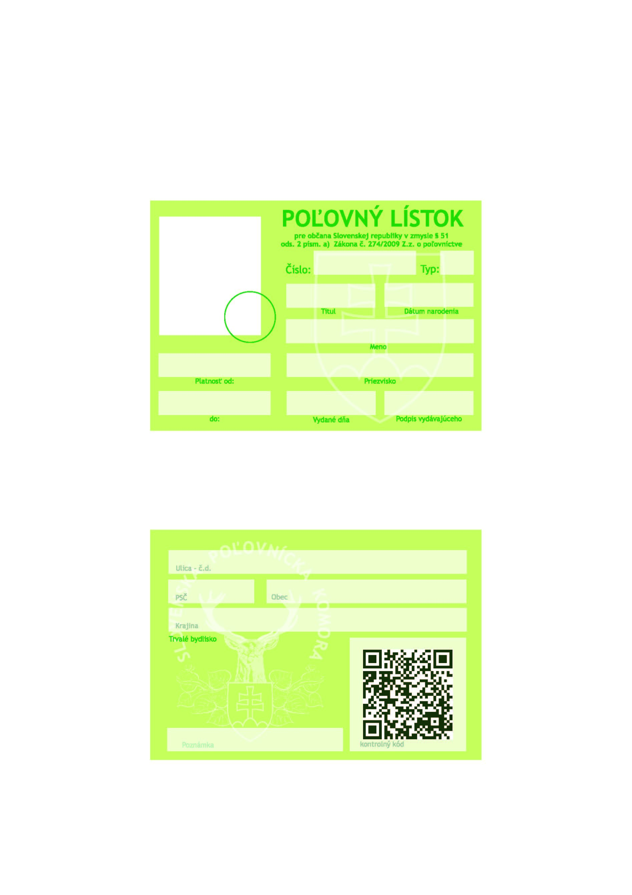
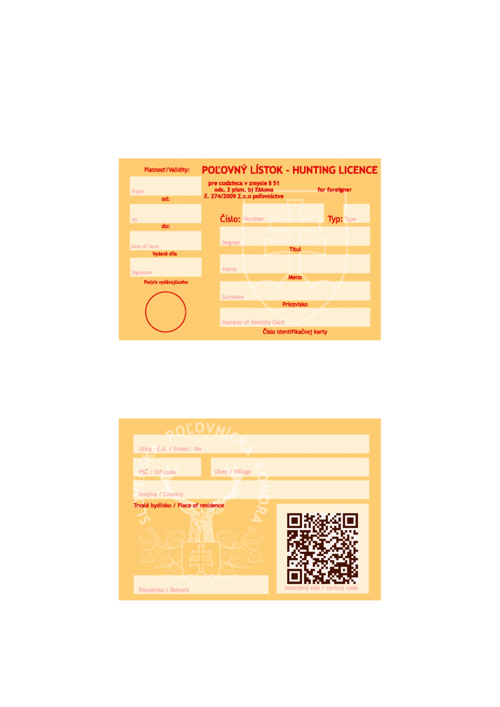

# Čl. I

Vyhláška Ministerstva pôdohospodárstva Slovenskej republiky č. 344/2009 Z. z., ktorou sa vykonáva zákon o poľovníctve v znení vyhlášky Ministerstva pôdohospodárstva Slovenskej republiky č. 227/2010 Z. z. a vyhlášky Ministerstva pôdohospodárstva a rozvoja vidieka Slovenskej republiky č. 125/2012 Z. z. sa mení a dopĺňa takto:

- 1. V § 1 písm. n) sa slová „druhoch a kvalifikácii“ nahrádzajú slovami „druhoch, potrebnom počte a kvalifikácii“.

- 2. V § 1 písm. o) sa slovo „raticovej“ nahrádza slovom „ulovenej“.

- 3. V § 2 ods. 5 sa za slovo „zver“ vkladajú slová „alebo líška hrdzavá“ a za slovo „zveri“ sa vkladá čiarka a slovo „brlohovanie“.

- 4. § 3 odsek 1 znie:

- „(1)

- Projekt samostatnej zvernice a projekt samostatnej bažantnice obsahujú tieto časti:

- a)

- úvod

- 1.

- úvodná správna a historická dokumentácia, ak existuje,

- 2.

- civilizačné negatívne faktory,

- 3.

- výskyt zveri vrátane predátorov,

- b)

- opis prírodných podmienok

- 1.

- členitosť terénu, nadmorské výšky,

- 2.

- geografické, geologické a hydrologické podmienky,

- 3.

- klimatické podmienky,

- 4.

- štruktúra poľovných pozemkov a ich obhospodarovanie,

- c)

- štruktúra a podmienky chovu zveri

- 1.

- navrhovaný normovaný kmeňový stav jednotlivých druhov zveri a navrhovaný koeficient prírastku,

- 2.

- návrh cieľovej vekovej a pohlavnej štruktúry a návrhy na odlov,

- 3.

- kritériá chovnosti,

- 4.

- opis zootechniky chovu,

- d)

- návrh biotechnických úprav

- 1.

- lesotechnické opatrenia,

- 2.

- agrotechnické opatrenia,

- e)

- technické zariadenia

- 1.

- oplotenie,

- 2.

- kŕmne zariadenia, vnadiská,

- 3.

- posedy, úprava vodných zdrojov a tokov,

- 4.

- ostatné poľovnícke zariadenia,

- f)

- kalkulácia potreby krmiva,

- g)

- zabezpečenie základného chovného stáda,

- h)

- ostatné návrhy a odporúčania

- 1.

- potreba poľovne upotrebiteľných psov,

- 2.

- veterinárne opatrenia zohľadňujúce pohodu zvierat,

- i)

- záver,

- j)

- prílohy

- 1.

- súpis pozemkov, prehľad druhov pozemkov,

- 2.

- výpis z programu starostlivosti o les,

- 3.

- mapa poľovného hospodárenia.“.

- 5. V § 3 sa za odsek 1 vkladajú nové odseky 2 a 3, ktoré znejú:

- „(2)

- Projekt uznanej zvernice a projekt uznanej bažantnice obsahujú tieto časti:

- a)

- úvod

- 1.

- údaje o poľovnom revíri,

- 2.

- účel uznanej zvernice,

- 3.

- civilizačné negatívne faktory,

- 4.

- výskyt zveri vrátane predátorov,

- b)

- opis prírodných podmienok

- 1.

- členitosť terénu, nadmorské výšky,

- 2.

- geografické, geologické a hydrologické podmienky,

- 3.

- klimatické podmienky,

- 4.

- štruktúra poľovných pozemkov a ich obhospodarovanie,

- c)

- štruktúra a podmienky chovu zveri

- 1.

- navrhovaný normovaný kmeňový stav jednotlivých druhov zveri a navrhovaný koeficient prírastku,

- 2.

- návrh cieľovej vekovej a pohlavnej štruktúry a návrhy na odlov,

- 3.

- kritériá chovnosti,

- 4.

- opis zootechniky chovu,

- d)

- návrh biotechnických úprav

- 1.

- lesotechnické opatrenia,

- 2.

- agrotechnické opatrenia,

- e)

- technické zariadenia

- 1.

- oplotenie,

- 2.

- kŕmne zariadenia,

- 3.

- odchytové zariadenia,

- 4.

- ostatné poľovnícke zariadenia,

- f)

- kalkulácia potreby krmiva,

- g)

- zabezpečenie základného chovného stáda,

- h)

- ostatné návrhy a odporúčania

- 1.

- potreba poľovne upotrebiteľných psov,

- 2.

- veterinárne opatrenia zohľadňujúce pohodu zvierat,

- 3.

- prevádzkový poriadok zvernice na výcvik a skúšky poľovných psov,

- i)

- záver,

- j)

- prílohy

- 1.

- súpis pozemkov,

- 2.

- výpis z programu starostlivosti o les,

- 3.

- mapa poľovného hospodárenia,

- k)

- štúdia ekologických vplyvov na krajinu.

- (3)

- Pre projekt zvernice podľa § 2 ods. 1 písm. e) postačuje zjednodušený projekt.“.

- Doterajší odsek 2 sa označuje ako odsek 4.

- 6. § 4 znie:

- 㤠4

- Zaradenie poľovných revírov do poľovných oblastí a poľovných lokalít je uvedené spolu so zákresom poľovných oblastí na mape na webovom sídle ministerstva. Samostatné zvernice a samostatné bažantnice sa do poľovných oblastí a poľovných lokalít nezaraďujú.“.

- 7. V § 7 ods. 3 sa slová „z jarných kmeňových stavov“ nahrádzajú slovami „zo stavu zveri podľa § 36 (ďalej len „jarný kmeňový stav“)“.

- 8. V § 7 ods. 3 sa na konci pripája táto veta: „Koeficient prírastku určí okresný úrad pri zaradení poľovného revíru do kvalitatívnej triedy. Pri samostatných zverniciach, uznaných zverniciach, samostatných bažantniciach a uznaných bažantniciach sa koeficient prírastku a normované kmeňové stavy uvedú v projekte.“.

- 9. V § 8 sa vypúšťajú slová „a určenie normovaných kmeňových stavov jednotlivých druhov zveri chovaných vo zvernici“ a „tabuľkách č. 1 a 2“.

- 10. § 9 znie:

- 㤠9

- Samostatné bažantnice možno uznávať len na poľovných pozemkoch zaradených v poľovných oblastiach s chovom malej zveri a srnčej zveri. Spôsob zaradenia bažantnice do kvalitatívnej triedy je uvedený v prílohe č. 5.“.

- 11. V § 12 ods. 1 sa na konci pripájajú slová „(ďalej len „medzinárodná rada“)“.

- 12. V § 12 ods. 2 sa v úvodnej vete za slovo „zveri“ vkladá čiarka a slová „ktorý vykonáva poradný zbor za poľovnú oblasť a chovateľská rada za chovateľský celok,“.

- 13. V § 12 ods. 2 písm. a) sa slovo „každej“ nahrádza slovom „poslednej“.

- 14. V § 13 ods. 2 sa slová „Medzinárodnej rady pre poľovníctvo a ochranu zveri“ nahrádzajú slovami „medzinárodnej rady“.

- 15. V § 14 ods. 2 sa za slovo „členmi“ vkladajú slová „miestne príslušnej“.

- 16. V § 16 ods. 7 sa dopĺňa táto veta: „Dolná čeľusť ako súčasť trofeje posúdenej na chovateľskej prehliadke ako správny odstrel sa užívateľovi poľovného revíru vracia, len ak o jej vrátenie vopred požiada pri doručení trofeje na chovateľskú prehliadku.“.

- 17. V § 17 ods. 5 sa vypúšťajú slová „podľa prílohy č. 7“ a slovo „najmenej“ a za písmeno f) sa vkladá nové písmeno g), ktoré znie:

- „g)

- vlka,“.

- Doterajšie písmeno g) sa označuje ako písmeno h).

- 18. Doterajší text § 18 sa označuje ako odsek 1 a dopĺňa sa odsekom 2, ktorý znie:

- „(2)

- Za národný rekord uzná komisia medzinárodnej rady zložená zo zahraničných hodnotiteľov a členov ústrednej hodnotiteľskej komisie najsilnejšiu trofej pochádzajúcu z voľného chovu podľa kritérií medzinárodnej rady.“.

- 19. V § 19 ods. 1 sa pripájajú tieto vety: „Proti rozhodnutiu komisie sa vlastník trofeje môže odvolať na ústrednú hodnotiteľskú komisiu, ktorá rozhodne o odvolaní na základe znaleckého posudku vypracovaného organizáciou poverenou ministerstvom alebo vypracovaného súdnym znalcom z odboru lesníctvo, odvetvie poľovníctvo. Náklady spojené s vypracovaním posudku uhrádza vlastník trofeje; ak sa odvolaniu vyhovelo, náklady na znalecký posudok vráti vlastníkovi trofeje príslušná obvodná poľovnícka komora. S trofejou spolu so spodnou čeľusťou, v čase nevyhnutnom na vyhotovenie znaleckého posudku, disponuje príslušná obvodná komora.“.

- 20. V § 19 ods. 4 sa slovo „výstave“ nahrádza slovami „chovateľskej prehliadke“.

- 21. V § 19 ods. 4 sa na konci pripája táto veta: „Pri takejto trofeji sa chovateľský zásah podľa odseku 1 nevyhodnocuje.“.

- 22. V § 20 písm. e) sa na konci pripájajú tieto slová: „do 30 dní po skončení chovateľskej prehliadky“.

- 23. § 21 a 22 vrátane nadpisov znejú:

- 㤠21

- Výhľadový plán poľovníckeho hospodárenia

- (1)

- Výhľadový plán poľovníckeho hospodárenia v poľovnom revíri musí zohľadňovať chovateľské ciele vyplývajúce z koncepcie chovu zveri v príslušnej poľovnej oblasti.

- (2)

- Výhľadový plán poľovníckeho hospodárenia obsahuje

- a)

- základné údaje o poľovnom revíri

- 1.

- názov poľovného revíru, zaradenie do chovateľského celku a poľovnej oblasti, zaradenie do kvalitatívnej triedy,

- 2.

- celková výmera poľovného revíru, z toho lesné poľovné pozemky, poľnohospodárske poľovné pozemky, ostatné pozemky,

- 3.

- prírodné podmienky - orografické, hydrologické, klimatické,

- 4.

- negatívne civilizačné faktory, stavby, dopravná sieť, cestovný ruch,

- 5.

- charakteristika lesných a poľnohospodárskych poľovných pozemkov a intenzita ich obhospodarovania, úživnosť poľovného revíru; funkčné plochy a úroveň ich obhospodarovania,

- b)

- zhodnotenie poľovníckeho hospodárenia

- 1.

- normované a odhadované stavy, vekové zloženie a pomer pohlaví pri raticovej zveri, lov jednotlivých druhov raticovej zveri vo vekovej a pohlavnej štruktúre, trofejové hodnoty C.I.C., lov malej zveri, koeficienty prírastku, vývoj za uplynulých desať rokov a súčasný stav,

- 2.

- poľovnícke zariadenia; stav a dislokácia,

- 3.

- starostlivosť o zver; ochrana, prikrmovanie,

- 4.

- zdravotný stav zveri a evidencia zverozdravotných opatrení,

- 5.

- súčasný stav a potreba poľovne upotrebiteľných psov,

- c)

- návrhy na úpravu poľovníckeho hospodárenia

- 1.

- chovateľské ciele a prostriedky na ich dosiahnutie pre jednotlivé druhy raticovej zveri a malej zveri na obdobie platnosti zmluvy o užívaní poľovného revíru,

- 2.

- návrh na úpravu skutočných stavov zveri a plánu lovu,

- 3.

- návrh na zlepšenie kvality trofejí,

- 4.

- návrh na zlepšenie úživnosti poľovného revíru, prikrmovania zveri, obhospodarovania funkčných plôch, výsadbu trvalej zelene, plodonosných drevín, políčok pre zver, zakladanie biopásov,

- 5.

- potreba krmiva, soli,

- 6.

- návrh na zlepšenie zdravotnej starostlivosti o zver,

- 7.

- budovanie a rekonštrukcia poľovníckych zariadení,

- 8.

- ekonomické kalkulácie na navrhované opatrenia a ich predpokladaná efektívnosť,

- d)

- mapu poľovníckeho hospodárenia na lesníckej organizačnej mape alebo obrysovej mape poľovného revíru so zakreslením

- 1.

- funkčných plôch, políčok, ohryzových plôch,

- 2.

- kŕmnych zariadení a soľníkov,

- 3.

- ostatných poľovníckych zariadení,

- 4.

- rujovísk, tokanísk,

- e)

- tabuľkovú časť

- 1.

- prehľad o stavoch a love zveri; skutočnosť, plán,

- 2.

- trofejové hodnoty raticovej zveri,

- f)

- fotodokumentáciu zachytávajúcu východiskový stav v poľovnom revíri,

- g)

- kópiu dokladu z evidencie podľa odseku 3.

- (3)

- Evidencia osôb odborne spôsobilých na vypracovanie výhľadového plánu poľovníckeho hospodárenia obsahuje

- a)

- identifikačné údaje

- 1.

- meno, priezvisko, dátum narodenia a adresa bydliska pri fyzickej osobe,

- 2.

- názov, sídlo a identifikačné číslo osoby pri právnickej osobe,

- b)

- dátum absolvovania vyššej skúšky z poľovníctva (ďalej len „vyššia skúška“) alebo dátum ukončenia štúdia na strednej škole alebo vysokej škole, kde je poľovníctvo povinným vyučovacím predmetom alebo povinne voliteľným vyučovacím predmetom,

- c)

- dátum vydania poľovného lístku,

- d)

- doklad o získanej praxi podľa § 30 ods. 6 zákona.

- (4)

- Osoba odborne spôsobilá na vypracovanie výhľadového plánu poľovníckeho hospodárenia je zároveň odborne spôsobilá na vypracovanie projektu podľa § 3.

- § 22

- Dokumentácia poľovného revíru

- (1)

- Dokumentáciu poľovného revíru tvorí

- a)

- výhľadový plán poľovníckeho hospodárenia (§ 21),

- b)

- ročné plány poľovníckeho hospodárenia, ktorými sú:

- 1.

- plán chovu o lovu raticovej zveri; vzor je uvedený v prílohe č. 10,

- 2.

- plán chovu a lovu malej zveri; vzor je uvedený v prílohe č. 11,

- 3.

- plán starostlivosti o zver; vzor je uvedený v prílohe č. 12,

- 4.

- plán spoločných poľovačiek; vzor je uvedený v prílohe č. 13,

- c)

- prvotná evidencia, ktorú tvorí

- 1.

- prehľad stavu zveri; vzor je uvedený v prílohe č. 14,

- 2.

- evidencia lovu zveri, jej úhynu, použitých značiek a použitia zveriny; vzor je uvedený v prílohe č. 8,

- 3.

- povolenia na lov zveri a evidencia vydaných značiek; vzor je uvedený v prílohe č. 15,

- 4.

- evidencia poľovných psov a poľovne upotrebiteľných psov; vzor je uvedený v prílohe č. 16,

- 5.

- kniha návštev poľovného revíru (§ 23),

- 6.

- mapa revíru s vyznačenými vnadiskami (§ 37),

- d)

- štatistický výkaz o revíri a stavoch zveri.

- (2)

- Termíny predloženia dokumentácie okresnému úradu sú:

- a)

- výhľadový plán poľovníckeho hospodárenia do troch mesiacov od evidencie zmluvy,

- b)

- plán chovu a lovu raticovej zveri do 31. marca,

- c)

- plán chovu a lovu malej zveri do 31. augusta,

- d)

- plán spoločných poľovačiek do 20. septembra,

- e)

- plán starostlivosti o zver do 31. marca,

- f)

- zistený stav zveri podľa § 36 spolu s plánom chovu a lovu raticovej zveri a spolu s plánom chovu a lovu malej zveri,

- g)

- evidencia lovu zveri, jej úhynu, použitých značiek a použitia diviny - na chovateľskú prehliadku v nasledujúcom roku,

- h)

- štatistický výkaz o revíri a stavoch zveri do 5. marca nasledujúceho kalendárneho roku.

- (3)

- Termíny posúdenia a schválenia navrhnutých plánov sú:

- a)

- výhľadový plán poľovníckeho hospodárenia do 30 dní od doručenia návrhu chovateľskej rady príslušného chovateľského celku.

- b)

- plán chovu a lovu raticovej zveri do 30. apríla,

- c)

- plán chovu a lovu malej zveri do 15. septembra,

- d)

- plán starostlivosti o zver do 30. apríla,

- e)

- plán spoločných poľovačiek do 30. septembra.

- (4)

- Štatistický výkaz o revíri a stavoch zveri sa predkladá Národnému lesníckemu centru do 15. marca.“.

- 24. V § 23 ods. 1 písmeno e) znie:

- „e)

- druh, pohlavie a počet ulovenej alebo nájdenej uhynutej zveri, čas a miesto lovu alebo nájdenia uhynutej zveri, číslo použitej značky.“.

- 25. V § 23 ods. 2 sa na konci pripája táto veta: „Kniha návštev môže byť vedená aj v elektronickej forme.“.

- 26. § 23 sa dopĺňa odsekom 3, ktorý znie:

- „(3)

- Knihu návštev poľovného revíru uchováva užívateľ poľovného spolu s povoleniami na lov zveri.“.

- 27. § 24 vrátane nadpisu znie:

- 㤠24

- Chovateľský cieľ a kvalita poľovníckeho hospodárenia

- (1)

- Chovateľským cieľom v chove raticovej zveri je dosiahnutie jarných kmeňových stavov, ktoré sú zhodné s normovanými kmeňovými stavmi raticovej zveri v danom poľovnom revíri, pri dosiahnutí plánovaného pomeru pohlavia, plánovanej vekovej a pohlavnej štruktúry populácie a plánovanej vekovej štruktúry samčej zveri. Chovateľským cieľom v chove malej zveri je dosiahnutie jarných kmeňových stavov, ktoré sú zhodné s normovanými kmeňovými stavmi malej zveri v danom poľovnom revíri, a v bažantniciach je zabezpečiť genofond jednotlivých druhov malej zveri a vytvorenie vhodných topických podmienok.

- (2)

- Na dosiahnutie chovateľského cieľa možno použiť pri raticovej zveri, okrem diviaka, manažment vekových tried alebo manažment trofejovej kulminácie. Metódu manažmentu určí pre každý druh zveri v poľovnej oblasti alebo lokalite poradný zbor.

- (3)

- Manažment trofejovej kulminácie znamená oddelené plánovanie lovu samčej zveri a samičej zveri a mláďat a zahŕňa

- a)

- lov samcov vo veku trofejovej kulminácie a po nej je najmenej 70 %,

- b)

- lov samcov pred vekom trofejovej kulminácie je najviac 30 % a lovia sa len jedince s parožím škodníka, abnormálnym alebo vo vývoji mimoriadne zaostávajúcim parožím,

- c)

- pri potrebe zvýšiť skutočné stavy zveri sa lov samíc a mláďat zníži a pri potrebe znížiť skutočné stavy sa ich lov v porovnaním s predchádzajúcim obdobím primerane zvýši,

- d)

- jeho použitie v oblastiach, kde je kvalita trofejí zveri vysoká alebo kde je veľký tlak šeliem - predátorov.

- (5)

- Plánovanie podľa manažmentu vekových tried sa uplatňuje pre jednotlivé druhy zveri v § 25 až 28 a 30.

- (6)

- Úroveň kvality poľovníckeho hospodárenia hodnotí poradný zbor a chovateľská rada v zápisnici podľa kritérií určených poradným zborom.“.

- 28. V § 25 ods. 4 druhá veta znie: „Z plánu odstrelu jeleňov treba v I. vekovej triede uloviť 30 %, II. vekovej triede 30 %, III. vekovej triede 15 % a vo IV. vekovej triede 25 % pri zachovaní kritérií selektívneho odstrelu; úhyn zveri sa započíta do plnenia plánu lovu.“.

- 29. V § 25 ods. 5 písm. a) sa čiarka nahrádza bodkočiarkou a pripájajú sa tieto slová: „pri nepárnom počte jelenčiat sa 50-percentný podiel zaokrúhlený na celé kusy nahor presunie do kategórie jeleníc a zvyšok do I. vekovej triedy jeleňov,“.

- 30. V § 25 ods. 5 písm. b) sa čiarka na konci nahrádza bodkočiarkou a pripájajú sa tieto slová: „pri nepárnych počtoch sa presúva príslušný percentuálny podiel zaokrúhlený na celé kusy nahor,“.

- 31. V § 25 ods. 8 čitateľ vo vzorci znie: „(NKS - JKS)“.

- 32. § 26 a 27 vrátane nadpisov znejú:

- 㤠26

- Srnčia zver

- (1)

- Plánovaný pomer pohlavia srnčej zveri je 1:1, najviac 1:1,2 v prospech sŕn. Plánovaná veková a pohlavná štruktúra normovaného kmeňového stavu je 38 % srncov, 38 % sŕn a 24 % vlaňajších srnčiat. Plánované vekové zloženie srncov v normovanom kmeňovom stave je:

- a)

- I. veková trieda - ročné a dvojročné srnce 42 %,

- b)

- II. veková trieda - trojročné až päťročné srnce 48 %,

- c)

- III. veková trieda - šesťročné a staršie srnce 10 %.

- (2)

- Vekové zloženie srncov po prevode je:

- a)

- I. veková trieda - 42 %,

- b)

- II. veková trieda - 40 %,

- c)

- III. veková trieda - 18 %.

- (3)

- Prevod prírastku srnčej zveri z predchádzajúceho roku sa vykonáva takto:

- a)

- z počtu srnčiat zistených k 31. marcu sa presunie 50 % do I. vekovej triedy srncov a 50 % do kategórie sŕn; pri nepárnom počte srnčiat sa 50 % podiel zaokrúhlený na celé kusy nahor presunie do kategórie sŕn a zvyšok do I. vekovej triedy srncov,

- b)

- 50 % z I. vekovej triedy srncov bez presunutého prírastku sa presunie do II. vekovej triedy, z II. vekovej triedy sa presunie 33 % do III. vekovej triedy; pri nepárnych počtoch sa presúva príslušný percentuálny podiel zaokrúhlený na celé kusy nahor.

- c)

- do triedy srnčiat sa pripočíta očakávaný prírastok.

- (4)

- Ak sa skutočný stav srnčej zveri v revíri rovná normovanému kmeňovému stavu a ak jeho štruktúra zodpovedá členeniu podľa odseku 1, musí sa ročný odstrel rovnať ročnému prírastku, ktorý pri koeficiente prírastku 0,9 je 34 % z normovaného kmeňového stavu; úhyn zveri sa započíta do plnenia plánu lovu.

- (5)

- Z celkového plánu lovu majú srnce predstavovať 35 %, srny 35 % a srnčatá 30 %. Štruktúra plánu lovu srncov musí byť takáto:

- a)

- I. veková trieda 42 %

- b)

- II. veková trieda 16 %

- c)

- III. veková trieda 42 %.“.

- (6)

- Ak skutočný stav zveri v revíri nezodpovedá normovanému kmeňovému stavu, postupuje sa podobne ako v § 25 ods. 6.“.

  - § 27 Danielia zver

  - (1) Plánovaný pomer pohlavia danielej zveri je 1:1, najviac 1:1,2 v prospech danielic. Plánovaná veková a pohlavná štruktúra normovaného kmeňového stavu je 40 % danielov, 40 % danielic a 20 % vlaňajších danielčat. Plánované vekové zloženie danielov v normovanom kmeňovom stave je:

    - a) I. veková trieda - ročné a dvojročné 32 %,

    - b) II. veková trieda - trojročné až sedemročné 45 %,

    - c) III. veková trieda - osemročné a staršie 23 %“.

  - (2) Prevod prírastku danielej zveri z predchádzajúceho roku sa vykonáva

    - a) z počtu danielčat zistených k 31. marcu sa presunie 50 % do I. vekovej triedy danielov a 50 % do kategórie danielic; pri nepárnom počte danielčat sa 50-percentný podiel zaokrúhlený na celé kusy nahor presunie do kategórie danielic a zvyšok do I. vekovej triedy danielov.

    - b) 50 % I. vekovej triedy danielov bez presunutého prírastku sa presunie do II. vekovej triedy, z II. vekovej triedy sa presunie 20 % do III. vekovej triedy; pri nepárnych počtoch sa presúva príslušný percentuálny podiel zaokrúhlený na celé kusy nahor.

    - c) do triedy danielčat sa pripočíta očakávaný prírastok.

  - (3) Ak sa skutočný stav danielej zveri v revíri rovná normovanému kmeňovému stavu a ak jeho štruktúra zodpovedá členeniu uvedenému v odseku 1, ročný odstrel sa rovná ročnému prírastku, ktorý je asi 30 % z normovaného kmeňového stavu; úhyn zveri sa započíta do plnenia plánu lovu.

  - (4) Pri dosiahnutí normovaného kmeňového stavu z celkového plánu lovu daniele predstavujú 33 %, danielice 35 % a danielčatá 32 %. Štruktúra plánu lovu danielov je:

    - a) I. veková trieda 45 %,

    - b) II. veková trieda 35 %,

    - c) III. veková trieda 20 %.

  - (5) Ak skutočný stav zveri v revíri nezodpovedá normovanému kmeňovému stavu, postupuje sa podobne ako v § 25 ods. 6.“.

- 33. V § 28 ods. 2 písm. a) sa čiarka nahrádza bodkočiarkou a pripájajú sa tieto slová: „pri nepárnom počte muflónčat sa 50-percentný podiel zaokrúhlený na celé kusy nahor presunie do kategórie muflónic a zvyšok do I. vekovej triedy muflónov,“.

- 34. V § 28 ods. 2 písm. b) sa čiarka na konci nahrádza bodkočiarkou a pripájajú sa tieto slová: „pri nepárnych počtoch sa presúva príslušný percentuálny podiel zaokrúhlený na celé kusy nahor,“.

- 35. V § 29 ods. 3 sa za prvú vetu vkladá táto veta: „Pri nepárnom počte lanštiakov sa počet diviakov zvýši o polovicu lanštiakov zaokrúhlenú na celé kusy nadol a počet diviačic sa zvýši o polovicu lanštiakov zaokrúhlenú na celé kusy nahor.“.

- 36. V § 29 ods. 4 sa na konci pripája táto veta: „Úhyn zveri sa započíta do plnenia plánu lovu.“.

- 37. V § 29 sa vypúšťa odsek 5.

- 38. V § 30 ods. 3 sa na konci pripája táto veta: „Pri nepárnych počtoch sa do kategórie kamzíc a do vyššej vekovej triedy presúva príslušný percentuálny podiel zaokrúhlený na celé kusy nahor.“.

- 39. Za § 30 sa vkladá § 30a, ktorý vrátane nadpisu znie:

- 㤠30a

- Ostatná raticová zver

- Vo zverniciach sa chov a lov jeleňa siku, jeleníka (pasrnca) bielochvostého, zubra hrivnatého a losa mokraďového plánuje podľa zásad uvedených v projekte zvernice a vo výhľadovom pláne poľovníckeho hospodárenia. V ostatných poľovných revíroch chov jeleňa siku a jeleníka (pasrnca) bielochvostého nemožno plánovať a loví sa celý stav zistený podľa § 36.“.

- 40. V § 31 ods. 1 sa slová „daniela 7“ nahrádzajú slovami „daniela 8“.

- 41. § 35 až 37 vrátane nadpisov znejú:

- 㤠35

- Postup a zásady plánovania starostlivosti o zver

- (1)

- Na zabezpečenie starostlivosti o zver sa v poľovnom revíri zriaďujú tieto poľovnícke zariadenia:

- a)

- na každých aj začatých 15 ks raticovej zveri okrem diviačej jedno krmovisko, ktoré je vybavené jedným kŕmidlom na objemové krmivo a zastrešeným válovom na jadrové krmivo,

- b)

- na každých aj začatých 70 ha výmery poľovného revíru najmenej jedným soľníkom vrátane soľníkov na krmoviskách,

- c)

- v revíri s chovom diviačej zveri na každých aj začatých 500 ha jedno krmovisko na jadrové krmivo a dužinaté krmivo,

- d)

- pre malú zver:

- 1.

- zajačia zver - jedno kŕmidlo a 1 soľník na každých aj začatých 100 ha; ak nie sú dostatočné zdroje vody, jedno napájadlo na každých aj začatých 50 ha,

- 2.

- bažantia zver - najmenej jeden násypec na každých aj začatých 50 ha bonitovanej plochy,

- 3.

- jarabičia zver - najmenej jeden násypec pre jeden kŕdeľ,

- 4.

- divé kačice - najmenej jedno prikrmovacie zariadenie na jadrové krmivo na každých aj začatých 200 ks,

- 5.

- divé králiky - najmenej jedno kŕmidlo na objemové krmivo a jeden soľník na každú kolóniu.

- (2)

- Prikrmovanie raticovej zveri v poľovnom revíri, okrem zvernice, možno len v čase núdze; nevzťahuje sa na prikrmovanie na zabránenie škodám. Na mape poľovného revíru sa vyznačujú miesta, na ktorých sa zver prikrmuje.

- § 36

- Zisťovanie stavov zveri

- (1)

- Zisťovanie stavov zveri sa vykonáva celoročne a odosiela sa v termínoch a spôsobom určenými okresným úradom v sídle kraja.

- (2)

- Výsledky zisťovania poľovnícky hospodár eviduje priebežne a vykazuje v prehľadoch stavu zveri, ktorých vzor je uvedený v prílohe č. 14.

- § 37

- Vnadenie diviačej zveri

- (1)

- Vnadisko na vnadenie diviačej zveri v poľovnom revíri možno zriadiť len mimo času núdze, a to najviac jedno vnadisko na aj začatých 300 ha poľovnej plochy. Návnadu možno vykladať len do poľovníckych zariadení alebo zapracovať do zeme. Vnadiť diviačiu zver v poľovných oblastiach s chovom jelenej zveri možno len v čase od 1. júla do 15. januára.

- (2)

- Vnadiská na vnadenie diviačej zveri sa vyznačujú na mape poľovného revíru.“.

- 42. Za § 37 sa vkladá § 37a, ktorý vrátane nadpisu znie:

- 㤠37a

- Sokoliarstvo

- (1)

- Sokoliarsku skúšku organizuje komora podľa skúšobného poriadku pre sokoliarsku skúšku vydaného komorou.

- (2)

- Skúšobná komisia pre sokoliarsku skúšku je trojčlenná; členov vymenúva komora.

- (3)

- Sokoliarsku skúšku môže vykonať osoba na základe žiadosti zaslanej organizátorovi skúšky po úspešnom absolvovaní skúšky uchádzača o poľovný lístok; náklady spojené s vykonaním sokoliarskej skúšky uhrádza uchádzač organizátorovi skúšky.“.

- 43. V § 39 sa vypúšťa nadpis.

- 44. V § 39 ods. 1 sa slová „skúšky z poľovníctva“ nahrádzajú slovami „skúšku uchádzača o poľovný lístok“.

- 45. V § 43 ods. 5 sa na konci pripája táto veta: „Na skúšku zo streľby z poľovníckych zbraní sa primerane vzťahuje § 44 ods. 2 a 10.“.

- 46. V § 48 ods. 6 sa na konci pripája táto veta: „Záver komisie o výsledku skúšky je konečný.“.

- 47. V § 51 ods. 1 sa na konci prvej vety vypúšťajú slová „z poľovníctva“.

- 48. V § 54 odsek 1 znie:

- „(1)

- Členom skúšobnej komisie môže byť osoba, ktorá

- a)

- má vysokoškolské vzdelanie lesníckeho zamerania najmenej prvého stupňa, vyššie odborné vzdelanie lesníckeho zamerania alebo úplné stredné odborné vzdelanie lesníckeho zamerania, alebo

- b)

- absolvovala vyššiu skúšku.“.

- 49. V § 58 odsek 4 znie:

- „(4)

- Výsledok skúšky hospodára zapíše predseda skúšobnej komisie do klasifikačného prehľadu skúšok hospodárov, ktorý predloží okresnému úradu a obvodnej komore príslušným podľa miesta trvalého pobytu žiadateľa. Vzor klasifikačného prehľadu skúšok hospodárov je uvedený v prílohe č. 29.“.

- 50. § 60 znie:

- 㤠60

- Vyššiu skúšku nemusia absolvovať osoby, ktoré majú vysokoškolské vzdelanie lesníckeho zamerania najmenej prvého stupňa, vyššie odborné vzdelanie lesníckeho zamerania alebo úplné stredné odborné vzdelanie lesníckeho zamerania.“.

- 51. V § 62 ods. 1 sa na konci pripája táto veta: „Členom skúšobnej komisie môže byť len osoba, ktorá spĺňa podmienky podľa § 54 ods. 1.“.

- 52. V § 64 ods. 4 sa vypúšťajú slová „na počítači“.

- 53. V § 64 ods. 5 sa na začiatok vkladá táto veta: „Skúšobná komisia pred ústnou skúškou ohodnotí doterajšiu časť skúšky žiadateľa.“ a za slovo „otázok“ sa vkladajú slová „a zároveň“.

- 54. V § 69 ods. 1 sa slovo „absolvuje“ nahrádza slovami „môže absolvovať aj“.

- 55. V § 71 odsek 1 znie:

- „(1)

- Čas lovu sa ustanovuje takto:

- a)

- srstnatá zver

- 1.

- zajac poľný od 1. novembra do 31. decembra; lov sokoliarskymi dravcami od 1. septembra do 31. decembra,

- 2.

- králik divý od 1. septembra do 31. decembra,

- 3.

- ondatra pižmová celoročne,

- 4.

- kuna lesná a kuna skalná od 1. septembra do konca februára,

- 5.

- jazvec lesný od 1. septembra do 30. novembra,

- 6.

- vlk dravý od 1. novembra do 15. januára okrem územia

- a)

- Národného parku Slovenský kras vrátane jeho ochranného pásma a katastrálnych území obcí Háj, Turňa nad Bodvou, Dvorníky, Hrhov, Jablonov nad Turňou, Zádiel a Včeláre,

- b)

- Chránenej krajinnej oblasti Kysuce a katastrálnych území Čadca, Horelica, Olešná, Staškov, Turzovka, Oščadnica, Raková, Klokočov, Svrčinovec, Čierne, Skalité v okrese Čadca,

- c)

- Chránenej krajinnej oblasti Horná Orava, územia Pieninského národného parku a jeho ochranného pásma, územia Tatranského národného parku, katastrálnych území Bobrov, Breza, Zubrohlava, Klin, Krušetnica, Mútne, Námestovo, Oravská Jasenica, Oravská Polhora, Oravské Veselé, Rabča, Slanica, Sihelné a Zákamenné v okrese Námestovo a katastrálnych území Trstená, Oravice, Tichá dolina, Čimhová, Hladovka, Liesek, Suchá Hora a Vitanová v okrese Tvrdošín,

- d)

- Chránenej krajinnej oblasti Východné Karpaty, územia Národného parku Poloniny a jeho ochranného pásma, katastrálnych území Becherov, Cigeľka, Frička, Gaboltov, Gerlachov, Hrabské, Hutka, Chmeľová, Kurov, Lenartov, Malcov, Nižná Polianka, Ondavka, Petrová, Regetovka, Snakov, Stebnícka Huta, Stebník, Varadka, Vyšná Polianka, Nižný Tvarožec a Vyšný Tvarožec v okrese Bardejov a katastrálnych území Kečkovce, Roztoky, Vyšný Mirošov v okrese Svidník,

- 7.

- diviak lesný a diviačica od 1. júla do 15. januára, diviača a lanštiak po celý rok,

- 8.

- daniel škvrnitý od 1. septembra do 15. januára, danielica a danielča od 1. augusta do 31. decembra,

- 9.

- jeleň lesný a jelienča od 1. augusta do 15. januára, jelenica od 1. augusta do 31. decembra,

- 10.

- jeleň sika celoročne,

- 11.

- jeleník (pasrnec) bielochvostý celoročne,

- 12.

- srnec lesný od 16. mája do 30. septembra, srna a srnča od 1. septembra do 31. decembra,

- 13.

- muflón lesný od 1. augusta do 15. januára, muflónica a muflónča od 1. augusta do 31. decembra; muflón samec vo zverniciach celoročne,

- 14.

- šakal zlatý od 1.augusta do konca februára,

- 15.

- kamzík vrchovský alpský od 1. septembra do 31. decembra,

- 16.

- líška hrdzavá celoročne,

- 17.

- medvedík čistotný celoročne,

- 18.

- psík medvedíkovitý celoročne,

- 19.

- tchor tmavý od 1. septembra do konca februára,

- 20.

- norok severoamerický celoročne,

- 21.

- nutria riečna celoročne,

- b)

- pernatá zver

- 1.

- jariabok lesný kohút od 1. októbra do 15. novembra,

- 2.

- morka divá kohút od 16. marca do 15. mája; obe pohlavia od 1. októbra do 31. decembra,

- 3.

- bažant poľovný od 1. novembra do 15. januára, v bažantniciach od 1. októbra do konca februára; lov sokoliarskymi dravcami od 1. septembra do 31. decembra,

- 4.

- bažant jarabý kohút od 1. októbra do 31. decembra, v bažantniciach od 1. septembra do konca februára,

- 5.

- jarabica poľná od 16. septembra do 15. októbra,

- 6.

- kuropta horská od 16. septembra do 31. decembra,

- 7.

- holub hrivnák od 1. augusta do 31. októbra,

- 8.

- hrdlička záhradná od 1. augusta do 31. decembra,

- 9.

- lyska čierna od 1. októbra do 15. januára,

- 10.

- sluka lesná od 1. septembra do 30. novembra,

- 11.

- hus divá, hus siatinná a hus bieločelá od 1. októbra do 20. januára,

- 12.

- kačica divá od 1. septembra do 31. januára,

- 13.

- chochlačka sivá od 1. októbra do 15. januára,

- 14.

- chochlačka vrkočatá od 1. októbra do 15. januára,

- 15.

- havran čierny od 1. augusta do 20. januára,

- 16.

- sojka škriekavá v poľovných oblastiach s chovom malej zveri od 1. júna do konca februára a v ostatných poľovných revíroch od 20. septembra do konca februára,

- 17.

- straka čiernozobá v poľovných oblastiach s chovom malej zveri od 1. júna do konca februára a v ostatných poľovných revíroch od 10. septembra do konca februára,

- 18.

- vrana túlavá v poľovných oblastiach s chovom malej zveri od 1. júna do konca februára a v ostatných poľovných revíroch od 1. augusta do 10. februára.“.

- 56. V § 72 odsek 3 znie:

- „(3)

- Loviť sliepku bažanta poľovného možno len v poľovných revíroch, kde sa vypúšťajú umelo odchované bažantie kurčatá alebo dospelé jedince - sliepky.“.

- 57. § 72 sa dopĺňa odsekom 4, ktorý znie:

- „(4)

- Zver ulovená na základe mimoriadneho povolenia lovu sa vykazuje v prílohe č. 8.“.

- 58. § 73 odsek 3 znie:

- „(3)

- Skúšok poľovnej upotrebiteľnosti sa môžu zúčastniť len psy plemien uvedených v prílohe č. 35a. Psy jednotlivých plemien môžu získať poľovnú upotrebiteľnosť len na skúškach uvedených v prílohe č. 35a pri príslušnom plemene.“.

- 59. V § 73 ods. 5 písmeno f) znie:

- „f)

- prinášačov - retrievrov“.

- 60. V § 75 sa na konci pripájajú tieto slová: „alebo zmluvne zabezpečených psov.“.

- 61. V § 75 sa doterajší text označuje ako odsek 1 a dopĺňajú sa odseky 2 až 4, ktoré znejú:

- „(2)

- Zoznam psov poľovných plemien, ktoré možno použiť na lov a dohľadávanie zveri a druhy odborných skúšok na účely poľovnej upotrebiteľnosti jednotlivých plemien podľa § 66 ods. 4 zákona je uvedený v prílohe č. 35a.

- (3)

- Potrebný počet poľovne upotrebiteľných psov je uvedený v prílohe č. 35b.

- (4)

- Užívateľ poľovného revíru vedie evidenciu poľovných psov a poľovne upotrebiteľných psov podľa vzoru uvedeného v prílohe č. 16, ktorú predkladá okresnému úradu na účely štátneho dozoru a obvodnej poľovníckej komore na účely výkonu kontroly.“.

- 62. V § 77 sa slová „raticovej zveri alebo veľkej šelmy“ nahrádzajú slovami „ulovenej zveri“.

- 63. V celom texte vyhlášky sa slová „krajský lesný úrad“ v príslušnom tvare nahrádzajú slovami „okresný úrad v sídle kraja“ v príslušnom tvare a slová „obvodný lesný úrad“ v príslušnom tvare sa nahrádzajú slovami „okresný úrad“ v príslušnom tvare okrem § 78 ods. 5.

- 64. Príloha č. 3 znie:

- „Príloha č. 3 k vyhláške č. 344/2009 Z. z.

- PODMIENKY ZARADENIA POĽOVNÝCH REVÍROV DO KVALITATÍVNYCH TRIED

- 1.

- Zistiť všetky skupiny lesných typov a ich výmeru v danom poľovnom revíri.

- 2.

- Zistené skupiny lesných typov zatriediť podľa tabuľky č. 2 do jednotlivých kvalitatívnych tried.

- 3.

- Tisícina výmery skupiny lesných typov v jednotlivých kvalitatívnych triedach vynásobiť normovanými kmeňovými stavmi hlavného druhu zveri v príslušnej kvalitatívnej triede, ktorých rozpätie sa uvádza v prílohe č. 4 tabuľka 1.

- Pri voľbe rozpätia normovaného kmeňového stavu (horná, stredná, dolná tretina) v jednotlivých kvalitatívnych triedach alebo pri znižovaní kvalitatívnej triedy prihliadať na tieto kritéria:

- Tabuľka č. 1

- Kritérium | Výborný stav | Vyhovujúci stav | Nevyhovujúci stav

- | 1 bod | 2 body | 3 body

- Škody zverou na lese1) | najmenšie | únosné | neúnosné

- Škody zverou v poľnohospodárstve2) | najmenšie | únosné | neúnosné

- Hospodársky charakter krajiny3) | prírodná – najmenej narušená | primerane narušená antropopresiou | silne narušená

- Úroveň starostlivosti o zver4) | nadštandardná | priemerná | slabá

- Vysvetlivky ku kritériám:

- 1)

- Škody na lese sa posudzujú podľa toho, či

- · je možná prirodzená alebo umelá obnova hlavných druhov drevín bez oplocovania alebo do akej miery,

- · sa zabezpečuje integrovaná ochrana lesa a s akými nákladmi,

- · sú značné škody lúpaním a obhryzom kôry alebo odhryzom výhonkov,

- · sa pri hodnotení škôd prihliada nielen na ich ekonomickú stránku, ale aj na ich vplyv na ekosystém, ďalší rozvoj lesa a dosiahnutie hospodárskeho cieľa.

- 2)

- Škody v poľnohospodárstve sa posudzujú podľa toho, či

- · sa zabezpečuje integrovaná ochrana poľnohospodárskych kultúr, akými prostriedkami a s akými nákladmi,

- · a aké percento strát na úrode vzniká v dôsledku pôsobenia zveri,

- · je v regióne značne rozšírené pestovanie kultúr troficky osobitne atraktívnych pre zver.

- 3)

- Hospodársky ráz krajiny sa posudzuje podľa toho, či

- · sú zachované súvislé komplexy lesa,

- · je veľká intenzita imisného zaťaženia,

- · je veľká hustota pozemných komunikácií a ich zaťaženosť,

- · je revír silne zaťažený turizmom a rekreáciou, chalupárstvom, lazníckym spôsobom bývania atď.,

- · je v revíri veľa intravilánov, mestských a priemyselných aglomerácií.

- 4)

- Intenzita starostlivosti o zver sa hodnotí podľa

- · výmery funkčných plôch pre zver (lúčky, políčka, remízky) a intenzity ich obhospodarovania; osobitná pozornosť sa venuje tzv. zdržným plochám,

- · intenzity prikrmovania zveri v čase núdze a pri diviačej zveri aj podľa toho, či sa vykonáva odvádzacie prikrmovanie vo vegetačnom období,

- · vybavenosti revíru poľovníckymi zariadeniami, najmä na prikrmovanie zveri,

- · celkovej úrovne manažmentu zveri s osobitným zreteľom na úroveň jej regulácie a selekcie a správnej sociálnej štruktúry jej lovu.

- 4.

- Ak sa súčet bodov nachádza v rozpätí hodnôt:

- a)

- 4 - 6, určí sa normovaný kmeňový stav (ďalej len „normovaný stav“) zveri pri hornej hranici rozpätia v príslušnej kvalitatívnej triede,

- b)

- 7 - 9, určí sa normovaný stav zveri uprostred rozpätia v príslušnej kvalitatívnej triede,

- c)

- 10 - 12, určí sa normovaný stav zveri pri dolnej hranici rozpätia v príslušnej kvalitatívnej triede.

- 5.

- Spočítať počty zveri v jednotlivých kvalitatívnych triedach získané vynásobením tisíciny výmery skupiny lesných typov a výsledkom je celkový počet hlavnej zveri, ktorá pripadá na lesnú plochu poľovného revíru.

- 6.

- Ak sa v revíri nachádza aj poľnohospodárska pôda, zvyšuje sa vypočítaný normovaný stav hlavnej zveri podľa typu poľnohospodárskej pôdy.

- Na účely zaradenia poľovného revíru do kvalitatívnej triedy sa rozlišujú tieto typy poľnohospodárskej pôdy:

- a)

- dlhodobo nevyužívané plochy poľnohospodárskej pôdy, najmä pasienky a tzv. neplodné plochy podliehajúce sukcesii, zarastené drevinami (stromami a krovinami), ako aj tzv. biele plochy podľa lesníckej klasifikácie,

- b)

- agrárna krajina pozostávajúca prevažne z trvalých trávnych porastov (lúk a pasienkov),

- c)

- agrárna krajina s prevahou intenzívne obhospodarovanej ornej pôdy.

- 7.

- Normovaný stav hlavného druhu vypočítaný na 1 000 ha lesa sa na 1 000 ha poľnohospodárskej pôdy zvyšuje nasledovne:

- a)

- na poľnohospodársku pôdu uvádzanú v bode 6 písm. a) sa určuje normovaný stav zveri na 1 000 ha v rozpätí 60 - 80 % ako boli určené na 1 000 ha lesa,

- b)

- na poľnohospodársku pôdu uvádzanú v bode 6 písm. b) sa určuje normovaný stav prežúvavej zveri na 1 000 ha v rozpätí 20 - 60 %, ako boli určené na 1 000 ha lesa, ale zveri diviačej len v rozpätí 20 - 30 %,

- c)

- na poľnohospodársku pôdu uvádzanú v bode 6 písm. c) sa určuje normovaný stav zveri na 1 000 ha v rozpätí 10 - 15 %, ako boli určené na 1 000 ha lesa,

- d)

- príslušné percento závisí aj od úrovne škôd spôsobených zverou na poľnohospodárskych kultúrach a intenzity ochranných opatrení proti nim a v tom istom revíri môže byť iné u prežúvavej a iné u diviačej zveri.

- 8.

- Celkový počet zveri na lesnej poľovnej ploche sa vydelí tisícinou jej výmery, čím sa dostane priemerný počet zveri na 1 000 ha lesnej poľovnej plochy. Porovnaním zisteného priemerného počtu zveri s normovanými kmeňovými stavmi uvedenými v prílohe č. 4 tabuľka č. 1 sa zistí, do ktorej kvalitatívnej triedy príslušný revír treba zaradiť.

- 9.

- Rovnakým spôsobom bonitovať poľovný revír pre druhý druh prežúvavej raticovej zveri a diviačiu zver, ktorá je vždy vedľajším druhom.

- 10.

- Normovaný stav ďalších druhov prežúvavej zveri sa určí prepočtom na úkor hlavnej a druhej prežúvavej zveri podľa koeficientov uvedených v prílohe č. 4 tabuľke č. 3.

- Osobitné ustanovenia pre jednotlivé poľovné oblasti

- Jelenie poľovné oblasti

- 1.

- V poľovných oblastiach pre jeleniu zver sa les posudzuje pre jeleniu zver, ktorá je tu hlavnou zverou. Tá istá plocha sa posudzuje aj pre srnčiu zver bez zníženia normovaných stavov jelenej zveri, ak sa v revíri nachádzajú skupiny lesných typov vhodné pre srnčiu zver. V tomto prípade sa však normované kmeňové stavy srnčej zveri uvedené v prílohe č. 4 tabuľke č. 1 môžu znížiť o 30 – 80 %. Percento zníženia závisí od kvality životných podmienok pre srnčiu zver v príslušnom regióne, od jej súčasnej početnosti, od početnosti ďalších druhov prežúvavej zveri a tlaku predátorov. Ak sa tu chová okrem toho ešte aj danielia alebo muflonia zver, je potrebné normovaný stav jelenej a srnčej zveri primerane znížiť a pomocou prepočítavacích koeficientov podľa prílohy č. 4 tabuľka č. 3 sa určí normovaný stav týchto ďalších druhov. Les sa pre tieto ďalšie dva druhy prežúvavej zveri osobitne neposudzuje. Pre diviačiu zver sa les posudzuje osobitne bez zreteľa na normovaný stav prežúvavej zveri.

- 2.

- V jeleních oblastiach nie je prípustné zakladať nové muflonie a danielie lokality s výnimkou zverníc.

- Srnčie poľovné oblasti

- 1.

- V poľovných oblastiach pre srnčiu zver sa les bonituje pre srnčiu zver, ktorá je tu hlavnou zverou. Tá istá plocha sa môže bonitovať aj pre jeleniu zver, ak sú tu pre ňu vhodné skupiny lesných typov bez zníženia normovaného stavu srnčej zveri. Vtedy sa normovaný stav jelenej zveri uvedený v prílohe č. 4 tabuľka č. 1 zníži o 30 – 60 %. Percento zníženia závisí od kvality životných podmienok pre jeleniu zver v príslušnom regióne, od jej súčasnej početnosti, od početnosti ďalších druhov prežúvavej zveri, tlaku predátorov, ale osobitne sa prihliada aj na škody, ktoré tu jelenia zver spôsobuje. Ak sa tu chová aj danielia alebo muflonia zver, sú dve alternatívy:

- a)

- ak v poľovnom revíri nie je jelenia zver, môže sa tá istá plocha, ktorá bola bonitovaná pre srnčiu zver zbonitovať aj pre danieliu alebo pre zver mufloniu, len pre jednu z nich bez zníženia normovaného stavu srnčej zveri ale s tým, že sa normovaný stav danielej alebo muflonej zveri uvedené v prílohe č. 4 tabuľke č. 1 znížia o 30 – 60 %. Predpokladom je, že v revíri sú vhodné skupiny lesných typov pre tieto druhy zveri,

- b)

- ak je v poľovnom revíri bonitovaná popri srnčej zveri aj zver jelenia (na úrovni 30 – 60 % z rozpätia v prílohe č. 4 tabuľke č. 1), môže sa ostatná prežúvavá zver chovať len na úkor určeného normovaného stavu srnčej a jelenej zveri, ktorý treba znížiť a pomocou prepočítavacích koeficientov podľa prílohy č. 4 tabuľky č. 3 sa určí normovaný stav týchto ďalších druhov. Les sa pre danieliu a mufloniu zver nebonituje.

- 2.

- Pre diviačiu zver sa les bonituje osobitne bez zreteľa na normovaný stav prežúvavej zveri.

- Danielie a muflonie poľovné lokality

- 1.

- V poľovných lokalitách pre danieliu zver sa les bonituje pre danieliu zver, ktorá je tu hlavnou zverou. Normovaný stav danielej zveri sa tu oproti normovanému stavu uvedenému v prílohe č. 4 tabuľke č. 1 môže zvýšiť až o 30 %, ak v lokalite nevznikajú vážne škody zverou na lese a poľnohospodárskych plodinách. Okrem toho sa tá istá plocha môže bonitovať aj pre srnčiu zver, ak sú tu pre ňu vhodné skupiny lesných typov. Ak sa v revíri chová ešte aj ďalší druh prežúvavej zveri (jelenia, muflonia), les sa pre ňu nebonituje, lebo sa chová na úkor danielej a srnčej zveri, ktorých normované stavy sa musia znížiť a pomocou prepočítavacích koeficientov podľa prílohy č. 4 tabuľky č. 3 sa určia normované stavy týchto ďalších druhov. Pre diviačiu zver sa les bonituje bez zreteľa na normované stavy prežúvavej zveri.

- 2.

- V poľovných lokalitách pre mufloniu zver sa postupuje podobne ako v danielích lokalitách s tým, že tu je muflonia zver hlavnou zverou. Aj tu je možné zvýšenie jej normované stavy najviac o 30 % v porovnaní s údajmi uvedenými v prílohe č. 4 tabuľke č. 1, ak sú škody spôsobené zverou únosné.

- Iné ustanovenia

- 1.

- Diviačia zver sa môže chovať v poľovných oblastiach pre jeleniu a srnčiu zver a pri zaraďovaní revíru do kvalitatívnej triedy sa posudzuje samostatne. Chov diviačej zveri v bažantniciach a v poľovných oblastiach s chovom malej zveri, okrem zverníc určených na chov diviačej zveri, je zakázaný.

- 2.

- Vhodné je kombinovať druhy s rôznou potravnou ekológiou, to znamená srnčiu zver s niektorým iným druhom. Menej vhodné je kombinovať druhy s veľmi blízkou potravnou ekológiou, napr. jeleniu a danieliu. Autochtónnu jeleniu a srnčiu zver treba uprednostňovať pred nepôvodnou danielou a mufloňou zverou.

- 3.

- V poľovných oblastiach pre jeleniu a srnčiu zver sa môže poľná časť poľovného revíru bonitovať aj pre malú zver tak, ako pri bonitácii poľovných revírov v poľovných oblastiach pre malú zver za predpokladu, že sú tu pre ňu vhodné životné podmienky.

- Zatriedenie skupín lesných typov do kvalitatívnych tried

- Tabuľka č. 2

- Kvalitatívna trieda | Druh zveri | | | |

- | jelenia | danielia | muflonia | srnčia | diviačia

- I. | QFr, UFrp, UFrc, U, FQ, Ft, Fap nst, AF nst, FAc nst, FAc hum nst, FrAc nst, AF vst, FAc vst, FAc hum vst, FrAc vst, Fap hum | QFr, UFrp, UFrc, CQ, CQ ac, FQ | QFr, CQ, CQ ac, CAc nst, FQ, CAc vst | QFr, UFrp, UFrc, U, CQ, CQ ac, CAc nst, FQ, CAc vst | UFrc, CQ, FQ

- II. | FrAl, CQ, CQ ac, CAc nst, FQ ac, CAc vst, FQ de, QF, QF til, QF de, F til, Fde nst, FA nst, PA nst, AAc nst, Fde vst, FA vst, AAc vst | U, CAc nst, FQ ac, CAc vst, QF, QF til, QF de, Ft, F til | UFrp, UFrc, U, CoQ pub, CoQ car, CoQ ac, FQ ac, CoQ fag, QF, QF til, QF de, Ft, F til | FrAl, Q, FQ ac, QF, QF til, Ft, F til | FrAl, QFr, Q, CQ ac, CAc nst, CoQ pub, CoQ car, CoQ ac, Fq nst, FQ ac, CAc vst, CoQ fag, Fq vst, QF, QF til

- III. | BQ, BAl, Ali, SAl, PiQ, Q, CoQ pub, CoQ car, CoQ ac, CoQ fag, QPi nst, TAc nst, QPi vst, PPi vst, TAc vst, PiP nst, Pa nst, AcA nst, PPide, PAde, PAc, PiP vst, LP nst, PA vst, AcA vst | BQ, FrAl, PiQ, Q, CoQ pub, CoQ car, CoQ ac, CoQ fag, QPi nst, TAc nst, QPi vst, AQ, TAc vst | BQ, PiQ, Q, QPi nst, TAc nst, CoF, QPi vst, AQ, TAc vst, | BQ, BAl, Ali, SAl, PiQ, CoQ pub, CoQ car, CoQ ac, CoQ fag, FQ de, QPi nst, TAc nst, QF de, QPi vst, Fqa, Fa, AQF, AQ, AQ til, TAc vst, Fde nst, Fde vst | BQ, BAl, Ali, SAl, UFrp, U, PiQ, FQ de, QPi nst, TAc nst, QF de, QPi vst, Fqa, AQF, Ft, AQ, F til, AQ til, TAc vst, Fde nst, Fde vst

- IV. | AP, Pil, Sf, Fq nst, Pide nst, Fq vst, Fp nst, PPi nst, CoF, Pide vst, Fqa, Aq, Fa, AQF, Fp vst, AQ, AQ til, Facid nst, F hum nst, Fap vst, Pa vst, Facid vst, F hum vst, AcP nst, FP nst, PiL nst, Pac, CP, SP, LP vst, AcP vst, FP vst, PiL vst, M, PM, CM, M, RM, M c | BAl, SAl, Fq nst, FQ de, Pide nst, Fq vst, Fp nst, PPi nst, CoF, Pide vst, Fqa, Aq, Fa, AQF, Fp vst, PPi vst, AQ til, Fde nst, Fap nst, PiP nst, Pa nst, Facid nst, FA nst, F hum nst, PA nst, AF nst, AcA nst, FAc nst, AAc nst, FAc hum nst, FrAc nst, Fde vst, PPide, PAde, PAc | BAl, FrAl, SAl, Fq nst, FQ de, Pide nst, Fq vst, Fp nst, PPi nst, Pide vst, Fqa, Aq, Fa, AQF, Fp vst, PPi vst, AQ til, Fde nst, Fap nst, PiP nst, Pa nst, Facid nst, FA nst, F hum nst, PA nst, AF nst, AcA nst, FAc nst, AAc nst, FAc hum nst, FrAc nst, Fde vst, PPide, PAde, Pac | AP, Sf, Fq nst, Pide nst, Fq vst, Fp nst, PPi nst, CoF, Pide vst, Aq, Fp vst, PPi vst, Fap nst, PiP nst, Pa nst, Facid nst, FA nst, F hum nst, PA nst, AF nst, AcA nst, FAc nst, AAc nst, FAc hum nst, FrAc nst, PPide, PAde, PAc, Fap vst, Fap hum, PiP vst, Pa vst, Facid vst, LP nst, FA vst, F hum vst, PA vst, AF vst, AcA vst, FAc vst, AAc vst, FAc hum vst, AcP nst, FrAc vst, FP nst, PiL nst, Pac, CP, SP, LP vst, AcP vst, FP vst, PiL vst | AP, Sf, Pide nst, Fp nst, PPi nst, CoF, Pide vst, Aq, Fa, Fp vst, PPi vst, Fap nst, PiP nst, Pa nst, Facid nst, FA nst, F hum nst, PA nst, AF nst, AcA nst, FAc nst, AAc nst, FAc hum nst, FrAc nst, PPide, PAde, PAc, Fap vst, Fap hum, PiP vst, Pa vst, Facid vst, LP nst, FA vst, F hum vst, PA vst, AF vst, AcA vst, FAc vst, AAc vst, FAc hum vst, AcP nst, FrAc vst, FP nst, PiL nst, Pac, CP, SP, LP vst, AcP vst, FP vst, PiL vst

- Vysvetlivky:

- 1.

- AcP – Acereto-Piceetum (javorová smrečina)

- 2.

- AFac – Abieto-Fagetum acerosum (jedľová bučina s javorom)

- 3.

- AF nst – Abieto-Fagetum nst (jedľová bučina – nižší stupeň)

- 4.

- AF vst – Abieto-Fagetum vst (jedľová bučina – vyšší stupeň)

- 5.

- AFzm – Abieto-Fagetum zm (zmenená jedľová bučina)

- 6.

- Ali – Alnetum incanae (sivá jelšina)

- 7.

- AP – Abieto-Piceetum (jedľová smrečina)

- 8.

- BAl – Betuleto-Alnetum (brezová jelšina)

- 9.

- BQ – Betuleto-Quercetum (brezová dúbrava)

- 10.

- CAc nst – Carpineto-Aceretum nst (hrabová javorina – nižší stupeň)

- 11.

- CAc vst – Carpineto-Aceretum vst (hrabová javorina – vyšší stupeň)

- 12.

- CoF – Corneto-Fagetum (drieňová bučina)

- 13.

- CoQac – Corneto-Quercetum carpineum (drieňová dúbrava s javorom)

- 14.

- CoQcar – Corneto-Quercetum carpineum (drieňová dúbrava s hrabom)

- 15.

- CoQ nst – Corneto-Quercetum nst (drieňová dúbrava – nižší stupeň)

- 16.

- CoQ vst – Corneto-Quercetum vst (drieňová dúbrava – vyšší stupeň)

- 17.

- CQ – Carpineto-Quercetum (hrabová dubina)

- 18.

- CQac – Carpineto-Quercetum acerosum (hrabová dubina s javorom)

- 19.

- Fa – Fagetum abietinum (bučina s jedľou)

- 20.

- FAc-h – Fageto-Aceretum-humile (nízka buková javorina)

- 21.

- F-acid nst – Fagetum-acidifilum nst (kyslá bučina – nižší stupeň)

- 22.

- F-acid vst – Fagetum-acidifilum vst (kyslá bučina – vyšší stupeň)

- 23.

- FAc nst – Fageto-Aceretum nst (buková javorina – nižší stupeň)

- 24.

- FAc vst – Fageto-Aceretum vst (buková javorina – vyšší stupeň)

- 25.

- FA nst – Fageto-Abietum nst (buková jedlina – nižší stupeň)

- 26.

- FA vst – Fageto-Abietum vst (buková jedlina – vyšší stupeň)

- 27.

- Fap-h – Fagetum abietino-piceosum-humile (nízka jedľová bučina so smrekom)

- 28.

- Fap nst – Fagetum abietino-piceosum-nst (jedľová bučina so smrekom – nižší stupeň)

- 29.

- Fap vst – Fagetum abietino-piceosum-vst (jedľová bučina so smrekom – vyšší stupeň)

- 30.

- Fde nst – Fagetum dealpinum nst (vápencová bučina – nižší stupeň)

- 31.

- Fde vst – Fagetum dealpinum vst (vápencová bučina – vyšší stupeň)

- 32.

- F-hum – Fagetum humile (zakrslá bučina)

- 33.

- FP nst – Fageto-Piceetum nst (buková smrečina – nižší stupeň)

- 34.

- FP vst – Fageto-Piceetum nst (buková smrečina – vyšší stupeň)

- 35.

- Fp nst – Fagetum pauper nst (bučina – nižší stupeň)

- 36.

- Fp vst – Fagetum pauper vst (bučina – vyšší stupeň)

- 37.

- FQ – Fageto-Quercetum (buková dubina)

- 38.

- Fqa – Fagetum quercino-abietinum (jedľová bučina s dubom)

- 39.

- FQac – Fageto-Quercetum acerosum (buková dubina s javorom)

- 40.

- FQde – Fageto-Quercetum dealpinum (dealpínska buková dúbrava)

- 41.

- Fq nst – Fagetum quercinum nst (kyslá dubová bučina – nižší stupeň)

- 42.

- Fq vst – Fagetum quercinum vst (kyslá dubová bučina – vyšší stupeň)

- 43.

- FrAl – Fraxineto-Alnetum (jaseňová jelšina)

- 44.

- FrAc nst – Fraxineto-Aceretum nst (jaseňová javorina – nižší stupeň)

- 45.

- FrAc vst – Fraxineto-Aceretum vst (jaseňová javorina – vyšší stupeň)

- 46.

- Ft – Fagetum typicum (typická bučina)

- 47.

- Ftil – Fagetum tiliosum (lipová bučina)

- 48.

- Ft zm – Fagetum typicum zm (zmenená typická bučina)

- 49.

- LP – Lariceto-Piceetum (smrekovcová smrečina)

- 50.

- M – Mugetum (kosodrevina)

- 51.

- Mc – Mugetum calcicole (vápencová kosodrevina)

- 52.

- PA – Piceeto-Abietum (smreková jedlina)

- 53.

- Pa – Piceetum abietinum (smrečina s jedľou)

- 54.

- Pide nst – Pinetum dealpinum nst (dealpínska borina – nižší stupeň)

- 55.

- Pide vst – Pinetum dealpinum vst (dealpínska borina – vyšší stupeň)

- 56.

- Pil – Pinetum lecosum (rašelinová borina)

- 57.

- PiL nst – Pineto-Laricetum nst (smrekovcová borina – nižší stupeň)

- 58.

- PiL vst – Pineto-Laricetum vst (smrekovcová borina – vyšší stupeň)

- 59.

- PiP nst – Pineto-Piceetum nst (borová smrečina – nižší stupeň)

- 60.

- PiP vst – Pineto-Piceetum vst (borová smrečina – vyšší stupeň)

- 61.

- PiQ – Pineto-Quercetum (borová dúbrava)

- 62.

- Q – Quercetum (dúbrava)

- 63.

- QF – Querceto-Fagetum (dubová bučina)

- 64.

- QFde – Querceto-Fagetum dealpinum (dealpínska dubová bučina)

- 65.

- QFr – Querceto-Fraxinetum (dubové jaseniny)

- 66.

- QFtil – Querceto-Fagetum tiliosum (dubová bučina s lipou)

- 67.

- QPi – Querceto-Pinetum (dubová borina)

- 68.

- RM – Ribeto-Mugnetum (ríbezľová kosodrevina)

- 69.

- SAl – Saliceto-Alnetum (vŕbová jelšina)

- 70.

- SP – Sorbeto-Piceetum (jarabinová smrečina)

- 71.

- TAc nst – Tilieto-Aceretum nst (lipová javorina – nižší stupeň)

- 72.

- TAc vst – Tilieto-Aceretum vst (lipová javorina – vyšší stupeň)

- 73.

- U – Ulmetum (brestové porasty)

- 74.

- UFr-c – Ulmeto-Fraxinetum carpineum (brestová jasenina s hrabom)

- 75.

- UFr-p – Ulmeto-Fraxinetum populeum (brestová jasenina s topoľom)“.

- 65. Príloha č. 5 znie:

„Príloha č. 5 k vyhláške č. 344/2009 Z. z.

KRITÉRIÁ ZARADENIA DO KVALITATÍVNYCH TRIED

1.

Zvernice

Tabuľka č. 1

Kvalitatívna trieda | Najnižšie zastúpenie drevín v % z porastovej plochy | | Optimálne zastúpenie gaštana, pagaštana + plánky v % z plochy zvernice | Minimálna výmera úživných plôch v % z plochy zvernice | |

| listnáče | z toho duby a buky | | políčka | TTP | ohryzové plochy

I. | 80 + | 60 + | 0,5 – 2 % | 1 | 1 – 2 | 1

II. | 65 – 79 | 45 – 59 | | 2 | 1,5 – 3 | 1,5

III. | 50 – 64 | 30 – 44 | | 3 | 2 – 4 | 2

IV. | 20 – 49 | 10 – 29 | | 4 | 3 + | 4

Ak kvalitatívnu triedu zvernice nemožno jednoznačne určiť podľa zastúpenia listnatých drevín, najmä dubov a bukov, určí sa interpoláciou. Napríklad zastúpenie listnatých drevín tvorí 85 %, čo zodpovedá I. kvalitatívnej triede, ale ak zastúpenie dubov tvorí len 25 %, čo zodpovedá IV. kvalitatívnej triede. Výsledná kvalitatívna trieda je III.

Ak by pri interpolácii kvalitatívna trieda patrila medzi jednotlivé triedy, napr. 2,5 – 3,5 a pod., zaokrúhli sa smerom nahor alebo nadol podľa momentálneho zastúpenia gaštana, pagaštana a plánok. Keď zastúpenie uvedených drevín dosahuje 1 – 2 % z plochy zvernice, určí sa vyššia kvalitatívna trieda, v opačnom prípade nižšia.

Pri výskyte spodných vrstiev listnatých drevín v ihličnatých porastoch sa tieto chápu ako listnaté. Takéto prípady sú najmä v borovicových porastoch alebo v smrekových a smrekovcových porastoch so zakmenením 0,7 a menej.

Ak výmera poľnohospodárskej pôdy presahuje viac ako dvojnásobne výmery políčok a trvalých trávnatých porastov určených v tabuľke č. 1, určujú sa normované kmeňové stavy osobitne aj na ňu. Na 1 ha možno zvýšiť normovaný kmeňový stav prežúvavej zveri pri jelenej zveri najviac o 4 ks, pri danielej zveri o 4 ks a muflonej zveri o 8 ks.

Pri zaraďovaní diviačích zverníc do kvalitatívnych tried je rozhodujúce zastúpenie dubov a bukov. Určenie normovaných kmeňových stavov zveri vo zvernici podľa tabuľky č. 2 pre diviačiu zver sa použije len v prípade diviačich zverníc. V ostatných zverniciach sa použije na určenie normovaných kmeňových stavov diviačej zveri výmera oplotenej plochy na 1 ks plánovanej zveri od 17,6 ha do 20 ha.

Vo veľkých zverniciach, ktoré presahujú optimálnu výmeru a celá výmera lesa nie je zaradená do lesov osobitného určenia z dôvodu poľovníctva, môže sa kvalitatívna trieda zvernice znížiť najviac o jednu triedu.

V špeciálnych diviačích zverniciach musí byť vyššie zastúpenie políčok ako lúk a ohryzových plôch.

V diviačích zverniciach sa namiesto pagaštana požaduje gaštan.

Návrh normovaných kmeňových stavov jednotlivých druhov zveri vo zvernici určuje projektant v projekte zvernice podľa § 3 písm. c) ods. 2 zákona. Výpočet normovaných kmeňových stavov pre jeleniu, danieliu a mufloniu zver určí na základe produkcie sušiny biomasy zelenej hmoty trvalých trávnatých porastov. Výpočet normovaných kmeňových stavov diviačej zveri projektant určí na základe zastúpenia dubov a bukov. Pri zastúpení duba a buka nad 50 % – výmera oplotenej plochy na 1 jedinca diviačej zveri – 2,5 ha, pri zastúpení duba a buka pod 50 % – výmera oplotenej plochy – 3,5 ha. Plánovaný pomer pohlavia vo zvernici 1:1,2 a viac v prospech samčej zveri.

2.

Bažantnice

Tabuľka č. 2

Číselný kód agroklimatického regiónu | Lesy, remízy | Kvalitatívna trieda

| | | 00, 01 | A*) | I.

| B**) | II.

02, 03 | A | III.

| B | IV.

*)

A – lesné jadro s bohatou bylinnou a krovitou etážou, priestorová a porastová úprava je vykonaná.

**)

B – lesné jadro s chudobnou bylinnou a krovitou etážou, priestorová a porastová úprava nie je vykonaná.

Poľovný revír vytvorený z poľnohospodárskych pozemkov

Základné určenie kvalitatívnej triedy poľovného revíru pre všetky druhy malej zveri sa vykoná na základe zatriedenia poľovného revíru do agroklimatického regiónu. Ak poľovný revír spadá do viacerých agroklimatických regiónov, kvalitatívna trieda sa určí interpoláciou. Na zaraďovanie poľnohospodárskych pozemkov do kvalitatívnych tried sa zvolili v poľnohospodárstve používané kvalitatívno-bonitné pôdno-ekologické jednotky. Bonitné pôdno-ekologické jednotky sú evidované v číselných kódoch. Prvé dvojčíslie udáva agroklimatické regióny, ktorých je spolu desať. Agroklimatické regióny najvýstižnejšie charakterizujú klimatické podmienky, čo je z hľadiska chovu malej zveri rozhodujúce. Z tohto dôvodu sa agroklimatický región považuje za najvhodnejší základ zaradenia poľovných revírov vytvorených na poľnohospodárskych pozemkoch do kvalitatívnych tried. Zaradenie poľovného revíru do kvalitatívnej triedy podľa agroklimatického regiónu sa uvádza v prílohe č. 6 tabuľka č. 1. Druhé dvojčíslie bonitné pôdno-ekologické jednotky udáva hlavné pôdne jednotky alebo pôdne subtypy, pričom sa mnohé z nich môžu vyskytovať aj vo viacerých agroklimatických regiónoch. Ich rozdelenie podľa zrnitosti a reakcie pôdy je uvedené v prílohe č. 6 tabuľke č. 2.

Osobitné ustanovenie pre jednotlivé druhy malej zveri

Zajačia zver

Pre zajačiu zver sa posudzuje celá poľná a lesná plocha, súvislé lesné komplexy do 100 ha, vodné plochy a tzv. iné plochy. Väčšie komplexy lesa a trstiny sa neposudzujú osobitne, ale v rámci ostatnej poľnej poľovnej plochy.

Pri tejto zveri má byť pomer pohlavia v normovanom kmeňovom stave spravidla 1:1.

Bažantia zver

Pre bažantiu zver sa posudzuje lesná poľovná plocha, súvislé lesné komplexy do 100 ha a tá časť poľnej poľovnej plochy, na ktorej sa bažantia zver skutočne vyskytuje alebo ktorá jej poskytuje vhodné životné podmienky. Väčšie komplexy lesa a trstiny sa neposudzujú osobitne, ale v rámci ostatnej poľnej poľovnej plochy, ak sa neposudzujú osobitne ako jadro bažantnice.

Pomer pohlavia v normovanom kmeňovom stave zveri je pri bažantoch spravidla 1:4 až 1:5. Bažantnice je vhodné zakladať len v agroklimatických regiónoch 00, 01, 02, 03 a 04. Kritériá na zaradenie do kvalitatívnych tried uvedené v prílohe č. 6 tabuľke č. 1 platia len pre jadro bažantnice a k nemu priľahlé pásmo poľnej plochy do najväčšej vzdialenosti 1 km od okraja. Normovaný kmeňový stav bažantej zveri podľa prílohy č. 6 tabuľky č. 2 platí pre prírodný kmeňový stav bažantov. Koeficient očakávaného prírastku je kalkulovaný len pre lov kohútov. Ak sa do poľovného revíru na účely lovu vypúšťajú aj umelo odchované bažanty a lovia aj sliepky, normovaný kmeňový stav bažantov v takomto poľovnom revíri má pomer pohlavia 1:5 až 1:6.

Jarabičia zver

Pre jarabičiu zver sa do kvalitatívnej triedy zaraďuje celá plocha poľovného revíru tvorená poľovnými pozemkami. Pomer pohlavia v normovanom kmeňovom stave zveri je spravidla 1:1. Pri výpočte očakávaného prírastku zveri sa koeficientom očakávaného prírastku, ktorý zodpovedá príslušnej kvalitatívnej triede poľovného revíru, vynásobí celý skutočný jarný kmeňový stav zveri.

Poľná srnčia zver

Pre poľnú srnčiu zver sa posudzujú tie časti poľovného revíru vrátane súvislých lesíkov a trstín, v ktorých sa táto zver skutočne aj vyskytuje alebo nachádza vhodné životné podmienky. Lesné komplexy a trstiny, ktorých súvislá plocha presahuje výmeru 100 ha sa posudzujú tak ako v srnčích oblastiach.

Pomer pohlavia v normovanom kmeňovom stave zveri je spravidla 1:1 až 1:1,2.

Ostatné druhy

V poľovných oblastiach s chovom malej zveri možno určiť normovaný kmeňový stav jelenej zveri len v tých lesných komplexoch a trstinách, ktoré majú súvislú výmeru najmenej 500 ha, pričom môžu zasahovať do viacerých poľovných revírov. Ostatné menšie lesné komplexy a trstiny s výmerou najmenej 100 ha sa posudzujú len pre srnčiu zver, len výnimočne aj pre danieliu zver alebo pre mufloniu zver, a to len vtedy, keď sú tam pre ne vhodné životné podmienky z aspektu ich ekológie, predovšetkým potravnej.

Prehľad agroklimatických regiónov Slovenskej republiky

Číselný kód | Charakteristika priemerného úhrnu ročných zrážok Z a priemernej dennej teploty vzduchu T | Nadmorská výška (m n. m.)

00 | Veľmi teplý, veľmi suchý, nížinný, Z 500 – 600 mm, T 10 – 9 ºC | pod 115

01 | Veľmi teplý, suchý, nížinný, Z 550 – 650 mm, T 10 – 9 ºC | 115 – 200

02 | Teplý, mierne suchý, pahorkatinový, Z 600 – 700 mm, T 9 – 8 ºC | 200 – 340

03 | Veľmi teplý, suchý, nížinný, kontinentálny, Z 550 – 600 mm, T 10 – 9 ºC | 115 – 200

04 | Veľmi teplý, suchý, kotlinový, kontinentálny Z 600 – 700 mm, T 8 – 7 ºC | 115 – 200

05 | Teplý, mierne suchý, kotlinový, kontinentálny, Z 600 – 700mm, T 8 – 7 ºC | 200 – 350

06 | Teplý, mierne vlhký, vrchovinový, Z 650 – 750 mm, T 8 – 7 ºC | 200 – 350

07 | Mierne teplý, mierne vlhký, Z 650 – 750 mm, T 6 – 7 ºC | 340 – 450

08 | Mierne chladný, mierne vlhký, Z 700 – 800 mm, T 6 – 5 ºC | 150 – 540

09 | Chladný, vlhký, z viac ako 800 mm, T 5 ºC | 540 – 650

Poľovné revíry v poľovnej oblasti pre malú zver sa zaraďujú do kvalitatívnych tried len v agroklimatických regiónoch 00 - 05 do nadmorskej výšky 350 m n. m.“.

- 66. V prílohe č. 6 tabuľke č. 1 posledný riadok znie:

- „

- „06,07,08 | IV. | do10 | do 0,2 | do 10 | do 0,2 | do 10 | do 0,1 | do 1,9 | do 0,25“.

- “.

- 67. Príloha č. 8 znie:

- „Príloha č. 8 k vyhláške č. 344/2009 Z. z.

- ZÁZNAM O LOVE ZVERI, NÁJDENEJ UHYNUTEJ ZVERI, POUŽITÝCH ZNAČKÁCH A POUŽITÍ DIVINY

- [príloha 08](assets/9d065cb3ac4380b2d7dc85dc372ff0ef0f62f2d090a36318c94c0c9993230280.pdf)“.

- 68. Príloha č. 10 znie:

- „Príloha č. 10 k vyhláške č. 344/2009 Z. z.

- PLÁN chovu a lovu raticovej zveri na poľovnícku sezónu 2.../2...

- [príloha 10](assets/7acf464d718830fd321b2e971493ae6499d6a0168fef2d32f70754f3c2fb6503.pdf)“.

- 69. Zrušuje sa príloha č. 13a.

- 70. Príloha č. 17 sa dopĺňa písmenom h), ktoré znie:

- „h)

- dátum vyradenia zmluvy z evidencie.“.

- 71. Príloha č. 34 znie:

- „Príloha č. 34 k vyhláške č. 344/2009 Z. z.

- 

- 

- [Žiadosť o vydanie*/predĺženie platnosti* poľovného lístka](assets/f6e907f569192b5d74937eb4a205f8d69b54d81136af1793ff669bdab1d20b44.pdf)

- [Žiadosť o vydanie*/predĺženie platnosti* poľovného lístka pre cudzinca](assets/1b7d853ebcd360bc42bd9f27ad53c06a5a049afc733e9a6be0705eb6fac11e87.pdf)

- [príloha 34](assets/300e651dd041f2bbb31b355e85f14760dd2ba4e2cecd72a70b879d0f876cc2e2.pdf)“.

- 72. Príloha č. 35 znie:

„Príloha č. 35 k vyhláške č. 344/2009 Z. z.

DRUHY SKÚŠOK PRE ZÍSKANIE KVALIFIKÁCIE POĽOVNEJ UPOTREBITEĽNOSTI PSOV

Por. | Druh skúšky | skratka

1 | Jesenné skúšky stavačov | JSS

2 | Farbiarske skúšky stavačov | FSS

3 | Lesné skúšky stavačov | LSS

4 | Všestranné skúšky stavačov | VSS

5 | Špeciálne skúšky z vodnej práce | VP

6 | Jesenné skúšky malých plemien | JSMP

7 | Farbiarske skúšky malých plemien | FSMP

8 | Lesné skúšky malých plemien | LSMP

9 | Všestranné skúšky malých plemien | VSMP

10 | Jesenné skúšky retrievrov | JSR

11 | Farbiarske skúšky retrievrov | FSR

12 | Lesné skúšky retrievrov | LSR

13 | Všestranné skúšky retrievrov | VSR

14 | Skúšky retrievrov z prinášania malej zveri | SRPMZ

15 | Predbežné skúšky farbiarov | PF

16 | Individuálne hlavné skúšky farbiarov | IHF

17 | Skúšky duričov | SD

18 | Farbiarske skúšky duričov | FD

19 | Skúšky v brlohovaní | BL

“.

- 73. Za prílohu č. 35 sa vkladajú prílohy č. 35a a 35b, ktoré znejú:

- „Príloha č. 35a k vyhláške č. 344/2009 Z. z.

- ZOZNAM PSOV POĽOVNÝCH PLEMIEN, KTORÉ MÔŽU ABSOLVOVAŤ SKÚŠKY POĽOVNEJ UPOTREBITEĽNOSTI

- Skupina | Názov plemena | Druh skúšok

- 3 | Airedale terrier | JSMP, JSR, VSMP, VSR, FSMP, FSR, LSMP, LSR, VP, FD

- 3 | Austrálsky teriér | JSMP, JSR, VSMP, VSR, FSMP, FSR, LSMP, LSR, VP, BL, FD, SD

- 3 | Bedlington terrier | JSMP, JSR, VSMP, VSR, FSMP, FSR, LSMP, LSR, VP, FD, SD

- 3 | Border terrier | SMP, JSR, VSMP, VSR, FSMP, FSR, LSMP, LSR, VP, BL, FD, SD

- 3 | Bull terrier | JSMP, JSR, VSMP, VSR, FSMP, FSR, LSMP, LSR, VP, FD, SD

- 3 | Cairn terrier | JSMP, JSR, VSMP, VSR, FSMP, FSR, LSMP, LSR, VP, BL, FD, SD

- 3 | Český teriér | JSMP, JSR, VSMP, VSR, FSMP, FSR, LSMP, LSR, VP, BL, FD, SD

- 3 | Dandie dinmont terrier | JSMP, JSR, VSMP, VSR, FSMP, FSR, LSMP, LSR, VP, BL, FD, SD

- 3 | Deutscher Jagdterrier | JSMP, JSR, VSMP, VSR, FSMP, FSR, LSMP, LSR, VP, BL, FD, SD

- 3 | Foxterrier smooth (foxteriér hladkosrstý) | JSMP, JSR, VSMP, VSR, FSMP, FSR, LSMP, LSR, VP, BL, FD, SD

- 3 | Foxterrier wire (foxteriér hrubosrstý) | JSMP, JSR, VSMP, VSR, FSMP, FSR, LSMP, LSR, VP, BL, FD, SD

- 3 | Glen of imaal terrier | JSMP, JSR, VSMP, VSR, FSMP, FSR, LSMP, LSR, VP, FD, SD

- 3 | Irish terrier | JSMP, JSR, VSMP, VSR, FSMP, FSR, LSMP, LSR, VP, FD, SD

- 3 | Jack Russel terrier | JSMP, JSR, VSMP, VSR, FSMP, FSR, LSMP, LSR, VP, BL, FD, SD

- 3 | Kerry blue terrier | JSMP, JSR, VSMP, VSR, FSMP, FSR, LSMP, LSR, VP, FD, SD

- 3 | Lakeland terrier | JSMP, JSR, VSMP, VSR, FSMP, FSR, LSMP, LSR, VP, BL, FD, SD

- 3 | Manchester terrier | JSMP, JSR, VSMP, VSR, FSMP, FSR, LSMP, LSR, VP, BL, FD, SD

- 3 | Nihon teria (japonský teriér) | JSMP, JSR, VSMP, VSR, FSMP, FSR, LSMP, LSR, VP, BL, FD, SD

- 3 | Norfolk terrier | JSMP, JSR, VSMP, VSR, FSMP, FSR, LSMP, LSR, VP, BL, FD, SD

- 3 | Norwich terrier | JSMP, JSR, VSMP, VSR, FSMP, FSR, LSMP, LSR, VP, BL, FD, SD

- 3 | Parson Russell terrier | JSMP, JSR, VSMP, VSR, FSMP, FSR, LSMP, LSR, VP, BL, FD, SD

- 3 | Patterdale terrier | JSMP, JSR, VSMP, VSR, FSMP, FSR, LSMP, LSR, VP, BL, FD, SD

- 3 | Scottish terrier | JSMP, JSR, VSMP, VSR, FSMP, FSR, LSMP, LSR, VP, BL, FD, SD

- 3 | Sealyham terrier | JSMP, JSR, VSMP, VSR, FSMP, FSR, LSMP, LSR, VP, BL, FD, SD

- 3 | Skye terrier | JSMP, JSR, VSMP, VSR, FSMP, FSR, LSMP, LSR, VP, FD, SD

- 3 | Soft coated wheaten terrier (pšeničný teriér) | JSMP, JSR, VSMP, VSR, FSMP, FSR, LSMP, LSR, VP, FD, SD

- 3 | Welsh terrier | JSMP, JSR, VSMP, VSR, FSMP, FSR, LSMP, LSR, VP, BL, FD, SD

- 3 | West highland white terrier | JSMP, JSR, VSMP, VSR, FSMP, FSR, LSMP, LSR, VP, BL, FD, SD

- 4 | Dachshund – jazvečíky všetkých rázov a druhov | JSMP, JSR, VSMP, VSR, FSMP, FSR, LSMP, LSR, VP, BL, FD, SD

- 5 | Basenji | JSMP, VSMP, FSMP, LSMP, VP, FD, SD

- 5 | Cirneco del Etna (sicílsky durič) | JSMP, VSMP, FSMP, LSMP, VP, FD

- 5 | Jämthund (sivý losí pes) | JSMP, VSMP, FSMP, LSMP, VP, FD,

- 5 | Karjalankarhukoira (karelský medvedí pes) | JSMP, VSMP, FSMP, LSMP, VP, FD, SD

- 5 | Norbottenspets (švédsky špic) | JSMP, VSMP, FSMP, LSMP, VP, FD, SD

- 5 | Norsk Elkhund grä (nórsky losí špic sivý) | JSMP, VSMP, FSMP, LSMP, VP, FD, SD

- 5 | Norsk Elkhund Sort (nórsky losí špic čierny) | JSMP, VSMP, FSMP, LSMP, VP, FD, SD

- 5 | Russko-evropeiskaia lajka | JSMP, VSMP, FSMP, LSMP, VP, FD SD

- 5 | Suomenpystykorva (fínsky špic) | JSMP, VSMP, FSMP, LSMP, VP, FD, SD

- 5 | Vostotchnosibirskaja lajka (východosibírska lajka) | JSMP, VSMP, FSMP, LSMP, VP, FD, SD

- 5 | Zapadnosibirskaia lajka (západosibírska lajka) | JSMP, VSMP, FSMP, LSMP, VP, FD, SD

- 6 | Alpenländische Dachsbracke (jazvečíkovitý durič) | JSMP, VSMP, FSMP, LSMP, VP, FD, SD, PF

- 6 | Ariégeois (ariégeoiský durič) | JSMP, VSMP, FSMP, LSMP, VP, FD

- 6 | Basety | JSMP, VSMP, FSMP, LSMP, VP, FD, SD

- 6 | Bayerischer Gebirgsschweisshund (bavorský farbiar) | FSMP, LSMP, FD, PF, IHF

- 6 | Beagle | JSMP, VSMP, FSMP, LSMP, VP, FD, SD

- 6 | Beagle Harrier | JSMP, VSMP, FSMP, LSMP, VP, FD, SD

- 6 | Billy (francúzsky durič) | JSMP, VSMP, FSMP, LSMP, VP, FD

- 6 | Bloodhound | FSMP, LSMP, FD, PF, IHF

- 6 | Bosanski ostrodlaki gonic barak (bosniansky ostrosrstý durič) | JSMP, VSMP, FSMP, LSMP, VP, FD,

- 6 | Briquet griffon vendeen (hrubosrstý vendénsky briket) | JSMP, VSMP, FSMP, LSMP, VP, FD,

- 6 | Crnogorski Planinsky gonič (Černohorský horský durič) | JSMP, VSMP, FSMP, LSMP, VP, FD, SD

- 6 | Chien d´Artois (francúzske plemeno duriča) | JSMP, VSMP, FSMP, LSMP, VP, FD

- 6 | Deutsche Bracke (nemecký durič) | JSMP, VSMP, FSMP, LSMP, VP, FD, SD

- 6 | Drever (švédsky jazvečíkovitý durič) | JSMP, VSMP, FSMP, LSMP, VP, FD, SD

- 6 | Dunker (nórsky durič) | JSMP, VSMP, FSMP, LSMP, VP, FD,

- 6 | English fox-hound (anglický líščí pes) | JSMP, VSMP, FSMP, LSMP, VP, FD

- 6 | Erdélyi kopó (sedmohradský durič) | JSMP, VSMP, FSMP, LSMP, VP, FD

- 6 | Francais blanc et noir (francúzsky bielo-čierny durič) | JSMP, VSMP, FSMP, LSMP, VP, FD

- 6 | Francais blanc et orange (francúzsky bielo-oranžový durič) | JSMP, VSMP, FSMP, LSMP, VP, FD

- 6 | Francais tricolore (francúzsky trikolórový durič) | JSMP, VSMP, FSMP, LSMP, VP, FD

- 6 | Grand anglo-francais blanc et noir (veľký anglo-franc. bielo-čierny) | JSMP, VSMP, FSMP, LSMP, VP, FD

- 6 | Grand anglo-francais blanc et orange (bielo-oranžový durič) | JSMP, VSMP, FSMP, LSMP, VP, FD

- 6 | Grand anglo-francais tricolore (veľký anglo-franc. trikolórny durič) | JSMP, VSMP, FSMP, LSMP, VP, FD

- 6 | Grand basset griffon vendeen (veľký hrubosrstý vendénsky baset) | JSMP, VSMP, FSMP, LSMP, VP, FD

- 6 | Grand bleu de Gascone (veľký modrý gaskonský durič) | JSMP, VSMP, FSMP, LSMP, VP, FD

- 6 | Grand gascon saintongeois (veľký francúzsky durič – saintongeois) | JSMP, VSMP, FSMP, LSMP, VP, FD

- 6 | Grand griffon vendeen (veľký hrubosrstý vendénsky durič) | JSMP, VSMP, FSMP, LSMP, VP, FD

- 6 | Griffon bleu de Gascogne (modrý hrubosrstý durič z Gascogne) | JSMP, VSMP, FSMP, LSMP, VP, FD,

- 6 | Griffon fauve de Bretagne (plavý hrubosrstý durič z Bretagne) | JSMP, VSMP, FSMP, LSMP, VP, FD,

- 6 | Griffon nivernais (nivernaiský durič) | JSMP, VSMP, FSMP, LSMP, VP, FD,

- 6 | Haldenstöver (nórsky durič) | JSMP, VSMP, FSMP, LSMP, VP, FD

- 6 | Hamilton stövare (švédsky durič) | JSMP, VSMP, FSMP, LSMP, VP, FD

- 6 | Hannover´scher Schweisshund (hanoverský farbiar) | FSMP, LSMP, FD, PF, IHF

- 6 | Harrier (anglický durič – na lov zajacov) | JSMP, VSMP, FSMP, LSMP, VP, FD

- 6 | Hellinikos ichnilatis (grécky durič) | JSMP, VSMP, FSMP, LSMP, VP, FD

- 6 | Hygenhund (hygenov pes) | JSMP, VSMP, FSMP, LSMP, VP, FD,

- 6 | Istarski kratkodlaki gonič (istrijský krátkosrstý durič) | JSMP, VSMP, FSMP, LSMP, VP, FD, SD

- 6 | Istarski ostrodlaki gonič (istrijský drôtosrstý durič) | JSMP, VSMP, FSMP, LSMP, VP, FD, SD

- 6 | Ogar Polski (poľský ogar) | JSMP, VSMP, FSMP, LSMP, VP, FD

- 6 | Österreichische glatthaarige Bracke (Brandlbracke – rakúsky hladkosrstý durič) | JSMP, VSMP, FSMP, LSMP, VP, FD,

- 6 | Otterhound / Vydrí pes/ | JSMP, VSMP, FSMP, LSMP, VP, FD,

- 6 | Petit basset griffon vendeen (malý hrubosrstý vendénsky basset) | JSMP, VSMP, FSMP, LSMP, VP, FD, SD

- 6 | Petit bleu de Gascogne (malý modrý durič z Gascogne) | JSMP, VSMP, FSMP, LSMP, VP, FD

- 6 | Petit gascon saintongeois (malý durič gascon-saintongeoiský) | JSMP, VSMP, FSMP, LSMP, VP, FD

- 6 | Poitevin (durič francúzskeho pôvodu) | JSMP, VSMP, FSMP, LSMP, VP, FD

- 6 | Polski gonczi / Poľský durič/ | JSMP, VSMP, FSMP, LSMP, VP, FD,

- 6 | Porcelaine (durič francúzskeho pôvodu) | JSMP, VSMP, FSMP, LSMP, VP, FD

- 6 | Posavski gonič (posávsky durič) | JSMP, VSMP, FSMP, LSMP, VP, FD, SD

- 6 | Sabueso espaňol (španielsky durič) | JSMP, VSMP, FSMP, LSMP, VP, FD

- 6 | Schiller stövare (Schillerov durič) – pôvod Švédsko | JSMP, VSMP, FSMP, LSMP, VP, FD

- 6 | Schweizerischer Laufhund – švajčiarske vysokonohé duriče a) Berner Laufhund b) Bruno du Jura c) Luzerner Laufhund d) Schwytzer Laufhund | JSMP, VSMP, FSMP, LSMP, VP, FD

- 6 | Schweizerischer Niederlaufhund – švajčiarske nízkonohé duriče a) Berner Laufhund b) Petit courant ou Bruno du Jura c) Luzerner Laufhund d) Schwytzer Laufhund | JSMP, VSMP, FSMP, LSMP, VP, FD, SD

- 6 | Segugio italiano pelo forte (taliansky hrubosrstý durič) | JSMP, VSMP, FSMP, LSMP, VP, FD

- 6 | Segugio italiano pelo raso (taliansky krátkosrstý durič) | JSMP, VSMP, FSMP, LSMP, VP, FD

- 6 | Slovenský kopov | JSMP, VSMP, FSMP, LSMP, VP, FD, SD, PF

- 6 | Smalandsstövare (smálanský durič) | JSMP, VSMP, FSMP, LSMP, VP, FD, SD

- 6 | Srbski trojbojni gonič (srbský trojfarebný durič) | JSMP, VSMP, FSMP, LSMP, VP, FD, SD

- 6 | Steirische Rauhhaarbracke (štajerský durič) | JSMP, VSMP, FSMP, LSMP, VP, FD, SD, PF

- 6 | Suomenajokoira (fínsky durič) | JSMP, VSMP, FSMP, LSMP, VP, FD

- 6 | Tatranský durič | JSMP, VSMP, FSMP, LSMP, VP, FD, SD, PF

- 6 | Tiroler Bracke (tirolský durič) | JSMP, VSMP, FSMP, LSMP, VP, FD, SD

- 6 | Westfälische Dachsbracke (westfálsky jazvečíkovitý durič) | JSMP, VSMP, FSMP, LSMP, VP, FD, SD

- 7 | Bracco italiano (taliansky stavač) | JSS, VSS, FSS, LSS, VP

- 7 | Braque d´Auvergne (auvernajský stavač) | JSS, VSS, FSS, LSS, VP

- 7 | Braque de l´Ariége (ariégsky stavač) | JSS, VSS, FSS, LSS, VP

- 7 | Braque du Bourbonnais (bourbonnaisský stavač) | JSS, VSS, FSS, LSS, VP

- 7 | Braque Dupuy (dupuyský stavač) | JSS, VSS, FSS, LSS, VP

- 7 | Braque francais, type Gascogne (franc. stavač gaskonského typu) | JSS, VSS, FSS, LSS, VP

- 7 | Braque francais, type Pyrenees (franc. stavač pyrenejského typu) | JSS, VSS, FSS, LSS, VP

- 7 | Braque Saint Germain (saint-germainský stavač) | JSS, VSS, FSS, LSS, VP

- 7 | Deutscher drahthaariger Vorstehhund (nemecký drôtosrstý stavač) | JSS, VSS, FSS, LSS, VP

- 7 | Deutscher kurzhaariger Vorstehhund (nemecký krátkosrstý stavač) | JSS, VSS, FSS, LSS, VP

- 7 | Deutscher langhaariger Vorstehhund (nemecký dlhosrstý stavač) | JSS, VSS, FSS, LSS, VP

- 7 | Deutscher stichelhaariger Vorstehhund (nem. ostrosrstý stavač) | JSS, VSS, FSS, LSS, VP

- 7 | Drentsche patrijshound (drentský jarabičiar) | JSS, VSS, FSS, LSS, VP

- 7 | Drótszöru magyar vizsla (maďarský drôtosrstý stavač) | JSS, VSS, FSS, LSS, VP

- 7 | Český fousek | JSS, VSS, FSS, LSS, VP

- 7 | Pointer | JSS, VSS, FSS, LSS, VP

- 7 | English setter (anglický seter) | JSS, VSS, FSS, LSS, VP

- 7 | Epagneul bleu de Picardie (modrý pikardský španiel) | JSS, VSS, FSS, LSS, VP

- 7 | Epagneul breton (bretónsky španiel) | JSS, VSS, FSS, LSS, VP

- 7 | Epagneul de picardie (pikardský španiel) | JSS, VSS, FSS, LSS, VP

- 7 | Epagneul de Pont-Audemer (pont-audemerský španiel) | JSS, VSS, FSS, LSS, VP

- 7 | Epagneul francais (francúzsky španiel) | JSS, VSS, FSS, LSS, VP

- 7 | Gammel dansk honsehund (dánsky stavač) | JSS, VSS, FSS, LSS, VP

- 7 | Gordon setter | JSS, VSS, FSS, LSS, VP

- 7 | Griffon á poil laineux (stavač s vlnovitou srsťou) | JSS, VSS, FSS, LSS, VP

- 7 | Griffon d´arret á poil dur (francúzsky krátkosrstý stavač) | JSS, VSS, FSS, LSS, VP

- 7 | Grosser münsterländer Vorstehhund (veľký münsterlandský stavač) | JSS, VSS, FSS, LSS, VP

- 7 | Irish red and white setter (írsky červeno-biely seter) | JSS, VSS, FSS, LSS, VP

- 7 | Irish red setter (írsky červený seter) | JSS, VSS, FSS, LSS, VP

- 7 | Kleiner münsterländer Vorstehhund (malý münsterlandský stavač) | JSS, VSS, FSS, LSS, VP

- 7 | Perdigueiro Portugués (portugalský stavač) | JSS, VSS, FSS, LSS, VP

- 7 | Perdiguero de Burgos (burgosský stavač) | JSS, VSS, FSS, LSS, VP

- 7 | Pudepointer | JSS, VSS, FSS, LSS, VP

- 7 | Rövidsörü magyar vizsla (maďarský krátkosrstý stavač) | JSS, VSS, FSS, LSS, VP

- 7 | Slovenský hrubosrstý stavač | JSS, VSS, FSS, LSS, VP

- 7 | Spinone italiano (taliansky spinone – stavač) | JSS, VSS, FSS, LSS, VP

- 7 | Staby houn (holandský stavač) | JSS, VSS, FSS, LSS, VP

- 7 | Weimaraner (krátkosrstý a dlhosrstý) | JSS, VSS, FSS, LSS, VP

- 8 | American cocker (americký kokeršpaniel) | JSMP, VSMP, FSMP, LSMP, VP, FD, SD

- 8 | American water spaniel (americký vodný španiel) | JSMP, JSR, VSMP, VSR, FSMP, FSR, LSMP, LSR, VP, FD

- 8 | Barbet (sliedič francúzskeho pôvodu s kučeravou srsťou) | JSMP, JSR, VSMP, VSR, FSMP, FSR, LSMP, LSR, VP, FD

- 8 | Chesapeake bay retriever | JSMP, VSMP, FSMP, LSMP, VP, FD, FTSRPMZ

- 8 | Clumber spaniel | JSMP, JSR, VSMP, VSR, FSMP, FSR, LSMP, LSR, VP, FD, SD

- 8 | Curly coated retriever | JSMP, JSR, VSMP, VSR, FSMP, FSR, LSMP, LSR, VP, FD, SRPMZ

- 8 | Deutscher Wachtelhund (nemecký prepeličiar) | JSMP, JSR, VSMP, VSR, FSMP, FSR, LSMP, LSR, VP, FD, SD

- 8 | English cocker spaniel (anglický kokeršpaniel) | JSMP, JSR, VSMP, VSR, FSMP, FSR, LSMP, LSR, VP, FD, SD

- 8 | English springer spaniel (anglický špringer španiel) | JSMP, JSR, VSMP, VSR, FSMP, FSR, LSMP, LSR, VP, FD, SD

- 8 | Field spaniel (poľný španiel) | JSMP, VSMP, FSMP, LSMP, VP, FD

- 8 | Flat coated retriever | JSMP, JSR, VSMP, VSR, FSMP, FSR, LSMP, LSR, VP, FD, SRPMZ

- 8 | Golden retriever (zlatý retríver) | JSMP, JSR, VSMP, VSR, FSMP, FSR, LSMP, LSR, VP, FD, SRPMZ

- 8 | Irish water spaniel (írsky vodný španiel) | JSMP, JSR, VSMP, VSR, FSMP, FSR, LSMP, LSR, VP, FD

- 8 | Labrador retriever | JSMP, JSR, VSMP, VSR, FSMP, FSR, LSMP, LSR, VP, FD, SRPMZ

- 8 | Nova Scotia duck tolling retriever | JSMP, JSR, VSMP, VSR, FSMP, FSR, LSMP, LSR, VP, FD, SRPMZ

- 8 | Sussex spaniel (sussexský španiel) | JSMP, JSR, VSMP, VSR, FSMP, FSR, LSMP, LSR, VP, FD

- 8 | Welsh springer spaniel | JSMP, JSR, VSMP, VSR, FSMP, FSR, LSMP, LSR, VP, FD, SD

- 8 | Wetterhoun (vodný pes) | JSMP, JSR, VSMP, VSR, FSMP, FSR, LSMP, LSR, VP, FD

- Príloha č. 35b k vyhláške č. 344/2009 Z. z.

- POČET A POUŽÍVANIE POĽOVNE UPOTREBITEĽNÝCH PSOV PODĽA VÝMERY POĽOVNÉHO REVÍRU A DRUHU CHOVANEJ A LOVENEJ ZVERI

- Pri výkone práva poľovníctva sa môžu používať len poľovne upotrebiteľné psy uvedené v zozname psov poľovných plemien, ktoré môžu absolvovať skúšky poľovnej upotrebiteľnosti s preukazom o pôvode.

- 1.

- Počet poľovne upotrebiteľných psov v poľovných revíroch je dostatočný, ak

- a)

- v poľovných revíroch s malou zverou na každých i začínajúcich 1 000 ha je jeden stavač

- a na každých i začínajúcich 2 000 ha jeden jazvečík, teriér, sliedič, retriever alebo durič,

- b)

- v zmiešaných revíroch, v ktorých prevláda malá zver, na každých i začínajúcich 1 500 ha jeden stavač a na každých i začínajúcich 2 000 ha jeden jazvečík, teriér, sliedič, retriever alebo durič,

- c)

- v zmiešaných revíroch, v ktorých prevláda raticová zver, na každých i začínajúcich 2 500 ha jeden stavač a jeden jazvečík alebo teriér, sliedič, retriever alebo durič,

- d)

- v lesných revíroch, v ktorých je raticová zver, na každých i začínajúcich 4 000 ha jeden farbiar, slovenský kopov, jazvečíkovitý durič alebo štajerský durič s absolvovanými predbežnými skúškami farbiarov a jeden jazvečík, teriér, sliedič alebo durič,

- e)

- vo všetkých revíroch bez zreteľa na výmeru jeden brlohár na lov líšok na účely tlmenia besnoty.

- 2.

- V poľovných revíroch, v ktorých sa neplánuje lov malej zveri, nemusia byť k dispozícii poľovne upotrebiteľné stavače.

- 3.

- V poľovných revíroch, v ktorých sa loví raticová zver, treba zabezpečiť na dohľadávanie:

- a)

- srnčej zveri na každých i začínajúcich 3 000 ha jedného psa, ktorý skúškami preukázal schopnosť dohľadať srnčiu zver,

- b)

- diviačej zveri na každých i začínajúcich 3 000 ha jedného psa, ktorý skúškami preukázal schopnosť dohľadať diviačiu zver,

- c)

- jelenej, danielej alebo muflonej zveri na každých i začínajúcich 4 000 ha jedného poľovne upotrebiteľného farbiara, slovenského kopova, jazvečíkovitého duriča alebo štajerského duriča s absolvovanými predbežnými skúškami farbiarov.

- 4.

- Počty poľovne upotrebiteľných psov podľa bodu 3 písm. a) až c) treba zabezpečiť na výmeru poľovných pozemkov, na ktorých sa lov príslušného druhu raticovej zveri plánuje.

- 5.

- Na spoločných poľovačkách na diviačiu zver sa na durenie môžu používať iba psy s absolvovanými skúškami duričov a psy vo výcviku pripravujúce sa na skúšky duričov. Predpísaný minimálny počet psov na spoločnej poľovačke musí mať absolvované skúšky duričov.

- 6.

- Ak užívateľ poľovného revíru alebo jeho členovia nevlastnia dostatočný počet poľovne upotrebiteľných psov, je možné ich zabezpečiť zmluvou.

- 7.

- Poľovnú upotrebiteľnosť na lov a dohľadávanie jednotlivých druhov zveri získavajú psy na skúškach, a to:

- a)

- malej zveri (zajac, bažant)

- – stavače, ak úspešne absolvovali jesenné, lesné alebo všestranné skúšky stavačov,

- – teriéry, jazvečíky, sliediče, retrievre a duriče, ak úspešne absolvovali jesenné alebo všestranné skúšky pre malé plemená a retrievre,

- b)

- kačice divej, chochlačky sivej a chochlačky vrkočatej, husi divej, husi siatinnej a husi bieločelej:

- – stavače, teriéry, jazvečíky, sliediče, retrievre a duriče, ktoré úspešne absolvovali jesenné skúšky alebo špeciálne skúšky z vodnej práce alebo všestranné skúšky,

- c)

- srnčej zveri

- – stavače, ktoré úspešne absolvovali farbiarske alebo lesné alebo všestranné skúšky stavačov,

- – teriéry, jazvečíky, sliediče, retrievre alebo duriče, ktoré úspešne absolvovali farbiarske alebo lesné, alebo všestranné skúšky malých plemien alebo retrievrov,

- – farbiare, ktoré úspešne absolvovali farbiarske alebo lesné skúšky malých plemien alebo individuálne hlavné skúšky farbiarov,

- d)

- diviačej zveri

- – duriče, teriéry, jazvečíky a sliediče, ktoré úspešne absolvovali skúšky duričov alebo farbiarske skúšky duričov,

- – farbiare, ktoré úspešne absolvovali farbiarske skúšky duričov alebo individuálne hlavné skúšky farbiarov,

- e)

- jelenej, muflónej a danielej zveri

- – len farbiare, slovenské kopovy, jazvečíkovité duriče alebo štajerské duriče po absolvovaní predbežných skúšok farbiarov“.

- Farbiare po úspešnom absolvovaní individuálnych hlavných skúšok farbiarov získavajú kvalifikáciu poľovnej upotrebiteľnosti na dohľadávanie všetkých druhov raticovej zveri.

- Poľovnú upotrebiteľnosť na lov škodlivej zveri môžu získať jazvečíky a teriéry, ktoré úspešne absolvujú skúšky v brlohovaní.“.
