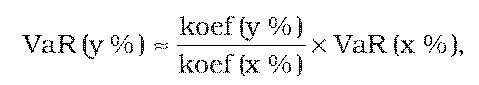
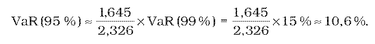
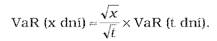
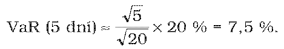
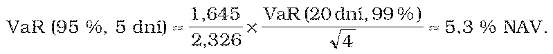

Príloha č. 2 k opatreniu č. 5/2013 Z. z. ZÁSADY PRE ÚPRAVY LIMITU ABSOLÚTNEJ HODNOTY V RIZIKU

- Úprava limitu absolútnej hodnoty v riziku (Value at Risk) na rozdielne intervaly spoľahlivosti a rozdielne časové horizonty, pre ktoré sa vypočítava hodnota v riziku, sa vykonáva v súlade s týmito zásadami:

- 1. Pri prispôsobení maximálneho limitu absolútnej hodnoty v riziku na rozdielny interval spoľahlivosti sa zohľadňuje táto tabuľka normálneho rozdelenia:

Interval spoľahlivosti | Koeficient normálneho rozdelenia

99,0 % 97,5 % 95,0 % | 2,326 1,96 1,645

- 2. Pre interval spoľahlivosti y % a časový horizont 20 dní sa maximálny limit absolútnej hodnoty v riziku podľa § 22 ods. 2 s intervalom spoľahlivosti x % (napr. 99 %) upraví na nový maximálny limit absolútnej hodnoty v riziku podľa tohto vzorca:

kde VaR je hodnota v riziku (Value at Risk).

- 3. Ak sa na výpočet celkového rizika metódou absolútnej hodnoty v riziku používa vo vnútorných postupoch správcovskej spoločnosti interval spoľahlivosti 95 %, použitie vzorca podľa bodu 2 vedie k tejto novej výške maximálneho limitu absolútnej hodnoty v riziku:

- 4. Rovnakým spôsobom ako v bodoch 2 a 3 je možné postupovať pri úprave limitu absolútnej hodnoty v riziku z jedného časového horizontu na iný časový horizont použitím druhej odmocniny časového pravidla. Pre používanie metódy absolútnej hodnoty v riziku s časovým horizontom x dní a intervalom spoľahlivosti 99 % sa maximálny limit absolútnej hodnoty v riziku podľa § 22 ods. 2 s časovým horizontom t dní (napr. 20) upraví na nový limit absolútnej hodnoty v riziku podľa tohto vzorca:

- 5. Ak sa na výpočet celkového rizika metódou absolútnej hodnoty v riziku používa časový horizont päť dní, použitie vzorca podľa bodu štyri vedie k tejto novej výške maximálneho limitu absolútnej hodnoty v riziku:

- 6. Ak sa na výpočet celkového rizika metódou absolútnej hodnoty v riziku používa interval spoľahlivosti 95 % a časový horizont päť dní, nová výška maximálneho limitu absolútnej hodnoty v riziku je

