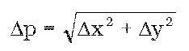

# Čl. I

Vyhláška Úradu geodézie, kartografie a katastra Slovenskej republiky č. 461/2009 Z. z., ktorou sa vykonáva zákon Národnej rady Slovenskej republiky č. 162/1995 Z. z. o katastri nehnuteľností a o zápise vlastníckych a iných práv k nehnuteľnostiam (katastrálny zákon) v znení neskorších predpisov v znení vyhlášky č. 74/2011 Z. z. sa mení a dopĺňa takto:

- 1. V § 1 ods. 3 sa na konci pripája táto veta: „Ak z dôvodu nižšej absolútnej presnosti zobrazovaného obsahu nie je účelné do nečíselnej vektorovej katastrálnej mapy priamo zapracovávať číselné výsledky meraní, dopĺňa nečíselnú vektorovú katastrálnu mapu súbor prevzatých meraní obsahujúci všetky číselné výsledky meraní zapísaných do platného stavu katastra (ďalej len „súbor prevzatých meraní“).“.

- 2. V § 1 odsek 4 znie:

- „(4)

- Vektorizácia mapy je prevod mapy do elektronickej podoby mapy, v ktorej je každý prvok mapy zobrazený pomocou súradníc a atribútov veľkosti a smeru. Číselné výsledky meraní prevzaté do vektorovej katastrálnej mapy sú lokalizované v súradniciach geodetického systému S-JTSK.1) Jednoznačný obojsmerný vzťah medzi súradnicami jeho realizácie JTSK03, reprezentujúcej matematické vyjadrenie súradníc systému ETRS89,1a) využívanom pre meranie v prostredí aktívnych geodetických základov, a súradnicami v systéme S-JTSK definuje Prevodná interpolačná tabuľka. Transformáciu medzi uvedenými súradnicami zabezpečuje Rezortná transformačná služba zriadená úradom. Prevodná interpolačná tabuľka a Rezortná transformačná služba sú prístupné na webovom sídle úradu.“.

- Poznámky pod čiarou k odkazom 1 a 1a znejú:

- „1)

- § 2 ods. 2 písm. b) vyhlášky č. 300/2009 Z. z. v znení vyhlášky č. 75/2011 Z. z.

- 1a)

- § 2 ods. 2 písm. a) vyhlášky č. 300/2009 Z. z. v znení vyhlášky č. 75/2011 Z. z.“.

- Doterajší odkaz 1 sa označuje ako odkaz 1b.

- 3. V § 6 sa vypúšťajú odseky 6 a 7.

- 4. V § 28 sa vypúšťa odsek 2. Súčasne sa zrušuje označenie odseku 1.

- 5. V § 50 odsek 2 znie:

- „(2)

- Elektronický podklad na aktualizáciu súboru geodetických informácií podľa odseku 1 písm. c) obsahuje nové a upravené objekty v súlade s navrhovanou zmenou a pozostáva z vektorového geodetického podkladu

- a)

- na aktualizáciu číselnej vektorovej katastrálnej mapy podľa § 1 ods. 2,

- b)

- na aktualizáciu nečíselnej vektorovej katastrálnej mapy podľa § 1 ods. 3 pre priame zapracovanie číselných výsledkov meraní,

- c)

- podľa § 1 ods. 3 na aktualizáciu súboru prevzatých meraní a vektorového geodetického podkladu na aktualizáciu nečíselnej vektorovej katastrálnej mapy,

- d)

- na aktualizáciu mapy určeného operátu podľa § 2 ods. 3.“.

- 6. V § 54 sa odsek 1 dopĺňa písmenom e), ktoré znie:

- „e)

- vektorový geodetický podklad, ak sa v nečíselnej vektorovej katastrálnej mape na účely vytýčenia určia lomovým bodom vytyčovanej hranice čísla bodov a súradnice v S-JTSK podľa § 55 ods. 4.“.

- 7. V § 55 odsek 3 znie:

- „(3)

- Meračské práce sa vykonajú tak, aby výsledok merania bol presne zobrazený a súčasne spojený s nezmeneným obsahom a zobrazeným obsahom katastrálnej mapy alebo mapy určeného operátu a zároveň, aby umožnili určiť súradnice lomových bodov predmetov merania v S-JTSK.“.

- 8. V § 55 sa za odsek 3 vkladá nový odsek 4, ktorý znie:

- „(4)

- Súradnice bodov, ktoré sa preberajú do katastra, sa transformujú z geodetického systému, v ktorom sa vykonáva meranie (ETRS89, JTSK03) do S-JTSK podľa § 1 ods. 4 na úrovni geodetických základov (ďalej len „základná transformácia“).“.

- Doterajší odsek 4 sa označuje ako odsek 5.

- 9. § 55a až 57 znejú:

- 㤠55a

- (1)

- Čísla a súradnice bodov v katastrálnom území s nečíselnou katastrálnou mapou, ktoré tvoria hranice pozemkov a boli určené v inom zázname podrobného merania zmien s kódom kvality T=3 a T=4 podľa prílohy č. 12, sa preberú pre nadväzujúcu zmenu po overení ich identity a presnosti.

- (2)

- Poloha bodov uvedených v odseku 1 sa overí ako pri identických bodoch. Novourčené súradnice sa porovnajú so skôr určenými súradnicami v S-JTSK. Ak vyhovujú kritériu uvedenému v § 56 ods. 6, ich súradnice a čísla sa prevezmú zo záznamu podrobného merania zmien, v ktorom boli pôvodne určené. Ak nevyhovujú kritériu uvedenému v § 56 ods. 6, nepoužijú sa pre nadväzujúcu zmenu a táto skutočnosť sa uvedie v zázname podrobného merania zmien.

- § 56

- (1)

- Identické body sú jednoznačne identifikovateľné podrobné body v teréne a zobrazené na katastrálnej mape, ktoré slúžia na zobrazenie a spojenie výsledku merania s obsahom mapy. Ako identické body možno použiť aj pevné body podrobného polohového bodového poľa.

- (2)

- Overenie identických bodov v katastrálnom území, v ktorom je spravovaná nečíselná vektorová katastrálna mapa, sa vykoná určením ich vzájomnej polohy alebo odmeraním vzdialenosti identického bodu od najmenej dvoch ďalších bodov, ktoré možno považovať za identické a porovnaním výsledku so zodpovedajúcimi údajmi dokumentovanými v súbore geodetických informácií.

- (3)

- Body podľa odseku 2 možno považovať za identické, ak sú splnené kritériá presnosti ustanovené v prílohe č. 13, v závislosti od pôvodu určenia posudzovaného bodu. Ak sa overením identity bodu zistí prekročenie kritérií presnosti, takýto bod sa považuje za neidentický a nesmie byť použitý.

- (4)

- Na účely aktualizácie číselnej vektorovej katastrálnej mapy sa za identické body vyberú body, ktoré umožňujú určiť polohovú odchýlku Δp medzi polohou bodu určeného pri pôvodnom meraní obsahu mapy a polohou identického bodu určenou meraním pomocou aktívnych geodetických základov, s následným využitím Prevodnej interpolačnej tabuľky alebo základnej transformácie. Ako identické body sa prednostne použijú najmä pevné body podrobného polohového bodového poľa, ak z nich bol meraný pôvodný obsah mapy alebo podrobné body, ktoré od času pôvodného merania obsahu mapy nezmenili svoju polohu.

- (5)

- Polohová odchýlka Δp sa vypočíta zo vzťahu

- 

- kde Δx = x1 – x2 a Δy = y1 – y2; kde x1, y1 sú súradnice bodu z pôvodného merania a x2, y2 sú súradnice identického bodu určeného v podmienkach globálnych navigačných satelitných systémov a transformované do S-JTSK prostredníctvom Prevodnej interpolačnej tabuľky.

- (6)

- Kritérium na posudzovanie súradnicových rozdielov Δx a Δy je Δp; Δp = 0,24 m.

- § 57

- (1)

- Meračskú sieť tvoria body geodetických základov, podrobné geodetické body, pomocné meračské body alebo ich kombinácia. Súradnice pomocných meračských bodov sa určia priamym pripojením na aktívne geodetické základy alebo z bodov, ktoré boli určené v meračskej sieti pripojenej na aktívne geodetické základy.

- (2)

- Pomocné meračské body sú body, ktoré dopĺňajú meračskú sieť na hustotu potrebnú na podrobné meranie. Pomocné meračské body sa určujú postupom podľa osobitného predpisu.12)

- (3)

- Ak sa na meranie využijú pomocné meračské body určené v inom zázname podrobného merania zmien, táto skutočnosť sa vyznačí v aktuálnom zázname podrobného merania zmien prebratím čísla pôvodného záznamu merania zmien v označení čísla pomocného meračského bodu.

- (4)

- Ak sa na meranie použije referenčná stanica, umiestni sa na bode Štátnej priestorovej siete alebo na podrobnom geodetickom bode.

- (5)

- Charakteristikou presnosti určenia súradníc pomocných meračských bodov je základná stredná súradnicová chyba mxy. Pomocný meračský bod sa určí tak, aby charakteristika presnosti určenia súradníc neprekročila hodnotu mxy=0,04 m.“.

- Poznámka pod čiarou k odkazu 12 znie:

- „12)

- Príloha č. 1 body 2.1 až 2.3, 2.4 písm. b) a c) a 2.5 až 2.7 vyhlášky č. 300/2009 Z. z. v znení vyhlášky č. 75/2011 Z. z.“.

- 10. Za § 58a sa vkladajú § 58b až 58d, ktoré vrátane nadpisov znejú:

- 㤠58b

- Aktualizácia číselnej vektorovej katastrálnej mapy

- (1)

- Ak na identických bodoch podľa § 56 ods. 4 až 6 nie je prekročené kritérium Δp, číselná vektorová katastrálna mapa sa aktualizuje z vektorového geodetického podkladu podľa § 50 ods. 2 písm. a), pričom pre určenie polohy nových lomových bodov sa využije základná transformácia podľa § 55 ods. 4.

- (2)

- Ak na identických bodoch podľa § 56 ods. 4 až 6 je prekročené kritérium Δp a zároveň posun na identických bodoch je systematický, číselná vektorová katastrálna mapa sa aktualizuje z vektorového geodetického podkladu podľa § 50 ods. 2 písm. a), pričom pre určenie polohy nových lomových bodov sa využije základná transformácia podľa § 55 ods. 4 a následne lokálna transformácia na identické body.

- (3)

- Ak z dôvodu nižšej absolútnej alebo relatívnej presnosti číselnej katastrálnej mapy nemožno použiť ustanovenia odsekov 1 a 2, opraví správa katastra zistené chyby a nesúlady na základe nového merania podľa § 59 zákona.

- § 58c

- Aktualizácia nečíselnej vektorovej katastrálnej mapy

- (1)

- Ak sa nečíselná vektorová katastrálna mapa aktualizuje z údajov priamo meraných a transformovaných základnou transformáciou, aktualizácia sa vykoná z vektorového geodetického podkladu podľa § 50 ods. 2 písm. b).

- (2)

- Ak sa podľa § 1 ods. 3 na základe údajov priamo meraných a transformovaných základnou transformáciou zapracúvajú číselné výsledky meraní do súboru prevzatých meraní, postupuje sa podľa § 55a. Súčasne sa z vektorového geodetického podkladu podľa § 50 ods. 2 písm. c) aktualizuje nečíselná vektorová katastrálna mapa tak, aby vykonaná zmena mala nadväznosť na doterajší stav mapy, pričom upravené merané údaje pre skonštruovanie zmeny do nečíselnej vektorovej katastrálnej mapy sú obsahom príslušného vektorového geodetického podkladu.

- (3)

- V pochybnostiach o spôsobe aktualizácie nečíselnej vektorovej katastrálnej mapy podľa odsekov 1 a 2 sa postupuje podľa stanoviska úradu.

- § 58d

- Dokumentácia prevzatých meraní v katastrálnych územiach bez vektorovej katastrálnej mapy

- (1)

- V katastrálnych územiach, v ktorých je spravovaná katastrálna mapa v papierovej podobe, slúži na dokumentáciu číselných výsledkov merania súbor prevzatých meraní do platného katastrálneho operátu, ktorý sa aktualizuje na podklade vektorového geodetického podkladu podľa § 50 ods. 2 písm. c).

- (2)

- Vektorová mapa určeného operátu sa aktualizuje na podklade vektorového geodetického podkladu podľa § 50 ods. 2 písm. d).“.

- 11. Príloha č. 12 znie:

- „Príloha č. 12 k vyhláške č. 461/2009 Z. z.

- Kód | Kvalita podrobného bodu

- 1 | Číselne určený bod v súradnicovom systéme Jednotnej trigonometrickej siete katastrálnej podľa § 55 ods. 4 (mxy= 0,08 m).

- 2 | Číselne určený bod v súradnicovom systéme Jednotnej trigonometrickej siete katastrálnej bez reálneho vyznačenia v teréne; tento kód nemožno použiť v prípade, v ktorom je vyznačenie bodu v teréne nutné, alebo v prípade, kde podrobný bod je už v teréne označený (mxy= 0,08m).

- 3 | Číselne určený bod v súradnicovom systéme Jednotnej trigonometrickej siete katastrálnej prostredníctvom geodetických terestrických metód bez pripojenia na aktívne geodetické základy (mxy= 0,14 m).

- 4 | Číselne určený bod v súradnicovom systéme Jednotnej trigonometrickej siete katastrálnej prostredníctvom geodetických terestrických metód bez pripojenia na aktívne geodetické základy (mxy= 0,26 m).

- 5 | Nečíselne určený bod, súradnice bodu určené kartometricky (mxybez rozlíšenia).

- “.
