# Čl. I

Vyhláška Úradu pre reguláciu sieťových odvetví č. 221/2013 Z. z., ktorou sa ustanovuje cenová regulácia v elektroenergetike sa mení a dopĺňa takto:

- 1. § 1 sa dopĺňa písmenom o), ktoré znie:

- „o)

- nameraným výkonom najvyššia hodnota štvrťhodinového činného elektrického výkonu nameraného počas kalendárneho mesiaca 24 hodín denne.“.

- 2. V § 4 ods. 1 písmeno l) znie:

- „l)

- režijné náklady s maximálnou prípustnou mierou medziročného rastu vo výške JPI-X, kde JPI je aritmetický priemer indexov jadrovej inflácie v percentách zverejnených štatistickým úradom za obdobie od júla roku t-2 do júna roku t-1 a X je faktor efektivity v percentách určený na regulačné obdobie, ktorého hodnota je 3,5 %, ak je JPI < X, potom sa JPI - X = 0 a do oprávnených nákladov v roku t sa zahrnú režijné náklady najviac vo výške režijných nákladov roku t-1,“.

- 3. V § 4 sa odsek 1 dopĺňa písmenami m) a n), ktoré znejú:

- „m)

- úrok z dlhopisu vydaného regulovaným subjektom do výšky úroku rovnajúceho sa aritmetickému priemeru hodnôt mesačných priemerov ukazovateľa 12M EURIBOR za obdobie posledných 12 mesiacov predchádzajúcich mesiacu, v ktorom sa predkladá návrh ceny, zverejnených na webovom sídle www.euribor-ebf.eu v časti Euribor rates, na zabezpečenie finančných prostriedkov na prevádzkové náklady súvisiace s nákupom elektriny na straty a úhradu doplatku podľa osobitných predpisov,9)

- n)

- náklady na projekty spoločného záujmu podľa osobitného predpisu.9a)“.

- Poznámka pod čiarou k odkazu 9a znie:

- „9a)

- Nariadenie Európskeho parlamentu a Rady (EÚ) č. 347/2013 zo 17. apríla 2013 o usmerneniach pre transeurópsku energetickú infraštruktúru, ktorým sa zrušuje rozhodnutie č. 1364/2006/ES a menia a dopĺňajú nariadenia (ES) č. 713/2009, (ES) č. 714/2009 a (ES) č. 715/2009 (Ú. v. EÚ L 115, 25. 4. 2013).“.

- 4. V § 7 ods. 12 sa vypúšťajú slová „okrem zariadenia výrobcu elektriny využívajúceho ako zdroj vodnú energiu s celkovým inštalovaným výkonom do 2 MW vrátane“.

- 5. Poznámka pod čiarou k odkazu 44 znie:

- „44)

- § 6 ods. 8 zákona č. 309/2009 Z. z. v znení zákona č. 382/2013 Z. z.“.

- 6. V § 7 sa vypúšťa odsek 13.

- Doterajšie odseky 14 až 20 sa označujú ako odseky 13 až 19.

- 7. V § 7 ods. 14 sa za slová „návratnosti investície“ vkladá slovo „najmenej“.

- 8. V § 8 ods. 1 sa za slová „potom CEPSDti,j = CEPSDzi,j“ vkladá čiarka a slová „to neplatí pre zariadenia výrobcov elektriny uvedené do prevádzky od 1. marca 2013,“.

- 9. V § 8 ods. 1 tabuľka č. 1 znie:

- „

- Technológia výroby elektriny | Primárne palivo | Príplatok Pzn1t v eurách/MWh | | |

- | | 2012 | 2013 | 2014 | 2015

- z obnoviteľných zdrojov energie | biomasa | | | |

- | biokvapalina – rastlinný olej | 17,75 | | |

- | bioplyn | | | |

- | biometán | | | |

- vysoko účinnou kombinovanou výrobou | zemný plyn | 3,77 | | | -2,72

- | vykurovací olej | 4,64 | | 4,28 | -0,64

- | hnedé uhlie | | | 0,67 |

- | čierne uhlie | | | |

- | energeticky využiteľné plyny vznikajúce pri hutníckej výrobe ocele | | | |

- “.

- 10. Nadpis § 10 znie: „Cena elektriny pre zariadenie výrobcu elektriny uvedené do prevádzky v roku 2014“ a v § 10 ods. 1 a 2 sa slová „od 1. januára“ nahrádzajú slovami „v roku“.

- 11. Za § 10 sa vkladá § 10a, ktorý vrátane nadpisu znie:

- 㤠10a

- Cena elektriny pre zariadenie výrobcu elektriny uvedené do prevádzky od 1. januára 2015

- (1)

- Cena elektriny vyrobenej z obnoviteľných zdrojov energie v zariadení výrobcu elektriny uvedeného do prevádzky od 1. januára 2015 sa určuje priamym určením pevnej ceny v eurách na megawatthodinu takto:

- a) | z vodnej energie s celkovým inštalovaným výkonom zariadenia výrobcu elektriny | |

- | 1. | do 100 kW vrátane | 111,27 eura/MWh,

- | 2. | nad 100 kW do 200 kW vrátane | 109,17 eura/MWh,

- | 3. | nad 200 kW do 500 kW vrátane | 106,84 eura/MWh,

- | 4. | nad 500 kW do 1 MW vrátane | 105,15 eura/MWh,

- | 5. | nad 1 MW do 5 MW vrátane | 97,98 eura/MWh,

- b) | zo slnečnej energie s celkovým inštalovaným výkonom zariadenia výrobcu elektriny do 30 kW, ktoré je umiestnené na strešnej konštrukcii alebo obvodovom plášti jednej budovy spojenej so zemou pevným základom | | 88,89 eura/MWh,

- c) | z veternej energie | | 62,49 eura/MWh,

- d) | z geotermálnej energie | | 155,13 eura/MWh,

- e) | zo spaľovania alebo spoluspaľovania kombinovanou výrobou | |

- | 1. | cielene pestovanej biomasy okrem obilnej slamy | 92,09 eura/MWh,

- | 2. | odpadnej biomasy ostatnej okrem obilnej slamy | 96,90 eura/MWh,

- | 3. | obilnej slamy | 107,21 eura/MWh,

- | 4. | biokvapaliny | 91,79 eura/MWh,

- f) | zo spoluspaľovania biologicky rozložiteľných zložiek komunálneho odpadu s fosílnymi palivami kombinovanou výrobou; ak podiel biologicky rozložiteľnej zložky v komunálnom odpade je podľa osobitného predpisu,49) cena sa uplatní bez podmienky výroby elektriny kombinovanou výrobou | | 100,49 eura/MWh,

- g) | zo spaľovania | |

- | 1. | skládkového plynu alebo plynu z čističiek odpadových vôd | 70,34 eura/MWh,

- | 2. | biometánu získaného z bioplynu vyrobeného anaeróbnou fermentačnou technológiou s celkovým výkonom zariadenia do 1 MW vrátane | 107,53 eura/MWh,

- | 3. | bioplynu vyrobeného anaeróbnou fermentačnou technológiou s celkovým výkonom zariadenia do 250 kW vrátane | 120,49 eura/MWh,

- | 4. | bioplynu vyrobeného anaeróbnou fermentačnou technológiou s celkovým výkonom zariadenia nad 250 kW do 500 kW vrátane | 110,00 eur/MWh,

- | 5. | bioplynu vyrobeného anaeróbnou fermentačnou technológiou s celkovým výkonom zariadenia nad 500 kW do 750 kW vrátane | 102,95 eura/MWh,

- | 6. | bioplynu vyrobeného anaeróbnou fermentačnou technológiou s celkovým výkonom zariadenia nad 750 kW | 100,23 eura/MWh,

- | 7. | plynu vyrobeného termochemickým splyňovaním biomasy v splyňovacom generátore | 99,21 eura/MWh,

- | 8. | fermentovanej zmesi vyrobenej aeróbnou fermentáciou biologicky rozložiteľného odpadu | 95,50 eura/MWh.

- (2)

- Cena elektriny vyrobenej vysoko účinnou kombinovanou výrobou v zariadení výrobcu elektriny uvedeného do prevádzky od 1. januára 2015 sa určuje priamym určením pevnej ceny v eurách na megawatthodinu takto:

- a) | v spaľovacej turbíne s kombinovaným cyklom | | 74,75 eura/MWh,

- b) | v spaľovacej turbíne s regeneráciou tepla | | 72,89 eura/MWh,

- c) | v spaľovacom motore s palivom | |

- | 1. | zemný plyn | 82,53 eura/MWh,

- | 2. | vykurovací olej | 78,89 eura/MWh,

- | 3. | zmes vzduchu a metánu | 74,39 eura/MWh,

- | 4. | z katalyticky spracovaného odpadu | 99,82 eura/MWh,

- | 5. | z termického štiepenia odpadov a jeho produktov | 98,40 eura/MWh,

- d) | v protitlakovej parnej turbíne alebo v kondenzačnej parnej turbíne s odberom tepla s palivom | |

- | 1. | zemný plyn | 80,97 eura/MWh,

- | 2. | vykurovací olej | 78,96 eura/MWh,

- | 3. | hnedé uhlie | 80,37 eura/MWh,

- | 4. | čierne uhlie s celkovým inštalovaným výkonom zariadenia výrobcu elektriny do 50 MW vrátane | 74,84 eura/MWh,

- | 5. | čierne uhlie s celkovým inštalovaným výkonom zariadenia výrobcu elektriny nad 50 MW | 71,83 eura/MWh,

- | 6. | komunálny odpad | 77,60 eura/MWh,

- | 7. | plyn vyrobený termochemickým splyňovaním odpadu v splyňovacom generátore alebo termickým štiepením odpadu | 89,05 eura/MWh,

- e) | spaľovanie energeticky využiteľných plynov vznikajúcich pri hutníckej výrobe ocele | | 80,02 eura/MWh,

- f) | v Rankinovom organickom cykle | | 98,31 eura/MWh.“.

- “.

- 12. V § 11 ods. 5 písm. a) sa na konci pripájajú tieto slová: „vrátane nákladov na nákup emisných kvót určených podľa oficiálneho kurzového lístka zverejneného burzou EEX na jej webovom sídle, za produkt EU Emission Allowances-Spot Market v eurách na tony CO2 za obdobie od 1. januára roku t-2 do 31. decembra roku t-2“.

- 13. V § 16 ods. 2 písm. b) sa na konci pripájajú tieto slová: „a alikvotná časť tarify za prevádzkovanie systému na organizovanie a vyhodnotenie krátkodobého trhu s elektrinou organizátora krátkodobého trhu s elektrinou v eurách v roku t sa vypočíta podľa vzorca

  - 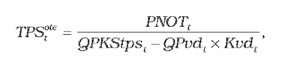

- kde

  - 1. QPKStpst

  - je celková plánovaná koncová spotreba elektriny na vymedzenom území v roku t, na ktorú sa uplatňujú tarify za prevádzkovanie systému,

  - 2. QPvdt

  - je celkový plánovaný objem elektriny v jednotkách množstva elektriny v roku t odobratej koncovými odberateľmi elektriny priamo pripojenými do prenosovej sústavy s dobou ročného využitia maxima v roku t-2 vyššou ako 6 800 hodín a súčasne pomernou odchýlkou subjektu zúčtovania menšou ako 0,025; dobou ročného využitia maxima sa rozumie podiel celkového ročného preneseného množstva elektriny v roku t-2 a rezervovanej kapacity určenej ako aritmetický priemer mesačných maxím štvrťhodinového výkonu za mesiace november roku t-4 až február roku t-3,

  - 3. Kvdt

  - je koeficient zvýhodnenia odberového diagramu pre individuálne sadzby taríf koncových odberateľov elektriny priamo pripojených do prenosovej sústavy na rok t, ktorého hodnota je 0,95,“.

- 14. V § 20 ods. 1 vzorec znie:

  - 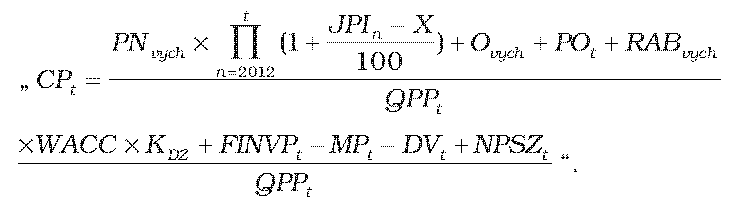

- 15. V § 20 ods. 1 písm. l) sa za slová „do prenosovej sústavy“ vkladá čiarka a slová „výrobcami elektriny, ktorí sú priamo pripojení do prenosovej sústavy,“.

- 16. V § 20 sa odsek 1 dopĺňa písmenom m), ktoré znie:

- „m)

- NPSZt sú náklady na projekty spoločného záujmu v eurách na rok t.“.

- 17. V § 23 ods. 3 písm. e) vzorec znie:

  - 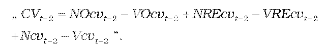

- 18. V § 23 ods. 3 písm. e) sa vypúšťajú tretí bod a štvrtý bod. Doterajšie body päť až osem sa označujú ako tretí bod až šiesty bod.

- 19. V § 26 ods. 14 sa vypúšťa druhá veta.

- 20. V § 26 ods. 21 prvej vete sa slová „a určená“ nahrádzajú slovami „alebo určená“ a piatej vete sa slová „Pri žiadosti odberateľa elektriny o zníženie hodnoty rezervovanej kapacity pre odberné miesta nevybavené určeným meradlom s meraním štvrťhodinového činného výkonu sa odberateľom elektriny preukazuje zníženie menovitej hodnoty ističa predložením“ nahrádzajú slovami „Podmienkou na zníženie hodnoty rezervovanej kapacity pre odberné miesto nevybavené určeným meradlom s meraním štvrťhodinového činného výkonu je predloženie“.

- 21. V § 26 ods. 24 prvej vete sa za slová „je jeho miestna distribučná sústava pripojená“ vkladajú slová „alebo je zariadenie na výrobu elektriny výrobcu elektriny pripojené do miestnej distribučnej sústavy, ktorá je pripojená do regionálnej distribučnej sústavy prostredníctvom jednej alebo viacerých miestnych distribučných sústav“.

- 22. V § 26 odsek 35 znie:

- „(35)

- Ceny za prístup do distribučnej sústavy a distribúciu elektriny, do prenosovej sústavy a prenos elektriny sa kalkulujú pri základnom zabezpečení pripojenia užívateľa sústavy štandardným pripojením. Za štandardné pripojenie užívateľa sústavy sa považuje pripojenie jedným napájacím vedením podľa technických podmienok prevádzkovateľa distribučnej sústavy. Pri pripojení užívateľa sústavy s osobitnými nárokmi na spôsob zabezpečenia distribúcie elektriny, napríklad cez ďalšie napájacie vedenia, sa cena za prístup do distribučnej sústavy určí vo výške 15 % z tarify za rezervovanú kapacitu, ktorá je dohodnutá pre ďalšie napájacie vedenie, podľa cenového rozhodnutia na rok t. Užívateľ sústavy si určí sám, ktoré napájacie vedenie je štandardné a ktoré je ďalšie napájacie vedenie, a to na obdobie kalendárneho roka. V prípade distribúcie elektriny cez ďalšie napájacie vedenie na základe požiadavky užívateľa sústavy v danom mesiaci sa cena za prístup do distribučnej sústavy určí vo výške 15 % z tarify za rezervovanú kapacitu pre napäťovú úroveň, do ktorej je ďalšie napájacie vedenie pripojené, a cena za distribúciu elektriny sa určí vo výške 100 % tarify za distribúciu elektriny pre napäťovú úroveň, do ktorej je ďalšie napájacie vedenie pripojené, pričom cena za prístup do distribučnej sústavy a distribúciu elektriny za štandardné pripojenie nie je týmto dotknutá. V prípade dohodnutej rezervovanej kapacity pre ďalšie napájacie vedenie na napäťovej úrovni vysokého napätia nad 10 MW sa cena za prístup do distribučnej sústavy určí vo výške 7,5 % z tarify za rezervovanú kapacitu a v prípade distribúcie elektriny cez ďalšie napájacie vedenie sa cena za distribúciu elektriny určí vo výške 100 % tarify za distribúciu elektriny, pričom cena za prístup do distribučnej sústavy a distribúciu elektriny za štandardné pripojenie nie je týmto dotknutá. V prípade dohodnutej rezervovanej kapacity pre ďalšie napájacie vedenie na napäťovej úrovni veľmi vysokého napätia nad 100 MW sa cena za prístup do distribučnej sústavy určí vo výške 7,5 % z tarify za rezervovanú kapacitu a v prípade distribúcie elektriny cez ďalšie napájacie vedenie sa cena za distribúciu elektriny určí vo výške 100 % tarify za distribúciu elektriny, pričom cena za prístup do distribučnej sústavy a distribúciu elektriny za štandardné pripojenie nie je týmto dotknutá.“.

- 23. V § 27 ods. 3 písm. h) sa slová „v intervale od 0,90 do 1,00“ nahrádzajú slovami „podľa podielu

  - 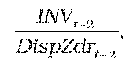 pričom ak tento podiel je

- vyšší alebo rovný 0,5, tak KDZ = 1,00,

- menší ako 0,5 a zároveň vyšší alebo rovný 0,4, tak KDZ = 0,98,

- menší ako 0,4 a zároveň vyšší alebo rovný 0,3, tak KDZ = 0,96,

- menší ako 0,3 a zároveň vyšší alebo rovný 0,2, tak KDZ = 0,94,

- menší ako 0,2 a zároveň vyšší alebo rovný 0,1, tak KDZ = 0,92 alebo

- menší ako 0,1, tak KDZ = 0,90,

- kde

  - 1. INVt-2

  - je skutočná hodnota investícií na napäťovej úrovni v eurách zaradených do hodnoty regulačnej bázy aktív na napäťovej úrovni nevyhnutne využívaných pre regulovanú činnosť v roku t-2,

  - 2. DispZdrt-2

  - je súčet schválených alebo určených odpisov na napäťovej úrovni v eurách súvisiacich s regulovanou činnosťou v roku t-2 a vypočítaných na základe zostatkovej doby technickej životnosti tried aktív nevyhnutne využívaných pre regulovanú činnosť podľa prílohy č. 1 tabuľky č. 2 a zisku prevádzkovateľa distribučnej sústavy v roku t-2 v eurách po zdanení daňou z príjmov, ktorý sa vypočíta RAB x WACC x ( – daň z príjmov), pričom WACC a daň z príjmov sa vzťahuje na obdobie t-2,“.

- 24. V § 27 ods. 4 vzorec znie:

  - 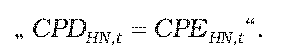

- 25. V § 27 ods. 4 sa vypúšťa písmeno b). Súčasne sa zrušuje označenie písmena a).

- 26. V § 27 ods. 6 vzorec znie:

  - 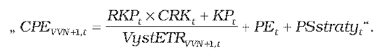

- 27. V § 27 sa odsek 6 dopĺňa písmenom f), ktoré znie:

- „f)

- KPt je faktor vyrovnania ceny za prístup do prenosovej sústavy a prenos elektriny v eurách, ktorý sa vypočíta podľa vzorca

- 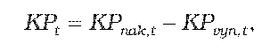

- kde

- 1.

- KPnak,t

- je korekcia nákladov za prístup do prenosovej sústavy a prenos elektriny v eurách, ktorá sa vypočíta podľa vzorca

- 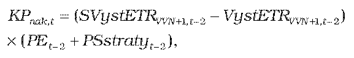

- kde

- 1a.

- SVystETRVVN+1,t-2 je skutočné množstvo elektriny v jednotkách množstva elektriny vstupujúce do príslušnej napäťovej úrovne cez transformáciu z vyššej napäťovej úrovne v roku t-2,

- 1b.

- VystETRVVN+1,t-2 je plánované množstvo elektriny v jednotkách množstva elektriny vstupujúce do príslušnej napäťovej úrovne cez transformáciu z vyššej napäťovej úrovne v roku t-2,

- 1c.

- PE,t-2 je cena za prenesenú elektrinu v eurách na jednotku množstva elektriny v roku t-2 uplatňovaná regulovanému subjektu prevádzkovateľom prenosovej sústavy,

- 1d.

- PSstratyt-2je tarifa za straty pri prenose elektriny v eurách na jednotku množstva elektriny v roku t-2 uplatňovaná regulovanému subjektu prevádzkovateľom prenosovej sústavy,

- 2.

- KPvyn,t

- je korekcia výnosov z účtovania ceny CPDHN,t-2, ktorá sa vypočíta podľa vzorca

- 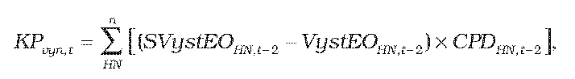

- kde

- 2a.

- SVystEOHN,t-2 je skutočné množstvo elektriny v jednotkách množstva elektriny distribuované na príslušnej napäťovej úrovni ku koncovým odberateľom elektriny v roku t-2,

- 2b.

- VystEOHN,t-2 je plánované množstvo elektriny v jednotkách množstva elektriny distribuované na príslušnej napäťovej úrovni koncovým odberateľom elektriny v roku t-2.“.

- 28. V § 29 ods. 13 sa za prvú vetu vkladá nová druhá veta, ktorá znie: „Platba podľa prvej vety sa uhrádza prevádzkovateľovi miestnej distribučnej sústavy výrobcom elektriny podľa príslušnej napäťovej úrovne miestnej distribučnej sústavy, do ktorej je výrobca elektriny pripojený.“.

- 29. V § 30 ods. 1 vzorec Atznie:

  - 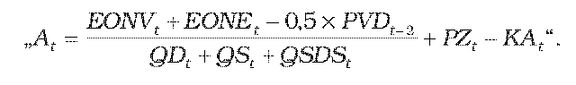

- 30. V § 30 ods. 1 písm. h) vzorec znie:

  - 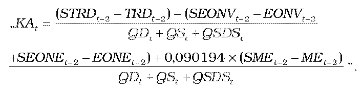

- 31. V § 30 ods. 1 sa písmeno h) dopĺňa siedmym bodom a ôsmym bodom, ktoré znejú:

- „7.

- STRDt-2sú skutočné schválené alebo určené výnosy v eurách za distribúciu elektriny v roku t-2 okrem nákladov na obstaranie elektriny na krytie strát elektriny pri distribúcii elektriny,

- 8.

- TRDt-2sú plánované schválené alebo určené výnosy v eurách za distribúciu elektriny v roku t-2 okrem nákladov na obstaranie elektriny na krytie strát elektriny pri distribúcii elektriny.“.

- 32. V § 37 ods. 2 písm. b) druhom bode sa slová „pre domácnosti“ nahrádzajú slovami „dodávateľom poslednej inštancie“.

- 33. V § 41 ods. 7 sa slová „odberateľ elektriny“ nahrádzajú slovom „žiadateľ“.

- 34. V § 42 sa slová „110 kV“ nahrádzajú slovami „od 52 kV vrátane do 110 kV“.

- 35. V § 43 sa slová „do napäťovej úrovne od 1 kV vrátane do 110 kV“ nahrádzajú slovami „do napäťovej úrovne od 1 kV do 52 kV“.

- 36. Za § 47 sa vkladá § 47a, ktorý vrátane nadpisu znie:

- 㤠47a

- Prechodné ustanovenie k úpravám účinným od 1. júla 2014

- Podľa tejto vyhlášky v znení účinnom od 1. júla 2014 sa prvýkrát postupuje pri vykonávaní cenovej regulácie na rok 2015.“.

- 37. V prílohe č. 7 ods. 1 tabuľka znie:

- „

- Číslo | Názov výkazu | Za obdobie | Termín predloženia

- 1 | Výkaz investičných výdavkov | očakávaná skutočnosť t-1 | do 31. októbra roka t-1

- | | skutočnosť t-2 | do 31. októbra roka t-1

- | | plán t | do 31. októbra roka t-1

- 2 | Výkaz vybraných nákladov | skutočnosť t-2 | do 31. októbra roka t-1

- | | očakávaná skutočnosť t-1 | do 31. októbra roka t-1

- | | plán t | do 31. októbra roka t-1

- 3 | Výkaz cenových štatistík | skutočnosť t-2 | do 31. októbra roka t-1

- | | očakávaná skutočnosť t-1 | do 31. októbra roka t-1

- | | plán t | do 31. októbra roka t-1

- “.

- 38. V prílohe č. 7 ods. 2 tabuľka znie:

- „

- VIV-E-DE Investície – dodávka elektriny pre malý podnik | rok t-2 | rok t-1 | rok t | rok t+1 | rok t+2 | rok t+3 | rok t+4

- Dodávka elektriny pre malý podnik | | | | | | |

- “.
