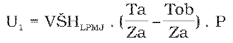
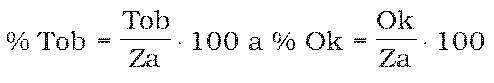
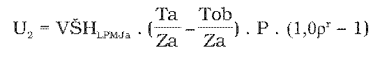
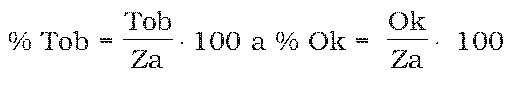
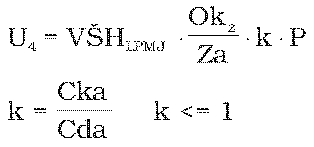
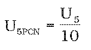

Príloha č. 2 k nariadeniu vlády č. 7/2014 Z. z.

- SPÔSOB VÝPOČTU FINANČNEJ NÁHRADY NA LESNOM POZEMKU

  - A. Spôsob výpočtu náhrady za stratu alebo zníženie výnosu z dreva v územiach so zákazom ťažby alebo s výnimočným povolením ťažby

    - 

    - Použije sa pre územia s trvalým zákazom vykonávania hospodárskych činností (5. stupeň ochrany prírody).

    - Pri obnovných ťažbách počas obnovnej doby platí:

    - Σ % Tob + Σ %OK počas obnovnej doby ‹=100 %,

    - pričom

    - 

  - B. Spôsob výpočtu náhrady za zníženie výnosu z dreva v porastoch, napríklad s obmedzeným predpisom obnovnej ťažby s predĺženou rubnou dobou, dočasným zákazom ťažby, odsunom ťažieb mimo území s trvalým zákazom ťažby (5. stupeň ochrany prírody) – podľa písmena A

    - 

    - Použije sa pre územia s požadovanou zníženou intenzitou úmyselných ťažieb alebo s dočasným zákazom zasahovania do porastu.

    - Napríklad: Predĺženie obnovnej doby, predĺženie rubnej doby, odsun ťažieb oproti bežnému obhospodarovaniu z dôvodu druhovej ochrany a ochrany biotopov.

    - Pri obnovných ťažbách platí:

    - Σ % Tob + Σ % Ok počas obnovnej doby ‹=100 %,

    - pričom

    - 

  - C. Spôsob výpočtu náhrady za zvýšenie nákladov na bežné obhospodarovanie porastu

    - U3,1 = (Nob1– Nb1) . Taz

    - – pre prípady, keď sa zvýšené náklady vypočítavajú podľa zrealizovaného objemu drevnej hmoty,

      - U3,2 = (Nob2– Nb2) . Pz

    - – pre prípady, keď sa zvýšené náklady vypočítavajú podľa plochy, na ktorej sa realizoval zásah.

      - Pri výpočte sa vychádza z podkladov dokladujúcich skutočné náklady pri požadovanom spôsobe obhospodarovania alebo vykonania činnosti. Náklady pri bežnom spôsobe obhospodarovania alebo vykonania činnosti sa odvodia z prevádzkových nákladov v podobných podmienkach pri rovnakých činnostiach.

  - D. Spôsob výpočtu náhrady v prípade mimoriadnych okolností prírodných kalamít

    - 

  - E. Iné možnosti výpočtu

    - Znalec použije iný postup výpočtu, keď možno náhradu určiť objektívnejšie inou metodikou presnejšie zodpovedajúcou skutočnosti.

  - F. Spôsob výpočtu celkovej hodnoty náhrady za obmedzenie bežného obhospodarovania

    - V opodstatnených prípadoch je možná aj kombinácia jednotlivých čiastkových úhrad vypočítaných podľa vzorcov U1až U4. Suma jednotlivých čiastkových úhrad sa zníži o vyplatené dotácie, príspevky a oslobodenia od dane z pozemkov a výšku nájomného alebo odplaty za zmluvnú starostlivosť. K výslednej hodnote náhrady sa pripočíta vyúčtovanie nákladov za vypracovanie znaleckého posudku určené podľa osobitného predpisu.9)

    - U5 = (U1...+...U4) – (Ksp + Da + Knzs) + Z

    - Výpočet pomernej ročnej časti náhrady, ktorá sa bude vyplácať podľa § 61e ods. 8 zákona v priebehu platnosti programu starostlivosti o lesy sa v tomto prípade určí ako

    - 

    - Význam premenných (symbolov) vo vzorcoch

    - Un,m – vzorce výpočtu náhrady, n – druh obmedzenia bežného obhospodarovania, m – poradie vzorcov na výpočet daného druhu obmedzenia bežného obhospodarovania,

    - U5PCN – pomerná ročná časť náhrady,

    - VŠHLPMJ – jednotková všeobecná hodnota lesného porastu v eurách/ha v skutočnom veku porastu vypočítaná podľa osobitného predpisu,8)

    - Ta – objem plánovaných výchovných alebo obnovných ťažieb podľa bežného obhospodarovania,

    - Tob – objem obmedzených výchovných alebo obnovných ťažieb,

    - Ok – objem kalamitného dreva v m3,

    - Za – zásoba lesného porastu,

    - P – plocha lesného porastu v ha,

    - Σ % Tob – suma % obnovnej ťažby, ktorú bolo umožnené vykonať (aj v predošlých decéniách obnovnej doby) + percento obnovnej ťažby, ktorú nebolo umožnené vykonať, ale za ktorú bola vyplatená náhrada v predošlých decéniách obnovnej doby,

    - Σ % Ok – suma % náhodnej ťažby, ktorú bolo umožnené vykonať + percento náhodnej ťažby, ktorú nebolo umožnené vykonať, ale za ktorú bola vyplatená náhrada v predošlých decéniách,

    - VŠHLPMJa – jednotková všeobecná hodnota lesného porastu v eurách/ha vo veku v čase schválenia programu starostlivosti o lesy vypočítaná podľa osobitného predpisu,8)

    - ρ – 3-percentná úroková sadzba,

    - r – platnosť programu starostlivosti o lesy v rokoch alebo dĺžka obmedzenia v rokoch v rámci programu starostlivosti o lesy (ak obmedzenie netrvalo celé obdobie jeho platnosti),

    - Nob1 – celkové jednotkové náklady pri požadovanom (obmedzenom) spôsobe obhospodarovania v eurách/m3,

    - Nob2 – celkové jednotkové náklady pri požadovanom (obmedzenom) spôsobe obhospodarovania v eurách/ha,

    - Nb1 – celkové jednotkové náklady bežného spôsobu obhospodarovania v eurách/m3,

    - Nb2 – celkové jednotkové náklady bežného spôsobu obhospodarovania v eurách/ha,

    - Taz – objem ťažby so zvýšenými nákladmi v m3,

    - Pz – plocha zásahu so zvýšenými nákladmi v ha,

    - % Okz – percento náhodnej ťažby, ktorú nebolo umožnené vykonať,

    - Okz – objem náhodnej ťažby v m3, ktorú nebolo umožnené vykonať,

    - k – koeficient zníženia hodnoty kalamitného dreva,

    - Cda – cena dreva na pni,

    - Cka – cena kalamitného dreva na pni,

    - Ksp – vyplatené dotácie alebo príspevky z podporných fondov vzťahujúce sa na predmet ujmy a obdobie, na ktoré sa ujma uplatňuje podľa § 1 ods. 2 písm. i) a j),

    - Da – oslobodenie od dane z pozemkov, ktoré sú predmetom náhrady za obmedzenie bežného obhospodarovania, o ktorú bol žiadateľ oslobodený, za obdobie, na ktoré si uplatňuje náhradu ujmy,

    - Knzs – výška nájomného alebo odplaty za zmluvnú starostlivosť (§ 61b a 61d zákona),

    - Z – náklady na vyhotovenie znaleckého posudku.
