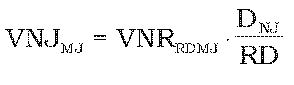

Príloha č. 4 k nariadeniu vlády č. 7/2014 Z. z.

- SPÔSOB VÝPOČTU MAXIMÁLNEJ VÝŠKY NÁJOMNÉHO A ODPLATY ZA ZMLUVNÚ STAROSTLIVOSŤ NA LESNOM POZEMKU

  - A. Výpočet maximálnej výšky nájomného na lesnom pozemku sa vykoná výpočtom podľa vzťahu

  - 

  - B. Výpočet maximálnej výšky odplaty za zmluvnú starostlivosť na lesnom pozemku sa vykoná výpočtom podľa vzťahu

  - VZSMJ= VNRRDMJ

  - Význam premenných (symbolov) vo vzorcoch

  - VNJMJ – výška nájomného na mernú jednotku (v eurách/m2),

  - VZSMJ – výška odplaty za zmluvnú starostlivosť na mernú jednotku (v eurách/m2),

  - VNRRDMJ – predpokladaná výška finančnej náhrady pre hospodársky súbor lesných typov na mernú jednotku a rubnú dobu pre hospodársky súbor lesných typov určená podľa vzorcov U1,U2,U3,1,U3,2podľa prílohy č. 2 alebo ich kombinácie,

  - DNJ– obdobie trvania nájmu (v rokoch),

  - RD – rubná doba pre hospodársky súbor lesných typov.
