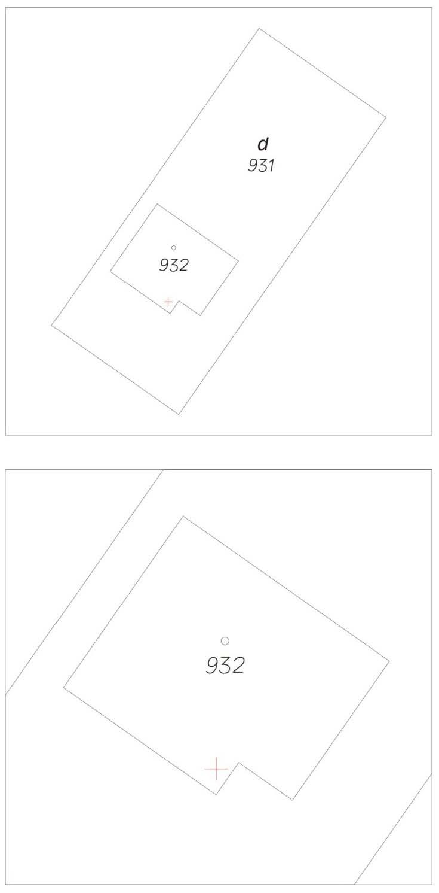

Príloha k vyhláške č. 142/2015 Z. z.

- VZOR ZAMERANIA ADRESNÉHO BODU V LISTINNEJ PODOBE

  - A. Grafická časť

- 

  - B. Popisná časť

  - Kód | Názov | Hodnota

  - φ | elipsoidická (geodetická) šírka adresného bodu | dd,ddd ddd d

  - λ | elipsoidická (geodetická) dĺžka adresného bodu | dd,ddd ddd d

  - h | elipsoidická (geodetická) výška adresného bodu | ddd,dd

  - KRAJ | označenie kraja, v ktorom sa budova nachádza |

  - OKRES | označenie okresu, v ktorom sa budova nachádza |

  - OBEC | označenie obce, v ktorej sa budova nachádza |

  - ČASŤ OBCE | označenie časti obce, v ktorej sa budova nachádza |

  - ULICA | názov ulice, na ktorej sa budova nachádza |

  - OCB | orientačné číslo vstupu do budovy |

  - SCB | súpisné číslo budovy |

  - | meno, priezvisko a podpis toho, kto adresný bod zameral |
