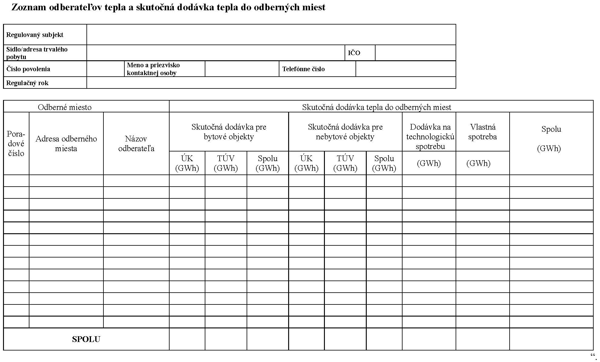

# Čl. I

Vyhláška Úradu pre reguláciu sieťových odvetví č. 222/2013 Z. z., ktorou sa ustanovuje cenová regulácia v tepelnej energetike v znení vyhlášky č. 190/2014 Z. z. sa mení a dopĺňa takto:

- 1. § 1 sa dopĺňa písmenom p), ktoré znie:

- „p)

- zariadením na výrobu tepla zariadenie na premenu rôznych foriem energie na teplo, ktoré zahŕňa stavebnú časť a technologické zariadenia v rámci stavebnej časti po tepelný rozvod.“.

- 2. V § 5 ods. 1 popisy veličín Y1 a Y2 znejú:

- „Y1 je faktor investičného rozvoja v tepelnej energetike, ktorý zohľadňuje náklady v roku t na

- a)

- investičný rozvoj, ak ich cieľom bude zvýšenie účinnosti sústavy tepelných zariadení alebo zníženie prevádzkových nákladov pri výrobe tepla alebo distribúcii tepla,

- b)

- ekologizáciu zariadenia na výrobu tepla,

- c)

- plánovanú generálnu opravu zariadenia na výrobu tepla,

- d)

- odstránenie poruchy spôsobenej živelnou pohromou alebo haváriou,

- e)

- odstránenie poruchy, havárie alebo udalosti zavinenej treťou osobou, ktorej včasné neodstránenie by malo za následok ohrozenie zdravia osôb alebo vznik veľkých materiálnych škôd,

- Y2 je faktor investičného rozvoja v tepelnej energetike, ktorý zohľadňuje náklady na výstavbu zariadenia na výrobu tepla alebo jeho časti, v ktorom sa ako palivo budú využívať obnoviteľné zdroje energie, ktoré regulovaný subjekt realizuje v roku t.“.

- 3. V § 5 ods. 2 popis veličiny INb znie:

- „INb sú náklady na ekologizáciu zariadenia na výrobu tepla,“.

- 4. V § 8 ods. 2 písmeno c) znie:

- „c)

- zmluva na nákup paliva na rok t,“.

- 5. V § 8 odsek 4 znie:

- „(4)

- Návrh ceny tepla podľa odseku 1 a podklady podľa odseku 2 písm. a), b), d), e) a f) a odseku 3 sa predkladajú v elektronickej podobe a v listinnej podobe na formulároch podľa príloh č. 1 až 6 a 8 až 12.“.

- 6. V § 9 odsek 2 znie:

- „(2)

- Výška skutočných nákladov na výrobu tepla, distribúciu tepla a dodávku tepla za rok t sa predkladá v elektronickej podobe a v listinnej podobe na formulároch podľa príloh č. 7, 13 a 14 a pri kombinovanej výrobe elektriny a tepla aj podľa príloh č. 15 až 19 do 31. marca nasledujúceho kalendárneho roka.“.

- 7. Za § 10 sa vkladá § 10a, ktorý vrátane nadpisu znie:

- 㤠10a

- Prechodné ustanovenie k úpravám účinným od 1. júla 2015

- Regulačný príkon odberného zariadenia podľa § 7 ods. 3 vypočítaný na rok 2015 sa uplatní aj v roku 2016.“.

- 8. Príloha č. 7 vrátane nadpisu znie:

- „Príloha č. 7 k vyhláške č. 222/2013 Z. z.

- Zoznam odberateľov tepla a skutočná dodávka tepla do doberných miest“.

- 
