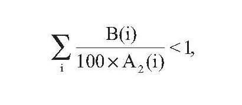
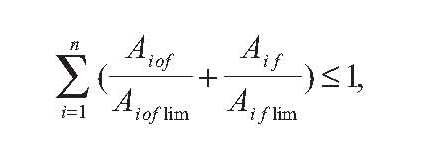

# § 2

(1) Zo zodpovednosti za jadrovú škodu podľa § 4 zákona a z povinnosti finančne kryť túto zodpovednosť podľa § 6 zákona pri preprave rádioaktívnych materiálov je vyňatý

- a) rádioaktívny materiál, ktorý obsahuje jediný rádionuklid s celkovou aktivitou, ktorá je menšia ako stonásobok hodnoty A2 pre jeden dopravný prostriedok, kde A2 je hodnota aktivity príslušného rádionuklidu podľa prílohy č. 1; za jeden dopravný prostriedok sa považuje aj súbor jednotlivých dopravných prostriedkov, ak sú počas prepravy spojené,

- b) rádioaktívny materiál, ktorý obsahuje zmes rádionuklidov, ktorých zloženie a aktivita sú známe, ak výsledná aktivita pre jeden dopravný prostriedok je určená na základe výpočtu podľa vzorca

- VZOREC

- 

- kde

- B(i) je aktivita rádionuklidu (i) obsiahnutého v rádioaktívnom materiáli a

- A2(i) je hodnota aktivity A2 príslušného rádionuklidu (i) podľa prílohy č. 1; za jeden dopravný prostriedok sa považuje aj súbor jednotlivých dopravných prostriedkov, ak sú počas prepravy spojené,

- c) rádioaktívny materiál, ktorý obsahuje neznámy rádionuklid alebo neznámu zmes rádionuklidov, alebo nie sú o nich dostupné relevantné údaje, a pre jeden dopravný prostriedok platí vzorec podľa písmena b) s hodnotami A2 podľa prílohy č. 2; za jeden dopravný prostriedok sa považuje aj súbor jednotlivých dopravných prostriedkov, ak sú počas prepravy spojené,

- d) osobitný štiepny materiál, ktorý sa môže prepravovať ako bežná zásielka za podmienok, že materiálom

  - 1. je urán obohatený 235U najviac na 1 % hmotnosti s celkovým obsahom Pu a 233U neprevyšujúcim 1 % hmotnosti 235U, rozložený úplne homogénne v celom materiáli, a ak je 235U vo forme kovu, oxidu alebo karbidu, nesmie byť usporiadaný do tvaru mreže,

  - 2. sú kvapalné roztoky dusičnanu uranylu s uránom obohateným 235U najviac na 2 % hmotnosti s celkovým obsahom Pu a 233U neprevyšujúcim 0,002 % hmotnosti uránu a s pomerom atómov dusíka k uránu (N/U) najmenej 2,

  - 3. je urán s maximálnym obohatením uránu 5 % hmotnosti 235U za predpokladu, že

    - 3a. neprevyšuje 3,5 g 235U na zásielku,

    - 3b. celkový obsah Pu a 233U neprevyšuje 1 % hmotnosti 235U na zásielku,

    - 3c. preprava zásielky neprevyšuje 45 g štiepnych rádionuklidov,

  - 4. je štiepny rádionuklid s celkovou hmotnosťou neprevyšujúcou 2 g na zásielku za predpokladu, že preprava zásielky neprevyšuje 15 g štiepnych rádionuklidov,

  - 5. je balený alebo nebalený štiepny rádionuklid s celkovou hmotnosťou neprevyšujúcou 45 g na zásielku, ktorý musí byť prepravovaný za výlučného použitia zásielky neprevyšujúcej 45 g štiepnych rádionuklidov, alebo

  - 6. je jeden štiepny materiál povolený pre celú zásielku, ak povolenie na prepravu neobsahuje rôznorodé materiály.

(2) Zo zodpovednosti za jadrovú škodu podľa § 4 zákona a z povinnosti finančne kryť túto zodpovednosť podľa § 6 zákona je vyňaté jadrové zariadenie počas jeho vyraďovania, ak sú splnené podmienky podľa § 5 ods. 5 písm. b) zákona a zároveň ak

- a) zariadenie obsahuje niekoľko izotopov (n) podľa prílohy č. 3 v podobe aktivity v spevnenej forme (f) alebo aktivity v akejkoľvek inej forme (of) a

- b) tieto aktivity rôznych izotopov prítomných v jadrovom zariadení (Ai) spoločne spĺňajú kritériá:

- VZOREC

- 

- kde

- Ai of lim je limit aktivity pre izotop (i) prítomný v akejkoľvek inej forme ako v spevnenej forme a

- Ai f lim je limit aktivity pre izotop (i) prítomný v aktivite v spevnenej forme.
